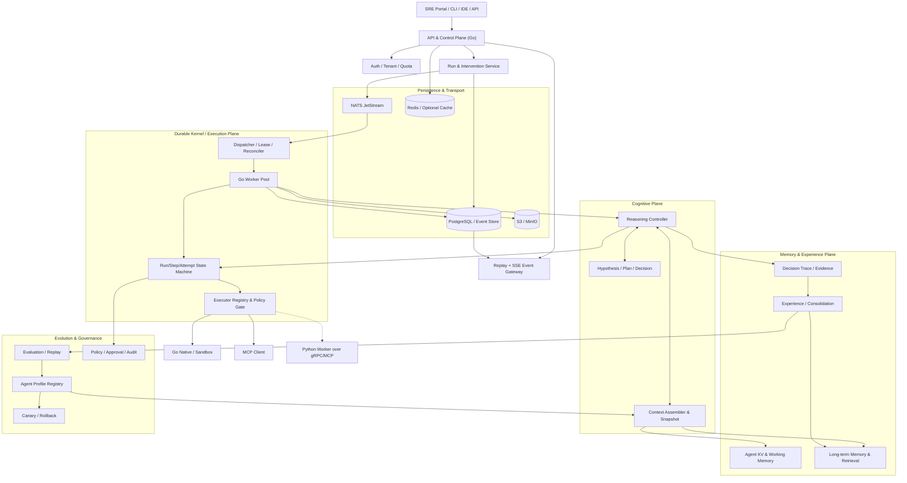
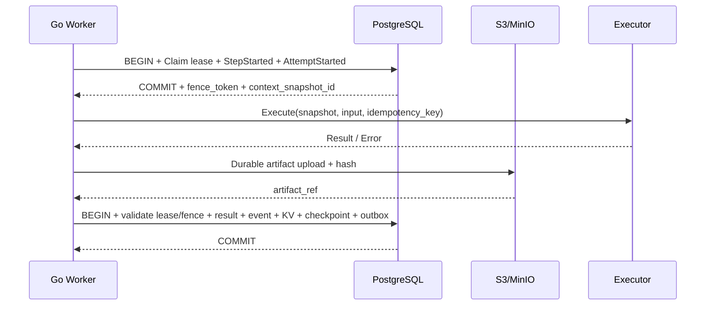
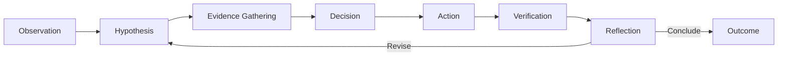
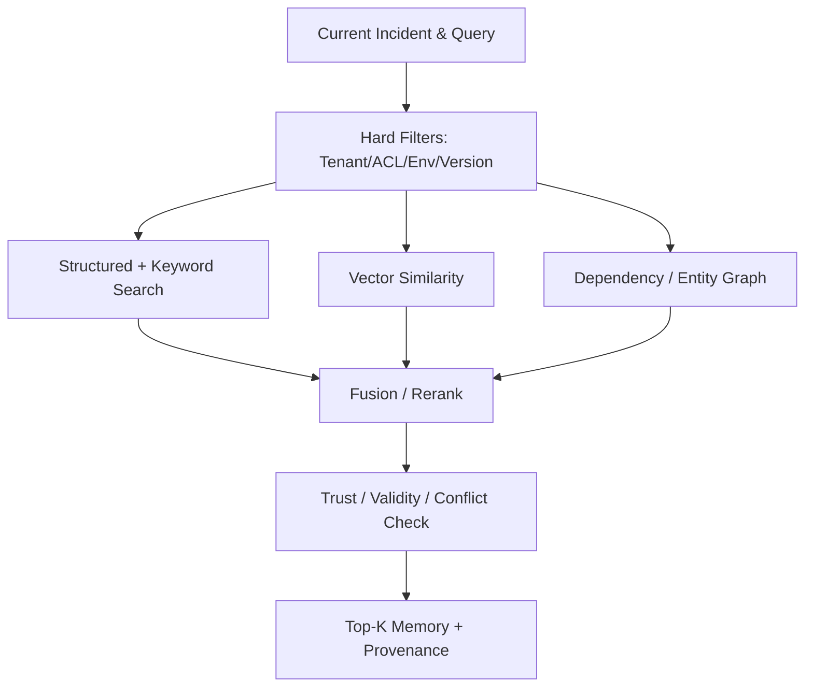
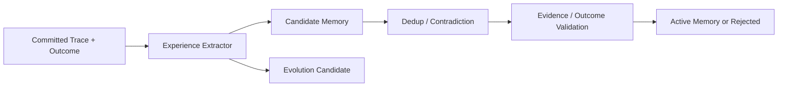
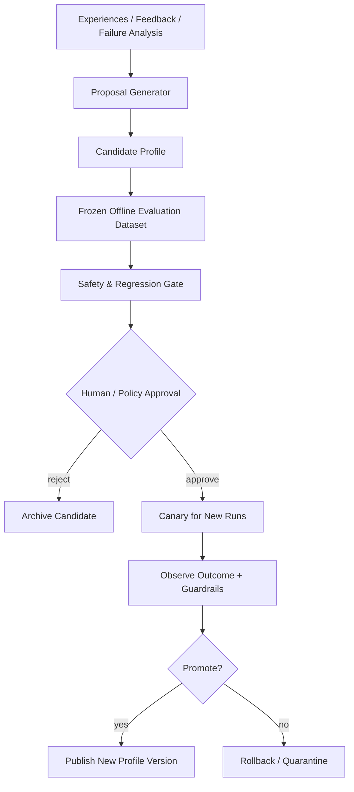
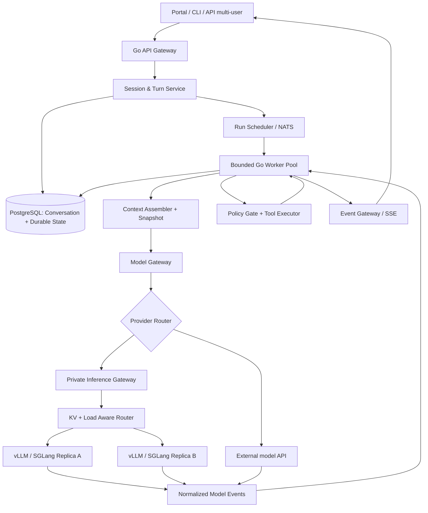
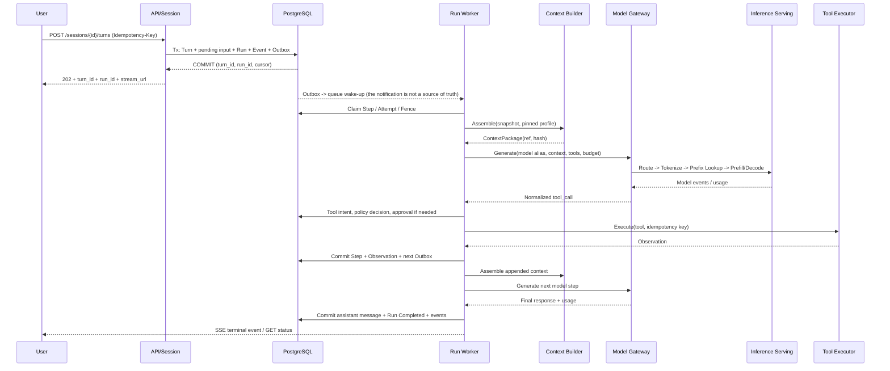
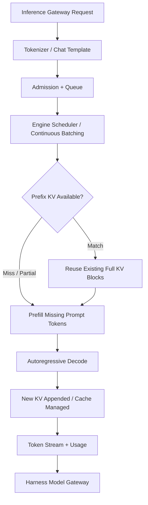

# Go SRE Cognitive Agent Harness: Production Architecture and Implementation Design (v1.1)

**English** | [简体中文](GoAgentHarness.zh-CN.md)

> **Document status**: Architecture proposal / Engineering RFC
> **Version**: v1.1.3
> **First draft**: 2026-10-29  
> **Revised**: 2026-11-04  
> **Primary implementation language**: Go  
> **Extended stack**: PostgreSQL, NATS JetStream, Redis (optional), S3/MinIO, MCP, gRPC, OpenTelemetry; Python workers reserved; optional vLLM / SGLang inference cluster  
> **Target users**: SRE / platform engineering / infrastructure operations teams

### Revision history

| Version | Date | Changes |
|---|---|---|
| v1.1.3 | 2026-11-04 | Fixed P2 issues: ① fixed misplaced 3.3 and 10.4 and separators, duplicated separators and the broken reference list; ② KV CAS excludes deleted/expired keys, `PutIfAbsent` supports resurrection with monotonic versions, small values inline and large values external, versions referenced by snapshots cannot be GC'd (13.4); ③ the KV Go interface adds `GetAtVersion/List/Watch/Snapshot`, provenance and error types (6.4); ④ worker config adds `control_reserved` and validates the sum of resource pools (24); ⑤ profile status adds `QUARANTINED`, with a clear split of duties against `evolution_rollouts` (13.1); `initiator_type` is backfilled from the `run.created` event before the constraint is added (35.2); ⑥ entity IDs are UUIDs; examples use placeholder aliases in one consistent style (3.1, 31.1) |
| v1.1.2 | 2026-11-04 | Fixed P1 consistency issues: ① completed the Run/Step/Attempt state machines — `PAUSE_REQUESTED`/`CANCELLING` are now derived from `desired_state`; added Run `NEEDS_HUMAN`, delayed requeue via `not_before`, Step `RETRY_WAIT`, Attempt `CANCELLED` and CHECK constraints; step-level leases (4.2, 4.3, 13.1, 13.2, 34.3, 37.1); ② event field unified as `event_seq`; DDL adds `payload_hash/trace_id/occurred_at/committed_at` (3.1, 5.1, 13.2, 17.1); ③ context snapshot lifecycle unified as "pin versions at claim → render → bind", reused on retry; table adds `step_id/compaction_epoch/kv_versions/memory_refs` (10.2, 13.5, 14.2, 21.2, 36.3); ④ the usage ledger becomes an append-only ledger with revision numbers + an effective view (35.4); ⑤ model stream event enum aligned with Go `EventType` (31.2, 36.2); ⑥ all v1.0 tables use same-tenant composite foreign keys; outbox / memory version add `tenant_id` (13.7) |
| v1.1.1 | 2026-11-04 | Fixed 6 P0 consistency defects: ① added Run `PENDING_ACTIVATION`; runs of queued turns cannot be scheduled (4.2, 13.1, 29.3); ② heartbeats/claims do not increment `run.version`; `expected_version` is optional for pause/cancel (4.5, 14.2, 17.2); ③ the side-effect idempotency key becomes `(tenant, run, step, action_hash)`, stable across attempts (13.2, 14.3, 15.1); ④ added approval, checkpoint, result revision and canary tables (13.6); ⑤ the worker template distinguishes "nothing to do" from "lease lost", sets deadlines, and writes model requests with the fence (15.2, 35.4, 36.3); ⑥ step commit is separated from merging incident shared state (3.2, 6.5); added matching tests (22.1) |
| v1.1 | 2026-10-31 | Conversation runtime, model gateway, inference serving (chapters 28–39) |
| v1.0 | 2026-10-29 | First draft |

---

## 0. Executive summary

This proposal designs a production-grade agent harness in which **the Step is the unit of persistence and intervention, the Run is the unit of execution isolation, the Incident is the unit of shared cognition, and the Agent Profile is the unit of versioned evolution**.

The core capability is not "wiring a model to tools", but:

1. **Durable execution**: every agent step is persisted before it runs; afterwards its state, artifacts and events are recorded atomically; restart and recovery are supported.
2. **Interruptible execution**: pause, resume, cancel, approve, reject, inject evidence, edit the not-yet-executed next step, and fork — all version-controlled and audited.
3. **Cognitive runtime**: structured Observation → Hypothesis → Evidence → Decision → Action → Verification → Reflection, instead of relying on the model's invisible internal reasoning.
4. **Agent KV**: multi-level namespaces, CAS, TTL, snapshots, event correlation and transactional writes; strictly distinct from the inference engine's KV cache.
5. **Multi-tier memory**: run / incident working memory is separate from cross-task long-term memory; long-term memory supports provenance, conflict detection, validity, confidence and versioning.
6. **Experience & RSI-ready**: execution traces are validated and distilled into experience; controlled self-improvement through offline evaluation, candidate agent profiles, canary releases and rollback.
7. **High concurrency**: bounded Go worker pools + NATS JetStream + PostgreSQL leases / fencing / outbox; multi-tenant fair scheduling and backpressure.
8. **Extensibility**: unified Executor, Model Provider, Reasoning Strategy and Memory Backend interfaces; MCP is a first-class extension, and Python plugs in over gRPC / MCP when needed.
9. **SRE safety**: read-only by default, risk classes, human approval, environment isolation, sensitive-data governance and a policy engine that cannot be bypassed.
10. **Conversation runtime**: User / Session / Branch / Turn / Message are separate from Run / Step; single writer per branch, concurrency across sessions, fork and reconnect supported.
11. **LLM gateway & inference serving**: model capability registry, routing between external APIs and self-hosted deployments, aggregation of streamed tool calls, cost accounting, and optional KV-/load-aware GPU routing; the GPU cache is not business recovery state.

### 0.1 Key architecture decisions

| ID | Decision | Reason |
|---|---|---|
| ADR-001 | **Go is the only control kernel**; Python is only a remote execution extension | Simplifies state consistency and deployment while keeping access to the AI ecosystem |
| ADR-002 | **PostgreSQL is the strongly consistent source of run state**; NATS only carries notifications | Queue delivery order must never become the fact of run state |
| ADR-003 | Step = logical execution unit, Attempt = physical retry, Event = immutable fact | Supports diagnosis, replay, idempotency and auditing |
| ADR-004 | Context snapshots must be version-pinned with traceable references | Prevents memory changes during a run from altering the basis of past decisions |
| ADR-005 | The model's internal CoT is not used as the framework's audit basis | Providers do not necessarily expose raw reasoning; use structured decision traces instead |
| ADR-006 | Agent KV is separate from memory | KV owns deterministic state; memory owns knowledge validity and recall |
| ADR-007 | **RSI must never escalate its own privileges, bypass approval or directly modify the production kernel** | Keeps the trust boundary between evolution and execution |
| ADR-008 | In V1, a single run advances decision steps serially; concurrency is across runs | Prove correctness first, then grow into DAG / multi-agent |
| ADR-009–017 | Session single writer, model gateway, KV vs. checkpoint isolation, model attempt auditing, etc. | See section 39.4 |

### 0.2 Non-goals (first version)

- No new foundation model; no PyTorch / Transformer training stack.
- No cross-system exactly-once side-effect guarantee for any production tool operation.
- Arbitrary raw reasoning text is not required to be observable CoT.
- V1 does not support arbitrary parallel DAGs within one run, automated production changes, or a self-modifying kernel.
- A vector DB does not replace the transactional database, and long-term memory never directly modifies the state of a running step.

---

## 1. Requirement boundaries and SLOs

### 1.1 Core scenarios (focused on the framework, not specific capabilities)

- One incident triggers several runs; each run can investigate a different direction while sharing the same versioned incident working memory.
- Every decision can prove the context snapshot, factual evidence, memory versions, agent profile and chosen action it was based on.
- Operators can approve before execution, request pause/cancel during execution, and add new evidence; the agent cannot override these operations.
- After a worker crash, lease expiry or queue redelivery, the run continues; there are never two valid state committers.
- After an incident closes, experience extraction happens in the background; unverified inferences are never promoted to proven long-term knowledge.
- A new strategy first becomes a candidate profile and, after evaluation and approval, is canaried to new runs only.

### 1.2 Draft SLOs (to be calibrated by load tests; not implemented metrics)

| Metric | Initial target | Definition / notes |
|---|---:|---|
| API run-creation availability | ≥99.9% / month | Excludes agreed maintenance windows; the real target is set by the team |
| P95 latency of run creation | <200ms | Excludes queueing and LLM inference; a low-load reference target |
| Unauthorized executions of high-risk steps | 0 | Hard safety constraint |
| Loss of successfully committed step state | 0 | Assumes DB commit plus backup / disaster recovery |
| Worker death detection and takeover | <60s (reference) | Depends on lease TTL and scheduling period |
| Event catch-up after SSE reconnect | No logical gaps | Depends on the event store retention window |
| Duplicate valid commits from duplicate messages | 0 | Guaranteed by state versions and fencing |
| Duplicate external side effects | Measured per tool idempotency strategy | **Cannot be promised as 0 across the board** |
| Audit completeness of approval commands | 100% | Accept, reject and timeout all produce events |
| Provenance traceability of long-term memory | 100% (Active) | Active memories must link to trusted evidence / review records |

Throughput targets must come from the real workload distribution: `runs/s`, average steps per run, LLM latency, tool types and external API quotas jointly determine capacity. "Supports 100k concurrency" is not an unconditional promise.

---

## 2. Layered architecture



### 2.1 Responsibilities of the control, execution and cognitive planes

| Plane | Main content | Consistency principle |
|---|---|---|
| Control plane | Run creation, permissions, intervention commands, approvals, config releases | Acknowledge acceptance only after the transaction commits |
| Durable kernel | Step state machine, leases, execution recovery, checkpoints | Serial commits per run, attempt fencing |
| Cognitive plane | Reasoning strategies, hypotheses, plans, decisions, context assembly | Decisions reference immutable context snapshots |
| Memory plane | Agent KV, working memory, long-term memory, retrieval | Transactional KV; versioned long-term memory |
| Experience/evolution | Experience extraction, evaluation, candidate strategies, version releases | Asynchronously isolated from online execution |
| Execution plane | Go tools, MCP, sandbox, remote workers | Never bypasses policy / approval |
| Governance | Approvals, risk classes, auditing, data permissions | Default deny, least privilege |

---

## 3. Unified domain model and ID scheme

```text
Tenant
 └─ Service / Environment
     └─ Incident (shared cognition and fact space)
         ├─ Run A (independent agent execution)
         │   ├─ Step 1 / Attempt 1
         │   ├─ Step 2 / Attempt 1, 2
         │   └─ Step 3 / Attempt 1
         └─ Run B

Agent Profile (immutable version)
  ├─ Reasoning Policy
  ├─ Context Assembly / Memory Retrieval Policy
  ├─ Model & Tool Schema Version
  └─ Evaluation / Evolution Configuration
```

### 3.1 Key entities

| Entity | Immutable identity | Mutable content | Key relations |
|---|---|---|---|
| Tenant | tenant_id | Quotas, policies | Hard isolation boundary for all resources |
| Incident | incident_id | Timeline, shared facts, status | Multiple runs |
| Run | run_id | Status, lease, context cursor | profile_id + profile_version |
| Step | step_id | Status, current attempt | run_id + step_seq |
| Attempt | attempt_id | Execution status, lease result | step_id + attempt_no |
| Event | event_id | **Immutable** | run_id + event_seq |
| Command | command_id | Accepted / applied / rejected result | Command source and expected_version |
| Context Snapshot | snapshot_id | **Immutable** | Set of KV / working / memory references |
| Decision Artifact | decision_id | **Immutable; corrections create a new version** | evidence_refs + step_id |
| Memory Record | memory_id | Current projection, status | version + source_refs |
| Experience | experience_id | Quality assessment and status | decision → action → outcome |
| Agent Profile | profile_id + version | **Immutable once published** | Pinned when a run starts |

**ID conventions (v1.1.3)**: entity IDs such as `run_id`, `step_id`, `attempt_id`, `event_id` and `snapshot_id` are always UUIDs (UUIDv7 recommended for time ordering and index locality), generated by the API/application; `tenant_id`, `profile_id` and `model_alias` are human-readable strings. `run-1001`, `step-0006`, `ctx-0023` etc. in the JSON / SSE examples of this document are **readable placeholder aliases**, not the real format; clients must not parse ID structure or rely on IDs increasing.

### 3.2 System invariants (must have automated tests)

1. Every attempt that starts executing must be linked to an already committed step and an `attempt.started` event.
2. A serial run has at most one **valid** lease holder at any time (from the database-commit point of view).
3. Step state changes, event appends, **run-private** KV changes and the outbox for follow-up scheduling commit in one transaction; a CAS conflict on incident shared state must not roll back the result of an executed step (see 6.5).
4. All events within one run use a strictly increasing `event_seq`; no global order is required.
5. A decision binds the same version of the agent profile, context snapshot, tool descriptions and policies.
6. An attempt whose external side effect cannot be confirmed goes to `UNKNOWN` and cannot simply be retried.
7. "Accepted" for a user command does not mean "in effect"; each has its own event and timestamp.
8. Deletes and updates of long-term memory must keep an audit or compliance tombstone; history is never silently rewritten.
9. Improvements proposed autonomously by the agent must not bypass production permissions or release approval.

### 3.3 Conversation dimension (v1.1 addition)

v1.0 is centered on Incident / Run, which suits incident automation; v1.1 adds a `User -> Session -> Branch -> Turn -> Run` conversation entry point: a run may be linked to a turn, or be triggered automatically by an incident without a session. See chapters 29 and 35 for the database migration and same-branch concurrency policy. **Do not pin a session to a Go goroutine or a GPU replica.**

---

## 4. Durable step engine and interruptible state machine

### 4.1 Physical and logical boundaries of a step

- **Step**: a logical unit that can be checkpointed, audited, intervened on and retried independently, e.g. `reason`, `retrieve_memory`, `tool`, `verify`, `compact`.
- **Attempt**: one concrete execution, recording duration, worker, input hash, output, status and resource usage.
- **Artifact**: the observation / hypothesis / decision / evidence / verification produced by a step, as structured data; one step can produce several artifacts.
- **Event**: a fact about state, stored in an append-only event store; non-critical streams such as token deltas can be stored separately.

Principle: **the smallest unit of intervention is the step safety boundary**. Changing a command that is already executing requires the executor to implement safe cancellation; changing a database field cannot alter an external action that is already happening.

### 4.2 Run states

```text
PENDING_ACTIVATION -> QUEUED | CANCELLED     # only for queued conversation turns
QUEUED   -> RUNNING                          # claim a step (not_before <= now())
RUNNING  -> QUEUED                           # step committed with more steps to go; lease released
RUNNING  -> QUEUED (not_before = t)          # rate limit / retryable failure: delayed requeue, worker released
RUNNING  -> WAITING_APPROVAL -> QUEUED       # re-decide after approval / rejection / timeout
RUNNING  -> PAUSED -> QUEUED                 # desired_state=PAUSED, committed at a safe point
RUNNING  -> COMPLETED | FAILED
RUNNING  -> CANCELLED                        # after the current attempt ends (or confirms cancellation)
RUNNING  -> NEEDS_HUMAN                      # an UNKNOWN side effect cannot be reconciled automatically
{QUEUED, PAUSED, WAITING_APPROVAL, NEEDS_HUMAN} -> CANCELLED   # no lease; committed directly by the control plane
{QUEUED, WAITING_APPROVAL} -> PAUSED                           # no lease; committed directly by the control plane
NEEDS_HUMAN -> QUEUED                        # resume after human reconciliation
```

A run also has `desired_state={RUNNING, PAUSED, CANCELLED}`. **State ownership rules** after the v1.1.2 revision:

- **With a valid lease** (`RUNNING`): the control plane only writes `desired_state` and the `run.pause_requested` / `run.cancel_requested` event; the lease holder commits the actual state at a safe point. v1.0's `PAUSE_REQUESTED` / `CANCELLING` are no longer persisted states; the API derives "pausing / cancelling" from `status=RUNNING AND desired_state<>'RUNNING'`, so two fields never express the same fact.
- **Without a valid lease**: the control plane commits the actual state directly in a transaction that locks the run row (see the diagram above), without waiting for a worker.
- `PENDING_ACTIVATION`: the run is persisted but **cannot be scheduled**; only the "activate next turn" transaction (section 29.3) can move it to `QUEUED` and write the outbox.
- **Step-level leases**: after each step commits, the run goes back to `QUEUED` and `lease_owner` is cleared; the next step is claimed again (the same worker may claim it locally right away as an optimization, without changing semantics). Therefore `pause` naturally takes effect at step boundaries.
- **Delayed requeue** (implements `RETRY_WAIT` from section 34.3 and the "recoverable waiting state" from section 37.1): the run goes back to `QUEUED` with `not_before` set, and the step goes to `RETRY_WAIT` with `next_attempt_at` recorded; scheduling only claims runs with `not_before <= now()`; wake-up happens through an outbox message with `next_retry_at = not_before` (the publisher publishes it only when due) or a reconciler scan, never by a sleeping goroutine.

### 4.3 Step / attempt states

```text
Step: PENDING -> RUNNING -> SUCCEEDED | FAILED | CANCELLED | UNKNOWN
                         -> WAITING_APPROVAL -> PENDING | SKIPPED
                         -> RETRY_WAIT -> PENDING          # rate limit / safely retryable, next_attempt_at reached
      FAILED -> PENDING (only when retry is explicitly allowed)
      UNKNOWN -> RECONCILING -> PENDING | SUCCEEDED | NEEDS_HUMAN

Attempt: RUNNING -> SUCCEEDED | FAILED | TIMED_OUT | CANCELLED | LOST | UNKNOWN
```

- An attempt is created directly as `RUNNING` in the claim transaction (v1.0's `CREATED` had no persisted moment of its own and is removed).
- `CANCELLED`: cooperative cancellation confirmed by the executor; `LOST`: the lease expired as judged by the reconciler and the executor never committed a result; `TIMED_OUT`: exceeded the step deadline. For tools with side effects, `TIMED_OUT` / `LOST` must also set the step to `UNKNOWN`; it cannot simply be retried.

### 4.4 Execution order



If the DB commit fails after an artifact was persisted, orphan objects may remain and need periodic GC; step completion is promised to the outside only after the DB update succeeds. A worker can only commit results while it holds the current fencing token.

### 4.5 Intervention command semantics

| Command | Target state / object | Takes effect | Failure conditions |
|---|---|---|---|
| `pause` | Run | Safe point after the step completes | Run already terminal |
| `resume` | Run | PAUSED → QUEUED | Version conflict / insufficient permission |
| `cancel` | Run | Cancellation requested immediately, confirmed asynchronously | Terminal-state conflict |
| `approve_tool` | Step + argument hash | The exact pending tool call | Input changed, expired, already consumed |
| `reject_tool` | Step | Current approval point | Approval state already changed |
| `inject_evidence` | Incident/Run | Next context snapshot | No source or out of scope |
| `replace_pending_input` | Step not yet run | Before the next attempt is claimed | Step already executed |
| `retry` | Recoverable step | New attempt | UNKNOWN not yet reconciled |
| `fork` | Checkpoint | Creates an independent run | No usable snapshot |
| `override_result` | Logical output of a completed step | New artifact / version; old events are not overwritten | Side effects cannot be undone automatically |

**Version check rules (v1.1.1 revision)**:

- `run.version` increments only when **control-plane-visible state** changes: run status, `desired_state`, advancing the current step, replacing pending input, approval results. Claiming a lease writes `fence_token` and heartbeats only update `lease_until`; **neither increments `run.version`**, otherwise every versioned command would keep conflicting with background heartbeats.
- `pause` / `cancel` are monotonic "tightening" intents, so `expected_version` is **optional**: without it only state legality is checked (terminal states reject), and repeated requests return the same command by idempotency key.
- `resume`, `replace_pending_input`, `retry`, `override_result`, `approve_tool` / `reject_tool` change what executes or loosen execution, so they **must** carry `expected_version` (approval commands also verify `action_hash`); a conflict returns `409` with the current version and nothing is silently overwritten.

### 4.6 Approval and risk gates

Before execution an `ActionIntent` must be computed: `tenant, environment, target, tool, input_hash, tool_version, risk_class, policy_version, effects`. The approval token binds this complete operation identity and carries an expiry, a use count, the approver and the related event.

- **R0**: information retrieval / read-only; normally runs automatically.
- **R1**: low-risk, reversible changes; allowed by policy or a single approval.
- **R2**: production writes with side effects; human approval by default, with a rollback plan required.
- **R3**: destructive, permission-changing or irreversible operations; strong approval or forbidden by the framework.

The policy denies unknown side effects by default; tool descriptions provided by an MCP server are untrusted metadata only and can never decide their own permission level.

---

## 5. Event sourcing, checkpoints and recovery

### 5.1 Three kinds of storage

| Content | Source | Physical storage |
|---|---|---|
| Strongly consistent state and audit events | Run / Step / Commands / KV | PostgreSQL |
| Large artifacts / prompts / outputs | Redacted binary or text | S3/MinIO |
| Real-time push and task wake-up | Derived from outbox messages | NATS / SSE, not a source of truth |

**Key events**: `run.created`, `run.started`, `step.planned`, `attempt.started`, `step.succeeded`, `step.failed`, `run.pause_requested`, `run.paused`, `approval.requested`, `approval.decided`, `memory.proposed`, `memory.activated`, `profile.promoted`.

An event contains at least `event_id, tenant_id, run_id, event_seq, step_id?, attempt_id?, actor_type, actor_id?, event_type, schema_version, payload, payload_ref?, payload_hash?, trace_id?, occurred_at, committed_at`; field names map one-to-one to the `run_events` DDL in section 13.2 (unified in v1.1.2). Event types are always lowercase dotted `domain.action` (e.g. `step.started`, `model.requested`).

### 5.2 Checkpoint content

- `last_committed_step_seq`, run status, context cursor.
- Versions of the current profile / reasoning / context / tool schema / policy.
- Conversation messages the model can continue from, or opaque reasoning state supported by the provider (used where compatible).
- Confirmed tool results, pending tool calls, pending approvals.
- Working memory version, agent KV snapshot references, incident memory version.
- File workspace snapshot or Git commit / workspace snapshot reference (if code tools changed files).
- Key artifact references, hashes, encryption and retention policy.

A checkpoint is itself an immutable snapshot; raw events / evidence are kept as the basis for replay. **A conversation checkpoint is not an operating-system or workspace snapshot.**

### 5.3 Recovery categories

1. **Deterministically recoverable**: read-only tools, or existing successful results/artifacts that can be reused.
2. **Safely retryable**: calls protected by an idempotency key, or where the previous attempt is confirmed not to have taken effect.
3. **Possibly side-effecting**: look up the external operation ID; if it cannot be confirmed, `UNKNOWN` / human reconciliation.
4. **Not reproducible**: environment, tool version or original input is missing; keep the audit but mark it as not replayable.

"Re-executing as it was" must not be claimed to be strict replay. **Audit replay** views the events that actually happened; **simulated replay** uses fixed model outputs / tool recordings; **re-execution** may produce different results and must be isolated and labeled.

## 6. Agent KV: a deterministic state space

### 6.1 Clarifying the concept

- **Agent KV** is the versioned key-value/state system managed by the harness.
- **Model KV cache** is the attention key/value cache inside a Transformer inference engine, usually managed by the model server; **it is not this project's agent KV and is not a basis for cross-model recovery**.

### 6.2 Namespaces

```text
/tenant/{tenant_id}/run/{run_id}/...                # run-private state
/tenant/{tenant_id}/incident/{incident_id}/...      # incident shared working state
/tenant/{tenant_id}/agent/{agent_id}/...            # agent long-term config/preferences
/tenant/{tenant_id}/service/{service_id}/...        # service-related state references
/tenant/{tenant_id}/organization/...                # organization-level config/policies
```

Temporary step state usually does not need long-lived KV; if it must be saved, use the `step/{step_id}` namespace with a short TTL. A namespace is a way to organize queries, not authorization itself; every read and write still checks tenant, environment, owner and ACL.

### 6.3 KV contract

| Operation | Semantics |
|---|---|
| `Get` | Returns value, version, ETag, TTL and provenance |
| `PutIfAbsent` | Atomic first creation |
| `CAS` | Atomic compare-and-update against `expectedVersion`; returns Conflict on failure |
| `DeleteIfVersion` | Versioned delete, keeping a tombstone and audit |
| `List` | Paged reads limited to tenant/scope |
| `Watch` | Subscribes to changes, ultimately through an event cursor |
| `Snapshot` | Pins references to several KV versions in one transaction |
| `GetAtVersion` | Reads history from the KV version history |
| `Txn` | Multi-key changes + step event in one database transaction; only committed with a step through `UnitOfWork` (see 6.4) |

KV values should be registered by schema: `content_type`, `schema_id`, `schema_version`, `data_ref`, `hash`, `version`, `expires_at`; avoid letting arbitrary unversioned JSON into core state.

### 6.4 Go interface (design contract)

```go
package kv

import (
    "context"
    "errors"
    "time"
)

type Key struct {
    TenantID string
    Scope    string // run | incident | agent | service | organization
    OwnerID  string
    Name     string
}

var (
    ErrNotFound      = errors.New("kv: not found")       // missing, deleted or expired
    ErrAlreadyExists = errors.New("kv: already exists")
    ErrConflict      = errors.New("kv: version conflict")
)

type Provenance struct {
    EventID   string // run_events.event_id that produced this version
    RunID     string
    StepID    string
    ActorType string
    ActorID   string
}

type Value struct {
    Data          []byte     // small values inline; large values read transparently from object storage by the Store
    Version       int64
    Hash          string     // doubles as the ETag
    SchemaID      string
    SchemaVersion int
    ExpiresAt     *time.Time
    Provenance    Provenance
}

type Entry struct {
    Key   Key
    Value Value
}

type Write struct {
    Key             Key
    Data            []byte
    SchemaID        string
    SchemaVersion   int
    TTL             time.Duration // 0 = never expires
    ExpectedVersion *int64        // nil = PutIfAbsent; non-nil = CAS
    Delete          bool          // when true, writes a tombstone at ExpectedVersion
}

type ListOptions struct {
    Prefix    string
    PageSize  int
    PageToken string
}

type Store interface {
    Get(ctx context.Context, k Key) (Value, error)
    GetAtVersion(ctx context.Context, k Key, version int64) (Value, error)
    PutIfAbsent(ctx context.Context, w Write) (Value, error)
    CompareAndSwap(ctx context.Context, w Write) (Value, error)
    DeleteIfVersion(ctx context.Context, k Key, version int64) error
    // List must be limited to TenantID + Scope + OwnerID; cross-tenant scans are not supported.
    List(ctx context.Context, scope Key, opt ListOptions) (entries []Entry, nextPageToken string, err error)
    // Watch follows a run_events / KV version event cursor and resumes from afterSeq after a disconnect; not real-time, but gap-free.
    Watch(ctx context.Context, scope Key, afterSeq int64) (<-chan Change, error)
    // Snapshot returns the current version numbers of several keys in one read transaction (values are not copied), for context_snapshots.kv_versions.
    Snapshot(ctx context.Context, keys []Key) (map[Key]int64, error)
}

type Change struct {
    Seq     int64
    Key     Key
    Version int64
    Deleted bool
}

// The transaction interface is implemented by the persistence adapter; several independent Get/Put calls must not pose as an atomic commit.
// KVWrites may only touch the run-private namespace; incident shared state goes through mutation intents (see 6.5).
type UnitOfWork interface {
    CommitStepAndKV(ctx context.Context, commit StepCommit, kvWrites []Write) error
}
```

`Txn` is not exposed to reasoning / executors on its own: multi-key changes can only be persisted atomically with a step commit through `UnitOfWork`, so fence validation cannot be bypassed.

### 6.5 Conflict handling

- Run-private KV gets its ordering easily from serial steps within the run.
- Incident shared KV needs CAS, field-level merging or an explicit CRDT-style type definition; **last-write-wins is not the default**.
- Evidence-like data prefers append-only `evidence_added`, with the incident memory manager building a materialized view.

**Two-phase commit boundary (v1.1.1 revision)**: once a tool has executed, the step result is a fact that must not be lost; a shared-state conflict is only a "merge problem". The two must never sit in one transaction that rolls back entirely when a CAS fails.

1. **Step commit transaction** (fence validated): step/attempt result, artifact references, events, run-private KV (serial within the run, no contention), an **append-only mutation intent** for the incident `incident_memory_events(base_version, mutation, source_step_id)`, and the outbox. This transaction does no CAS on incident shared KV, so it cannot fail because of concurrent writes from other runs.
2. **Shared-state merge** (the incident memory manager, asynchronously or right after in the same process): consumes mutation intents serially per incident and applies CAS / field-level merges to the shared materialized view; on success it writes `incident.memory_updated`; when automatic merging is impossible it writes `incident.mutation_conflicted`, keeps both sides' evidence, and hands the decision to the next `reason` step or a human.
3. If a decision **must** be based on the latest shared state (e.g. "roll back only if nobody has already rolled back"), put that condition into the ActionIntent's precondition and check it against `incident.memory_version` in the claim transaction **before** execution, rather than discovering the conflict at commit time after execution.
- Redis is only a cache and temporary quota system; it can never be the sole source of step state that must not be lost.

---

## 7. Cognitive runtime: structured decision traces, not raw CoT

### 7.1 Two kinds of "reasoning state"

1. **Provider reasoning state**: some models support reasoning summaries, encrypted/opaque reasoning items or conversation references. Whether to keep them and how to continue from them is the model adapter's job; never assume every model provides plaintext internal thinking.
2. **Harness decision trace**: an auditable result built deliberately by the framework, containing verifiable observations, hypotheses, evidence, a summary of the decision rationale and verification records; it is the basis for post-mortems and learning.

Core constraint: **a decision trace is an explicitly generated, auditable explanatory artifact; it is not, and does not claim to reconstruct, the model's hidden internal reasoning.**

### 7.2 Cognitive state machine



### 7.3 Base artifact schema (logical)

| Type | Required fields | Requirements |
|---|---|---|
| Observation | observed_at, source, payload_ref, trust_level | Describes the observation only; cannot be labeled as the root cause directly |
| Hypothesis | statement, status, supporting_refs, refuting_refs | Clearly distinguishes `UNVERIFIED/VERIFIED/REFUTED` |
| Evidence | source_ref, captured_at, integrity_hash, relation | Supports/refutes relation, keeps the original source |
| Decision | alternatives, chosen_action, reason_summary, risk, evidence_refs | Reviewable by humans; does not store unobtainable hidden CoT |
| Plan | steps, preconditions, stop_conditions, rollback | Changes must include verification and rollback strategies |
| Verification | expected, observed, verdict, evidence_refs | Results are based on measurable evidence |
| Reflection | error_modes, lessons, counterexamples, source_refs | Never automatically promoted to long-term fact |

### 7.4 JSON decision trace example

```json
{
  "schema_version": 1,
  "decision_id": "dec-003",
  "run_id": "run-1001",
  "step_id": "step-0006",
  "context_snapshot_id": "ctx-0023",
  "profile_ref": "sre-diagnosis@12",
  "observations": ["obs:cpu", "obs:request-latency"],
  "hypotheses": [
    {
      "id": "hyp:pool-exhaustion",
      "status": "UNVERIFIED",
      "confidence_estimate": 0.68,
      "supports": ["evidence:pool-wait"],
      "refutes": []
    }
  ],
  "alternatives": ["hyp:slow-query", "hyp:traffic-spike"],
  "decision": {
    "action": "inspect_connection_pool",
    "reason_summary": "Verify the hypothesis with read-only connection pool metrics",
    "expected_observation": "Active connections, wait queue and error rate",
    "risk_class": "R0"
  }
}
```

`confidence_estimate` is an estimate from the model/strategy and must not be treated as a calibrated probability. Calibration evaluation against incident ground truth comes later.

### 7.5 Reasoning strategy plugins

```go
type ReasoningStrategy interface {
    Name() string
    Decide(ctx context.Context, input ReasoningInput) (DecisionArtifact, error)
    Reflect(ctx context.Context, input ReflectionInput) (ReflectionArtifact, error)
}
```

The recommended default strategy is `HypothesisDriven + PlanAndExecute + Verify`, with `ReAct`, `Deliberation` and `MultiAgentReview` reserved. A strategy is a versionable component of the profile and may never bypass step events, context snapshots or the policy gate.

### 7.6 Cognitive hot-path performance

Do not force every observation / hypothesis to be an extra LLM request. One `reason` step can produce several cognitive artifacts. Recommended:

- `Step`: independently schedulable / recoverable / approvable.
- `Artifact`: the structured results formed within a step.
- `Event`: state changes of steps / artifacts.

High-frequency token deltas and streamed output can be written to object storage asynchronously in batches; step state and decision summaries go into the transactional event stream.

---

## 8. Short-term memory: run and incident working memory

### 8.1 Two levels of working memory

**Run working memory** (private): the current task goal, plan, hypotheses under verification, pending steps, model history, confirmed tool outputs, the latest context cursor.

**Incident working memory** (shared): the incident timeline, confirmed facts, evidence submitted by different agents, a shared hypothesis board, actions taken, the current environment version.

Three constraints:

1. A run can only obtain an incident snapshot through a versioned read.
2. Runs never overwrite shared facts directly; they go through mutation events such as `EvidenceAdded`, `HypothesisUpdated` and `DecisionRecorded`.
3. Newly written incident information only affects context snapshots created afterwards; it never silently affects a running step.

### 8.2 Memory snapshot

```json
{
  "snapshot_id": "ctx-0023",
  "run_id": "run-1001",
  "profile_version": 12,
  "working_memory_version": 33,
  "incident_memory_version": 18,
  "kv_versions": {"run/plan": 8, "run/hypotheses": 4},
  "retrieved_memory_refs": ["mem-001@3", "mem-009@1"],
  "tool_schema_set_hash": "sha256:...",
  "context_hash": "sha256:...",
  "created_at": "2026-10-29T02:00:00Z"
}
```

Do not inline every large object in a snapshot; use immutable references, hashes and auditable versions. Context snapshots are the data foundation for retries, post-mortems and RSI evaluation.

### 8.3 Compaction and fidelity

Keep three kinds of content apart: `Raw History` (immutable), `Working State` (structured current state) and `Context Summary` (a regenerable projection).

Compaction must preserve: unfinished operations, approval state, links to core evidence, counter-evidence, error causes, environment versions, and the next safe operation point. **Permission boundaries, root-cause uncertainty and counter-evidence that affects decisions must never be compacted away.**

---

## 9. Long-term memory: verifiable cross-task accumulation

### 9.1 Three kinds of long-term memory

| Memory type | Meaning | SRE example |
|---|---|---|
| Semantic | System knowledge and facts | Service dependencies, configuration constraints, facts about historical versions |
| Episodic | Experiences and events | The symptoms, judgments, operations and final outcome of one incident |
| Procedural | Strategies, methods, runbook rules | Diagnostic priorities when a particular symptom appears |

**Procedural memory affects behavior, so it needs stricter evaluation and release gates**; one successful task must never automatically turn it into a high-priority production rule.

### 9.2 Memory lifecycle

```text
CANDIDATE -> VALIDATING -> ACTIVE -> STALE -> ARCHIVED
                       |         -> SUPERSEDED -> ARCHIVED
                       +-> REJECTED
```

Fields: `tenant_id, scope, owner, memory_type, status, version, content_ref, content_hash, source_refs, evidence_refs, confidence, verified_by, valid_from, valid_until, expires_at, environment, service_version, policy_version, created_at`.

### 9.3 Retrieval pipeline



**Hard filters can never be replaced by soft scores.** Tenant, ACL, environment, expiry status, sensitivity level and tool scope must be filtered first. Vector similarity only helps rank relevance; it cannot prove that a past experience applies to the current failure.

### 9.4 Retrieval result type

```go
type MemoryHit struct {
    MemoryID   string
    Version    int64
    Type       string
    ContentRef string
    SourceRefs []string
    Trust      string
    Score      float64
    ValidUntil *time.Time
}
```

Recommended for V1: PostgreSQL + pgvector + full-text search. Abstract a search backend only when data volume exceeds a reasonable threshold; the kernel is not tied to a dedicated vector database.

### 9.5 Memory poisoning protection

Content from logs, external web pages, MCP, runbooks and other people's notes is **data, not system instructions**. Required:

- Content provenance and an integrity hash; untrusted text can never be promoted to system-prompt priority.
- Before writing: deduplication, conflict checks, sensitive-data detection, validity checks.
- `ACTIVE` long-term memory must link to evidence or a human verification result; high-risk procedural memory needs approval.
- Tenant, service and environment authorization enforced on reads and writes.
- Wrong knowledge can be withdrawn, invalidated, revised and blocked from retrieval, with a compliance audit kept.
- Prompt-injection protection is applied in three places at once: the model prompt, the tool adapter and the memory consolidator.

---

## 10. Context engineering: a single entry point for context assembly

### 10.1 Context assembler invariants

Every LLM call must go through the context assembler. Its inputs include:

- The profile (model, reasoning strategy, tool versions, permissions and budget).
- The immutable working-state snapshot of the current run / incident.
- Hypotheses awaiting verification, key counter-evidence and the decision trace.
- Long-term memory hits that passed permission/validity checks.
- The current task budget: tokens, steps, time, cost and risk.

The output `ContextPackage` contains `messages_ref, tool_schema_set_hash, context_hash, source_refs, memory_refs, token_budget, model_config_version`.

### 10.2 Assembly order

1. Pin the versions of the profile, policy and memory/working snapshot.
2. Filter out memories without permission or that have expired.
3. Treat system instructions/permission policies as high-trust input and third-party content as low-trust referenced data.
4. Allocate context by task relevance, recency, evidence quality and token budget.
5. Produce a hashed ContextPackage; commit the snapshot reference before sending the model request.
6. Tool intents produced by the model must pass through the policy gate again, rather than relying only on prompt constraints.

**Snapshot lifecycle (unified in v1.1.2, replacing the scattered descriptions in sections 14.2, 21.2 and 36.3)**:

| Phase | Where | Content | Slow I/O allowed? |
|---|---|---|---|
| ① Pin versions | The claim transaction of the step's **first** attempt (step 6 of 14.2) | Insert into `context_snapshots`: profile version, working/incident memory versions, KV version table, memory hit references output by the upstream `retrieve_memory` step, `compaction_epoch` | No: only reads current version numbers; no retrieval, no rendering |
| ② Render | After the claim transaction, before the model call | Read content at the pinned versions; render and upload the ContextPackage / prompt manifest | Yes, but may only read the versions pinned in ① |
| ③ Bind | A short fence-validated transaction (same transaction that creates `model_requests`) | Write `context_hash`, `manifest_ref`; a snapshot can be written only once | No |

- Long-term memory retrieval is the **execution** of a `retrieve_memory` step, whose output is a memory hit artifact; it does not "pin a snapshot" but is referenced by phase ① of the **next** step.
- Retry attempts of the same step reuse the first attempt's snapshot, guaranteeing that "the decision binds the same context"; for the agent to see new information such as `inject_evidence`, the kernel must plan a new step (new snapshot) rather than rewrite the retry's input.
- Non-`reason` steps (tool / verify) also pin versions in ① for auditing; they may have no ② and ③.

### 10.3 Context budget

Suggested priority: `security policy > current evidence > current plan/hypotheses > verified historical knowledge > general conversation summary`. The budget is controlled by the profile; never assume a fixed ratio works for all providers. Opaque reasoning state kept by the model is stored by the provider adapter where compatible and never mixed into ordinary memory records.

### 10.4 v1.1 prompt prefix and model request snapshot

In v1.1 the `ContextPackage` should also produce an immutable `Prompt Manifest` recording the model/template/tool schema versions, the selected message cursor, the request hash and cache hints. Cache hits are only an optional performance optimization and must never block compaction or affect ACLs or evidence integrity. See chapters 30–33.

---

## 11. Experience consolidation and long-term learning

### 11.1 Decoupling online and offline

- **Hot path**: each step produces events, KV mutations and decision/evidence artifacts; only the necessary lightweight structured persistence happens here.
- **Cold path**: after the run/incident ends (or at an explicit safety boundary), consume the persisted events and extract, merge and validate experience; failures are retryable and never block the run.



### 11.2 Experience record

`trigger, context_snapshot_ref, decision_ref, action_ref, outcome_ref, feedback_ref, lesson, failure_modes, counterexamples, applicability, source_refs, extractor_version, quality_grade`.

**Record mistakes and failures too.** For example, the experience `high CPU → guessed GC → refuted by traffic metrics` is just as valuable for future decisions. Experience extraction must never treat the model's self-assessed success as a factual conclusion.

### 11.3 Validity confirmation

- Technical events can be verified from persisted tool results and objective state.
- Root causes, post-mortem reports and cross-service conclusions may require SRE review.
- New deployment versions and topology/configuration changes trigger memory re-validation or lower retrieval priority.
- The consolidator only proposes `candidate`; it can never publish high-risk procedural memory directly.

---

## 12. RSI-ready: a controlled evolution system

### 12.1 What can evolve, and the boundaries

**Candidate changes may be proposed for**: prompt templates, reasoning strategy parameters, context budgets, memory retrieval strategies, plan templates, verification strategies, tool selection priorities, agent profiles.

**Never loosened or executed by the agent itself**: production permissions, tool risk classes, approval rules, tenant access control, the kernel's core safety logic, RBAC, key management.

Use an **immutable kernel + versioned, evolvable profiles**.

### 12.2 Evolution loop



### 12.3 Evaluation engine

Must support:

- **Dataset**: incident samples, evidence snapshots, ground truth, allowed tool lists, risk labels; supports freezing and versioning.
- **Record/replay**: record external tool/model outputs; offline simulation must never access production write interfaces.
- **Metrics**: correct root-cause rate, evidence citation accuracy, false positives/negatives, number of diagnostic steps, tokens/cost, mean time to locate, tool risk, approval compliance.
- **Regression**: compare `Profile A` vs `Profile B` on the same test set; stratify by service/environment to avoid overfitting to a few samples.
- **Holdout**: split training and evaluation sets by time/incident/service to reduce leakage of historical events.
- **Release gate**: major risk metrics must not regress; only improvements above a preset threshold may be canaried.

### 12.4 Pinning profile versions

Each run pins `profile_id + profile_version` at creation, including: `model provider/model version, reasoning strategy, prompt template, tool schema set, memory policy, context policy, evaluation policy, security policy`.

Profile V13 can only become the default for new runs. Existing V12 runs need an explicit migration command to switch, which appends a `profile.migrated` event.

### 12.5 Agent RSI roadmap

1. **V1**: record the data evaluation needs; no automatic improvement.
2. **V2**: automatically generate reflections and experience candidates; humans review and consolidate.
3. **V3**: automatically propose candidate profiles; offline tests and human approval.
4. **V4**: automate canaries of low-risk strategies, with strict safety gates and automatic rollback.
5. **Long term**: consider broader strategy evolution; kernel code changes still go through separate engineering CI/CD and human approval.

## 13. PostgreSQL persistence design (core DDL draft)

The SQL below is based on PostgreSQL 16+ syntax and is a **starting point for migration design**, not a complete production migration package. A real deployment must add table partitioning, RLS/ACL, redaction, grants, index monitoring, disaster recovery and upgrade migrations. UUIDs are generated by the API/application, and every table uses `tenant_id` as a mandatory tenant filter.

### 13.1 Profile / Incident / Run

```sql
CREATE TABLE agent_profiles (
  tenant_id TEXT NOT NULL,
  profile_id TEXT NOT NULL,
  version BIGINT NOT NULL,
  spec JSONB NOT NULL,
  spec_hash TEXT NOT NULL,
  status TEXT NOT NULL CHECK (status IN
    ('DRAFT','CANDIDATE','ACTIVE','QUARANTINED','ARCHIVED')),
  created_at TIMESTAMPTZ NOT NULL DEFAULT now(),
  PRIMARY KEY (tenant_id, profile_id, version)
);
-- v1.1.3: a profile version's status only says "can new runs select this version"; the canary
-- percentage, promotion and rollback process are recorded in 13.6 evolution_rollouts. During CANARY
-- the target version stays CANDIDATE and the profile selector splits traffic by
-- rollout.traffic_percent; on rollback the target version becomes QUARANTINED.
-- Existing runs that pinned this version are not affected by status changes (see 12.4).

CREATE TABLE incidents (
  id UUID PRIMARY KEY,
  tenant_id TEXT NOT NULL,
  service_id TEXT NOT NULL,
  environment TEXT NOT NULL,
  status TEXT NOT NULL,
  memory_version BIGINT NOT NULL DEFAULT 0,
  created_at TIMESTAMPTZ NOT NULL DEFAULT now(),
  UNIQUE (tenant_id, id)              -- v1.1.2: target of same-tenant composite foreign keys
);

CREATE TABLE agent_runs (
  id UUID PRIMARY KEY,
  tenant_id TEXT NOT NULL,
  incident_id UUID NULL,
  profile_id TEXT NOT NULL,
  profile_version BIGINT NOT NULL,
  status TEXT NOT NULL CHECK (status IN (
    'PENDING_ACTIVATION',  -- run of a queued turn, invisible to the scheduler
    'QUEUED','RUNNING','PAUSED','WAITING_APPROVAL','NEEDS_HUMAN',
    'CANCELLED','COMPLETED','FAILED'
    -- v1.1.2: PAUSE_REQUESTED / CANCELLING are derived from desired_state instead (see 4.2)
  )),
  desired_state TEXT NOT NULL DEFAULT 'RUNNING'
    CHECK (desired_state IN ('RUNNING','PAUSED','CANCELLED')),
  version BIGINT NOT NULL DEFAULT 0,  -- version of control-plane-visible state; heartbeats do not increment it (see 14.2)
  last_event_seq BIGINT NOT NULL DEFAULT 0,
  next_step_seq BIGINT NOT NULL DEFAULT 1,
  not_before TIMESTAMPTZ NULL,        -- delayed requeue (rate limiting / backoff), see 4.2
  context_snapshot_id UUID NULL,      -- composite FK, see 13.7
  lease_owner TEXT NULL,
  lease_until TIMESTAMPTZ NULL,
  fence_token BIGINT NOT NULL DEFAULT 0,
  created_at TIMESTAMPTZ NOT NULL DEFAULT now(),
  updated_at TIMESTAMPTZ NOT NULL DEFAULT now(),
  UNIQUE (tenant_id, id),
  FOREIGN KEY (tenant_id, incident_id) REFERENCES incidents(tenant_id, id),
  FOREIGN KEY (tenant_id, profile_id, profile_version)
    REFERENCES agent_profiles(tenant_id, profile_id, version),
  CHECK ((lease_owner IS NULL) = (lease_until IS NULL))
);
CREATE INDEX idx_run_queue ON agent_runs (not_before NULLS FIRST, created_at, id)
  WHERE status = 'QUEUED' AND desired_state = 'RUNNING';
CREATE INDEX idx_run_lease ON agent_runs (lease_until)
  WHERE status = 'RUNNING';
CREATE INDEX idx_run_incident ON agent_runs (tenant_id, incident_id, created_at DESC);
```

The scheduling claim predicate is `status='QUEUED' AND desired_state='RUNNING' AND (not_before IS NULL OR not_before <= now())`.

### 13.2 Step / Attempt / Event

```sql
CREATE TABLE agent_steps (
  id UUID PRIMARY KEY,
  tenant_id TEXT NOT NULL,
  run_id UUID NOT NULL,
  seq BIGINT NOT NULL,
  kind TEXT NOT NULL,
  executor_name TEXT NOT NULL,
  status TEXT NOT NULL CHECK (status IN (
    'PENDING','RUNNING','WAITING_APPROVAL','RETRY_WAIT','SUCCEEDED','FAILED',
    'SKIPPED','CANCELLED','UNKNOWN','RECONCILING','NEEDS_HUMAN'
  )),
  input_ref TEXT,
  input_hash TEXT,
  output_ref TEXT,                    -- projection of the currently effective revision, see 13.6 step_output_revisions
  context_snapshot_id UUID,           -- pinned when the first attempt is claimed, reused by retries (see 10.2)
  current_attempt INT NOT NULL DEFAULT 0,
  next_attempt_at TIMESTAMPTZ,        -- when RETRY_WAIT expires
  created_at TIMESTAMPTZ NOT NULL DEFAULT now(),
  updated_at TIMESTAMPTZ NOT NULL DEFAULT now(),
  UNIQUE (run_id, seq),
  UNIQUE (tenant_id, id),
  FOREIGN KEY (tenant_id, run_id) REFERENCES agent_runs(tenant_id, id)
);

CREATE TABLE step_attempts (
  id UUID PRIMARY KEY,
  tenant_id TEXT NOT NULL,
  run_id UUID NOT NULL,
  step_id UUID NOT NULL,
  attempt_no INT NOT NULL,
  worker_id TEXT NOT NULL,
  fence_token BIGINT NOT NULL,
  status TEXT NOT NULL CHECK (status IN (
    'RUNNING','SUCCEEDED','FAILED','TIMED_OUT','CANCELLED','LOST','UNKNOWN'
  )),
  -- The external side-effect idempotency key is derived from the "logical action", not the attempt;
  -- retries of the same step must reuse it: hash(tenant_id, run_id, step_id, action_hash).
  -- Attempts themselves are distinguished by id.
  idempotency_key TEXT NOT NULL,
  started_at TIMESTAMPTZ NOT NULL DEFAULT now(),
  ended_at TIMESTAMPTZ,
  error_code TEXT,
  UNIQUE (step_id, attempt_no),
  UNIQUE (tenant_id, id),
  FOREIGN KEY (tenant_id, run_id) REFERENCES agent_runs(tenant_id, id),
  FOREIGN KEY (tenant_id, step_id) REFERENCES agent_steps(tenant_id, id)
);

CREATE TABLE run_events (
  tenant_id TEXT NOT NULL,
  run_id UUID NOT NULL,
  event_seq BIGINT NOT NULL,          -- v1.1.2: one name throughout; strictly increasing within a run
  event_id UUID NOT NULL UNIQUE,
  step_id UUID,
  attempt_id UUID,
  event_type TEXT NOT NULL,
  actor_type TEXT NOT NULL,
  actor_id TEXT,
  schema_version INT NOT NULL DEFAULT 1,
  payload JSONB NOT NULL DEFAULT '{}'::jsonb,
  payload_ref TEXT,
  payload_hash TEXT,                  -- required when payload_ref is set (checked by the application)
  trace_id TEXT,
  occurred_at TIMESTAMPTZ NOT NULL,   -- when the business fact happened (may precede commit, e.g. tool completion)
  committed_at TIMESTAMPTZ NOT NULL DEFAULT now(),  -- transaction commit time; ordering is by event_seq
  PRIMARY KEY (run_id, event_seq),
  FOREIGN KEY (tenant_id, run_id) REFERENCES agent_runs(tenant_id, id)
);
CREATE INDEX idx_events_tenant_time ON run_events (tenant_id, committed_at DESC);
```

`idx_steps_run` duplicated `UNIQUE (run_id, seq)` and was removed in v1.1.2. `event_seq` is assigned as `last_event_seq + 1` after locking the run row, so event writes for one run are naturally serialized.

`run_events` uses a composite primary key here for illustration. Large deployments can partition physically by time/hash; the uniqueness and foreign-key constraints of partitioned tables must be re-reviewed against PostgreSQL's constraint rules — copying them unchanged does not make partitioning correct.

### 13.3 Intervention commands, outbox, idempotency and side effects

```sql
CREATE TABLE run_commands (
  id UUID PRIMARY KEY,
  tenant_id TEXT NOT NULL,
  run_id UUID NOT NULL,
  idempotency_key TEXT NOT NULL,
  command_type TEXT NOT NULL,
  actor_id TEXT NOT NULL,
  expected_version BIGINT,
  status TEXT NOT NULL DEFAULT 'PENDING'
    CHECK (status IN ('PENDING','APPLIED','REJECTED','EXPIRED')),
  payload JSONB NOT NULL DEFAULT '{}'::jsonb,
  created_at TIMESTAMPTZ NOT NULL DEFAULT now(),
  applied_at TIMESTAMPTZ,
  UNIQUE (tenant_id, run_id, idempotency_key)
);

CREATE TABLE outbox_messages (
  id UUID PRIMARY KEY,                -- also the NATS Msg-Id; prevents duplicate publishing within the JetStream dedup window
  tenant_id TEXT NOT NULL,            -- v1.1.2: per-tenant rate limiting / isolated publishing
  aggregate_id UUID NOT NULL,
  subject TEXT NOT NULL,
  payload JSONB NOT NULL,
  publish_attempt INT NOT NULL DEFAULT 0,
  next_retry_at TIMESTAMPTZ NOT NULL DEFAULT now(),
  claimed_until TIMESTAMPTZ,
  published_at TIMESTAMPTZ,
  created_at TIMESTAMPTZ NOT NULL DEFAULT now()
);
CREATE INDEX idx_outbox_pending
  ON outbox_messages (next_retry_at, created_at)
  WHERE published_at IS NULL;

CREATE TABLE external_tool_effects (
  id UUID PRIMARY KEY,
  tenant_id TEXT NOT NULL,
  run_id UUID NOT NULL,
  step_id UUID NOT NULL,
  idempotency_key TEXT NOT NULL,
  target TEXT NOT NULL,
  state TEXT NOT NULL CHECK (state IN (
    'PREPARED','DISPATCHED','CONFIRMED','UNKNOWN','COMPENSATED'
  )),
  external_operation_id TEXT,
  last_check_at TIMESTAMPTZ,
  result_ref TEXT,
  UNIQUE (tenant_id, idempotency_key, target)
);
```

Every command type needs concrete state-transition rules and role permissions; being able to access a run is not enough to allow high-risk `override_result` or `approve_tool`.

### 13.4 KV and history

```sql
CREATE TABLE agent_kv (
  tenant_id TEXT NOT NULL,
  scope TEXT NOT NULL,
  owner_id TEXT NOT NULL,
  key TEXT NOT NULL,
  value_inline BYTEA,                 -- v1.1.3: small values inline (threshold e.g. 8 KiB, set by load tests)
  value_ref TEXT,                     -- large values go to object storage
  value_hash TEXT NOT NULL,
  schema_id TEXT,
  schema_version INT NOT NULL DEFAULT 1,
  version BIGINT NOT NULL,
  expires_at TIMESTAMPTZ,
  tombstone BOOLEAN NOT NULL DEFAULT FALSE,
  updated_at TIMESTAMPTZ NOT NULL DEFAULT now(),
  PRIMARY KEY (tenant_id, scope, owner_id, key),
  CHECK (tombstone OR ((value_inline IS NULL) <> (value_ref IS NULL)))  -- a live value uses exactly one of the two
);

CREATE TABLE agent_kv_versions (
  tenant_id TEXT NOT NULL,
  scope TEXT NOT NULL,
  owner_id TEXT NOT NULL,
  key TEXT NOT NULL,
  version BIGINT NOT NULL,
  value_inline BYTEA,
  value_ref TEXT,
  value_hash TEXT,                    -- NULL for tombstone versions
  tombstone BOOLEAN NOT NULL DEFAULT FALSE,
  event_id UUID NOT NULL,
  recorded_at TIMESTAMPTZ NOT NULL DEFAULT now(),
  PRIMARY KEY (tenant_id, scope, owner_id, key, version)
);
```

KV CAS transaction example:

```sql
-- Only the key version-control predicates are shown; the application must also insert history and the event.
-- CAS: only updates "live" keys; deleted or expired keys are treated as absent (v1.1.3 revision).
UPDATE agent_kv
SET value_inline = $5,
    value_ref = $6,
    value_hash = $7,
    expires_at = $9,
    version = version + 1,
    updated_at = now()
WHERE tenant_id = $1 AND scope = $2
  AND owner_id = $3 AND key = $4
  AND version = $8
  AND tombstone = FALSE
  AND (expires_at IS NULL OR expires_at > now())
RETURNING version;
-- 0 rows: version conflict, deleted or expired; return Conflict / NotFound and let the caller re-read.

-- PutIfAbsent: creates the key when it is missing, deleted or expired; resurrecting an old key continues
-- its version sequence (version + 1), so versions of a key stay monotonic and historical snapshot
-- references never collide with the new value.
INSERT INTO agent_kv (tenant_id, scope, owner_id, key,
                      value_inline, value_ref, value_hash, expires_at, version)
VALUES ($1, $2, $3, $4, $5, $6, $7, $8, 1)
ON CONFLICT (tenant_id, scope, owner_id, key) DO UPDATE
SET value_inline = EXCLUDED.value_inline,
    value_ref = EXCLUDED.value_ref,
    value_hash = EXCLUDED.value_hash,
    expires_at = EXCLUDED.expires_at,
    tombstone = FALSE,
    version = agent_kv.version + 1,
    updated_at = now()
WHERE agent_kv.tombstone
   OR (agent_kv.expires_at IS NOT NULL AND agent_kv.expires_at <= now())
RETURNING version;
-- 0 rows means the key already exists and is live (AlreadyExists).
```

- **Expiry is not deletion**: expired keys are treated as absent on the read and write paths; physical cleanup is done by a background job that writes a tombstone version and an event. Historical versions referenced by any `context_snapshots.kv_versions` must not be GC'd within their retention period, otherwise `GetAtVersion` and audit replay break.
- **Small vs. large values**: `value_inline` avoids an object-storage round trip on every KV write; values above the threshold are uploaded to object storage first (the same "upload first, commit after" rule as artifacts) and then `value_ref` is committed.

### 13.5 Context / Trace / Memory / Experience / Evolution

```sql
CREATE TABLE context_snapshots (
  id UUID PRIMARY KEY,
  tenant_id TEXT NOT NULL,
  run_id UUID NOT NULL,
  step_id UUID NOT NULL,              -- v1.1.2: a snapshot belongs to the step of its first attempt
  profile_id TEXT NOT NULL,
  profile_version BIGINT NOT NULL,
  working_memory_version BIGINT,
  incident_memory_version BIGINT,
  kv_versions JSONB NOT NULL DEFAULT '{}'::jsonb,
  memory_refs JSONB NOT NULL DEFAULT '[]'::jsonb,  -- mem_id@version, from the upstream retrieve_memory step
  refs JSONB NOT NULL,
  compaction_epoch BIGINT NOT NULL DEFAULT 0,       -- see 33.3
  context_hash TEXT,                  -- written once in phase ③ after rendering, immutable afterwards
  manifest_ref TEXT,
  created_at TIMESTAMPTZ NOT NULL DEFAULT now(),
  UNIQUE (tenant_id, id),
  UNIQUE (step_id),                   -- exactly one snapshot per step
  FOREIGN KEY (tenant_id, run_id) REFERENCES agent_runs(tenant_id, id),
  FOREIGN KEY (tenant_id, step_id) REFERENCES agent_steps(tenant_id, id)
);

CREATE TABLE cognitive_artifacts (
  id UUID PRIMARY KEY,
  tenant_id TEXT NOT NULL,
  run_id UUID NOT NULL,
  step_id UUID NOT NULL,
  kind TEXT NOT NULL,
  schema_version INT NOT NULL,
  artifact_ref TEXT NOT NULL,
  artifact_hash TEXT NOT NULL,
  context_snapshot_id UUID NOT NULL,
  source_refs JSONB NOT NULL DEFAULT '[]'::jsonb,
  created_at TIMESTAMPTZ NOT NULL DEFAULT now()
);

CREATE TABLE agent_memories (
  id UUID PRIMARY KEY,
  tenant_id TEXT NOT NULL,
  scope TEXT NOT NULL,
  scope_id TEXT NOT NULL,
  memory_type TEXT NOT NULL,
  status TEXT NOT NULL,
  current_version BIGINT NOT NULL DEFAULT 1,
  content_ref TEXT NOT NULL,
  content_hash TEXT NOT NULL,
  source_refs JSONB NOT NULL DEFAULT '[]'::jsonb,
  confidence DOUBLE PRECISION,
  verified_by TEXT,
  valid_from TIMESTAMPTZ,
  valid_until TIMESTAMPTZ,
  expires_at TIMESTAMPTZ,
  created_at TIMESTAMPTZ NOT NULL DEFAULT now(),
  CHECK (confidence IS NULL OR (confidence >= 0 AND confidence <= 1))
);
CREATE INDEX idx_memory_scope
  ON agent_memories (tenant_id, scope, scope_id, memory_type, status);

CREATE TABLE agent_memory_versions (
  tenant_id TEXT NOT NULL,            -- v1.1.2
  memory_id UUID NOT NULL,
  version BIGINT NOT NULL,
  content_ref TEXT NOT NULL,
  content_hash TEXT NOT NULL,
  status TEXT NOT NULL,
  provenance JSONB NOT NULL,
  created_at TIMESTAMPTZ NOT NULL DEFAULT now(),
  PRIMARY KEY (memory_id, version)
);

CREATE TABLE experiences (
  id UUID PRIMARY KEY,
  tenant_id TEXT NOT NULL,
  incident_id UUID,
  run_id UUID NOT NULL,
  decision_id UUID,
  action_step_id UUID,
  outcome_ref TEXT,
  lessons_ref TEXT,
  source_refs JSONB NOT NULL,
  quality_state TEXT NOT NULL,
  extractor_version TEXT NOT NULL,
  created_at TIMESTAMPTZ NOT NULL DEFAULT now()
);

CREATE TABLE evolution_candidates (
  id UUID PRIMARY KEY,
  tenant_id TEXT NOT NULL,
  profile_id TEXT NOT NULL,
  base_version BIGINT NOT NULL,
  candidate_spec_ref TEXT NOT NULL,
  evaluation_ref TEXT,
  status TEXT NOT NULL,
  approved_by TEXT,
  created_at TIMESTAMPTZ NOT NULL DEFAULT now()
);
```

Also recommended: `artifact_registry` (object metadata/lifecycle), `memory_embeddings` (managed per model version and dimension), `evaluation_datasets`, `evaluation_runs`, `incident_memory_events`. V1 deploys only the minimum tables it needs, but the schema contract is defined up front. (`evolution_rollouts` is given in 13.6.)

### 13.6 Approvals, checkpoints, result revisions and canaries (v1.1.1 addition)

Four kinds of state that the v1.1 text relied on but did not model: approval tokens (4.6), checkpoints (5.2 / `fork`), `override_result` (4.5) and profile canaries (12.2).

```sql
-- 4.6 ActionIntent: the "exact operation identity" an approval binds to; immutable
CREATE TABLE action_intents (
  id UUID PRIMARY KEY,
  tenant_id TEXT NOT NULL,
  run_id UUID NOT NULL,
  step_id UUID NOT NULL,
  environment TEXT NOT NULL,
  target TEXT NOT NULL,
  tool_name TEXT NOT NULL,
  tool_version TEXT NOT NULL,
  input_hash TEXT NOT NULL,
  action_hash TEXT NOT NULL,          -- H(the fields above + effects + policy_version)
  risk_class TEXT NOT NULL CHECK (risk_class IN ('R0','R1','R2','R3')),
  policy_version TEXT NOT NULL,
  effects JSONB NOT NULL,
  rollback_plan_ref TEXT,             -- required for R2 and above, checked by the application
  created_at TIMESTAMPTZ NOT NULL DEFAULT now(),
  UNIQUE (tenant_id, step_id, action_hash)
);

-- Approval requests and decisions; one request may require several approvers (two-person approval)
CREATE TABLE approval_requests (
  id UUID PRIMARY KEY,
  tenant_id TEXT NOT NULL,
  action_intent_id UUID NOT NULL,
  required_approvals INT NOT NULL DEFAULT 1 CHECK (required_approvals >= 1),
  status TEXT NOT NULL DEFAULT 'PENDING' CHECK (status IN
    ('PENDING','APPROVED','REJECTED','EXPIRED','SUPERSEDED','CONSUMED')),
  expires_at TIMESTAMPTZ NOT NULL,
  requested_event_seq BIGINT NOT NULL,
  created_at TIMESTAMPTZ NOT NULL DEFAULT now()
);
CREATE INDEX idx_approval_expiry ON approval_requests (expires_at)
  WHERE status = 'PENDING';           -- the reconciler scans for timeouts and writes the approval.expired event

CREATE TABLE approval_decisions (
  approval_request_id UUID NOT NULL,
  approver_id TEXT NOT NULL,
  decision TEXT NOT NULL CHECK (decision IN ('APPROVE','REJECT')),
  action_hash TEXT NOT NULL,          -- must match the intent, so an approval of old arguments cannot be reused
  command_id UUID NOT NULL,
  decided_at TIMESTAMPTZ NOT NULL DEFAULT now(),
  PRIMARY KEY (approval_request_id, approver_id)
);

-- Single-use grant: consumed atomically in the claim transaction before execution
CREATE TABLE approval_grants (
  id UUID PRIMARY KEY,
  tenant_id TEXT NOT NULL,
  approval_request_id UUID NOT NULL,
  action_hash TEXT NOT NULL,
  max_uses INT NOT NULL DEFAULT 1,
  used_count INT NOT NULL DEFAULT 0 CHECK (used_count <= max_uses),
  expires_at TIMESTAMPTZ NOT NULL,
  consumed_by_attempt_id UUID
);

-- 5.2 Checkpoint: immutable; the only entry point for fork / recovery
CREATE TABLE run_checkpoints (
  id UUID PRIMARY KEY,
  tenant_id TEXT NOT NULL,
  run_id UUID NOT NULL,
  last_committed_step_seq BIGINT NOT NULL,
  last_event_seq BIGINT NOT NULL,
  profile_id TEXT NOT NULL,
  profile_version BIGINT NOT NULL,
  context_snapshot_id UUID,
  message_cursor BIGINT,
  pending_refs JSONB NOT NULL DEFAULT '{}'::jsonb,  -- pending tool call / approval
  workspace_snapshot_ref TEXT,
  provider_state_ref TEXT,            -- opaque reasoning state, used where compatible
  manifest_ref TEXT NOT NULL,
  manifest_hash TEXT NOT NULL,
  replayable BOOLEAN NOT NULL DEFAULT TRUE,
  created_at TIMESTAMPTZ NOT NULL DEFAULT now(),
  UNIQUE (run_id, last_committed_step_seq)
);

ALTER TABLE agent_runs
  ADD COLUMN forked_from_checkpoint_id UUID;   -- composite foreign key in 13.7

-- 4.5 override_result: only appends new revisions; never rewrites the original output or events
CREATE TABLE step_output_revisions (
  step_id UUID NOT NULL,
  revision INT NOT NULL,              -- 0 = original execution result
  tenant_id TEXT NOT NULL,
  output_ref TEXT NOT NULL,
  output_hash TEXT NOT NULL,
  source TEXT NOT NULL CHECK (source IN ('EXECUTION','HUMAN_OVERRIDE')),
  command_id UUID,
  reason TEXT,
  side_effects_reverted BOOLEAN NOT NULL DEFAULT FALSE,  -- records a fact only; nothing is undone automatically
  created_at TIMESTAMPTZ NOT NULL DEFAULT now(),
  PRIMARY KEY (step_id, revision)
);
-- agent_steps.output_ref is only a projection of the "currently effective revision"; later contexts reference step_id@revision.

-- 12.2 Profile canary and rollback
CREATE TABLE evolution_rollouts (
  id UUID PRIMARY KEY,
  tenant_id TEXT NOT NULL,
  profile_id TEXT NOT NULL,
  from_version BIGINT NOT NULL,
  to_version BIGINT NOT NULL,
  candidate_id UUID,
  status TEXT NOT NULL CHECK (status IN
    ('PENDING_APPROVAL','CANARY','PROMOTED','ROLLED_BACK','QUARANTINED')),
  traffic_percent NUMERIC(5,2) NOT NULL DEFAULT 0
    CHECK (traffic_percent BETWEEN 0 AND 100),
  guardrails JSONB NOT NULL,
  approved_by TEXT,
  started_at TIMESTAMPTZ,
  ended_at TIMESTAMPTZ,
  FOREIGN KEY (tenant_id, profile_id, to_version)
    REFERENCES agent_profiles(tenant_id, profile_id, version)
);
CREATE UNIQUE INDEX uq_active_rollout ON evolution_rollouts (tenant_id, profile_id)
  WHERE status IN ('PENDING_APPROVAL','CANARY');
```

Semantic constraints:

- An approval is valid only for an intent with exactly the same `action_hash`; `replace_pending_input`, a new decision or a policy version change creates a new intent and, in the same transaction, marks the old `approval_requests` as `SUPERSEDED`.
- `approval_grants` are consumed in the attempt claim transaction with `UPDATE ... SET used_count = used_count + 1 WHERE used_count < max_uses AND expires_at > now() AND action_hash = $h`; 0 rows returned means the action must not execute.
- Approval timeouts are handled by the reconciler scanning `idx_approval_expiry`: it writes an `approval.expired` event, the step moves to `SKIPPED` or `NEEDS_HUMAN` per policy, and the run goes back to `QUEUED` to re-decide or to `FAILED`; this keeps later turns on the same branch from being blocked forever.
- `fork` may only reference committed `run_checkpoints`; the new run records `forked_from_checkpoint_id` and does not share the original run's lease, private KV namespace or unconsumed approval grants.

### 13.7 Tenant isolation constraints (v1.1.2 addition)

Every business table in sections 13.1–13.6 carries `tenant_id`. From v1.1.2 on, **single-column foreign keys to business entities are forbidden**: the parent table provides `UNIQUE (tenant_id, id)` and the child references it with a composite `(tenant_id, xxx_id)` foreign key, so "child and parent belong to the same tenant" is enforced by the database rather than only by application-level filtering. 13.1 and 13.2 declare this inline; the single-column foreign keys in the tables of 13.3–13.6 were removed and are declared here as composite foreign keys (the v1.1 tables in chapter 35 follow the same rule):

```sql
-- Composite unique keys on parent tables
ALTER TABLE agent_memories       ADD CONSTRAINT uq_memories_tenant   UNIQUE (tenant_id, id);
ALTER TABLE evolution_candidates ADD CONSTRAINT uq_candidates_tenant UNIQUE (tenant_id, id);
ALTER TABLE run_commands         ADD CONSTRAINT uq_commands_tenant   UNIQUE (tenant_id, id);
ALTER TABLE action_intents       ADD CONSTRAINT uq_intents_tenant    UNIQUE (tenant_id, id);
ALTER TABLE approval_requests    ADD CONSTRAINT uq_approvals_tenant  UNIQUE (tenant_id, id);
ALTER TABLE run_checkpoints      ADD CONSTRAINT uq_checkpoints_tenant UNIQUE (tenant_id, id);

-- Composite foreign keys on child tables
ALTER TABLE agent_runs ADD FOREIGN KEY (tenant_id, context_snapshot_id)
  REFERENCES context_snapshots(tenant_id, id) DEFERRABLE INITIALLY DEFERRED;  -- created in the same transaction as the snapshot
ALTER TABLE agent_runs ADD FOREIGN KEY (tenant_id, forked_from_checkpoint_id)
  REFERENCES run_checkpoints(tenant_id, id);
ALTER TABLE agent_steps ADD FOREIGN KEY (tenant_id, context_snapshot_id)
  REFERENCES context_snapshots(tenant_id, id) DEFERRABLE INITIALLY DEFERRED;
ALTER TABLE run_commands          ADD FOREIGN KEY (tenant_id, run_id)  REFERENCES agent_runs(tenant_id, id);
ALTER TABLE external_tool_effects ADD FOREIGN KEY (tenant_id, run_id)  REFERENCES agent_runs(tenant_id, id);
ALTER TABLE external_tool_effects ADD FOREIGN KEY (tenant_id, step_id) REFERENCES agent_steps(tenant_id, id);
ALTER TABLE cognitive_artifacts   ADD FOREIGN KEY (tenant_id, run_id)  REFERENCES agent_runs(tenant_id, id);
ALTER TABLE cognitive_artifacts   ADD FOREIGN KEY (tenant_id, step_id) REFERENCES agent_steps(tenant_id, id);
ALTER TABLE cognitive_artifacts   ADD FOREIGN KEY (tenant_id, context_snapshot_id)
  REFERENCES context_snapshots(tenant_id, id);
ALTER TABLE agent_memory_versions ADD FOREIGN KEY (tenant_id, memory_id) REFERENCES agent_memories(tenant_id, id);
ALTER TABLE experiences           ADD FOREIGN KEY (tenant_id, run_id)  REFERENCES agent_runs(tenant_id, id);
ALTER TABLE evolution_candidates  ADD FOREIGN KEY (tenant_id, profile_id, base_version)
  REFERENCES agent_profiles(tenant_id, profile_id, version);
ALTER TABLE action_intents        ADD FOREIGN KEY (tenant_id, run_id)  REFERENCES agent_runs(tenant_id, id);
ALTER TABLE action_intents        ADD FOREIGN KEY (tenant_id, step_id) REFERENCES agent_steps(tenant_id, id);
ALTER TABLE approval_requests     ADD FOREIGN KEY (tenant_id, action_intent_id)
  REFERENCES action_intents(tenant_id, id);
ALTER TABLE approval_decisions    ADD COLUMN tenant_id TEXT NOT NULL;
ALTER TABLE approval_decisions    ADD FOREIGN KEY (tenant_id, approval_request_id)
  REFERENCES approval_requests(tenant_id, id);
ALTER TABLE approval_decisions    ADD FOREIGN KEY (tenant_id, command_id)
  REFERENCES run_commands(tenant_id, id);
ALTER TABLE approval_grants       ADD CONSTRAINT uq_grant_request UNIQUE (approval_request_id);
ALTER TABLE approval_grants       ADD FOREIGN KEY (tenant_id, approval_request_id)
  REFERENCES approval_requests(tenant_id, id);
ALTER TABLE run_checkpoints       ADD FOREIGN KEY (tenant_id, run_id)  REFERENCES agent_runs(tenant_id, id);
ALTER TABLE run_checkpoints       ADD FOREIGN KEY (tenant_id, context_snapshot_id)
  REFERENCES context_snapshots(tenant_id, id);
ALTER TABLE step_output_revisions ADD FOREIGN KEY (tenant_id, step_id) REFERENCES agent_steps(tenant_id, id);
ALTER TABLE step_output_revisions ADD FOREIGN KEY (tenant_id, command_id)
  REFERENCES run_commands(tenant_id, id);
ALTER TABLE evolution_rollouts    ADD FOREIGN KEY (tenant_id, candidate_id)
  REFERENCES evolution_candidates(tenant_id, id);
```

- Tables whose primary key starts with `tenant_id`, such as `incidents.memory_version` and `agent_kv`, are isolated by construction; `model_catalog` / `model_endpoints` / `model_route_policies` are platform-wide shared configuration, with tenant authorization expressed by the `tenant_model_entitlements` table (see 35.3).
- Composite foreign keys only guarantee same-tenant references; the read path still needs both RLS (`USING (tenant_id = current_setting('app.tenant_id'))`) and service-layer filtering, verified by the cross-tenant tests in section 38.4.
- Foreign-key columns need matching indexes (PostgreSQL does not index the referencing side automatically); add them after evaluating query paths, so deletes/archiving do not cause full-table scans.

### 13.8 Data retention, partitioning and deletion

- Steps/events: retention configured per regulatory and incident-audit needs; time partitioning and archiving supported.
- Raw tool output: compressed and uploaded to object storage above a size threshold; the DB keeps only the reference and hash.
- Long-term memory: supports invalidation, version retention and the legally required deletion process; security policy decides the scope of redaction and deletion.
- API keys, cookies, database passwords and raw credentials are never written into artifacts, events or memory.
- Statistics are partitioned and indexed by tenant / service / time; **do not promise hundred-million-row single-table write performance without load testing**.

---

## 14. Scheduling, high concurrency and consistency

### 14.1 Core topology

```text
API -> PostgreSQL (Run/Event/Outbox transaction)
                         |
                    Outbox Publisher
                         |
                    NATS JetStream
                         |
              Durable Pull Consumers
                         |
               Bounded Go Worker Pool
                         |
             Claim Run + Step in Postgres
                         |
            Execute outside DB transaction
                         |
               Commit result + next outbox
```

The model is **at-least-once notification + idempotent database claims + fenced state commits**. NATS JetStream provides durable consumption and redelivery; that does not give external tool side effects an exactly-once guarantee.

### 14.2 Claiming execution rights

This must run in a short transaction:

1. Lock the run with `SELECT ... FOR UPDATE` by `run_id`.
2. Check `desired_state`, status, valid lease, current step and profile version.
3. Reject if another lease is active; an expired lease may be taken over after the recovery rules are checked.
4. Increment `fence_token` and set `lease_owner/lease_until`; increment `run.version` only if the run status changes from `QUEUED` to `RUNNING` (see the version check rules in 4.5).
5. Create the attempt (incrementing `attempt_no`) and write the `step.started` / `attempt.started` events.
6. For the step's first attempt, insert the context snapshot version-pinning record (see phase ① of the snapshot lifecycle in 10.2); retry attempts reuse the existing snapshot. Record the input hash and commit.
7. During execution a separate heartbeat extends the lease; if the lease is lost, cancel execution and forbid committing state.

The heartbeat renewal SQL must carry the fence predicate and must not change the version:

```sql
UPDATE agent_runs
SET lease_until = now() + $3::interval
WHERE id = $1 AND fence_token = $2 AND lease_owner = $4
  AND lease_until > now()            -- an expired lease cannot be "revived"; it can only be claimed again
RETURNING lease_until;               -- 0 rows = lease lost; the worker cancels execution immediately
```

Batch scheduling of candidates can use `FOR UPDATE SKIP LOCKED`, but consuming a single NATS notification should claim the target `run_id` the message points to, never an arbitrary other task.

### 14.3 Fencing tokens and downstream side effects

- PostgreSQL updates must check `run_id + lease_owner + fence_token + lease_until`.
- An old worker's result, even if it eventually returns, can never overwrite a new worker's state.
- **Fencing protects database state; it does not automatically stop an old process from reaching external systems.**
- Shells/sandboxes need process lifecycle management; external APIs should support idempotency keys and operation status queries wherever possible.
- **Idempotency key granularity (v1.1.1 revision)**: the idempotency key binds the logical action `(tenant_id, run_id, step_id, action_hash)`, and all attempts of a step reuse the same key, so when a new worker retries, the downstream system and `external_tool_effects` recognize it as the same operation. If `replace_pending_input` or a new decision changes `action_hash`, it is a new action with a new key, and the original approval becomes invalid. Never derive side-effect idempotency keys from attempt IDs, random numbers or timestamps.
- Before a write executes, register `PREPARED` in `external_tool_effects` with that key via `INSERT ... ON CONFLICT DO NOTHING`; if a `DISPATCHED/UNKNOWN` record already exists, the new attempt must first query the external state (reconcile) and must not dispatch again directly.
- Undeterminable external results are marked `UNKNOWN` and go to reconciliation / human review.

### 14.4 Concurrency control and fairness

Separate budgets per resource:

- `tenant_active_runs_limit`
- `tenant_queued_runs_limit`
- `global_llm_inflight`, `provider_rpm/tpm`, `model_concurrency` (layered reservation/settlement implemented by the v1.1 model gateway)
- `sandbox_inflight` / CPU / memory / IO / PIDs
- `mcp_server_concurrency`
- `db_connection_budget`
- `object_storage_upload_budget`

Go workers use bounded queues + semaphores and never hold a goroutine per run permanently. While waiting for human approval the worker quota is released; only durable state and the wake-up condition remain.

Scheduling fairness: V1 uses per-tenant limits + priorities; V2 uses weighted fair queueing / deficit round robin. Production incidents may get priority, but high-priority work must never starve the normal queue forever.

### 14.5 Estimation formulas

In steady state, Little's law:

```text
average_open_runs ~= run_arrival_rate * average_run_duration
step_throughput   ~= run_arrival_rate * average_steps_per_run
```

For example (**calculation example only**): 50 runs/s × 30 s average duration = 1,500 open runs; with 5 steps on average, about 250 steps/s. Database write pressure is determined jointly by transactions per step, events, KV mutations, outbox, retries and approvals.

`1,500 open runs` is not the same as `1,500 busy CPU workers`. Multi-tenant model calls are usually limited mainly by remote API quotas and downstream latency.

### 14.6 Backpressure and fault isolation

- Run creation above quota: `429/Retry-After`, or a queued-acceptance policy with an explicit SLA.
- Model service rate limiting: layered waiting per provider/model, with backoff driven by the response.
- Repeated MCP server failures: open the circuit and isolate it so it cannot drag down every run.
- PostgreSQL connection pool exhausted: shed load at admission and avoid unbounded retry storms.
- Slow memory retrieval: allow configured degradation (e.g. read only the verified working state), but never bypass security policy.
- During incidents, isolate the control plane by priority so ordinary background memory consolidation cannot take resources from real-time diagnosis.

---

## 15. Go core interfaces and package boundaries

### 15.1 Go core contracts (interface draft)

```go
package harness

import (
    "context"
    "time"
)

type StepKind string

const (
    StepReason     StepKind = "reason"
    StepTool       StepKind = "tool"
    StepRetrieve   StepKind = "retrieve_memory"
    StepVerify     StepKind = "verify"
    StepReflect    StepKind = "reflect"
    StepCompact    StepKind = "compact"
    StepCheckpoint StepKind = "checkpoint"
)

type StepRequest struct {
    TenantID          string
    RunID             string
    StepID            string
    AttemptID         string
    Kind              StepKind
    Executor          string
    InputRef          string
    InputHash         string
    ContextSnapshotID string
    FenceToken        int64
    ActionHash        string    // normalized ActionIntent hash (see 4.6)
    IdempotencyKey    string    // = H(TenantID, RunID, StepID, ActionHash), stable across attempts
    Deadline          time.Time
}

type StepResult struct {
    OutputRef string
    Hash      string
    Metadata  map[string]string
}

type Executor interface {
    Execute(ctx context.Context, req StepRequest) (StepResult, error)
}

type ExecutorRegistry interface {
    Resolve(ctx context.Context, tenantID string, name string) (Executor, error)
}

type ModelProvider interface {
    Complete(ctx context.Context, req ModelRequest) (ModelResponse, error)
}

type ReasoningStrategy interface {
    Decide(ctx context.Context, input ReasoningInput) (DecisionArtifact, error)
}

type ContextAssembler interface {
    Assemble(ctx context.Context, input ContextInput) (ContextPackage, error)
}

type MemoryManager interface {
    ReadWorking(ctx context.Context, scope MemoryScope) (WorkingState, error)
    Retrieve(ctx context.Context, query MemoryQuery) ([]MemoryHit, error)
    Propose(ctx context.Context, candidate MemoryCandidate) error
}

type StateStore interface {
    ClaimStep(ctx context.Context, runID, workerID string) (StepLease, error)
    CompleteStep(ctx context.Context, lease StepLease, result StepResult) error
    FailStep(ctx context.Context, lease StepLease, failure StepFailure) error
    RenewLease(ctx context.Context, lease StepLease) error
}

type EvaluationEngine interface {
    Evaluate(ctx context.Context, req EvaluationRequest) (EvaluationReport, error)
}
```

`ModelRequest`, `ModelResponse`, `ContextInput`, `StepLease` etc. are independent domain schemas, best placed in `internal/domain`; third-party model SDK types must never leak into the kernel. The code above is an interface design fragment, not a compilable single-file implementation.

### 15.2 Execution template for a single step

```go
// Sentinel errors for claim results (v1.1.1 revision): distinguish "nothing to do" from real failures.
var (
    ErrNoRunnableStep = errors.New("no runnable step")   // duplicate notification / completed / paused / not activated
    ErrLeaseHeld      = errors.New("lease held by other") // someone else holds a valid lease
    ErrLeaseLost      = errors.New("lease lost")          // fence found invalid at heartbeat or commit
)

// HandleNotification handles one NATS notification; the return value decides Ack / Nak.
func (w *Worker) HandleNotification(ctx context.Context, msg Notification) {
    err := w.ExecuteOne(ctx, msg.RunID)
    switch {
    case err == nil,
        errors.Is(err, ErrNoRunnableStep), // a notification is a wake-up, not a fact: nothing to do means Ack, avoiding redelivery storms
        errors.Is(err, ErrLeaseHeld),      // the holder advances on its own; lease expiry is handled by the reconciler
        errors.Is(err, ErrLeaseLost):      // the new holder takes over; the old worker does not retry
        msg.Ack()
    default:
        msg.NakWithDelay(w.backoff(msg.Delivered())) // infrastructure error: bounded backoff redelivery
    }
}

func (w *Worker) ExecuteOne(ctx context.Context, runID string) error {
    lease, err := w.store.ClaimStep(ctx, runID, w.id) // short transaction: fence + attempt + event + approval consumption
    if err != nil {
        return err // includes ErrNoRunnableStep / ErrLeaseHeld
    }

    // Execution context = parent ctx + step deadline + cancellation on lease loss.
    execCtx, cancel := context.WithDeadline(ctx, lease.Request.Deadline)
    defer cancel()
    leaseLost := w.leaseHeartbeat(execCtx, lease, cancel) // renewal returns 0 rows => close channel and cancel()
    defer w.stopHeartbeat(lease)

    executor, err := w.registry.Resolve(execCtx, lease.TenantID, lease.ExecutorName)
    var result StepResult
    if err == nil {
        result, err = executor.Execute(execCtx, lease.Request)
    }
    if err == nil {
        // Durably upload the artifact (with hash) first; failure is a retryable error and success must not be claimed.
        result, err = w.artifacts.Persist(execCtx, lease, result)
    }

    // Lease lost: never commit the result (success or failure); only record a local alert.
    select {
    case <-leaseLost:
        w.metrics.StaleResultDropped(lease)
        return ErrLeaseLost
    default:
    }

    // Commit with a separate short-lived context: still try hard to persist when the parent ctx is cancelled (e.g. graceful shutdown).
    commitCtx, commitCancel := context.WithTimeout(context.WithoutCancel(ctx), w.commitTimeout)
    defer commitCancel()

    if err != nil {
        return w.classifyAndCommitFailure(commitCtx, lease, err)
    }
    return w.commitSuccess(commitCtx, lease, result) // validates the fence in the transaction; appends events, KV, outbox
}
```

Important:

- `classifyAndCommitFailure()` must not turn every error into a retry; it distinguishes safely retryable, non-retryable, unknown side effect (`UNKNOWN`), deadline timeout (treated as an unknown side effect for writes) and stale fencing.
- The SQL of `commitSuccess` / `classifyAndCommitFailure` uses `fence_token = $lease.fence AND lease_owner = $w` as its predicate; 0 rows updated returns `ErrLeaseLost` and writes a security alert metric, with no retry.
- `ClaimStep` returns `ErrNoRunnableStep` for `PENDING_ACTIVATION`, `PAUSED`, `WAITING_APPROVAL`, terminal runs and `desired_state != RUNNING` (in the last case it also commits `PAUSED` / `CANCELLED` in the same transaction).
- Go's `context.Context` only handles cooperative cancellation; it cannot guarantee that an arbitrary external action is rolled back.

### 15.3 Implementation details the kernel does not depend on

- The kernel does not import `mcp`, the Postgres driver or Python stubs directly.
- Tool/model adapters implement stable domain contracts.
- Reasoning strategies do not read or write the DB directly; state updates all go through the kernel/UnitOfWork.
- The evolution engine holds no credentials for production execution tools.
- The memory consolidator has no direct publishing rights over the active profile.

---

## 16. Python and MCP extension points

### 16.1 Executor adapter layers

```text
ToolRegistry / ExecutorRegistry
 ├─ NativeGoExecutor
 ├─ ModelExecutor
 ├─ ShellSandboxExecutor
 ├─ MCPExecutor
 └─ RemoteExecutor
     ├─ Python Worker (gRPC)
     ├─ Rust Worker (gRPC)
     └─ Custom Service (gRPC)
```

The Go kernel manages the state machine, approvals, checkpoints and result commits. Remote workers only receive input and return results; **they never touch the core run/step tables directly**.

### 16.2 gRPC contract (draft)

```protobuf
syntax = "proto3";
package harness.executor.v1;
option go_package = "example.com/harness/proto/executor/v1;executorv1";

service ExecutorService {
  rpc GetCapabilities(CapabilitiesRequest) returns (CapabilitiesResponse);
  rpc ExecuteStep(ExecuteStepRequest) returns (ExecuteStepResponse);
  rpc CancelAttempt(CancelAttemptRequest) returns (CancelAttemptResponse);
}
message CapabilitiesRequest {}
message CapabilitiesResponse { repeated string names = 1; }
message ExecuteStepRequest {
  string tenant_id = 1;
  string run_id = 2;
  string step_id = 3;
  string attempt_id = 4;
  string executor = 5;
  string input_ref = 6;
  string context_snapshot_id = 7;
  int64 fence_token = 8;
  string idempotency_key = 9;
  int64 deadline_unix_ms = 10;
}
message ExecuteStepResponse {
  string result_ref = 1;
  string result_hash = 2;
  string status = 3;
  string error_code = 4;
  string external_operation_id = 5;
}
message CancelAttemptRequest { string attempt_id = 1; }
message CancelAttemptResponse { bool accepted = 1; }
```

A production version also needs: mTLS, protocol version negotiation, capability registration, heartbeats, cancellation acknowledgement, streamed progress, rate limiting and sandbox isolation. Python workers suit future embedding, reranking, data analysis and specific model inference; tools can also be exposed through a Python MCP server. Both extension routes need not be implemented at once.

### 16.3 MCP adapter

- Transport: stdio / Streamable HTTP, using the official Go SDK.
- Discovery: `ListTools` fetches names, descriptions and input schemas; they are normalized and registered in the ToolRegistry.
- Execute: tool intent → policy gate → MCP call → unified ToolResult artifact.
- Lifecycle: authentication, connection management, protocol versions, retries, tool refresh and auditing.
- Safety: an MCP server's tool descriptions are not trusted permissions; they must pass an allowlist, tenant binding, target access restrictions and approval.
- MCP output, wherever it comes from, enters the reasoning / memory pipeline as untrusted material.

---

## 17. External API, human intervention and event subscriptions

### 17.1 REST API draft

```http
POST   /v1/sessions                        # create a session
GET    /v1/sessions/{session_id}           # read the session / branch cursor
POST   /v1/sessions/{session_id}/turns     # submit a turn / create a run, idempotency key
POST   /v1/sessions/{session_id}/branches  # fork from a cursor
GET    /v1/turns/{turn_id}                 # turn status
POST   /v1/runs                            # create a run, idempotency key
GET    /v1/runs/{run_id}                   # current run status
GET    /v1/runs/{run_id}/steps             # step list
GET    /v1/runs/{run_id}/events?after_seq=123  # catch up by event_seq
GET    /v1/runs/{run_id}/events/stream     # SSE
POST   /v1/runs/{run_id}/commands          # Pause/Resume/Cancel/Retry/Inject...
GET    /v1/runs/{run_id}/commands/{cmd_id}
POST   /v1/runs/{run_id}/fork              # fork from a checkpoint
GET    /v1/incidents/{incident_id}/memory  # shared working memory
POST   /v1/incidents/{incident_id}/evidence
GET    /v1/memories?scope=service&status=ACTIVE
POST   /v1/memories/candidates
GET    /v1/profiles/{profile_id}/versions
POST   /v1/evaluations
POST   /v1/evolution/candidates
```

### 17.2 Pause / resume request example

```http
POST /v1/runs/00000000-0000-0000-0000-000000000001/commands
Idempotency-Key: cmd-pause-001
Content-Type: application/json

{
  "type": "pause",
  "expected_version": 12,
  "reason": "Waiting for a human to check the database state"
}
```

`expected_version` is optional for `pause` / `cancel` (see the version check rules in 4.5); if provided, it is checked strictly. `202 Accepted` + a command ID means the command is persisted, not that the run has actually paused. Clients wait for `run.paused` via a command query or SSE.

### 17.3 SSE resume semantics

```
id: 100
event: step.started
data: {"step_id":"step-003","attempt":1}

id: 101
event: run.pause_requested
data: {"command_id":"cmd-10"}

id: 102
event: run.paused
data: {"after_step_id":"step-003"}
```

Clients reconnect with Last-Event-ID; the server catches up events from the DB by the run-local `event_seq`. Real-time notifications are only wake-ups; when messages arrive late or are lost, the DB cursor still wins. The event retention period, reconnect behavior and snapshot fallback strategy must be defined explicitly.

---

## 18. SRE safety governance (framework level)

### 18.1 Permission hierarchy

`Organization → Tenant → Environment → Service → Incident → Run → Step → Tool Target`.

- API users, agent identities, worker identities and MCP server identities must each be authenticated separately.
- Approval belongs to the control plane; neither the model nor memory can grant itself extra permissions.
- Production read-only is the default policy; writes require an explicit target, time window, risk class and approval.
- High-risk actions use two-person approval, timeout expiry and single-use grants (depending on company policy).
- Environment isolation: production execution credentials must not appear in offline evolution/evaluation workers.

### 18.2 Trusted data tiers

| Tier | Examples | Usage |
|---|---|---|
| T0 | Security policies enforced by the framework | Highest priority; cannot be overridden by the model |
| T1 | Human confirmations, signed configuration | Enters the decision context once authorized |
| T2 | Trusted API query results, verification evidence | Must state time and source |
| T3 | Unverified historical memory and summaries | May be consulted; cannot be confirmed as fact directly |
| T4 | External web pages, log text, MCP output | Untrusted input; protect against prompt injection and data poisoning |

### 18.3 Threat model summary

- Prompt injection: from tools, knowledge, logs or external services, trying to change the agent's instructions and tool permissions.
- Memory poisoning: fake incident experience written as ACTIVE procedural memory.
- Cross-tenant leakage: vector search or shared caches returning another tenant's information.
- Duplicate side effects: repeated deployments/changes after a worker crash.
- Privilege escalation: a self-evolving strategy trying to loosen approval and tool scope.
- Context drift: inconsistent KV/memory versions during execution make decisions untraceable.
- Secret exposure: credentials leaking through prompts, artifacts or audit events.

Protections: a unified policy gate, zero-trust input, mandatory provenance, CAS and version snapshots, separate sandboxes, tool idempotency and reconciliation, least privilege, key isolation, log redaction, security evaluation, release approval.

---

## 19. Deployment, observability and data governance

### 19.1 Kubernetes deployment units

| Deployment / service | Main responsibility | Scaling signal |
|---|---|---|
| API / control plane | Run creation, command handling, authorization | RPS, P95, CPU |
| Event gateway | SSE replay and real-time push | Long-lived connections, egress traffic |
| Worker - LLM | Cognition and model I/O | Provider quota, queueing time |
| Worker - Tool | Go tools and sandbox scheduling | Resource quotas, task duration |
| Scheduler / reconciler | Leases, outbox, recovery | Backlog, expired leases |
| Memory consolidator | Asynchronous experience extraction and validation | Candidate backlog, cost budget |
| Evaluation worker | Isolated evaluation and replay | Evaluation queue and budget |
| Python worker (future) | Algorithms / external execution | CPU/GPU/task type |

PostgreSQL, NATS and object storage should be managed or highly available; Redis is an optional cache and never takes part in committing core facts.

### 19.2 OpenTelemetry

Trace hierarchy: `Run -> Step -> Attempt -> Context Assemble -> LLM/Executor -> Artifact Upload -> DB Commit`. Key spans carry identifiers such as `tenant_id` (mind access control), `run_id`, `step_id`, `profile_version` and `fence_token`; Prometheus metrics must not carry high-cardinality run/step ID labels.

Suggested metrics:

```text
harness_runs_active
harness_runs_queued
harness_steps_inflight
harness_step_duration_seconds
harness_step_failures_total
harness_attempt_retries_total
harness_lease_expired_total
harness_outbox_oldest_age_seconds
harness_intervention_apply_latency_seconds
harness_context_tokens_total
harness_memory_retrieval_latency_seconds
harness_memory_candidate_rejection_total
harness_evaluation_regression_total
harness_external_effect_unknown_total
```

### 19.3 Runtime logs vs. audit logs

- Runtime log: application troubleshooting; may be sampled and rotated.
- Domain event: facts about business execution; written transactionally, supports replay and audit.
- Tool artifact: large outputs; encrypted in object storage, hashed, access-controlled.
- Security audit: who created / approved / changed / read highly sensitive data; retained and alerted on separately.

### 19.4 Disaster recovery

- PostgreSQL backups and PITR, with regular restore drills.
- Cross-zone redundancy and lifecycle/versioning for object storage.
- NATS clusters and stream replicas; the outbox rebuilds notifications, so a brief queue loss is still recoverable.
- Target RPO/RTO must be tied to the organization's SRE policy; no numbers are promised without load testing.

## 20. Repository / Go module layout

```text
go-sre-harness/
├── go.mod
├── cmd/
│   ├── api/                 # REST/SSE server
│   ├── worker/              # bounded Worker runtime
│   ├── scheduler/           # queue, lease, reconciler
│   ├── memory-worker/       # consolidate & index
│   ├── evaluation-worker/   # offline replay
│   └── migrator/
├── internal/
│   ├── domain/              # entities, enum, versioned schemas
│   ├── conversation/        # v1.1 Session/Branch/Turn/Message
│   ├── kernel/
│   │   ├── run/
│   │   ├── step/
│   │   ├── attempt/
│   │   ├── state/
│   │   ├── checkpoint/
│   │   ├── intervention/
│   │   └── event/
│   ├── cognitive/
│   │   ├── reasoning/
│   │   ├── hypothesis/
│   │   ├── decision/
│   │   ├── evidence/
│   │   ├── planning/
│   │   └── reflection/
│   ├── context/
│   │   ├── snapshot/
│   │   ├── assembler/
│   │   ├── budget/
│   │   └── compaction/
│   ├── memory/
│   │   ├── kv/
│   │   ├── working/
│   │   ├── incident/
│   │   ├── longterm/
│   │   ├── retrieval/
│   │   ├── provenance/
│   │   └── consolidation/
│   ├── experience/
│   ├── evolution/
│   │   ├── candidate/
│   │   ├── evaluation/
│   │   ├── registry/
│   │   └── rollout/
│   ├── gateway/model/        # v1.1 Provider/Router/Usage/Stream
│   ├── execution/
│   │   ├── registry/
│   │   ├── model/
│   │   ├── native/
│   │   ├── shell/
│   │   ├── sandbox/
│   │   ├── mcp/
│   │   └── remote/
│   ├── scheduler/
│   │   ├── dispatch/
│   │   ├── lease/
│   │   ├── fairness/
│   │   └── reconcile/
│   ├── security/
│   │   ├── auth/
│   │   ├── policy/
│   │   ├── approval/
│   │   └── audit/
│   ├── infrastructure/
│   │   ├── postgres/
│   │   ├── nats/
│   │   ├── objectstore/
│   │   ├── redis/
│   │   └── telemetry/
│   └── transport/
│       ├── http/
│       ├── sse/
│       └── grpc/
├── proto/
│   └── harness/executor/v1/
├── api/
│   └── openapi/
├── migrations/
├── extensions/
│   └── python/              # reserved; not built in the first version
├── deploy/
│   ├── docker/
│   ├── helm/
│   └── kubernetes/
├── tests/
│   ├── integration/
│   ├── concurrency/
│   ├── chaos/
│   ├── replay/
│   ├── security/
│   └── load/
├── configs/
└── docs/
    ├── rfcs/
    ├── adrs/
    └── runbooks/
```

### 20.1 Dependency constraints

```text
transport -> application services -> domain interfaces
infrastructure implements domain interfaces
kernel -> domain; not model SDK / database driver / Python
cognitive -> context/decision interfaces; not raw SQL
memory -> stores + event contracts; not executor implementation
evolution -> evaluation + registry; no production tool credentials
```

`internal/kernel` must never import LLM, MCP, Python or a concrete PG SDK directly; adapters keep components replaceable later.

---

## 21. A concrete incident lifecycle

### 21.1 Incident initialization

1. An SRE or external incident system calls `POST /v1/runs` with `incident_id`, `service`, `environment`, `profile_version` or a profile selector.
2. The control plane validates tenant, target and quota and pins a valid agent profile.
3. Run, `run.created` event and outbox are created in a single transaction.
4. NATS wakes a worker, which claims the run / step.

### 21.2 Diagnosis

1. Step `retrieve_memory`: reads the current service's valid long-term memory and shared incident memory and outputs a memory hit artifact; the next step pins it into its context snapshot when claimed (see 10.2).
2. Step `reason`: produces a decision artifact (containing several hypotheses and evidence refs).
3. Step `tool`: runs read-only diagnostic tools, outputs an artifact and hash, persisted before commit.
4. Step `verify`: links tool evidence to verify or refute earlier hypotheses.
5. If a production change is needed, an ActionIntent, risk class and `approval.requested` are produced; approval cannot be bypassed.
6. SREs can add evidence or pause; new input only affects later context snapshots.
7. The agent finally gives a structured result: confirmed facts, probable cause, unresolved evidence, actions taken, risk notes.

### 21.3 After the incident

1. After `run.completed`, a background experience worker reads every step/event/outcome.
2. Experience is extracted from Decision → Action → Verification (successes and failures both recorded).
3. `CANDIDATE` memories are generated from evidence and the human post-mortem.
4. The memory validator checks duplicates, conflicts, validity periods and trusted sources.
5. Memories that meet the standard become `ACTIVE`; risky procedural memory waits for expert approval.
6. The profile evaluation worker builds candidate improvements from this experience and runs them on an isolated test set.
7. A candidate that passes the gates is canaried to **new runs**; anomalies roll it back.

---

## 22. Test matrix and acceptance criteria

### 22.1 Correctness tests (P0)

| Test | Injected condition | Must hold |
|---|---|---|
| Duplicate delivery | The same run notification delivered 100 times | Only one valid execution right at a time and one ordered state progression |
| Concurrent commands | Several operators pause, resume and cancel at once | Version checks + legal states; conflicts are never silently overwritten |
| Worker kill | Process killed right after `attempt.started` | Recoverable after lease expiry; the old attempt becomes invalid |
| Stale fence | Worker A commits after its lease expired | Commit rejected and a security alert recorded |
| Crash after side effect | Crash after the external tool succeeded, before the DB commit | Goes to query/UNKNOWN; no blind re-execution |
| Outbox failure | DB committed, NATS unavailable | The publish intent stays in the DB and is eventually re-sent |
| Artifact failure | S3 unavailable | Step success is never falsely committed |
| Replay event gap | SSE disconnect and reconnect | Catch-up by cursor; no duplicate state changes |
| Concurrent incident KV | Two runs write a shared fact at once | CAS conflict or explicit merge; no evidence lost |
| Memory ACL | Construct highly similar cross-tenant memories | Hard filters block the leak |
| Prompt injection | Tool output contains out-of-scope instructions | Policy unchanged; no direct execution allowed |
| Profile drift | A new profile is published mid-run | The original run keeps using its pinned version |
| Memory poisoning | An unproven root-cause candidate | Cannot become an ACTIVE proven long-term fact |
| Queued turn isolation | A new turn is submitted while the branch's active turn is unfinished, and its run notification is delivered | The new run stays `PENDING_ACTIVATION`; `ClaimStep` returns nothing to do and acks |
| Command vs. heartbeat | pause / resume submitted after many heartbeats during a long step | pause does not conflict with heartbeats; resume returns 409 only on a real state change |
| Idempotency across attempts | Worker killed after a write was DISPATCHED; a new attempt takes over | Reuses the same idempotency key; reconciles first, no second dispatch |
| Approval replay | `replace_pending_input` changes arguments after approval | Old approval becomes `SUPERSEDED`; the new `action_hash` must be approved again; a grant cannot be consumed twice |
| Approval timeout | An approval times out unhandled | The reconciler writes `approval.expired`; the run leaves `WAITING_APPROVAL`; later turns are not blocked forever |
| Lost lease mid-model | The lease expires during a model call | The old worker cannot create a new model_request; the result is dropped and counted |
| Incident merge conflict | Two runs modify the same shared fact after both executed tools | Both step results are committed; the conflict surfaces as `incident.mutation_conflicted`, no evidence lost |

### 22.2 Performance tests (P1/P2)

- **Open-loop load**: fixed runs/s, observing queueing latency, so pressure is not hidden by a closed-loop client.
- **Closed-loop load**: varying active runs and average step durations, measuring real worker utilization.
- **Burst**: several times the traffic for a short time, verifying admission / queue max / 429.
- **Long-tail tools**: MCP/LLM long tails of 30 s–10 min, verifying fairness and lease maintenance.
- **Database hot run**: a single run with many events, watching row-lock hotspots.
- **Memory retrieval**: P95, P99 and recall under permission filters across tenant/scope/embedding index sizes.
- **Recovery storm**: 1,000+ runs' leases expiring at once, verifying reconciler batching, jitter and DB rate limiting.
- **SSE fan-out**: DB catch-up cost and event gateway scaling with many subscribers.
- **Retention / archive**: after historical events / artifacts are cleaned up, API responses for expired data must be clearly explainable.

### 22.3 Fault injection (chaos)

- Drop PostgreSQL connections or fail over the primary.
- Shut down NATS JetStream, publish duplicate messages, delay acknowledgements.
- Kill tool workers; release old results after their lease expired.
- Inject untrusted MCP servers, timeouts and tool schema changes.
- Interrupt model streaming; lose token deltas while the final event is committed.
- Memory index delays, inconsistent long-term memory, conflicting candidates.
- An evolution candidate tries to publish after failing safety regression.

### 22.4 Go-live bar

P0 go-live must pass: all transactional invariant tests, end-to-end pause/resume/cancel, fencing, safe approval, sensitive-data redaction and at least one disaster-recovery drill. P1/P2 features are canaried only after validation under the matching test sets/traffic.

---

## 23. Phased implementation roadmap and deliverables

| Phase | Modules | Deliverables | Acceptance focus |
|---|---|---|---|
| **M0: architecture foundation** | Domain, schema, error types, profile registry, OpenAPI | Go project skeleton / ADRs / migrations | Clear module boundaries, explicit interface versions |
| **M1: durable core** | Run/Step/Attempt/Event, DB transactions, checkpoints, LLM and read-only tools | Working single-node loop | Steps persisted first, crash-resumable |
| **M2: intervention & observability** | Commands, approval, decision trace, SSE, audit | SRE control API / trace pages | Pause and approve; version conflicts visible |
| **M3: concurrency & recovery** | NATS, outbox, lease/fencing, worker pool, reconciler, quotas | Distributed runtime | Correct state under redelivery / failure recovery |
| **M4: KV & cognition** | Agent KV, working/incident memory, context snapshot, hypothesis policy | Cognitive layer SDK/interfaces | Decisions traceable to their context |
| **M5: long-term memory** | Retrieval, provenance, consolidation, experience | Memory registry | Source, freshness and permissions verifiable |
| **M6: evaluation & evolution** | Replay, evaluation datasets, candidate profiles, canary/rollback | RSI-ready evolution plane | Old and new strategies comparable and revertible |
| **M7: pluggable backends** | MCP, remote executor, Python worker (as needed) | Extension SDK / examples | Integrations without changing the kernel |

### 23.1 Recommended minimum viable version (MVP)

**M1–M3 + the minimal part of M4**: structured step events, pause/resume/approval, context snapshots, agent KV and a simple decision trace; for interactive multi-user use, P0-A/B/C of section 39.3 (session/turn, model gateway, prompt manifest) are also required. Do not wait for full long-term memory or RSI before shipping a basic auditable read-only SRE agent.

### 23.2 Priority relations

- Events/checkpoints must come before replay/evolution.
- KV/context snapshots must come before trusted long-term memory retrieval.
- Decision/evidence/outcome must come before automatic experience extraction.
- Evaluation/safety gates must come before any automatic profile promotion.
- Production writes are opened only after approval, sandboxing and external-effect reconciliation are complete.

---

## 24. Configuration example and default policies

```yaml
server:
  http_addr: ":8080"
  shutdown_grace: 30s

runtime:
  max_steps_per_run: 100
  max_run_duration: 1h
  default_step_timeout: 120s
  checkpoint_after_each_step: true

scheduler:
  lease_ttl: 45s
  heartbeat_interval: 10s
  reconciliation_interval: 10s
  max_claim_batch: 20

quota:
  tenant_active_runs: 100
  tenant_queued_runs: 1000
  provider_tpm: 100000        # placeholder; must match the provider's real quota

worker:
  max_inflight: 100              # total execution slots = sum of the resource pools; pools no longer crowd each other out
  max_llm_inflight: 50
  max_tool_inflight: 20
  max_mcp_inflight: 20
  control_reserved: 10           # v1.1.3: reserved for the control plane (pause/cancel commits, heartbeats, approval resume, reconcile); never used by execution tasks

memory:
  working:
    enabled: true
  long_term:
    enabled: true
    only_active: true
    require_provenance: true
    default_top_k: 8

reasoning:
  default_strategy: hypothesis_driven
  enforce_decision_trace: true
  preserve_opaque_provider_state: when_supported

intervention:
  pause_at_step_boundary: true
  production_write_requires_approval: true
  require_action_hash: true

profile:
  pin_on_run_create: true

rsi:
  enabled: false
  collect_evaluation_data: true
  auto_promote: false

extensions:
  mcp:
    enabled: true
  remote_executor:
    enabled: false
  python:
    enabled: false
```

Each resource pool is a separate semaphore, satisfying `max_llm_inflight + max_tool_inflight + max_mcp_inflight + control_reserved <= max_inflight`, validated at startup (matching "control plane reserved capacity" in section 37.3); heartbeats and lease renewals run in their own goroutines and take no execution slot. The values above are examples, not benchmark results. Real thresholds must be calibrated by load tests against the database, model token quotas, SRE concurrency and sandbox resources.

---

## 25. Build vs. Temporal

This project recommends **PostgreSQL + NATS + a home-grown Go durable kernel**, on the premise that the team explicitly wants steps, decision traces, agent KV and the intervention protocol as the core of its own product, and accepts the long-term cost of maintaining a distributed state machine.

If the goal changes to "ship business agents as fast as possible", Go + Temporal is worth evaluating: Temporal already provides reliable workflow capabilities such as event history, replay and signals/updates. But even with Temporal, the cognitive plane, memory plane, decision traces, SRE policy and RSI/evaluation still have to be built; workflow history is not simply agent memory.

Keeping a `WorkflowBackend` abstraction has limited value unless a second backend is definitely going to be used. V1 prioritizes stabilizing the kernel interfaces rather than building a speculative multi-engine adapter layer up front.

---

## 26. Open questions for engineering review

1. **Tenant isolation model**: shared DB + RLS, or separate schemas/DBs for key tenants?
2. **Incident source**: does an external platform own incident IDs, or does the harness create them?
3. **Retention**: how long are production incident traces, raw tool outputs and long-term memories kept?
4. **Approval policy**: how are production reads and writes classified? Are two-person approval and change windows required?
5. **Tool idempotency**: which operations can be queried for results or compensated, and which can only go to UNKNOWN?
6. **Data residency**: may data leave the boundary for model APIs and memory embeddings?
7. **Memory ground truth**: which data can be verified automatically, and which needs review by the incident owner?
8. **Evolution ownership**: who approves candidate profiles? How are online canary thresholds defined?
9. **SLO budget**: actual runs/s, average steps, peak duration, model cost and RPO/RTO?
10. **Development priority**: does V1 prioritize incident analysis, diagnostic collaboration or safe change workflows?

These questions do not block kernel interface design, but they affect production safety policy, storage cost, and deployment and operations parameters.

---

## 27. Final architecture conclusion

The framework should establish four independent yet interoperable loops:

**Execution loop**: `Run → Step → Attempt → Event/Checkpoint → Recovery`.

**Cognitive loop**: `Observation → Hypothesis → Evidence → Decision → Action → Verification`.

**Memory loop**: `Working State → Experience → Candidate Memory → Validation → Active Memory → Retrieval`.

**Evolution loop**: `Experience → Candidate Profile → Offline Evaluation → Approval → Canary → Promote/Rollback`.

The four loops are connected by versioned `Context Snapshots` and immutable `Event/Artifact/Provenance`. Go is responsible for execution correctness, concurrency and state consistency; MCP and remote Python workers provide optional execution capabilities; the agent's learning and evolution take effect only through controlled profile releases.

> **Final principles**: **execution facts cannot be changed by reasoning; reasoning hypotheses cannot be promoted to facts automatically; memory cannot bypass permissions; evolution cannot bypass evaluation; high concurrency cannot sacrifice state consistency.**

---

## 28. v1.1 extended architecture: conversation runtime × model serving

> **Scope of the increment**: this chapter through chapter 39 extend the v1.0 architecture; they do not replace the durable kernel, cognitive state machine, agent KV, memory, policy and RSI designs above. The extension focuses on the end-to-end path "multi-user Session/Turn → agent loop → LLM API → model routing → KV cache → GPU inference → tool loop". All code is interface or migration drafts, not compiled, deployed or load-tested.

### 28.1 Two scheduling domains and five key boundaries

1. **Conversation domain**: User, Session, Turn, Message; defines conversation order and multi-client concurrency semantics.
2. **Agent execution domain**: Run, Step, Attempt, Checkpoint; defines task execution and recovery semantics.
3. **Model gateway domain**: ModelRequest, Provider, RouteDecision, RequestAttempt; defines model call, retry, budget and audit semantics.
4. **Inference serving domain**: model replica, scheduler, KV blocks, prefill/decode; defines GPU scheduling and cache reuse.
5. **Memory domain**: agent KV, working memory, long-term memory; defines persistent knowledge and business state.

**Core invariants**: `Session != Goroutine`; `Turn != Run`; `Run != LLM API Request`; `business Agent KV != GPU Attention KV`; `GPU KV != Checkpoint`.



### 28.2 Full sequence of one request



**Note**: intermediate fragments of the SSE stream and the final completed assistant message in the database have different semantics; a client disconnect does not end the background run. If the request explicitly sets `cancel_on_disconnect`, a cancellation intent must be sent through the command protocol.

---

## 29. User / Session / Turn / Message / Run: domain model and concurrency semantics

### 29.1 New relations, unified across scenarios

```text
Tenant
 └── User / Service Principal
      ├── Session A (branch=main)
      │    ├── Turn 1
      │    │    ├── Message(user)
      │    │    └── Run 1
      │    │         ├── Step 1 / Attempt 1: reason -> LLM Request 1
      │    │         ├── Step 2 / Attempt 1: tool
      │    │         └── Step 3 / Attempt 1: reason -> LLM Request 2
      │    └── Turn 2 -> Run 2
      └── Session B -> Turn 1 -> Run 3

Incident (optional) ───┬── Run 1
                       └── Run 4 (another agent / another session / automatic task without a session)
```

| Object | Lifecycle | Single meaning | Concurrency rule |
|---|---|---|---|
| User / service principal | Account or service identity | Who made the call | No fixed binding to a goroutine or GPU |
| Session | Conversation container across turns | History and context cursor | By default one active writer per branch |
| Branch | Conversation branch | Parallel experiments / independent progress after a fork | Branches progress independently; parent branch history is immutable |
| Turn | The interaction triggered by one user input | Input, set of runs and completion status | On the same branch, commit order first, then the accept/queue policy |
| Message | Immutable message record | Role, content, tool interaction references | Appended, never overwritten; corrections create new versions/events |
| Run | One unit of agent work | Plan, tool calls, status, checkpoint | May exist without a session (automatic checks, incident triggers) |
| Step | Auditable/intervenable logical action | One reason / tool / compact etc. | Single writer per run by default |
| Model request | One model call to the gateway | Request, routing, token usage | One step can have several physical attempts |

### 29.2 Default same-session concurrency policy: serial writes + explicit fork

V1 should use the following policy so multi-client input never interleaves context:

1. **Same session, same branch**: users may submit turns, but if the previous turn's run is still progressing, the new turn is `QUEUED` by default. While queued, only the immutable `turn.input_ref` is stored; **no formal conversation message is written ahead of time**. Optionally configurable to `409 CONFLICT`, returning the active turn.
2. **Different sessions / different branches**: run concurrently by nature; no per-user thread is needed.
3. **User adds evidence to a running run**: use the `inject_evidence` command, which enters the **next** context snapshot; it is not disguised as a parallel turn.
4. **User wants a different line of thought**: create a branch/fork; a fork must reference a stable message cursor and checkpoint; the new run does not share the original run's mutable execution state.
5. **Multi-agent collaboration**: share the incident evidence/event view via versioned snapshots; independent session/run leases cannot be bypassed.

Optional V2 policy: optimistic multi-writer + explicit conflict handling, added only if the product really needs it. Do not just add an in-memory `sync.Mutex`; ordering cannot be guaranteed across replicas that way.

### 29.3 Turn / message states and commit order

```text
Turn: ACCEPTED -> QUEUED -> RUNNING -> COMPLETED
                                    -> FAILED
                                    -> CANCELLED

Message: immutable + ordered (session_id, branch_id, message_seq)
```

- The API deduplicates idempotently on `(tenant_id, session_id, branch_id, client_request_id)`.
- **Submit-turn transaction**: lock the branch → assign `turn_seq` → persist `Turn(input_ref, input_hash)`, run and event → update `branch.version`. If the branch is idle, the same transaction may activate the turn, assign `message_seq` and append the user message, creating the run as `QUEUED` and writing the scheduling outbox; if a turn is already active, only the pending input is recorded, the turn is `QUEUED`, and **the run is created as `PENDING_ACTIVATION` without a scheduling outbox** (v1.1.1 revision: otherwise the scheduler would claim that run early and break single-writer semantics).
- **Activate-next-turn transaction**: after the previous run/turn's terminal message is committed, lock the branch, take the next `QUEUED` turn, append its user message and pin the input `message_cursor`, mark the run runnable with `UPDATE agent_runs SET status='QUEUED' WHERE id=$run AND status='PENDING_ACTIVATION'`, and write the `run.activated` event and scheduling outbox in the same transaction. Queued input **must never enter the previous run's context**.
- When a queued turn is cancelled, the same transaction moves its run from `PENDING_ACTIVATION` directly to `CANCELLED`; the reconciler periodically looks for "branch with no active turn but a `QUEUED` turn" and performs the missing activation, so a lost wake-up message cannot leave a branch stuck.
- **Finish-current-turn transaction**: commit the previous turn's assistant message/terminal event → release `active_turn_id` → queue activation of the next turn (may be woken via the outbox); the global `message_seq` therefore follows the logical conversation order `User1, Assistant1, User2, Assistant2`. A failed/cancelled turn produces a terminal message or system status per policy, but its end boundary must still be explicit.
- `run_id` and `turn_id` are different identifiers. In the future a turn may link a main run and several child runs; the first version fixes one main run, and this business constraint is not hard-coded into the executor.
- Automatic incident runs may use `initiator_type=system`, `turn_id=NULL`; they still follow tenant permissions and auditing.
- At the end, the assistant message is appended with a stable message seq on the same branch; streamed deltas are not the committed final message. Reading a fork's history first walks the parent branch back to the fixed `parent_message_cursor`, then appends the child branch's own messages; never simply merge the latest messages of two branches.

### 29.4 User reconnect, session recovery and failure semantics

- The front end resumes SSE with `run_id + Last-Event-ID`; the server catches up by the run event cursor and never relies only on in-process channels.
- A session loads its message cursor and committed context references from PostgreSQL; **Go goroutine stacks are not restored**.
- When the last run is `WAITING_APPROVAL`, the recovered front end shows the approval state rather than calling the model again.
- When a token stream disconnects, reconnecting **can recover persisted events or retained fragments**, but cannot guarantee replaying every byte that was never persisted; the final answer is the committed message/artifact.

---

## 30. Model gateway: model registry, routing, quotas and failover

### 30.1 Control plane and data plane

**Model control plane**: maintains the model capability registry, provider endpoints, tenant allowlists, pricing rules, key references, canary weights and route policy versions; published configuration must be versioned.

**Model data plane**: receives normalized `ModelRequest`s and performs access control, budget reservation, candidate filtering, routing, protocol adaptation, stream handling, usage settlement and result normalization. The Go harness core depends only on interfaces and never references a particular vendor's SDK types.

```text
Agent reason Step
  -> ContextPackage (immutable)
  -> Model Gateway
      -> AuthN/AuthZ & Data Residency
      -> Provider/Model Capability Filter
      -> Context Window + Tool / Structured Output Compatibility
      -> Tenant Budget & Admission
      -> Circuit Breaker / Health Check
      -> Route Policy (latency, cost, available quota, failure)
      -> Provider Adapter
          ├─ External Responses / Messages / Chat API
          └─ Self-hosted Inference Gateway
      -> Normalized Stream & Usage
  -> Durable Step Commit
```

### 30.2 Routing decisions: hard filters first, then soft scoring

**Hard constraints**: tenant/region, data residency, context window, model availability, tool calling/structured output/streaming capability, authorized models, maximum cost budget, model/tokenizer compatibility, privacy constraints.

**Soft goals**: health, queueing delay, TTFT, token throughput, expected cost, likelihood of cache reuse, provider stability.

Example scoring (policy example only; must be calibrated with production data):

```text
eligible = hard_filter(candidates, request)
score_i = w1 * normalized_latency_i
        + w2 * normalized_cost_i
        + w3 * normalized_queue_i
        + w4 * normalized_failure_rate_i
        - w5 * cache_affinity_i
choose argmin(score_i) over eligible
```

The agent chooses a `model_alias` (e.g. `sre-reasoner`), never an unreviewed provider URL directly. The routing result records the actual `provider_id / model_id / endpoint_id / route_policy_version`.

### 30.3 Model capability and compatibility matrix

| Capability | Routing must verify | Incompatibility handling |
|---|---|---|
| Tool calling | Schema, call style and limits on parallel tools | Never silently fall back to natural-language execution |
| Structured output | Degree of JSON Schema support | Explicit adapter conversion or failure |
| Reasoning state | Whether opaque continuation state is supported | If missing, keep visible conversation and tool records; never assume hidden thinking can be recovered |
| Max context | Input + reserved output limit | Compaction or rejection; never truncate key evidence |
| Streaming | Delta and terminal event formats | Normalized into unified events |
| Caching | The provider's real capability | Only observe `cached_tokens`; never claim GPU block hits |
| Residency | Region and compliance attributes | Reject if not satisfied; cross-region fallback forbidden |

### 30.4 Retry and failover semantics (never mistake this for exactly-once)

1. **Failure before queueing**: another endpoint can safely be chosen; record a route_attempt.
2. **Connection failure before sending**: retry depending on whether the request is confirmed not to have arrived.
3. **Connection dropped but the request may have reached the model**: billing/output may already have happened, so "executed only once" cannot be claimed; mark `OUTCOME_UNKNOWN` and handle per the provider protocol.
4. **Tokens / tool-call deltas already produced**: by default the model cannot be switched transparently and outputs of several models cannot be stitched into one answer; terminate the current model attempt and explicitly create a new step attempt / recovery strategy.
5. **Tool intents**: only a complete intent that passed schema validation and was persisted may enter the policy gate; partial tokens can never trigger external side effects.
6. **Rate limits 429 / 5xx**: follow `Retry-After`, jittered backoff and maximum retry/token/cost budgets; circuit breaking is per provider/endpoint.
7. **Pinned capability version**: the run pins the logical profile; the actual physical endpoint may fail over, but if the model version or behavior capability changes materially, an explicit decision must be recorded and policy decides whether to create a new run or reassemble the context.

### 30.5 Budget metering

- Admission first reserves quota from a prompt-token estimate + `max_output_tokens`; final reconciliation uses the provider's actual usage.
- Layered limits: `tenant/user/session`, `provider/model/endpoint`, `tokens_per_minute`, `requests_per_minute`, `inflight`, daily/monthly cost budgets.
- Cached tokens from prompt caching **may still count toward TPM**; pricing must be maintained per provider/model/time-period version, and cached tokens must not all be treated as free.
- An attempt that never returned usage is booked as `UNKNOWN` with a conservative cost estimate and corrected after reconciliation; it must never be booked as 0 to keep metrics looking good.

---

## 31. Model API call contract, event stream and provider adapters

### 31.1 Unified request

**The request contains at least**:

```json
{
  "model_request_id": "mr-0001",
  "tenant_id": "tenant-a",
  "session_id": "optional_session_id",
  "turn_id": "optional_turn_id",
  "run_id": "run-1001",
  "step_id": "step-0007",
  "model_alias": "sre-reasoner",
  "context_snapshot_id": "ctx-0023",
  "prompt_manifest_ref": "s3://private/prompts/...",
  "tool_schema_set_hash": "sha256:...",
  "route_policy_version": 3,
  "stream": true,
  "max_output_tokens": 2048,
  "deadline_ms": 60000
}
```

The actual HTTP/API request is built by the provider adapter from authorized provider configuration; `tenant_id/run_id` are harness metadata, and these sensitive internal IDs should not be placed into the model-visible prompt unless the provider supports it and it is explicitly configured. `prompt_manifest_ref` must be a controlled reference; clients may never pass arbitrary local paths, cloud object addresses or tokens.

### 31.2 Normalized model output events

```text
started                  # the provider accepted the request
text_delta               # optional, non-terminal
reasoning_summary_delta  # only when the provider legitimately exposes it; not raw CoT
tool_call_delta          # UI only; not executable
tool_call_complete       # arguments complete and validated
usage                    # may arrive at the end or whenever the provider specifies
completed                # terminal
failed                   # terminal
cancelled                # terminal
```

Unified in v1.1.2: the table above is the complete set of values of Go `EventType` in section 36.2 (lowercase with underscores, part of the gateway stream protocol); by contrast, domain events persisted to `run_events` use lowercase dotted names (`model.requested`, `model.attempt_started`, `model.completed`, `model.failed`). Every stream ends with exactly one terminal event.

The mapping from `ModelRequest` to `LLM Attempt` must be auditable: a `step_id` may have just one logical LLM step, but each physical retry against the provider needs its own `model_attempt_id`, `started_at`, `request_hash`, `response_ref`, `finish_reason` and `usage`.

### 31.3 Tool call integrity

- Streamed text/argument deltas may split JSON at arbitrary points; the aggregator reassembles them by the provider's tool-call ID/index and parses and validates the schema only at the end marker.
- Untrusted tool descriptions must be version-pinned by the registry before reaching the model; a `tool_name` returned by the model can only map to an authorized schema.
- `TOOL_CALL_COMPLETED` only means the model proposed an intent; **it does not mean the tool was approved, let alone executed**.
- Parallel tool calls: V1 may execute them serially and keep their order; do not treat the final commit of several parallel tool side effects as atomic.

### 31.4 External APIs vs. self-hosted serving

| Aspect | External model API | Self-hosted vLLM/SGLang |
|---|---|---|
| Business API routing | Harness model gateway | Harness model gateway |
| GPU instance selection | Inside the vendor, not controllable | Controllable by a self-hosted inference router |
| Attention KV cache | Managed by the provider | Managed by the inference engine |
| Hit statistics | Cached token usage exposed by the provider | Engine/router metrics |
| Prompt prefix design | Controlled by the harness | Controlled by the harness |
| Cross-node GPU KV migration | Invisible | Depends on a self-built cache/transfer backend (not default) |
| Basis for failure recovery | Run/step/context snapshot | Same |

For features such as OpenAI's prompt caching, the concrete routing, cache TTL, breakpoints and pricing behavior differ by model and API version; **provider adapters must choose parameters from the capability registry rather than hard-coding them uniformly**. See the official links in chapter 40.

---

## 32. Self-hosted inference: GPU routing, attention KV, prefill and decode

### 32.1 Workflow inside the GPU



Note: the KV lookup and prefix reuse in the diagram happen **per inference instance**; different instances do not naturally share the same KV. Prefill also does not simply recompute full attention for every historical token; on a hit it can reuse the cached historical keys/values.

### 32.2 How block hashes / prefix caching work

Using vLLM's automatic prefix caching as the design reference:

```text
Prompt tokens  : [block A] [block B] [block C] [partial D]
Block A identity ~= hash(parent=None, tokens_A, extra_keys)
Block B identity ~= hash(hash_A, tokens_B, extra_keys)
Block C identity ~= hash(hash_B, tokens_C, extra_keys)

extra_keys: engine-specific conditions such as model/adapter/multimodal input/isolation salt
```

- Only an identical actual token prefix can be reused; semantically similar text is not a cache hit.
- Blocks must still be resident and usable and satisfy the engine's full-block and identity rules. Block size, hash implementation and eviction policy depend on the deployed version; the harness must not assume fixed constants.
- Dynamic timestamps, reordered tool schemas, compacted message history and changes to model weights/tokenizer/chat template can break hits.
- `session_id` is **not** all the information needed to compute block identity, and usually should not take part in the model token hash at all; tenant isolation is achieved by separate security constraints and supported cache-salt mechanisms.
- A cache hit is only a prefill optimization; **it does not skip inference for new tokens or guarantee deterministic output**.

### 32.3 Resource characteristics of prefill/decode

- **Prefill**: computes over the new input tokens and produces the attention KV each layer needs; usually compute-heavy for long prompts.
- **Decode**: keeps generating new tokens while reading the existing sequence KV; usually sensitive to memory bandwidth, KV capacity and batch shape.
- **Continuous batching**: the engine admits/advances requests per iteration; requests are not "one GPU thread per user".
- **Paged KV / block management**: reduces wasted cache memory, but does not remove GPU HBM capacity limits or the cost of long contexts.
- **KV offload / PD disaggregation**: can be evaluated in V2/V3 and is not required for the first version; weigh cross-device transfer cost, recovery complexity and hit-rate gains.

### 32.4 GPU router: cache-aware + load-aware

Two levels of routing:

1. **Harness provider router**: decides the model family, data boundary and provider / inference cluster.
2. **Inference router**: picks an instance only among compatible replicas, based on actual cache/load signals.

Candidate filters: `model_digest`, `tokenizer_digest`, chat template, adapter/LoRA, hardware/inference precision compatibility, tenant/region, instance health, available KV budget.

Example cost model:

```text
estimated_cost(instance) =
    a * expected_uncached_prefill_tokens
  + b * estimated_wait_ms
  + c * active_decode_pressure
  + d * kv_memory_pressure
  + e * network_transfer_penalty
```

- The router's cache affinity is an **estimate**; the real hit is confirmed by the serving engine.
- When prefix A hits more on GPU-1 but its queue is long, sending to GPU-2 may be faster overall; validate the weights against P95 TTFT/total cost.
- Session-sticky routing can be a degraded hint when no cache metrics are available, but never an absolute binding; re-select when the cache is evicted or a replica restarts.
- Never route requests to instances that violate isolation requirements across tenants, regions or model versions just to get a cache hit.

### 32.5 How two agent calls actually hit (example)

Assume the same model, the same chat template and the same tool schemas, with both requests routed to the same vLLM instance that still holds the cache:

```text
LLM Request #1:
  [Stable System: 2,000 tokens]
  [Tool Definitions: 1,000 tokens]
  [History + User A: 1,000 tokens]
  = 4,000 input tokens -> first prefill -> generate answer/tool call

LLM Request #2:
  [exactly the same first 4,000 tokens]
  [tool result just completed + current instruction: 300 tokens]
  = 4,300 input tokens

KV Manager:
  first look up the full prefix blocks shared with #1
  -> hit the blocks that are still resident and matching
  -> prefill the unmatched new suffix
  -> decode the new answer
```

If, to illustrate the computation, we assume **all** of the first 4,000 tokens have usable cache, then in theory only the 300 new prompt tokens need processing (in practice affected by full blocks, templates, model parameters and engine implementation). This hit is **prefill reuse**, not a semantic result cache, and it cannot be claimed from `session_id` alone. If the second request is routed to another replica without those blocks, the cache was evicted, or an earlier tool schema changed, more tokens may need recomputation.

### 32.6 KV cache isolation and security

- Self-hosted inference engines handle cross-tenant cache boundaries with their officially supported `cache_salt` / isolation policies; separate replica pools are stronger but more expensive isolation.
- Never put prompt plaintext, API keys or secret tool output into the router's shared cache index or Prometheus labels.
- Guard against cache-hit side channels: do not expose probeable details across tenants about "whether a specific prefix is already loaded"; aggregate metrics and control access.
- The cache need not be permanent personal-data storage: handle cache TTL, GPU/CPU offload, cross-region replication and destruction according to the data retention policy.
- After redeployment/scaling/eviction, re-prefilling is an acceptable degradation; **attention KV can never be the source of truth for agent checkpoint recovery**.

---

## 33. Context engineering × prefix cache: a reusable context protocol

### 33.1 Correct context first, then optimize hit rate

Split one LLM input into four segments:

```text
[A] Stable System / Safety / Agent Profile (pinned version)
[B] Stable Tool Definitions + Output Schema (pinned version and order)
[C] Append-only Conversation / Confirmed Tool Results
[D] Dynamic Retrieved Evidence / Current Turn / Budget Notes
```

As long as task correctness and tenant security constraints are met, keep `[A][B]` as stable as possible and extend `[C]` append-only in later reasoning within the same session. Never hide new critical alerts or refuse compaction just to preserve the cache.

### 33.2 Prompt manifest (immutable)

Every model request persists **a snapshot of the normalized request actually sent**, or an immutable reference that can reconstruct that request exactly:

```json
{
  "manifest_version": 1,
  "profile_ref": "sre-diagnosis@12",
  "model_alias": "sre-reasoner",
  "context_snapshot_id": "ctx-0023",
  "chat_template_version": "provider-specific-v1",
  "prompt_prefix_version": "sre-core@5",
  "tool_schema_set_hash": "sha256:...",
  "message_cursor": 23,
  "memory_refs": ["mem-001@3"],
  "rendered_request_hash": "sha256:...",
  "request_artifact_ref": "object://encrypted/immutable/...",
  "token_estimate": 6320,
  "cache_partition_ref": "tenant-scoped-opaque-id"
}
```

- `rendered_request_hash` is the **hash of the normalized request after the provider adapter's parameter/ordering processing**, used for auditing/dedup hints; it is not a GPU block hash and does not guarantee a prefix hit.
- Lock the context snapshot / prompt template / tool schema versions before sending; never change them silently within one logical attempt.
- Third-party tool output and RAG results must keep their trust tier and source; cache priority is always lower than permissions and evidence integrity.

### 33.3 Compaction vs. cache conflicts

When the context window is insufficient:

1. Generate a **new** context summary artifact in a separate `compact` step, recording the input message cursor, sources and evidence references.
2. Make sure unresolved side effects, approvals, counter-evidence, risk classes and unfinished tool calls are not erased.
3. The new context snapshot explicitly records `compaction_epoch`, so prefix cache hits before and after the epoch can be compared.
4. A lower hit rate on the first request is acceptable; evaluate with accuracy, token cost, TTFT and context safety together, never cache hit rate alone.

### 33.4 Cache policy is a performance hint, not a security identity

```text
CacheHint {
  provider_cache_partition: opaque tenant-scoped identifier
  stable_prefix_fingerprint: diagnostic only
  expected_reuse_scope: session | profile
  retention_preference: provider-conditional
}
```

For external providers, support for explicit cache breakpoints, TTLs, cache keys and usage breakdowns is decided by the adapter's capabilities; for self-hosted models, the harness must not pretend to know the real hit status of every GPU KV block.

---

## 34. Streamed tokens, agent loop, pause/resume and tool call transaction boundaries

### 34.1 Layering of events and messages

| Channel | Example events | Consistency promise | Main use |
|---|---|---|---|
| Durable domain events | `model.requested`, `step.succeeded`, `approval.requested` | DB transaction commit, strict per-run sequence | Audit and recovery |
| Model stream deltas | `output_text_delta`, `tool_call_delta` | May be saved in batches / retained for a limited time | Real-time viewing by users |
| Assistant message | Complete final message, tool intent | Immutable after commit | Building later context |
| Tool effects ledger | `PREPARED`, `DISPATCHED`, `CONFIRMED`, `UNKNOWN` | Separate side-effect reconciliation | Prevent unsafe retries |

### 34.2 Key failure scenarios

**Scenario A: the user's SSE disconnects.** The worker keeps executing; the front end reconnects and catches up durable events, reading the last complete message and token segments (subject to retention) when needed.

**Scenario B: the worker crashes mid-inference.** After lease expiry, a new worker recovers from committed steps/checkpoints; an LLM attempt without a complete result is marked interrupted/unknown and the model may be called again at extra cost. Tokens from two different model attempts must never be stitched into one valid result.

**Scenario C: only half of a tool call's JSON arrived.** That tool intent is **incomplete** and must not enter the policy gate or executor. Partial deltas may be recorded for debugging, but no side effect can result.

**Scenario D: the LLM produced several parallel tool calls.** Each tool action gets its own auditable step/attempt and policy gate; V1 may execute them in order. A parallel implementation must introduce group/join and a conflict policy and cannot rely on V1's serial-run assumption.

**Scenario E: human pause/cancel.** In-flight external requests are cooperatively cancelled first; the actual state is committed at a safety boundary by the current valid lease owner. If the downstream does not support cancellation, wait or record an unknown result; never just set `status=PAUSED` and assume the request stopped.

### 34.3 Agent loop (state progression, not a permanently resident for-loop)

```text
RUNNING
  -> claim(reason Step)
  -> build ContextSnapshot
  -> create ModelRequest
  -> stream complete ModelResponse
  -> commit Decision + Step Result
      ├─ Final -> commit AssistantMessage -> COMPLETED
      ├─ Tool Intent -> Policy -> tool Step -> Observation -> next reason Step
      ├─ Approval -> WAITING_APPROVAL (release Worker)
      ├─ Budget exhausted -> PAUSED/FAILED per policy
      └─ Recoverable failure -> Step RETRY_WAIT + Run QUEUED(not_before) -> new Attempt
```

`Tool Intent → Policy → Tool` must be separated by explicit persistence boundaries; external tools' idempotency keys use the stable `tenant/run/step/action_hash`, never a fresh random value each time.

---

## 35. PostgreSQL v1.1 incremental schema (migration draft)

> Compatibility with chapter 13: the following is an incremental design on top of the **existing v1.0 tables**. The sample SQL shows constraints, indexes and relations; it is not a complete zero-downtime migration that can run directly against any production database. In particular, cross-table tenant safety requires reviewing `UNIQUE (tenant_id, id)`, composite foreign keys, RLS and backfill order; a real migration should be split into four phases: Expand / Backfill / Validate / Contract.

### 35.1 Sessions / Branches / Turns / Messages

```sql
CREATE TABLE conversation_sessions (
  id UUID PRIMARY KEY,
  tenant_id TEXT NOT NULL,
  created_by TEXT NOT NULL,
  title TEXT,
  status TEXT NOT NULL DEFAULT 'ACTIVE'
    CHECK (status IN ('ACTIVE','ARCHIVED','DELETED')),
  default_branch_id UUID,
  created_at TIMESTAMPTZ NOT NULL DEFAULT now(),
  updated_at TIMESTAMPTZ NOT NULL DEFAULT now(),
  UNIQUE (tenant_id, id)
);

CREATE TABLE conversation_branches (
  id UUID PRIMARY KEY,
  tenant_id TEXT NOT NULL,
  session_id UUID NOT NULL,
  parent_branch_id UUID,
  parent_message_cursor BIGINT,
  version BIGINT NOT NULL DEFAULT 0,
  last_turn_seq BIGINT NOT NULL DEFAULT 0,
  last_message_seq BIGINT NOT NULL DEFAULT 0,
  active_turn_id UUID,
  FOREIGN KEY (tenant_id, session_id)
    REFERENCES conversation_sessions(tenant_id, id),
  UNIQUE (tenant_id, id),
  UNIQUE (tenant_id, session_id, id)
);

CREATE TABLE conversation_turns (
  id UUID PRIMARY KEY,
  tenant_id TEXT NOT NULL,
  session_id UUID NOT NULL,
  branch_id UUID NOT NULL,
  run_id UUID,
  seq BIGINT NOT NULL,
  input_ref TEXT NOT NULL,          -- raw input of a QUEUED turn; not a formal message
  input_hash TEXT NOT NULL,
  input_message_cursor BIGINT,     -- filled on activation; pins this turn's input context
  activated_at TIMESTAMPTZ,
  client_request_id TEXT NOT NULL,
  status TEXT NOT NULL CHECK
    (status IN ('ACCEPTED','QUEUED','RUNNING','COMPLETED','FAILED','CANCELLED')),
  created_at TIMESTAMPTZ NOT NULL DEFAULT now(),
  updated_at TIMESTAMPTZ NOT NULL DEFAULT now(),
  FOREIGN KEY (tenant_id, session_id, branch_id)
    REFERENCES conversation_branches(tenant_id, session_id, id),
  UNIQUE (tenant_id, branch_id, seq),
  UNIQUE (tenant_id, branch_id, client_request_id),
  UNIQUE (tenant_id, id)
);

CREATE TABLE conversation_messages (
  id UUID PRIMARY KEY,
  tenant_id TEXT NOT NULL,
  session_id UUID NOT NULL,
  branch_id UUID NOT NULL,
  turn_id UUID NOT NULL,
  seq BIGINT NOT NULL,
  role TEXT NOT NULL CHECK
    (role IN ('system','developer','user','assistant','tool')),
  content_ref TEXT NOT NULL,
  content_hash TEXT NOT NULL,
  message_kind TEXT NOT NULL,
  source_step_id UUID,
  created_at TIMESTAMPTZ NOT NULL DEFAULT now(),
  FOREIGN KEY (tenant_id, session_id, branch_id)
    REFERENCES conversation_branches(tenant_id, session_id, id),
  FOREIGN KEY (tenant_id, turn_id)
    REFERENCES conversation_turns(tenant_id, id),
  UNIQUE (tenant_id, branch_id, seq)
);
CREATE INDEX idx_messages_cursor
  ON conversation_messages (tenant_id, branch_id, seq);
```

A real migration must also add a same-tenant reference constraint for `conversation_branches.parent_branch_id` and a same-tenant foreign key for `active_turn_id`. To avoid circular dependencies at creation time, create the tables first and then add them with `ALTER TABLE` as `DEFERRABLE`, or let the persistence layer enforce them transactionally. The same applies to `conversation_sessions.default_branch_id`. Message bodies should live in encrypted object storage, and sensitive content must not be exposed in database indexes/logs.

### 35.2 Extending the existing agent run

```sql
-- The Expand phase allows old runs without a session / turn (automatic incident runs remain valid).
ALTER TABLE agent_runs
  ADD COLUMN session_id UUID,
  ADD COLUMN turn_id UUID,
  ADD COLUMN initiator_type TEXT,     -- v1.1.3: nullable during Expand, no default
  ADD COLUMN initiator_id TEXT,
  ADD COLUMN branch_id UUID;

-- Backfill: use the real initiator from the run.created event rather than a blanket default 'system';
-- otherwise historical user-created runs would be mislabeled as system tasks, breaking audit and quota attribution.
UPDATE agent_runs r
SET initiator_type = CASE e.actor_type WHEN 'user' THEN 'user'
                                       WHEN 'service_principal' THEN 'service_principal'
                                       ELSE 'system' END,
    initiator_id = e.actor_id
FROM run_events e
WHERE e.run_id = r.id AND e.event_type = 'run.created'
  AND r.initiator_type IS NULL;
-- Runs without a run.created event (archived) are marked 'unknown'; no guessing.
UPDATE agent_runs SET initiator_type = 'unknown' WHERE initiator_type IS NULL;

-- Validate / Contract: tighten constraints after the backfill; new writes are supplied explicitly by the application, not by defaults.
ALTER TABLE agent_runs ADD CONSTRAINT ck_run_initiator_type
  CHECK (initiator_type IN ('user','service_principal','system','unknown')) NOT VALID;
ALTER TABLE agent_runs VALIDATE CONSTRAINT ck_run_initiator_type;
ALTER TABLE agent_runs ALTER COLUMN initiator_type SET NOT NULL;

ALTER TABLE agent_runs ADD CONSTRAINT ck_run_turn_session
  CHECK (turn_id IS NULL OR (session_id IS NOT NULL AND branch_id IS NOT NULL));

CREATE INDEX idx_agent_runs_session
  ON agent_runs (tenant_id, session_id, created_at DESC)
  WHERE session_id IS NOT NULL;

-- agent_runs already has a (tenant_id,id) unique key from 13.1;
-- link turns / sessions / branches via same-tenant composite FKs;
-- add a same-tenant FK for conversation_turns.run_id, or use a turn_run_links table instead.
```

### 35.3 Model registry, deployment and routing

```sql
CREATE TABLE model_catalog (
  model_id TEXT NOT NULL,
  model_version TEXT NOT NULL,
  capability JSONB NOT NULL,
  tokenizer_digest TEXT,
  context_window_tokens BIGINT NOT NULL,
  enabled BOOLEAN NOT NULL DEFAULT TRUE,
  created_at TIMESTAMPTZ NOT NULL DEFAULT now(),
  PRIMARY KEY (model_id, model_version)
);

CREATE TABLE model_endpoints (
  id UUID PRIMARY KEY,
  provider_id TEXT NOT NULL,
  model_id TEXT NOT NULL,
  model_version TEXT NOT NULL,
  endpoint_ref TEXT NOT NULL,     -- service discovery / secret manager reference, never a plaintext key
  region TEXT NOT NULL,
  endpoint_type TEXT NOT NULL CHECK
    (endpoint_type IN ('EXTERNAL_API','SELF_HOSTED')),
  status TEXT NOT NULL,
  capacity_spec JSONB NOT NULL,
  FOREIGN KEY (model_id, model_version)
    REFERENCES model_catalog(model_id, model_version)
);

CREATE TABLE model_route_policies (
  policy_id TEXT NOT NULL,
  version BIGINT NOT NULL,
  spec JSONB NOT NULL,
  spec_hash TEXT NOT NULL,
  status TEXT NOT NULL,
  PRIMARY KEY (policy_id, version)
);
```

Tenant-specific model allowlists, regions and quotas should go into separate `tenant_model_entitlements` and `tenant_model_quotas` tables; do not just use `tenant_id=NULL` in `model_endpoints` to mean everyone is entitled.

### 35.4 Model Request / Attempt / Usage Ledger

```sql
CREATE TABLE model_requests (
  id UUID PRIMARY KEY,
  tenant_id TEXT NOT NULL,
  run_id UUID NOT NULL,
  step_id UUID NOT NULL,
  step_attempt_id UUID NOT NULL,      -- v1.1.1: distinguishes requests from different attempts of the same step
  fence_token BIGINT NOT NULL,        -- lease token at creation; audits requests produced by stale workers
  context_snapshot_id UUID NOT NULL,
  model_alias TEXT NOT NULL,
  route_policy_id TEXT NOT NULL,
  route_policy_version BIGINT NOT NULL,
  request_ref TEXT NOT NULL,
  request_hash TEXT NOT NULL,
  status TEXT NOT NULL CHECK (status IN
    ('QUEUED','INFLIGHT','SUCCEEDED','FAILED','CANCELLED','OUTCOME_UNKNOWN')),
  max_output_tokens BIGINT NOT NULL,
  created_at TIMESTAMPTZ NOT NULL DEFAULT now(),
  finished_at TIMESTAMPTZ,
  UNIQUE (tenant_id, id)
);
CREATE INDEX idx_model_requests_run ON model_requests
  (tenant_id, run_id, created_at DESC);

CREATE TABLE model_request_attempts (
  id UUID PRIMARY KEY,
  tenant_id TEXT NOT NULL,
  model_request_id UUID NOT NULL,
  attempt_no INT NOT NULL,
  provider_id TEXT NOT NULL,
  endpoint_id UUID,
  resolved_model_id TEXT NOT NULL,
  resolved_model_version TEXT NOT NULL,
  route_reason JSONB NOT NULL DEFAULT '{}'::jsonb,
  status TEXT NOT NULL CHECK (status IN
    ('PREPARED','SENT','STREAMING','SUCCEEDED','FAILED','CANCELLED','OUTCOME_UNKNOWN')),
  provider_request_id TEXT,
  response_ref TEXT,
  finish_reason TEXT,
  error_code TEXT,
  started_at TIMESTAMPTZ NOT NULL DEFAULT now(),
  ended_at TIMESTAMPTZ,
  FOREIGN KEY (tenant_id, model_request_id)
    REFERENCES model_requests(tenant_id, id),
  UNIQUE (model_request_id, attempt_no),
  UNIQUE (tenant_id, id)
);

CREATE TABLE model_usage_ledger (
  id UUID PRIMARY KEY,
  tenant_id TEXT NOT NULL,
  model_attempt_id UUID NOT NULL,
  usage_state TEXT NOT NULL CHECK
    (usage_state IN ('ESTIMATED','REPORTED','RECONCILED','UNKNOWN')),
  revision INT NOT NULL,              -- v1.1.2: ledger revision number per attempt, monotonically increasing
  supersedes_id UUID REFERENCES model_usage_ledger(id),
  input_tokens BIGINT,
  output_tokens BIGINT,
  cached_input_tokens BIGINT,
  cache_write_tokens BIGINT,
  pricing_version TEXT NOT NULL,
  estimated_cost_micros BIGINT,
  reconciled_cost_micros BIGINT,
  recorded_at TIMESTAMPTZ NOT NULL DEFAULT now(),
  FOREIGN KEY (tenant_id, model_attempt_id)
    REFERENCES model_request_attempts(tenant_id, id),
  UNIQUE (model_attempt_id, revision)
);
CREATE INDEX idx_usage_tenant_time
  ON model_usage_ledger (tenant_id, recorded_at DESC);

-- Billing / metrics read only the latest revision of each attempt; never SUM ledger rows directly.
CREATE VIEW model_usage_effective AS
SELECT DISTINCT ON (model_attempt_id) *
FROM model_usage_ledger
ORDER BY model_attempt_id, revision DESC;
```

The ledger is append-only: `ESTIMATED` (admission reservation) → `REPORTED` (returned by the provider) → `RECONCILED` (bill reconciliation). Each state change inserts a new revision whose `supersedes_id` points at the previous row; `UNKNOWN` is booked at a conservative estimate until a later revision replaces it. Metrics such as `harness_llm_cost_micros_total` are computed incrementally from `model_usage_effective`, so estimated and reported values are never double-billed.

**Schema notes**: `model_requests` is the harness's logical model action; `model_request_attempts` are network/provider requests that may happen several times; `model_usage_ledger` records the different usage states and adjustments, and never treats "no bill returned" as zero cost.

### 35.5 Consistency and data governance

- First store the ContextSnapshot/prompt manifest and the pending `model_request`; after the request ends, store the physical attempt and the normalized ModelResponse artifact; a successful step commit must depend on persisted results.
- These tables **do not** replace the existing `agent_steps / step_attempts / run_events`. One `Step Attempt` may relate to one or more `Model Attempt`s, with the relation recorded explicitly via `run_id + step_id + model_request_id`.
- Sensitive content references must never be usable for cross-tenant access; apply RLS, composite tenant constraints, encryption and auditing across the board; object storage uses tenant-scoped prefixes and signed access.
- Token deltas are high volume; write them in segments to object storage with a TTL, keeping checksums and sequence numbers; do not INSERT every token as a `run_events` row.

---

## 36. Go core interfaces and executable boundaries (v1.1 contract draft)

### 36.1 Conversation interface

```go
package conversation

import "context"

type SubmitTurnRequest struct {
    TenantID      string
    ActorID       string
    SessionID     string
    BranchID      string
    ClientRequestID string
    InputRef      string
    ExpectedVersion *int64
}

type SubmittedTurn struct {
    TurnID         string
    RunID          string
    BranchVersion  int64
    EventCursor    int64
    Queued         bool
}

type Service interface {
    SubmitTurn(context.Context, SubmitTurnRequest) (SubmittedTurn, error)
    ResumeSession(ctx context.Context, tenantID, sessionID, branchID string) (SessionView, error)
    ForkBranch(ctx context.Context, req ForkBranchRequest) (BranchView, error)
}

// SessionView / ForkBranchRequest / BranchView are independently versioned domain schemas.
// SubmitTurn must be implemented transactionally in the DB, not with an in-process mutex alone.
```

### 36.2 Model gateway: normalized events and adapters

```go
package model

import "context"

type Request struct {
    RequestID         string
    TenantID          string
    RunID             string
    StepID            string
    ContextSnapshotID string
    ModelAlias        string
    PromptManifestRef string
    ToolSchemaHash    string
    MaxOutputTokens   int64
    Stream            bool
}

type EventType string
const (
    EventStarted               EventType = "started"
    EventTextDelta             EventType = "text_delta"
    EventReasoningSummaryDelta EventType = "reasoning_summary_delta"
    EventToolCallDelta         EventType = "tool_call_delta"
    EventToolCallComplete      EventType = "tool_call_complete"
    EventUsage                 EventType = "usage"
    EventCompleted             EventType = "completed" // terminal
    EventFailed                EventType = "failed"    // terminal
    EventCancelled             EventType = "cancelled" // terminal
)

type Event struct {
    Type     EventType
    Sequence int64
    DataRef  string   // highly sensitive / large text goes through an encrypted artifact ref
}

type Sink func(context.Context, Event) error

type Gateway interface {
    // The complete result must be persisted before returning; stream events are for display/observation only.
    Generate(ctx context.Context, req Request, sink Sink) (Response, error)
}

type RoutePolicy interface {
    Pick(ctx context.Context, req Request, candidates []ModelEndpoint) (RouteDecision, error)
}

type ProviderAdapter interface {
    Capabilities() CapabilitySet
    Generate(ctx context.Context, call ProviderCall, sink Sink) (ProviderResult, error)
}

// Response / ModelEndpoint / RouteDecision / CapabilitySet / ProviderCall /
// ProviderResult must be defined once in internal/domain/model; SDK types must not leak.
```

### 36.3 Recommended execution structure

```go
// Pseudocode showing database commit boundaries; omits error types, lease renewal and concrete model stream adaptation.
func (w *Worker) ExecuteReasonStep(ctx context.Context, runID string) error {
    lease, err := w.store.ClaimStep(ctx, runID, w.id)
    if err != nil { return err }
    // Acquire / heartbeat fence + stop on lease loss.
    // The snapshot version was already pinned in the claim transaction (lease.ContextSnapshotID); only render here (see 10.2 ②).
    pkg, err := w.context.Render(ctx, lease.ContextSnapshotID)
    if err != nil { return w.failSafely(lease, err) }

    req := w.buildModelRequest(lease, pkg) // includes lease.StepAttemptID
    // Durably save the model request + route intent before the call, binding context_hash in the same transaction (10.2 ③).
    // v1.1.1: the write must carry a fence check (INSERT ... SELECT ... FROM agent_runs
    // WHERE id=$run AND fence_token=$fence AND lease_owner=$w); 0 rows => ErrLeaseLost,
    // preventing a stale worker that lost its lease from continuing to create model requests and costs.
    if err = w.modelStore.CreateRequestFenced(ctx, lease, req); err != nil {
        return w.failSafely(lease, err)
    }
    result, err := w.model.Generate(ctx, req, w.streamSink(lease))
    if err != nil { return w.classifyModelFailure(lease, req, err) }

    // Complete tool calls must be validated before becoming the step's decision artifact.
    // Inside this function, upload the artifact first, then commit result, events and outbox via a DB fence CAS.
    return w.commitModelResult(lease, req, result)
}
```

**Constraints**: the above is not a complete compilable program; it deliberately splits transactional claiming, provider I/O and the final commit into three boundaries. Never block waiting for the LLM inside a database transaction; stream failure handling in `sink` must not change the durable-commit principle of the final state machine.

### 36.4 Core provider failure types

```text
REJECTED_BY_POLICY
CAPABILITY_MISMATCH
RATE_LIMITED
BUDGET_EXCEEDED
PROVIDER_UNAVAILABLE
TIMEOUT_BEFORE_SEND
TIMEOUT_OUTCOME_UNKNOWN
STREAM_INTERRUPTED
INVALID_TOOL_CALL
CONTEXT_WINDOW_EXCEEDED
MODEL_CHANGED_INCOMPATIBLY
```

All errors map onto a consistent retry/pause/fail decision table; provider-specific status codes/SDK exceptions are converted by the adapter, and the agent prompt never decides on retries from raw error strings.

---

## 37. Multi-level scheduling, capacity model and scalability

### 37.1 The three scheduling layers must not be merged

| Scheduler | Scheduled object | Resources / metrics | Inside the Go harness? |
|---|---|---|---|
| Run / Step Scheduler | Executable agent steps | Run count, leases, tenant quotas | Yes |
| Model Gateway Router | Provider/endpoint requests | RPM, TPM, budget, TTFT, link health | Yes; optionally split into its own process |
| GPU Inference Scheduler | Token iterations / KV blocks | HBM, batch, prefill/decode | No; owned by the inference service |

Cross-layer backpressure: the gateway returns a precise `retry_at` / `queue_reason`; the run scheduler sets the step to `RETRY_WAIT`, returns the run to `QUEUED` with `not_before = retry_at` (see 4.2), and releases the execution slot. Never let thousands of goroutines sleep at once waiting for the same provider rate-limit window.

### 37.2 Estimating concurrent capacity correctly

```text
logical_open_runs ≈ run_arrival_rate × average_run_duration
llm_inflight ≈ llm_request_rate × average_llm_latency
required_worker_slots ≈ active_non_waiting_step_concurrency
```

**An example, not a performance promise**: with 20 new runs per second and an average of 4 model requests per run, steady state is about 80 LLM requests/s; if an average model request takes 5s, there are about 400 model requests in flight on average. Real sizing must account for queueing, long tails, model rate limits, tool blocking and failure retries. `400` is not a CPU thread count, and it does not mean 400 GPUs.

### 37.3 Minimum requirements for four kinds of isolation

1. **Tenant fairness**: cap max active/queued runs, LLM inflight, TPM and budget; prevent a single tenant from draining shared model quota.
2. **Resource class pools**: separate semaphores for LLM I/O, MCP, shell/sandbox and DB/object storage, rather than one fixed pool that a long tail can exhaust.
3. **Control plane reserved capacity**: pause, cancel, approval, heartbeats and SSE must not share an exhaustible execution queue with bulk model calls.
4. **Workload separation**: online diagnosis is isolated from offline memory consolidation/RSI evaluation in scheduling and credentials.

### 37.4 HPA and elasticity metrics

- Go API: RPS, CPU, P95, active SSE connections.
- Run worker: task queue wait P95, runnable step backlog, quota usage, lease loss rate.
- Model gateway: per-provider inflight, RPM/TPM, queue time, circuit breaking, TTFT.
- GPU serving: KV usage, prefill/decode throughput, waiting requests, GPU memory OOM, GPU utilization.
- Adding GPUs does not guarantee a higher cache hit rate; more instances can dilute prefix locality. Confirm with load tests.

---

## 38. Metrics, tracing, cost, cache hits and security testing

### 38.1 Trace correlation

```text
trace_id
  -> session_id / turn_id / run_id
  -> step_id / step_attempt_id
  -> model_request_id / model_attempt_id
  -> provider_id / endpoint_id / resolved_model_version
  -> inference_request_id (when exposed)
```

Span attributes may keep access-restricted IDs; Prometheus labels must not contain high-cardinality fields such as `session_id/run_id/user_id`. Prompts/tool output are not stored as plaintext OTel span attributes by default; use controlled artifact refs and hashes.

### 38.2 Key metrics

| Metric | Meaning | Source |
|---|---|---|
| `harness_turns_queued` | Queueing from serialized same-session writes | Conversation Service |
| `harness_llm_requests_total` | Logical model request count | Model Gateway |
| `harness_llm_attempts_total` | Physical attempt count / failure rate | Provider Adapter |
| `harness_model_route_decisions_total` | Selected routes / rejection reasons | Model Router |
| `harness_llm_ttft_seconds` | User-perceived wait for the first model token | Gateway |
| `harness_llm_end_to_end_seconds` | Total request time | Gateway |
| `harness_llm_cached_input_tokens_total` | Cached input tokens reported by external providers | Usage Ledger |
| `harness_llm_cache_write_tokens_total` | Cache-write tokens reported by providers (if supported) | Usage Ledger |
| `harness_llm_cost_micros_total` | Model cost under a pricing version | Usage Ledger |
| `harness_context_compactions_total` | Prompt compaction frequency | Context Manager |
| `harness_inference_queue_seconds` | Queue time in self-hosted inference | Serving Router / Engine |
| `vllm:prefix_cache_queries` / `vllm:prefix_cache_hits` | vLLM prefix query/hit token counts | vLLM Exporter |
| `vllm:kv_cache_usage_perc` | vLLM KV usage ratio | vLLM Exporter |

**Calculation principles**: the provider-side `cached_input_tokens / input_tokens` and the self-hosted engine's `prefix_cache_hits / prefix_cache_queries` are measured differently and should not be blindly merged into one global hit rate. `TTFT` should be broken down into API queueing, context assembly, model gateway queueing, serving queueing and prefill to make problems easy to locate.

### 38.3 Required new test matrix

| Test | Condition | Acceptance |
|---|---|---|
| Concurrent turns from two clients on one session | Submitted at the same time, different idempotency keys | `turn_seq` monotonic, queued/rejected per policy, no interleaved messages |
| Duplicate turn request | Same `client_request_id` resent 100 times | Same turn/run returned, no duplicate tasks |
| Many concurrent sessions | 50 sessions for the same user | Shared execution pool, isolated state, no per-session resident worker |
| LLM request times out after sending | Provider may have received it | Attempt goes to UNKNOWN / legitimate retry; no false claim of zero cost |
| Stream drops midway | Tool-call JSON incomplete | Tool not executed; failure event kept |
| Two inference rounds with the same prefix | Same model/tool templates | Observe reuse where the engine supports it; never assert a fixed percentage as correctness |
| Tool schema order changes | Same messages, different tool order | Record the prefix change; never falsely report a cache hit |
| GPU replica restart | Warm up, then restart | Cache may be lost; runs recover normally; prefill again |
| Cache hit but GPU heavily loaded | Two instances with different queues | Router picks by measured overall latency, not hits alone |
| Identical prefix across tenants | Same tokens, different isolation policies | No plaintext leak / unauthorized side channel; verify per cache isolation policy |
| Provider fallback | Primary model lacks tool calling / region mismatch | Refuse fallback when hard constraints are not met |
| Context compaction | Many turns approaching the window limit | Keep safety/approval/counter-evidence; produce a traceable new snapshot |
| Cost reconciliation | Usage missing/late | UNKNOWN/ESTIMATED trackable, finally reconciled |
| Cache performance A/B | Prefix-stable vs. dynamic reordering | Compare TTFT, cost, P95 and quality, not only hit rate |

### 38.4 Security gates for acceptance

- No cache hint/provider configuration may bypass tenant/region/policy hard constraints.
- Tool calls returned by the model must pass integrity validation, tool registry checks, policy and approval.
- The model router itself holds no production tool credentials; inference services only process authorized data.
- Cross-tenant reads of sessions/messages, model requests and artifacts must be tested at both the service layer and the storage layer.
- Tokens/keys are never recorded in model traces; the prompt store enables access control, encryption, redaction and retention periods.

---

## 39. Project structure additions, configuration, implementation order and ADRs

### 39.1 Additional repository modules

Added on top of the chapter 20 layout (without overturning the existing layering):

```text
go-sre-harness/
├── internal/
│   ├── conversation/
│   │   ├── session/           # Session / Branch / Cursor
│   │   ├── turn/              # Turn transaction + admission
│   │   └── message/           # immutable message log
│   ├── gateway/
│   │   └── model/
│   │       ├── registry/      # model & endpoint capabilities
│   │       ├── router/        # hard filters, scores, fallback
│   │       ├── admission/     # quotas and budget reservation
│   │       ├── provider/      # SDK adapters, credentials
│   │       ├── stream/        # normalized events / tool aggregation
│   │       ├── usage/         # accounting / reconciliation
│   │       └── cachehint/     # non-authoritative cache hints
│   └── context/
│       └── manifest/         # immutable rendered-request manifest
├── migrations/
│   └── v1_1/                 # expand/backfill/validate/contract
├── tests/
│   ├── conversation/
│   ├── model-gateway/
│   └── inference-routing/
└── deploy/
    └── inference/            # V2 optional vLLM production stack
```

**Dependency direction**: `conversation -> application service -> kernel domain`; `model gateway -> provider interface`; `provider adapter implements interface`; the `inference cluster` connects through standard network protocols; the kernel never imports GPU or inference-engine SDKs.

### 39.2 New configuration example (overrides/extends chapter 24)

```yaml
conversation:
  default_branch_policy: single_writer_queue
  duplicate_request_ttl: 24h
  max_pending_turns_per_branch: 20
  enable_fork: true

model_gateway:
  default_route_policy: latency_cost_health_v1
  global_llm_inflight: 200           # example only; must be load tested
  queue_timeout: 30s
  max_provider_attempts: 2
  budget_reservation_enabled: true
  fallback_after_partial_stream: false
  allow_cross_region_fallback: false
  cache_hint_policy: provider_capability_only

model_aliases:
  sre-reasoner:
    required_capabilities: [tool_calling, streaming]
    allowed_provider_groups: [external-approved, private-approved]
    route_policy_version: 1

providers:
  external-approved:
    type: external_api
    secret_ref: secret-manager://llm/provider-a
    region: approved-region
  private-approved:
    type: self_hosted
    endpoint_ref: service-discovery://private-inference
    region: approved-region

inference:                           # enabled only for self-hosted V2
  enabled: false
  routing_mode: kv_and_load_aware
  cache_isolation: tenant_partitioned
  authoritative_cache_state: engine_only

context:
  stable_prompt_prefix: true
  immutable_prompt_manifest: true
  append_only_history_until_compaction: true
  compaction_preserve_safety_evidence: true

telemetry:
  record_model_usage: true
  record_provider_attempts: true
  store_token_deltas: bounded_object_storage
  raw_prompt_in_metrics: false
```

None of the example values are general recommended thresholds. A real rollout should validate unknown fields with a configuration schema and distinguish overrides, hot reloads, and changes that require publishing a new profile. Users must never be able to switch a specific provider/model to an unauthorized endpoint at will.

### 39.3 Recommended implementation order

| Phase | New work | Dependency on v1.0 | Acceptance outcome |
|---|---|---|---|
| **P0-A** | Session/Branch/Turn/Message domain + DB migration | M0/M1 | Serial consistency per branch, reconnectable |
| **P0-B** | Model gateway + provider adapter + model ledger | M1/M3 | Model interface abstraction, tool call integrity, failure classification |
| **P0-C** | Prompt manifest + context prefix version | Minimal M4 | Every model request traceable with reproducible configuration |
| **P1-A** | Streaming/SSE path + usage/cost dashboard | M2/M3 | Disconnect recovery, reconcilable costs |
| **P1-B** | Self-hosted vLLM/SGLang integration | P0-B | End-to-end prefill/decode working |
| **P2-A** | KV + load-aware router (prefer reusing community components) | P1-B | Performance comparison, isolation and fallback verified |
| **P2-B** | KV offload, PD disaggregation, cross-replica cache | P2-A, real load | Ship only if benefits exceed complexity/failure costs |

### 39.4 New architecture decisions (ADRs)

| ID | Decision |
|---|---|
| ADR-009 | A session is not an execution thread; default is single writer per branch, concurrency across sessions |
| ADR-010 | Conversation message / turn and run / step use different identities and lifecycles |
| ADR-011 | The model gateway is implemented in Go with a unified request contract, not tightly bound to any external provider |
| ADR-012 | The model router only decides provider/endpoint; token/block scheduling inside the GPU belongs to the serving engine |
| ADR-013 | The attention KV cache is a non-persistent inference acceleration layer, not agent KV / checkpoint |
| ADR-014 | Prompt manifests are immutable; prefix cache optimization must not sacrifice context, security or evidence integrity |
| ADR-015 | Tool calls enter the policy gate only after complete commit; partial streamed output must never trigger side effects |
| ADR-016 | Model attempts/usage are audited separately; unknown provider outcomes must never be treated as zero cost or exactly-once |
| ADR-017 | Self-hosted KV-aware routing prefers mature implementations from the inference community; the harness does not rewrite a GPU block manager |

### 39.5 Questions to answer before development

1. Should the default session concurrency policy be `single_writer_queue` or `single_writer_reject`? After a fork, must branches share read-only history?
2. Which providers are integrated in the first phase? Which tool calling / structured output / reasoning state capabilities are needed?
3. May data leave the corporate network? What are the tenant isolation, inference region and prompt retention policies?
4. External APIs only, or explicitly host self-managed GPUs in P1? What are their SLO and cost boundaries?
5. What are the expected peak runs/s, LLM requests/s, average prompt/output tokens, tool call distribution and retry rate?
6. Does the team operate inference services? If not, should we first define only the self-hosted provider adapter without taking on GPU router operations?
7. Do session message edit/delete policies and GDPR/enterprise compliance deletion requirements affect immutable audit references?
8. Does SSE need full token-delta replay, or only durable events + backfilling the final message?

### 39.6 v1.1 final overview

```text
Conversation Loop: User -> Session -> Branch -> Turn -> Message
Execution Loop   : Run -> Step -> Attempt -> Event -> Checkpoint -> Recovery
Model Loop       : ModelRequest -> Route -> ProviderAttempt -> Stream -> Usage
Inference Loop   : Tokens -> KV Lookup -> Prefill -> Decode -> Result
Cognitive Loop   : Observation -> Hypothesis -> Decision -> Action -> Verification
Memory Loop      : Working -> Experience -> Candidate -> Validated Memory
Evolution Loop   : Trace -> Evaluation -> Candidate Profile -> Canary -> Rollback
```

**Highest-priority invariants**: business state is determined by committed facts in PostgreSQL; tool side effects are constrained by an independent ledger and approval rules; the GPU KV cache is only an optimization; decisions provided by the model carry no execution authority; any agent self-improvement can only be released through the controlled profile process.

---

## 40. Technical references (official documentation)

> These are the reference mechanisms and interfaces this architecture builds on; technical choices should be re-checked against the actual dependency versions during implementation. The Go/SQL/Proto snippets in this document are design drafts, not verbatim copies of official implementations.

1. [MCP official Go SDK](https://github.com/modelcontextprotocol/go-sdk) — client, server, transport, protocol adaptation.
2. [MCP Go SDK Docs](https://go.sdk.modelcontextprotocol.io/) — Go SDK API and protocol semantics.
3. [NATS JetStream Concepts](https://docs.nats.io/concepts/jetstream) — durable messages, at-least-once delivery, consumer acks.
4. [PostgreSQL SELECT / SKIP LOCKED](https://www.postgresql.org/docs/current/sql-select.html) — queue-style row lock claiming and transaction semantics.
5. [OpenAI API Reasoning Guide](https://developers.openai.com/api/docs/guides/reasoning) — opaque reasoning state and optional reasoning summaries; explains that raw hidden reasoning is not a general audit interface.
6. [Temporal Workflows](https://docs.temporal.io/workflows) — durable history, workflow replay, and reference for alternative engine designs.
7. [OpenTelemetry for Go](https://opentelemetry.io/docs/languages/go/) — trace/metrics instrumentation design.
8. [pgvector](https://github.com/pgvector/pgvector) — vector search in PostgreSQL.
9. [OWASP GenAI Security Project](https://genai.owasp.org/) — threat modeling for agents, prompt injection, tools and memory.
10. [vLLM Prefix Caching Design](https://docs.vllm.ai/en/latest/design/prefix_caching/) — prefix-hash reuse of full blocks and cache isolation conditions.
11. [vLLM Production Stack: KV Cache Aware Routing](https://docs.vllm.ai/projects/production-stack/en/latest/use_cases/kv-cache-aware-routing.html) — routing based on actual cache and instance assignment.
12. [vLLM Metrics](https://docs.vllm.ai/en/latest/design/metrics/) — prefix cache, KV usage, running/waiting request metrics.
13. [OpenAI Prompt Caching Guide](https://developers.openai.com/api/docs/guides/prompt-caching) — prompt prefix reuse, cache parameters and usage accounting for external providers (model-version dependent).
14. [SGLang Documentation](https://docs.sglang.ai/) — RadixAttention / prefix cache, inference serving and extension mechanisms; re-check concrete interfaces against the deployed version.
15. [SGLang Router Design](https://github.com/sgl-project/sglang/tree/main/experimental/sgl-router) — cache-aware / load-aware and multi-instance deployment reference.

---

**End of document · v1.1.3**
