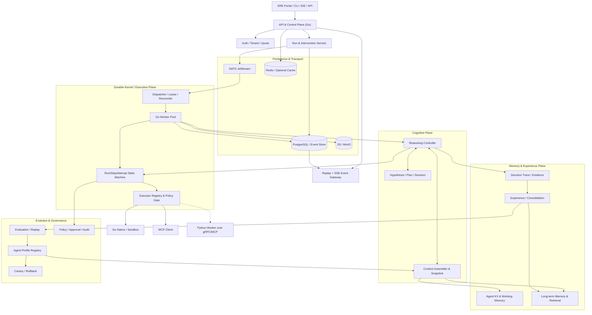
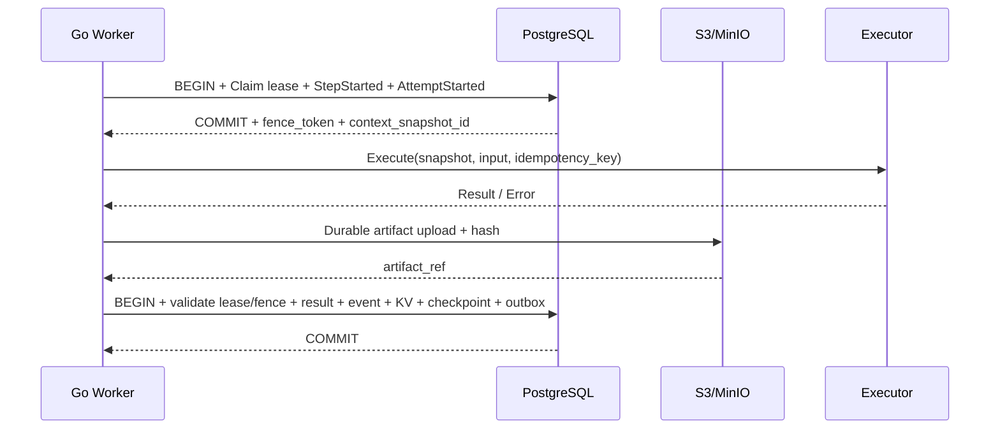
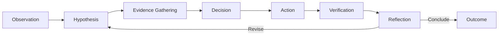
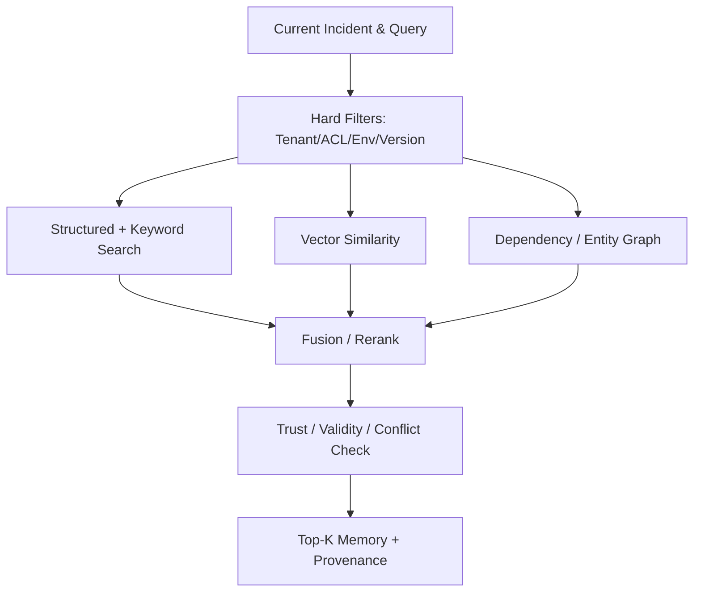
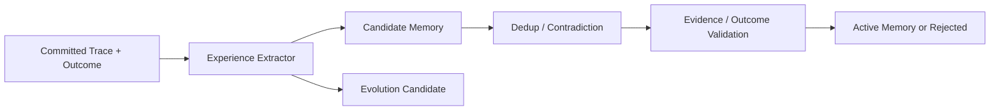
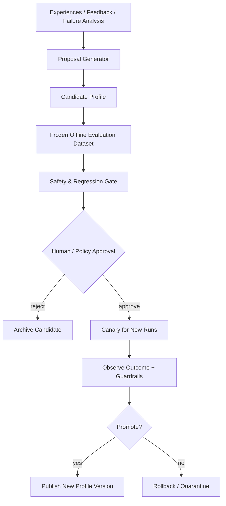
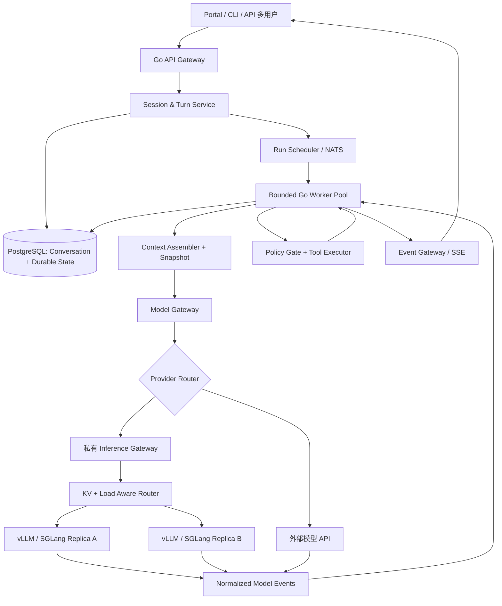
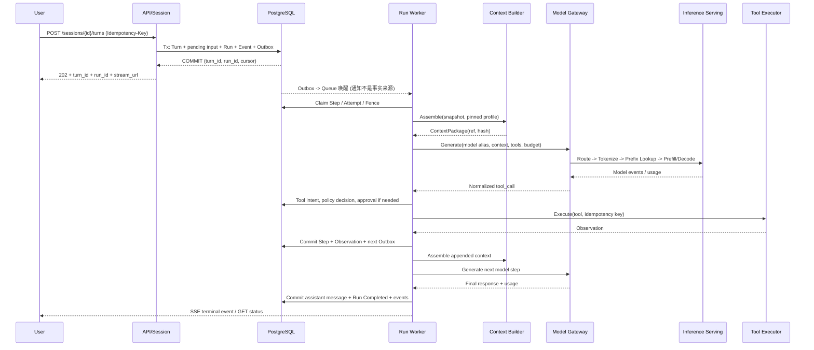
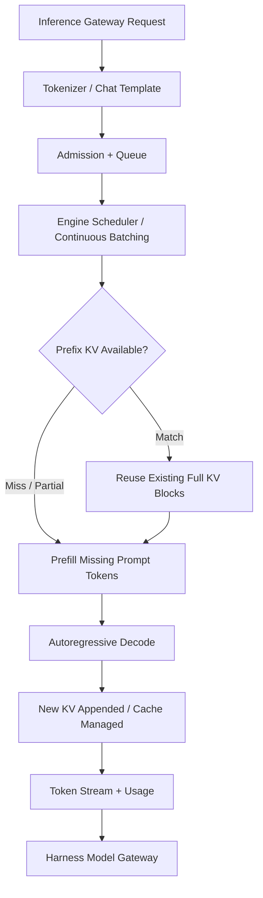

# Go SRE Cognitive Agent Harness：生产级架构与落地设计（v1.1）

[English](GoAgentHarness.md) | **简体中文**

> **文档状态**：架构方案 / Engineering RFC
> **版本**：v1.1.3
> **初稿日期**：2026-10-29  
> **修订日期**：2026-11-04  
> **主要实现语言**：Go  
> **扩展技术栈**：PostgreSQL、NATS JetStream、Redis（可选）、S3/MinIO、MCP、gRPC、OpenTelemetry；Python Worker 预留；可选 vLLM / SGLang 推理集群  
> **目标用户**：SRE / 平台工程 / 基础设施运维团队

### 修订记录

| 版本 | 日期 | 变更 |
|---|---|---|
| v1.1.3 | 2026-11-04 | 修订 P2 问题：① 修正 3.3、10.4 与分隔线错位、重复分隔线及参考资料列表断开；② KV CAS 排除已删除/过期键，`PutIfAbsent` 支持复活并保持版本单调，小值内联、大值外置，快照引用版本禁止 GC（13.4）；③ KV Go 接口补齐 `GetAtVersion/List/Watch/Snapshot`、Provenance 与错误类型（6.4）；④ Worker 配置新增 `control_reserved` 并校验资源池总和（24）；⑤ Profile 状态增加 `QUARANTINED` 并与 `evolution_rollouts` 分工（13.1）；`initiator_type` 改为按 `run.created` 事件回填后再加约束（35.2）；⑥ 明确实体 ID 为 UUID，示例为占位别名并统一风格（3.1、31.1） |
| v1.1.2 | 2026-11-04 | 修订 P1 一致性问题：① Run/Step/Attempt 状态机补全——`PAUSE_REQUESTED`/`CANCELLING` 改由 `desired_state` 派生，新增 Run `NEEDS_HUMAN`、`not_before` 延迟重排、Step `RETRY_WAIT`、Attempt `CANCELLED` 与 CHECK 约束，Step 粒度租约（4.2、4.3、13.1、13.2、34.3、37.1）；② Event 字段统一为 `event_seq`，DDL 补齐 `payload_hash/trace_id/occurred_at/committed_at`（3.1、5.1、13.2、17.1）；③ Context Snapshot 生命周期统一为“领取钉版本 → 渲染 → 绑定”，重试复用，表增加 `step_id/compaction_epoch/kv_versions/memory_refs`（10.2、13.5、14.2、21.2、36.3）；④ Usage Ledger 改为带修订号的 Append-only 账本 + 有效视图（35.4）；⑤ 模型流事件枚举与 Go `EventType` 对齐（31.2、36.2）；⑥ v1.0 表全部改为同租户复合外键，Outbox / Memory Version 补 `tenant_id`（13.7） |
| v1.1.1 | 2026-11-04 | 修订 6 项 P0 一致性缺陷：① 新增 Run `PENDING_ACTIVATION`，排队 Turn 的 Run 不可被调度（4.2、13.1、29.3）；② 心跳/领取不递增 `run.version`，pause/cancel 的 `expected_version` 可选（4.5、14.2、17.2）；③ 副作用幂等键改为 `(tenant, run, step, action_hash)`，跨 Attempt 稳定（13.2、14.3、15.1）；④ 补齐审批、Checkpoint、结果修订、灰度表（13.6）；⑤ Worker 模板区分无事可做/租约丢失、设置 Deadline、模型请求写入带 Fence（15.2、35.4、36.3）；⑥ Step 提交与 Incident 共享状态合并分离（3.2、6.5）；补充对应测试（22.1） |
| v1.1 | 2026-10-31 | Conversation Runtime、Model Gateway、Inference Serving（第 28—39 章） |
| v1.0 | 2026-10-29 | 初稿 |

---

## 0. 执行摘要

本方案设计一个**以 Step 为持久化与干预单元、以 Run 为执行隔离单元、以 Incident 为协同认知单元、以 Agent Profile 为版本化演进单元**的生产级 Agent Harness。

核心能力不是“把模型与工具串起来”，而是：

1. **Durable Execution**：每次 Agent Step 在执行前落盘，执行后原子地记录状态、产物与事件；支持重启与恢复。
2. **Interruptible Execution**：暂停、恢复、取消、审批、拒绝、注入证据、修改未执行的下一步与 Fork；全部受版本控制并留痕。
3. **Cognitive Runtime**：结构化 Observation → Hypothesis → Evidence → Decision → Action → Verification → Reflection，而不是依赖不可见的模型内部思维。
4. **Agent KV**：多层命名空间、CAS、TTL、快照、事件关联和事务写入；与模型推理引擎的 KV Cache 严格区分。
5. **Multi-tier Memory**：Run / Incident 工作记忆与跨任务长期记忆分离；长期记忆支持来源证明、冲突检测、有效性、置信度及版本化。
6. **Experience & RSI-ready**：执行轨迹经过验证和沉淀形成经验；通过离线评估、候选 Agent Profile、灰度与回滚支持受控自改进。
7. **High Concurrency**：Go 有界 Worker Pool + NATS JetStream + PostgreSQL 租约 / Fencing / Outbox；多租户公平调度与背压。
8. **Extensibility**：统一 Executor、Model Provider、Reasoning Strategy、Memory Backend 接口；MCP 为一等扩展，Python 通过 gRPC / MCP 按需接入。
9. **SRE Safety**：默认只读、风险分级、人类审批、环境隔离、敏感数据治理与不可绕过的 Policy Engine。
10. **Conversation Runtime**：User / Session / Branch / Turn / Message 与 Run / Step 分离；同分支单写者、跨 Session 并发，支持 Fork 和重连。
11. **LLM Gateway & Inference Serving**：模型能力注册、外部 API / 私有化部署路由、流式 Tool Call 汇聚、费用核算，以及可选的 KV / Load Aware GPU 路由；GPU 缓存不是业务恢复状态。

### 0.1 最关键的架构决策

| 编号 | 决策 | 原因 |
|---|---|---|
| ADR-001 | **Go 为唯一控制内核**，Python 只作为远程执行扩展 | 简化状态一致性和部署，保留 AI 算法生态扩展 |
| ADR-002 | **PostgreSQL 为强一致运行状态来源**；NATS 仅承载通知 | 避免队列投递顺序成为运行状态事实 |
| ADR-003 | Step = 逻辑执行单元，Attempt = 物理重试，Event = 不可变事实 | 支持诊断、回放、幂等和审计 |
| ADR-004 | Context Snapshot 必须版本固定、引用可追溯 | 防止运行中的记忆变更改变过去决策的依据 |
| ADR-005 | 模型内部 CoT 不作为框架审计依据 | Provider 不一定暴露原始推理；改为结构化 Decision Trace |
| ADR-006 | Agent KV 与 Memory 分离 | KV 负责确定性状态；Memory 负责知识有效性与召回 |
| ADR-007 | **RSI 不得自行提升权限、绕过审批或直接修改生产内核** | 保持演进与执行的信任边界 |
| ADR-008 | V1 单 Run 串行推进决策 Step；跨 Run 并发 | 先验证正确性，再发展 DAG / Multi-Agent |
| ADR-009—017 | Session 单写者、Model Gateway、KV 与 Checkpoint 隔离、Model Attempt 审计等 | 详见第 39.4 节 |

### 0.2 非目标（首版）

- 不开发新的基础大模型，不实现 PyTorch / Transformer 训练栈。
- 不对任何生产工具操作承诺跨系统 Exactly-once 副作用。
- 不把任意原始思维文本作为必须可观测的 CoT。
- 不在 V1 支持同一 Run 内任意拓扑的并行 DAG、自动生产变更或自修改 Kernel。
- 不以 Vector DB 替代事务数据库，也不让长期记忆直接修改运行中的 Step 状态。

---

## 1. 需求边界与 SLO

### 1.1 核心场景（关注框架而非具体能力）

- 某个 Incident 触发多个 Run；Run 可以分别诊断不同方向，复用同一个带版本的 Incident Working Memory。
- 每个决策能证明它看到的 Context Snapshot、事实证据、记忆版本、Agent Profile 以及所选行动。
- 操作人员可在执行前审批、在执行过程中请求暂停/取消、补充新证据，且操作不可被 Agent 自行覆写。
- 某个 Worker Crash、租约过期或队列重投递后，Run 可继续执行；不会产生两个有效的状态提交者。
- 事故关闭后，经验提取在后台进行；未经验证的推断不得提升为已证实的长期知识。
- 新策略先成为候选 Profile，经过评估和审批后仅向新 Run 灰度发布。

### 1.2 SLO 草案（需压测校准，不是已实现指标）

| 指标 | 初步目标 | 口径 / 说明 |
|---|---:|---|
| API 创建 Run 可用性 | ≥99.9% / 月 | 排除约定维护窗口，真实目标由团队确定 |
| 创建 Run 的 P95 延迟 | <200ms | 不含排队和 LLM 推理，低负载参考目标 |
| 高风险 Step 未授权执行次数 | 0 | 安全强约束 |
| 已成功提交的 Step 状态丢失 | 0 | 以 DB 提交与备份/灾备能力为前提 |
| Worker 死亡检测与接管 | <60s（参考） | 受 Lease TTL 和调度周期影响 |
| SSE 重连后事件补齐 | 无逻辑缺口 | 依赖事件存储保留窗口 |
| 重复消息导致重复有效提交 | 0 | 由状态版本与 Fencing 保证 |
| 外部副作用重复次数 | 按工具幂等策略统计 | **不可笼统承诺为 0** |
| 审批指令审计完整率 | 100% | 接受、拒绝、超时均应有事件 |
| 长期记忆来源可追溯率 | 100%（Active） | Active 必须关联可信证据/审核记录 |

吞吐量的目标必须通过真实业务分布确定：`Run/s`、平均 Step 数、LLM 耗时、Tool 类型和外部 API 额度共同决定容量，不以单个“支持 10 万并发”作为无条件承诺。

---

## 2. 分层架构



### 2.1 控制面、执行面、认知面职责

| 平面 | 主要内容 | 一致性原则 |
|---|---|---|
| Control Plane | Run 创建、权限、干预命令、审批、配置发布 | 事务落盘后确认接受 |
| Durable Kernel | Step 状态机、租约、执行恢复、检查点 | 同 Run 串行提交、Attempt Fencing |
| Cognitive Plane | 推理策略、假设、计划、决策、上下文组装 | 决策引用不可变上下文快照 |
| Memory Plane | Agent KV、工作记忆、长期记忆、检索 | KV 事务一致，长期记忆版本化 |
| Experience/Evolution | 经验提取、评估、候选策略、版本发布 | 与在线执行异步隔离 |
| Execution Plane | Go 工具、MCP、Sandbox、远程 Worker | 不绕过 Policy / Approval |
| Governance | 审批、风险分类、审计、数据权限 | 默认拒绝、最小权限 |

---

## 3. 统一领域模型与 ID 体系

```text
Tenant
 └─ Service / Environment
     └─ Incident (共享认知与事实空间)
         ├─ Run A (独立 Agent 执行)
         │   ├─ Step 1 / Attempt 1
         │   ├─ Step 2 / Attempt 1, 2
         │   └─ Step 3 / Attempt 1
         └─ Run B

Agent Profile (immutable version)
  ├─ Reasoning Policy
  ├─ Context Assembly / Memory Retrieval Policy
  ├─ Model & Tool Schema Version
  └─ Evaluation / Evolution Configuration
```

### 3.1 关键实体

| 实体 | 不可变身份 | 允许变更内容 | 关键关联 |
|---|---|---|---|
| Tenant | tenant_id | 配额、策略 | 所有资源的硬隔离边界 |
| Incident | incident_id | Timeline、共享事实、状态 | 多个 Run |
| Run | run_id | 状态、租约、Context Cursor | profile_id + profile_version |
| Step | step_id | 状态、当前 Attempt | run_id + step_seq |
| Attempt | attempt_id | 执行状态、租约结果 | step_id + attempt_no |
| Event | event_id | **不可修改** | run_id + event_seq |
| Command | command_id | 接受/应用/拒绝结果 | 指令来源和 expected_version |
| Context Snapshot | snapshot_id | **不可修改** | KV / Working / Memory 引用集合 |
| Decision Artifact | decision_id | **不可修改；修正新建版本** | evidence_refs + step_id |
| Memory Record | memory_id | 当前投影、状态 | version + source_refs |
| Experience | experience_id | 质量评估与状态 | decision → action → outcome |
| Agent Profile | profile_id + version | **发布后不可修改** | Run 启动时固定 |

**ID 约定（v1.1.3）**：`run_id`、`step_id`、`attempt_id`、`event_id`、`snapshot_id` 等实体 ID 一律为 UUID（推荐 UUIDv7，便于按时间排序和索引局部性），由 API/应用生成；`tenant_id`、`profile_id`、`model_alias` 为人类可读字符串。本文 JSON / SSE 示例中的 `run-1001`、`step-0006`、`ctx-0023` 等是**便于阅读的占位别名**，不代表真实格式；客户端不得解析 ID 结构或依赖其递增。

### 3.2 系统不变量（必须有自动化测试）

1. 每个开始执行的 Attempt 必须关联已经提交的 Step 和 `attempt.started` Event。
2. 同一个串行 Run 同时至多只有一个**有效**租约持有者（数据库提交视角）。
3. Step 状态变化、Event 追加、**Run 私有** KV 修改、后续调度 Outbox 在一个事务内提交；Incident 共享状态的 CAS 冲突不得导致已执行 Step 的结果回滚（见 6.5）。
4. 所有 Event 在单个 Run 内采用严格递增的 `event_seq`；不要求全局顺序。
5. 决策绑定同一版本的 Agent Profile、Context Snapshot、工具描述和策略。
6. 无法确认外部副作用的 Attempt 进入 `UNKNOWN`，不能直接重试。
7. 用户命令的“已接受”不等于“已生效”；两者分别有事件和时间戳。
8. 长期 Memory 的删除与更新必须保留审计或合规墓碑，不静默改写历史。
9. Agent 自主提出的改进不得绕过生产权限和发布审批。

### 3.3 Conversation 维度（v1.1 补充）

v1.0 以 Incident / Run 为中心，适用于事故自动化；v1.1 新增 `User -> Session -> Branch -> Turn -> Run` 对话入口：同一个 Run 可以关联 Turn，也可由 Incident 自动触发而没有 Session。数据库迁移与同分支并发策略详见第 29、35 章。**不要把一个 Session 固定到一个 Go Goroutine 或 GPU Replica。**

---

## 4. Durable Step Engine 与可干预状态机

### 4.1 Step 的物理与逻辑边界

- **Step**：可独立 Checkpoint、审计、干预和重试的逻辑单位，例如 `reason`, `retrieve_memory`, `tool`, `verify`, `compact`。
- **Attempt**：一次具体执行，记录耗时、Worker、输入 Hash、输出、状态、资源占用。
- **Artifact**：Step 产生的 Observation / Hypothesis / Decision / Evidence / Verification，属于结构化数据；一项 Step 可产生多个 Artifact。
- **Event**：状态事实，存于 Append-only Event Store；Token Delta 等非关键流可独立存储。

原则：**可干预的最小粒度是 Step 安全边界**。如果要求中途修改正在执行的命令，要由对应 Executor 实现安全取消，不能靠修改数据库字段直接改变正在发生的外部动作。

### 4.2 Run 状态

```text
PENDING_ACTIVATION -> QUEUED | CANCELLED     # 仅 Conversation 排队 Turn
QUEUED   -> RUNNING                          # 领取 Step（not_before <= now()）
RUNNING  -> QUEUED                           # Step 提交且还有后续 Step；释放租约
RUNNING  -> QUEUED (not_before = t)          # 限流 / 可重试失败：延迟重排，释放 Worker
RUNNING  -> WAITING_APPROVAL -> QUEUED       # 审批通过 / 拒绝 / 超时后重新决策
RUNNING  -> PAUSED -> QUEUED                 # desired_state=PAUSED，在安全点提交
RUNNING  -> COMPLETED | FAILED
RUNNING  -> CANCELLED                        # 当前 Attempt 结束（或确认取消）后
RUNNING  -> NEEDS_HUMAN                      # 存在 UNKNOWN 副作用且无法自动核对
{QUEUED, PAUSED, WAITING_APPROVAL, NEEDS_HUMAN} -> CANCELLED   # 无租约，Control Plane 直接提交
{QUEUED, WAITING_APPROVAL} -> PAUSED                           # 无租约，Control Plane 直接提交
NEEDS_HUMAN -> QUEUED                        # 人工核对后 resume
```

Run 另有 `desired_state={RUNNING, PAUSED, CANCELLED}`。v1.1.2 修订后**状态归属规则**：

- **有有效租约**（`RUNNING`）：Control Plane 只写 `desired_state` 与 `run.pause_requested` / `run.cancel_requested` Event；实际状态由租约持有者在安全点提交。v1.0 的 `PAUSE_REQUESTED` / `CANCELLING` 不再作为持久化状态，API 以 `status=RUNNING AND desired_state<>'RUNNING'` 派生展示“暂停中 / 取消中”，避免两个字段表达同一事实。
- **无有效租约**：Control Plane 在锁定 Run 行的事务中直接提交实际状态（见上图），不等待 Worker。
- `PENDING_ACTIVATION`：Run 已落盘但**不可被调度**；只有“激活下一个 Turn”事务（第 29.3 节）可把它转为 `QUEUED` 并写 Outbox。
- **Step 粒度租约**：每个 Step 提交后 Run 回到 `QUEUED` 并清空 `lease_owner`，下一个 Step 重新领取（同一 Worker 可在本地立即领取，作为优化，不改变语义）。因此 `pause` 自然在 Step 边界生效。
- **延迟重排**（落实第 34.3 节 `RETRY_WAIT` 与第 37.1 节“可恢复等待态”）：Run 回到 `QUEUED` 并设置 `not_before`，Step 置 `RETRY_WAIT` 并记录 `next_attempt_at`；调度只领取 `not_before <= now()` 的 Run，唤醒通过 `next_retry_at = not_before` 的 Outbox 消息（Publisher 到期才发布）或 Reconciler 扫描完成，不占用 Goroutine Sleep。

### 4.3 Step / Attempt 状态

```text
Step: PENDING -> RUNNING -> SUCCEEDED | FAILED | CANCELLED | UNKNOWN
                         -> WAITING_APPROVAL -> PENDING | SKIPPED
                         -> RETRY_WAIT -> PENDING          # 限流 / 可安全重试，next_attempt_at 到期
      FAILED -> PENDING (仅明确允许重试)
      UNKNOWN -> RECONCILING -> PENDING | SUCCEEDED | NEEDS_HUMAN

Attempt: RUNNING -> SUCCEEDED | FAILED | TIMED_OUT | CANCELLED | LOST | UNKNOWN
```

- Attempt 在领取事务中直接以 `RUNNING` 创建（v1.0 的 `CREATED` 没有独立持久化时刻，删除）。
- `CANCELLED`：协作取消已被 Executor 确认；`LOST`：租约过期由 Reconciler 判定，执行者未提交结果；`TIMED_OUT`：超过 Step Deadline。对有副作用的工具，`TIMED_OUT` / `LOST` 必须同时把 Step 置 `UNKNOWN`，不能直接重试。

### 4.4 执行顺序



持久化 Artifact 后 DB 提交失败可能产生孤儿对象，需要定期 GC；成功更新 DB 后才对外承诺 Step 完成。Worker 只能提交拥有当前 Fencing Token 的结果。

### 4.5 干预命令语义

| Command | 期望状态/对象 | 生效点 | 失败条件 |
|---|---|---|---|
| `pause` | Run | Step 完成后安全点 | Run 已终态 |
| `resume` | Run | PAUSED → QUEUED | 版本冲突/权限不足 |
| `cancel` | Run | 立即请求取消、最终异步确认 | 终态冲突 |
| `approve_tool` | Step + 参数 Hash | 待批准的精确工具调用 | 输入变化、过期、已消费 |
| `reject_tool` | Step | 当前审批点 | 审批状态已变 |
| `inject_evidence` | Incident/Run | 下一 Context Snapshot | 无来源或越权 |
| `replace_pending_input` | 未运行 Step | 下一 Attempt 领取前 | Step 已执行 |
| `retry` | 可恢复 Step | 新 Attempt | UNKNOWN 未核对 |
| `fork` | Checkpoint | 创建独立 Run | 无可用快照 |
| `override_result` | 已完成 Step 的逻辑输出 | 新 Artifact / 版本，不覆盖旧 Event | 副作用无法自动撤销 |

**版本校验规则（v1.1.1 修订）**：

- `run.version` 只在**控制面可见状态**变化时递增：Run 状态、`desired_state`、当前 Step 推进、Pending Input 替换、审批结果。租约领取写 `fence_token`，心跳续约只更新 `lease_until`，**二者均不递增 `run.version`**，否则任何带版本的命令都会因后台心跳持续冲突。
- `pause` / `cancel` 属于单调的“收紧”意图，`expected_version` **可选**：缺省时只做状态合法性检查（终态拒绝），重复请求按幂等键返回同一 Command。
- `resume`、`replace_pending_input`、`retry`、`override_result`、`approve_tool` / `reject_tool` 会改变执行内容或放宽执行，**必须**携带 `expected_version`（审批类同时校验 `action_hash`），冲突返回 `409` 与当前版本，不静默覆盖。

### 4.6 审批与风险门禁

执行前必须计算 `ActionIntent`：`tenant, environment, target, tool, input_hash, tool_version, risk_class, policy_version, effects`。审批令牌绑定这一完整操作身份，且带有效期、使用次数、审批者和关联 Event。

- **R0**：信息检索/只读，一般自动运行。
- **R1**：低风险、可撤销变更，基于政策允许或单次审批。
- **R2**：生产可写、具有副作用，默认人工审批并要求回滚计划。
- **R3**：破坏性、权限修改或不可逆操作，强审批或框架禁止。

策略默认拒绝未知副作用；MCP Server 提供的工具描述只能作为非可信元数据，不能自行决定权限等级。

---

## 5. 事件溯源、Checkpoint 与恢复

### 5.1 三类存储

| 内容 | 来源 | 物理存储 |
|---|---|---|
| 强一致状态与审计事件 | Run / Step / Commands / KV | PostgreSQL |
| 大体积 Artifact / Prompt / 输出 | 经脱敏后的二进制或文本 | S3/MinIO |
| 实时推送与任务唤醒 | Outbox 消息派生 | NATS / SSE，不是事实来源 |

**关键事件**：`run.created`, `run.started`, `step.planned`, `attempt.started`, `step.succeeded`, `step.failed`, `run.pause_requested`, `run.paused`, `approval.requested`, `approval.decided`, `memory.proposed`, `memory.activated`, `profile.promoted`。

Event 至少包含 `event_id, tenant_id, run_id, event_seq, step_id?, attempt_id?, actor_type, actor_id?, event_type, schema_version, payload, payload_ref?, payload_hash?, trace_id?, occurred_at, committed_at`；字段名与第 13.2 节 `run_events` DDL 一一对应（v1.1.2 统一）。事件类型统一为小写点分 `领域.动作`（如 `step.started`、`model.requested`）。

### 5.2 Checkpoint 内容

- `last_committed_step_seq`、Run 状态、Context Cursor。
- 当前 Profile / Reasoning / Context / Tool Schema / Policy 的版本。
- 模型可继续的会话消息或 Provider 支持的不透明 reasoning state（按兼容性使用）。
- 已确认的工具结果、Pending Tool Call、Pending Approval。
- Working Memory 版本、Agent KV 快照引用、Incident Memory 版本。
- 文件工作区快照或 Git Commit / Workspace Snapshot 引用（如果代码工具执行产生文件变化）。
- 关键 Artifact 引用、Hash、加密与保留策略。

Checkpoint 本身为不可变快照，原始 Event / Evidence 保留为可回放依据。**对话 Checkpoint 不等于操作系统或工作空间快照**。

### 5.3 恢复分类

1. **确定性可恢复**：纯读工具、已有成功结果/Artifact 可重用。
2. **可安全重试**：由幂等键保障的调用，或确认前一次未生效。
3. **可能有副作用**：查询外部操作 ID；无法确认时 `UNKNOWN` / 人工核对。
4. **无法复现**：环境、工具版本、原始输入缺失；保留审计但标记不可重放。

不应声称“恢复原样再次执行”就是严格 Replay。**审计回放**是查看当时已发生事件；**模拟回放**是使用固定模型输出/工具记录；**重新执行**可能产生不同结果，必须隔离且标注。

## 6. Agent KV：确定性状态空间

### 6.1 概念澄清

- **Agent KV** 是 Harness 管理的版本化键值/状态系统。
- **Model KV Cache** 是 Transformer 推理引擎中 Attention 的 Key/Value 缓存，通常由模型服务管理；**不属于本项目的 Agent KV，也不作为跨模型恢复的基础**。

### 6.2 命名空间

```text
/tenant/{tenant_id}/run/{run_id}/...                # Run 私有状态
/tenant/{tenant_id}/incident/{incident_id}/...      # Incident 共享工作态
/tenant/{tenant_id}/agent/{agent_id}/...            # Agent 长期配置/偏好
/tenant/{tenant_id}/service/{service_id}/...        # 服务相关状态引用
/tenant/{tenant_id}/organization/...                # 组织级配置/策略
```

Step 临时态一般无需长期 KV；如需保存则使用 `step/{step_id}` 命名空间和短 TTL。Namespace 是查询组织方式，不是授权本身；所有读写仍检查 Tenant、Environment、Owner 和 ACL。

### 6.3 KV Contract

| 操作 | 语义 |
|---|---|
| `Get` | 返回 Value、Version、ETag、TTL 与 Provenance |
| `PutIfAbsent` | 首次原子创建 |
| `CAS` | 对 `expectedVersion` 原子比较更新，失败返回 Conflict |
| `DeleteIfVersion` | 带版本删除，保留 Tombstone 和审计 |
| `List` | Tenant/Scope 限定的分页读取 |
| `Watch` | 最终通过 Event Cursor 订阅变更 |
| `Snapshot` | 在一次事务中固定多个 KV 版本引用 |
| `GetAtVersion` | 依赖 KV Version History 读取历史 |
| `Txn` | 同一数据库事务中的多键变更 + Step Event；仅经 `UnitOfWork` 随 Step 提交（见 6.4） |

KV Value 建议按 Schema 注册：`content_type`, `schema_id`, `schema_version`, `data_ref`, `hash`, `version`, `expires_at`；避免任意无版本 JSON 直接进入核心状态。

### 6.4 Go 接口（设计契约）

```go
package kv

import (
    "context"
    "errors"
    "time"
)

type Key struct {
    TenantID string
    Scope    string // run | incident | agent | service | organization
    OwnerID  string
    Name     string
}

var (
    ErrNotFound      = errors.New("kv: not found")       // 不存在、已删除或已过期
    ErrAlreadyExists = errors.New("kv: already exists")
    ErrConflict      = errors.New("kv: version conflict")
)

type Provenance struct {
    EventID   string // 产生该版本的 run_events.event_id
    RunID     string
    StepID    string
    ActorType string
    ActorID   string
}

type Value struct {
    Data          []byte     // 小值内联；大值由 Store 透明地从对象存储读取
    Version       int64
    Hash          string     // 兼作 ETag
    SchemaID      string
    SchemaVersion int
    ExpiresAt     *time.Time
    Provenance    Provenance
}

type Entry struct {
    Key   Key
    Value Value
}

type Write struct {
    Key             Key
    Data            []byte
    SchemaID        string
    SchemaVersion   int
    TTL             time.Duration // 0 = 不过期
    ExpectedVersion *int64        // nil = PutIfAbsent；非 nil = CAS
    Delete          bool          // true 时按 ExpectedVersion 写 tombstone
}

type ListOptions struct {
    Prefix    string
    PageSize  int
    PageToken string
}

type Store interface {
    Get(ctx context.Context, k Key) (Value, error)
    GetAtVersion(ctx context.Context, k Key, version int64) (Value, error)
    PutIfAbsent(ctx context.Context, w Write) (Value, error)
    CompareAndSwap(ctx context.Context, w Write) (Value, error)
    DeleteIfVersion(ctx context.Context, k Key, version int64) error
    // List 必须限定 TenantID + Scope + OwnerID，不支持跨租户扫描。
    List(ctx context.Context, scope Key, opt ListOptions) (entries []Entry, nextPageToken string, err error)
    // Watch 基于 run_events / KV 版本事件游标，断线后从 afterSeq 续读；不保证实时，只保证无缺口。
    Watch(ctx context.Context, scope Key, afterSeq int64) (<-chan Change, error)
    // Snapshot 在一次读事务中返回多个键的当前版本号（不复制值），供 context_snapshots.kv_versions 使用。
    Snapshot(ctx context.Context, keys []Key) (map[Key]int64, error)
}

type Change struct {
    Seq     int64
    Key     Key
    Version int64
    Deleted bool
}

// 事务接口由持久化适配层实现，不能以多次独立 Get/Put 伪装原子提交。
// KVWrites 只允许 Run 私有命名空间；Incident 共享状态走变更意图（见 6.5）。
type UnitOfWork interface {
    CommitStepAndKV(ctx context.Context, commit StepCommit, kvWrites []Write) error
}
```

`Txn` 不单独暴露给 Reasoning / Executor：多键变更只能随 Step 提交经 `UnitOfWork` 原子落盘，避免绕过 Fence 校验。

### 6.5 冲突处理

- Run 私有 KV 可通过同 Run 串行 Step 轻松保证次序。
- Incident 共享 KV 需 CAS、按字段合并或 CRDT 类型的明确定义；**不默认 Last-Write-Wins**。
- 证据类数据优先 Append-only `evidence_added`，由 Incident Memory Manager 构建 Materialized View。

**两阶段提交边界（v1.1.1 修订）**：工具已执行后，Step 结果是不可丢失的事实；共享状态冲突只是“合并问题”，两者不能放在同一个会因 CAS 失败而整体回滚的事务里。

1. **Step 提交事务**（Fence 校验）：Step/Attempt 结果、Artifact 引用、Event、Run 私有 KV（同 Run 串行，无竞争）、以及针对 Incident 的 **Append-only 变更意图** `incident_memory_events(base_version, mutation, source_step_id)`、Outbox。此事务不对 Incident 共享 KV 做 CAS，因此不会因其他 Run 的并发写入而失败。
2. **共享状态合并**（Incident Memory Manager 异步或同进程紧随执行）：按 Incident 串行消费变更意图，对共享 Materialized View 执行 CAS / 字段级合并；成功写 `incident.memory_updated`，无法自动合并时写 `incident.mutation_conflicted` 并保留双方证据，交给下一次 `reason` Step 或人工裁决。
3. 若某决策**必须**基于最新共享状态（例如“仅当无人已执行回滚时才回滚”），应把该条件放入 ActionIntent 的 precondition，在执行**前**的领取事务中以 `incident.memory_version` 校验，而不是在执行后提交时才发现冲突。
- Redis 仅为缓存和临时配额系统，不能成为不可丢 Step 状态的唯一来源。

---

## 7. Cognitive Runtime：结构化决策轨迹，而不是原始 CoT

### 7.1 两类“推理状态”

1. **Provider Reasoning State**：部分模型支持推理摘要、加密/不透明 reasoning item 或会话引用。是否保留、如何续接由 Model Adapter 负责；不可假设所有模型提供明文内部思考。
2. **Harness Decision Trace**：框架主动构建的可审计结果，包含可核对的观察、假设、证据、决策理由摘要与验证记录，作为复盘与学习基础。

核心约束：**Decision Trace 是明确生成、可审计的解释性 Artifact，不等于或声称还原模型内部隐藏的推理过程。**

### 7.2 认知状态机



### 7.3 基础 Artifact Schema（逻辑）

| 类型 | 必选字段 | 要求 |
|---|---|---|
| Observation | observed_at、source、payload_ref、trust_level | 仅描述观测；不能直接标为根因 |
| Hypothesis | statement、status、supporting_refs、refuting_refs | `UNVERIFIED/VERIFIED/REFUTED` 明确区分 |
| Evidence | source_ref、captured_at、integrity_hash、relation | 支持/反驳关系，保留原始出处 |
| Decision | alternatives、chosen_action、reason_summary、risk、evidence_refs | 人类能审查；不存不可得的隐藏 CoT |
| Plan | steps、preconditions、stop_conditions、rollback | 涉及变更时必须有验证与回退策略 |
| Verification | expected、observed、verdict、evidence_refs | 结果基于可测量证据 |
| Reflection | error_modes、lessons、counterexamples、source_refs | 不自动升级为长期事实 |

### 7.4 JSON Decision Trace 示例

```json
{
  "schema_version": 1,
  "decision_id": "dec-003",
  "run_id": "run-1001",
  "step_id": "step-0006",
  "context_snapshot_id": "ctx-0023",
  "profile_ref": "sre-diagnosis@12",
  "observations": ["obs:cpu", "obs:request-latency"],
  "hypotheses": [
    {
      "id": "hyp:pool-exhaustion",
      "status": "UNVERIFIED",
      "confidence_estimate": 0.68,
      "supports": ["evidence:pool-wait"],
      "refutes": []
    }
  ],
  "alternatives": ["hyp:slow-query", "hyp:traffic-spike"],
  "decision": {
    "action": "inspect_connection_pool",
    "reason_summary": "通过只读连接池指标验证假设",
    "expected_observation": "获取活跃连接、等待队列与错误率",
    "risk_class": "R0"
  }
}
```

`confidence_estimate` 是模型/策略给出的估计，不应直接被视为经过校准的概率。以后用 Incident Ground Truth 做 Calibration Evaluation。

### 7.5 Reasoning 策略插件

```go
type ReasoningStrategy interface {
    Name() string
    Decide(ctx context.Context, input ReasoningInput) (DecisionArtifact, error)
    Reflect(ctx context.Context, input ReflectionInput) (ReflectionArtifact, error)
}
```

建议默认策略为 `HypothesisDriven + PlanAndExecute + Verify`，并预留 `ReAct`, `Deliberation`, `MultiAgentReview`。策略是 Profile 的可版本化组件，不允许绕过 Step Event、Context Snapshot 或 Policy Gate。

### 7.6 认知热路径性能

不要把每个 Observation / Hypothesis 都强制实现为一次额外 LLM 请求。一个 `reason` Step 可生成多个认知 Artifact。推荐：

- `Step`：可单独调度/恢复/审批。
- `Artifact`：Step 中形成的多项结构化结果。
- `Event`：Step / Artifact 的状态变化。

高频 Token Delta 和流式输出可批量异步写对象存储；Step 状态与决策摘要进入事务事件流。

---

## 8. Short-term Memory：Run 与 Incident 工作记忆

### 8.1 两级工作记忆

**Run Working Memory**（私有）：当前任务目标、计划、正在验证的假设、待执行 Step、模型历史、已确认工具输出、最近 Context Cursor。

**Incident Working Memory**（共享）：事故时间线、已确认事实、不同 Agent 提交的证据、共享假设板、已采取行动、当前环境版本。

三条约束：

1. Run 只能通过有版本的读取获得 Incident Snapshot。
2. 不同 Run 不直接覆盖共享事实，须通过 `EvidenceAdded`, `HypothesisUpdated`, `DecisionRecorded` 等 Mutation 事件。
3. 新写入的 Incident 信息只影响之后创建的 Context Snapshot，不静默影响正在运行的 Step。

### 8.2 Memory Snapshot

```json
{
  "snapshot_id": "ctx-0023",
  "run_id": "run-1001",
  "profile_version": 12,
  "working_memory_version": 33,
  "incident_memory_version": 18,
  "kv_versions": {"run/plan": 8, "run/hypotheses": 4},
  "retrieved_memory_refs": ["mem-001@3", "mem-009@1"],
  "tool_schema_set_hash": "sha256:...",
  "context_hash": "sha256:...",
  "created_at": "2026-10-29T02:00:00Z"
}
```

Snapshot 中不要内联所有大对象；使用不可变引用、Hash 和可审计版本。Context Snapshot 是重试、复盘和 RSI 评估的数据基础。

### 8.3 压缩与保真

分离三种内容：`Raw History`（不可变）、`Working State`（结构化当前态）、`Context Summary`（可重生成的投影）。

Compaction 时必须保留：未完成操作、审批状态、核心证据链接、反证、错误原因、环境版本、下一个安全操作点。**不能压缩掉权限边界、根因不确定性或影响决策的反证**。

---

## 9. Long-term Memory：可验证的跨任务积累

### 9.1 三种长期记忆

| Memory Type | 含义 | SRE 示例 |
|---|---|---|
| Semantic | 系统知识与事实 | 服务依赖关系、配置约束、历史版本事实 |
| Episodic | 经历与事件 | 一次事故的症状、判断、操作和最终结果 |
| Procedural | 策略、方法、Runbook 规则 | 遇到特定症状时的诊断优先级 |

**Procedural Memory 会影响行为，因此需要更严格的评估和发布门禁**，不能因为一次任务成功就自动成为高优先级生产规则。

### 9.2 记忆生命周期

```text
CANDIDATE -> VALIDATING -> ACTIVE -> STALE -> ARCHIVED
                       |         -> SUPERSEDED -> ARCHIVED
                       +-> REJECTED
```

字段：`tenant_id, scope, owner, memory_type, status, version, content_ref, content_hash, source_refs, evidence_refs, confidence, verified_by, valid_from, valid_until, expires_at, environment, service_version, policy_version, created_at`。

### 9.3 Retrieval Pipeline



**硬过滤不可用软分数替代**。Tenant、ACL、环境、过期状态、敏感级别、工具作用域必须先过滤。向量相似度只能辅助相关性排序，不能证明历史经验适用于当前故障。

### 9.4 检索返回类型

```go
type MemoryHit struct {
    MemoryID   string
    Version    int64
    Type       string
    ContentRef string
    SourceRefs []string
    Trust      string
    Score      float64
    ValidUntil *time.Time
}
```

推荐 V1：PostgreSQL + pgvector + 全文检索。后续数据量超过合理阈值时再抽象 Search Backend，不在内核绑定某个专用向量数据库。

### 9.5 Memory Poisoning 防护

来自日志、外部网页、MCP、Runbook、他人备注的内容都是**数据，不是系统指令**。需要：

- 内容来源与完整性 Hash；不可信文本禁止提升系统提示词优先级。
- 写入前去重、冲突检查、敏感信息检测、有效期校验。
- `ACTIVE` 长期记忆必须关联证据或人工验证结果；高风险 Procedural Memory 需要审批。
- 读写时强制 Tenant、Service、Environment 授权。
- 对错误知识支持撤回、失效、修订与检索屏蔽；保留合规审计。
- 提示注入防护在 Model Prompt、Tool Adapter、Memory Consolidator 三处同时实施。

---

## 10. Context Engineering：统一上下文组装入口

### 10.1 Context Assembler 不变量

每次 LLM 调用必须经由 Context Assembler，输入包括：

- Profile（模型、推理策略、工具版本、权限与预算）。
- 当前 Run / Incident 的不可变工作态 Snapshot。
- 待验证 Hypothesis、关键反证和 Decision Trace。
- 经过权限/有效性校验的 Long-term Memory Hits。
- 当前任务预算：Token、步骤、时间、费用与风险。

输出 `ContextPackage` 包含 `messages_ref, tool_schema_set_hash, context_hash, source_refs, memory_refs, token_budget, model_config_version`。

### 10.2 组装顺序

1. 锁定 Profile、Policy、Memory/Working Snapshot 版本。
2. 过滤无权限或过期的记忆。
3. 把系统指令/权限策略作为高信任输入，第三方内容作为低信任引用数据。
4. 按 Task 的相关性、时效、证据质量与 Token 预算分配上下文。
5. 生成带 Hash 的 ContextPackage，提交 Snapshot 引用后再发起模型请求。
6. 模型产生的 Tool Intent 必须再经过 Policy Gate，而不是仅靠 Prompt 约束。

**Snapshot 生命周期（v1.1.2 统一，取代第 14.2、21.2、36.3 节的分散表述）**：

| 阶段 | 位置 | 内容 | 是否允许慢 I/O |
|---|---|---|---|
| ① 版本钉住 | Step **首个** Attempt 的领取事务（14.2 第 6 步） | 插入 `context_snapshots`：Profile 版本、Working/Incident Memory 版本、KV 版本表、上游 `retrieve_memory` Step 输出的 Memory Hit 引用、`compaction_epoch` | 否：只读当前版本号，无检索、无渲染 |
| ② 渲染 | 领取事务之后、模型调用之前 | 按钉住的版本读取内容，渲染 ContextPackage / Prompt Manifest 并上传 | 是，但只能读 ① 中钉住的版本 |
| ③ 绑定 | Fence 校验的短事务（与 `model_requests` 创建同事务） | 写 `context_hash`、`manifest_ref`；同一 Snapshot 只能写一次 | 否 |

- 长期记忆检索属于 `retrieve_memory` Step 的**执行**，其输出是 Memory Hit Artifact；它不“固定 Snapshot”，而是被**下一个** Step 的 ① 阶段引用。
- 同一 Step 的重试 Attempt 复用首个 Attempt 的 Snapshot，保证“决策绑定同一上下文”；要让 Agent 看到 `inject_evidence` 等新信息，必须由 Kernel 规划一个新 Step（新 Snapshot），而不是改写重试的输入。
- 非 `reason` 类 Step（tool / verify）同样在 ① 钉住版本，供审计；可以没有 ② ③。

### 10.3 Context Budget

建议按照：`安全策略 > 当前证据 > 当前计划/假设 > 已验证历史知识 > 一般对话摘要` 优先级。预算由 Profile 控制，不能假定固定比例适用于所有 Provider。模型保留的 opaque reasoning state 由 Provider Adapter 按兼容性保存，不将其混入普通 Memory 记录。

### 10.4 v1.1 Prompt Prefix 与模型请求快照

`ContextPackage` 在 v1.1 中还应生成不可变 `Prompt Manifest`，记录模型/模板/Tool Schema 版本、已选择的消息 Cursor、请求 Hash 和缓存提示。缓存命中只是可选性能优化，不得阻止 Compaction 或影响 ACL 与证据完整性。参见第 30—33 章。

---

## 11. Experience Consolidation 与长期学习

### 11.1 在线与离线解耦

- **Hot Path**：每个 Step 产生 Event、KV Mutation、Decision/Evidence Artifact；只做必要的轻量结构化保存。
- **Cold Path**：Run/Incident 结束后（或明确的安全边界）消费持久事件，提取、合并、验证经验；失败可重试，不阻塞 Run。



### 11.2 Experience Record

`trigger, context_snapshot_ref, decision_ref, action_ref, outcome_ref, feedback_ref, lesson, failure_modes, counterexamples, applicability, source_refs, extractor_version, quality_grade`。

**同时记录错误与失败**。例如 `CPU 高 → 猜测 GC → 被流量指标反驳` 的经历对未来决策同样有价值。经验提取不能把模型自评成功当作事实结论。

### 11.3 有效性确认

- 技术事件可由已持久化工具结果与客观状态验证。
- 根因、复盘报告、跨服务结论可要求 SRE 审核。
- 新的部署版本、拓扑/配置改变触发记忆重新验证或降低召回优先级。
- Consolidator 只提出 `candidate`，不能直接发布高风险 Procedural Memory。

---

## 12. RSI-ready：受控演进系统

### 12.1 演进对象及边界

**可提出候选修改**：Prompt 模板、Reasoning Strategy 参数、Context 预算、Memory Retrieval 策略、计划模板、验证策略、工具选择优先级、Agent Profile。

**不能由 Agent 自行放宽/执行**：生产权限、工具风险分类、审批规则、租户访问控制、Kernel 核心安全逻辑、RBAC、密钥管理。

采用 **Immutable Kernel + Versioned Evolvable Profile**。

### 12.2 Evolution Loop



### 12.3 Evaluation Engine

需要支持：

- **Dataset**：Incident 样本、证据快照、Ground Truth、允许工具列表、风险标签，支持冻结与版本管理。
- **Record/Replay**：录制外部 Tool/Model 输出；离线模拟不得访问生产写接口。
- **Metrics**：正确根因率、证据引用准确率、误报/漏报、诊断 Step 数、Token/费用、平均定位时长、工具风险、审批合规。
- **Regression**：相同测试集比较 `Profile A` vs `Profile B`；跨服务/环境分层统计，避免只对少量样本过拟合。
- **Holdout**：按时间/事故/服务划分训练与评估集，减少历史事件泄漏。
- **Release Gate**：重大风险指标不得退化；效果改进达到预设阈值方可灰度。

### 12.4 Profile 版本固定

每个 Run 创建时固定 `profile_id + profile_version`，包括：`model provider/model version, reasoning strategy, prompt template, tool schema set, memory policy, context policy, evaluation policy, security policy`。

Profile V13 只能默认用于新 Run。存量 V12 Run 需要显式 Migration Command 才能切换，并追加 `profile.migrated` Event。

### 12.5 Agent RSI 发展路径

1. **V1**：记录评估所需数据，不自动改进。
2. **V2**：自动生成反思与 Experience Candidate，人审沉淀。
3. **V3**：自动提出候选 Profile，离线测试与人工批准。
4. **V4**：低风险策略灰度自动化，严格 Safety Gate 和自动回滚。
5. **远期**：考虑更广泛策略演进；Kernel 代码变更仍走独立工程 CI/CD 及人工审批。

## 13. PostgreSQL 持久化设计（核心 DDL 草案）

以下 SQL 以 PostgreSQL 16+ 语法为基础，是 **Migration 设计起点**，不是完整生产迁移包。真实部署需要补齐表分区、RLS/ACL、脱敏、授权、索引监控、灾备及升级迁移。UUID 生成由 API/应用负责，所有表以 `tenant_id` 为强制租户过滤条件。

### 13.1 Profile / Incident / Run

```sql
CREATE TABLE agent_profiles (
  tenant_id TEXT NOT NULL,
  profile_id TEXT NOT NULL,
  version BIGINT NOT NULL,
  spec JSONB NOT NULL,
  spec_hash TEXT NOT NULL,
  status TEXT NOT NULL CHECK (status IN
    ('DRAFT','CANDIDATE','ACTIVE','QUARANTINED','ARCHIVED')),
  created_at TIMESTAMPTZ NOT NULL DEFAULT now(),
  PRIMARY KEY (tenant_id, profile_id, version)
);
-- v1.1.3：Profile 版本状态只描述“该版本能否被新 Run 选用”；灰度比例、晋升与回滚过程
-- 由 13.6 evolution_rollouts 记录。CANARY 阶段的目标版本保持 CANDIDATE，
-- 由 Profile Selector 按 rollout.traffic_percent 分流；回滚时目标版本转 QUARANTINED。
-- 已固定该版本的存量 Run 不受状态变化影响（见 12.4）。

CREATE TABLE incidents (
  id UUID PRIMARY KEY,
  tenant_id TEXT NOT NULL,
  service_id TEXT NOT NULL,
  environment TEXT NOT NULL,
  status TEXT NOT NULL,
  memory_version BIGINT NOT NULL DEFAULT 0,
  created_at TIMESTAMPTZ NOT NULL DEFAULT now(),
  UNIQUE (tenant_id, id)              -- v1.1.2：供同租户复合外键引用
);

CREATE TABLE agent_runs (
  id UUID PRIMARY KEY,
  tenant_id TEXT NOT NULL,
  incident_id UUID NULL,
  profile_id TEXT NOT NULL,
  profile_version BIGINT NOT NULL,
  status TEXT NOT NULL CHECK (status IN (
    'PENDING_ACTIVATION',  -- 排队 Turn 的 Run，调度器不可见
    'QUEUED','RUNNING','PAUSED','WAITING_APPROVAL','NEEDS_HUMAN',
    'CANCELLED','COMPLETED','FAILED'
    -- v1.1.2：PAUSE_REQUESTED / CANCELLING 改为由 desired_state 派生（见 4.2）
  )),
  desired_state TEXT NOT NULL DEFAULT 'RUNNING'
    CHECK (desired_state IN ('RUNNING','PAUSED','CANCELLED')),
  version BIGINT NOT NULL DEFAULT 0,  -- 控制面可见状态版本；心跳续约不递增（见 14.2）
  last_event_seq BIGINT NOT NULL DEFAULT 0,
  next_step_seq BIGINT NOT NULL DEFAULT 1,
  not_before TIMESTAMPTZ NULL,        -- 延迟重排（限流 / 退避），见 4.2
  context_snapshot_id UUID NULL,      -- 复合 FK 见 13.7
  lease_owner TEXT NULL,
  lease_until TIMESTAMPTZ NULL,
  fence_token BIGINT NOT NULL DEFAULT 0,
  created_at TIMESTAMPTZ NOT NULL DEFAULT now(),
  updated_at TIMESTAMPTZ NOT NULL DEFAULT now(),
  UNIQUE (tenant_id, id),
  FOREIGN KEY (tenant_id, incident_id) REFERENCES incidents(tenant_id, id),
  FOREIGN KEY (tenant_id, profile_id, profile_version)
    REFERENCES agent_profiles(tenant_id, profile_id, version),
  CHECK ((lease_owner IS NULL) = (lease_until IS NULL))
);
CREATE INDEX idx_run_queue ON agent_runs (not_before NULLS FIRST, created_at, id)
  WHERE status = 'QUEUED' AND desired_state = 'RUNNING';
CREATE INDEX idx_run_lease ON agent_runs (lease_until)
  WHERE status = 'RUNNING';
CREATE INDEX idx_run_incident ON agent_runs (tenant_id, incident_id, created_at DESC);
```

调度领取谓词为 `status='QUEUED' AND desired_state='RUNNING' AND (not_before IS NULL OR not_before <= now())`。

### 13.2 Step / Attempt / Event

```sql
CREATE TABLE agent_steps (
  id UUID PRIMARY KEY,
  tenant_id TEXT NOT NULL,
  run_id UUID NOT NULL,
  seq BIGINT NOT NULL,
  kind TEXT NOT NULL,
  executor_name TEXT NOT NULL,
  status TEXT NOT NULL CHECK (status IN (
    'PENDING','RUNNING','WAITING_APPROVAL','RETRY_WAIT','SUCCEEDED','FAILED',
    'SKIPPED','CANCELLED','UNKNOWN','RECONCILING','NEEDS_HUMAN'
  )),
  input_ref TEXT,
  input_hash TEXT,
  output_ref TEXT,                    -- 当前有效修订的投影，见 13.6 step_output_revisions
  context_snapshot_id UUID,           -- 首个 Attempt 领取时固定，重试复用（见 10.2）
  current_attempt INT NOT NULL DEFAULT 0,
  next_attempt_at TIMESTAMPTZ,        -- RETRY_WAIT 到期时间
  created_at TIMESTAMPTZ NOT NULL DEFAULT now(),
  updated_at TIMESTAMPTZ NOT NULL DEFAULT now(),
  UNIQUE (run_id, seq),
  UNIQUE (tenant_id, id),
  FOREIGN KEY (tenant_id, run_id) REFERENCES agent_runs(tenant_id, id)
);

CREATE TABLE step_attempts (
  id UUID PRIMARY KEY,
  tenant_id TEXT NOT NULL,
  run_id UUID NOT NULL,
  step_id UUID NOT NULL,
  attempt_no INT NOT NULL,
  worker_id TEXT NOT NULL,
  fence_token BIGINT NOT NULL,
  status TEXT NOT NULL CHECK (status IN (
    'RUNNING','SUCCEEDED','FAILED','TIMED_OUT','CANCELLED','LOST','UNKNOWN'
  )),
  -- 外部副作用幂等键按“逻辑动作”而非 Attempt 生成，同一 Step 的重试必须复用；
  -- 推导：hash(tenant_id, run_id, step_id, action_hash)。Attempt 自身用 id 区分。
  idempotency_key TEXT NOT NULL,
  started_at TIMESTAMPTZ NOT NULL DEFAULT now(),
  ended_at TIMESTAMPTZ,
  error_code TEXT,
  UNIQUE (step_id, attempt_no),
  UNIQUE (tenant_id, id),
  FOREIGN KEY (tenant_id, run_id) REFERENCES agent_runs(tenant_id, id),
  FOREIGN KEY (tenant_id, step_id) REFERENCES agent_steps(tenant_id, id)
);

CREATE TABLE run_events (
  tenant_id TEXT NOT NULL,
  run_id UUID NOT NULL,
  event_seq BIGINT NOT NULL,          -- v1.1.2：全文统一命名，Run 内严格递增
  event_id UUID NOT NULL UNIQUE,
  step_id UUID,
  attempt_id UUID,
  event_type TEXT NOT NULL,
  actor_type TEXT NOT NULL,
  actor_id TEXT,
  schema_version INT NOT NULL DEFAULT 1,
  payload JSONB NOT NULL DEFAULT '{}'::jsonb,
  payload_ref TEXT,
  payload_hash TEXT,                  -- payload_ref 非空时必填（应用层校验）
  trace_id TEXT,
  occurred_at TIMESTAMPTZ NOT NULL,   -- 业务事实发生时间（可早于提交，如工具完成时刻）
  committed_at TIMESTAMPTZ NOT NULL DEFAULT now(),  -- 事务提交时间，排序以 event_seq 为准
  PRIMARY KEY (run_id, event_seq),
  FOREIGN KEY (tenant_id, run_id) REFERENCES agent_runs(tenant_id, id)
);
CREATE INDEX idx_events_tenant_time ON run_events (tenant_id, committed_at DESC);
```

`idx_steps_run` 与 `UNIQUE (run_id, seq)` 重复，v1.1.2 删除。`event_seq` 由锁定 Run 行后 `last_event_seq + 1` 分配，因此同一 Run 的事件写入天然串行。

这里 `run_events` 演示用组合主键。在大规模部署时可按时间/Hash 设计物理分区；分区表的唯一性与外键约束需根据 PostgreSQL 约束规则重新审核，不能原样复制后就认为分区正确。

### 13.3 干预命令、Outbox、幂等与副作用

```sql
CREATE TABLE run_commands (
  id UUID PRIMARY KEY,
  tenant_id TEXT NOT NULL,
  run_id UUID NOT NULL,
  idempotency_key TEXT NOT NULL,
  command_type TEXT NOT NULL,
  actor_id TEXT NOT NULL,
  expected_version BIGINT,
  status TEXT NOT NULL DEFAULT 'PENDING'
    CHECK (status IN ('PENDING','APPLIED','REJECTED','EXPIRED')),
  payload JSONB NOT NULL DEFAULT '{}'::jsonb,
  created_at TIMESTAMPTZ NOT NULL DEFAULT now(),
  applied_at TIMESTAMPTZ,
  UNIQUE (tenant_id, run_id, idempotency_key)
);

CREATE TABLE outbox_messages (
  id UUID PRIMARY KEY,                -- 同时作为 NATS Msg-Id，JetStream 去重窗口内防重复发布
  tenant_id TEXT NOT NULL,            -- v1.1.2：按租户限流 / 隔离发布
  aggregate_id UUID NOT NULL,
  subject TEXT NOT NULL,
  payload JSONB NOT NULL,
  publish_attempt INT NOT NULL DEFAULT 0,
  next_retry_at TIMESTAMPTZ NOT NULL DEFAULT now(),
  claimed_until TIMESTAMPTZ,
  published_at TIMESTAMPTZ,
  created_at TIMESTAMPTZ NOT NULL DEFAULT now()
);
CREATE INDEX idx_outbox_pending
  ON outbox_messages (next_retry_at, created_at)
  WHERE published_at IS NULL;

CREATE TABLE external_tool_effects (
  id UUID PRIMARY KEY,
  tenant_id TEXT NOT NULL,
  run_id UUID NOT NULL,
  step_id UUID NOT NULL,
  idempotency_key TEXT NOT NULL,
  target TEXT NOT NULL,
  state TEXT NOT NULL CHECK (state IN (
    'PREPARED','DISPATCHED','CONFIRMED','UNKNOWN','COMPENSATED'
  )),
  external_operation_id TEXT,
  last_check_at TIMESTAMPTZ,
  result_ref TEXT,
  UNIQUE (tenant_id, idempotency_key, target)
);
```

所有命令类型都须有具体状态转换规则和角色权限；不要仅校验用户能访问 Run 就允许高风险 `override_result` 或 `approve_tool`。

### 13.4 KV 与历史

```sql
CREATE TABLE agent_kv (
  tenant_id TEXT NOT NULL,
  scope TEXT NOT NULL,
  owner_id TEXT NOT NULL,
  key TEXT NOT NULL,
  value_inline BYTEA,                 -- v1.1.3：小值内联（阈值如 8 KiB，按压测设定）
  value_ref TEXT,                     -- 大值放对象存储
  value_hash TEXT NOT NULL,
  schema_id TEXT,
  schema_version INT NOT NULL DEFAULT 1,
  version BIGINT NOT NULL,
  expires_at TIMESTAMPTZ,
  tombstone BOOLEAN NOT NULL DEFAULT FALSE,
  updated_at TIMESTAMPTZ NOT NULL DEFAULT now(),
  PRIMARY KEY (tenant_id, scope, owner_id, key),
  CHECK (tombstone OR ((value_inline IS NULL) <> (value_ref IS NULL)))  -- 有效值二选一
);

CREATE TABLE agent_kv_versions (
  tenant_id TEXT NOT NULL,
  scope TEXT NOT NULL,
  owner_id TEXT NOT NULL,
  key TEXT NOT NULL,
  version BIGINT NOT NULL,
  value_inline BYTEA,
  value_ref TEXT,
  value_hash TEXT,                    -- tombstone 版本为 NULL
  tombstone BOOLEAN NOT NULL DEFAULT FALSE,
  event_id UUID NOT NULL,
  recorded_at TIMESTAMPTZ NOT NULL DEFAULT now(),
  PRIMARY KEY (tenant_id, scope, owner_id, key, version)
);
```

KV CAS 事务示例：

```sql
-- 仅说明版本控制关键谓词；应用需要同时插入历史、Event。
-- CAS：只更新“存活”的键；已删除或已过期的键视为不存在（v1.1.3 修订）。
UPDATE agent_kv
SET value_inline = $5,
    value_ref = $6,
    value_hash = $7,
    expires_at = $9,
    version = version + 1,
    updated_at = now()
WHERE tenant_id = $1 AND scope = $2
  AND owner_id = $3 AND key = $4
  AND version = $8
  AND tombstone = FALSE
  AND (expires_at IS NULL OR expires_at > now())
RETURNING version;
-- 返回 0 行：版本冲突、已删除或已过期，统一返回 Conflict / NotFound，由调用方重新读取。

-- PutIfAbsent：键不存在、已删除或已过期时创建；复活旧键沿用版本序列（version + 1），
-- 保证同一键的版本号单调，历史快照引用不会与新值撞号。
INSERT INTO agent_kv (tenant_id, scope, owner_id, key,
                      value_inline, value_ref, value_hash, expires_at, version)
VALUES ($1, $2, $3, $4, $5, $6, $7, $8, 1)
ON CONFLICT (tenant_id, scope, owner_id, key) DO UPDATE
SET value_inline = EXCLUDED.value_inline,
    value_ref = EXCLUDED.value_ref,
    value_hash = EXCLUDED.value_hash,
    expires_at = EXCLUDED.expires_at,
    tombstone = FALSE,
    version = agent_kv.version + 1,
    updated_at = now()
WHERE agent_kv.tombstone
   OR (agent_kv.expires_at IS NOT NULL AND agent_kv.expires_at <= now())
RETURNING version;
-- 返回 0 行意味着键已存活存在（AlreadyExists）。
```

- **过期不是删除**：到期键在读写路径上视为不存在，物理清理由后台任务写 tombstone 版本与 Event 完成；被任一 `context_snapshots.kv_versions` 引用的历史版本在其保留期内不得 GC，否则 `GetAtVersion` 与审计回放失效。
- **大小值分流**：`value_inline` 避免每次 KV 写入都走对象存储往返；超过阈值的值先上传对象存储（与 Artifact 相同的“先上传、后提交”规则），再提交 `value_ref`。

### 13.5 Context / Trace / Memory / Experience / Evolution

```sql
CREATE TABLE context_snapshots (
  id UUID PRIMARY KEY,
  tenant_id TEXT NOT NULL,
  run_id UUID NOT NULL,
  step_id UUID NOT NULL,              -- v1.1.2：Snapshot 属于首个 Attempt 所在 Step
  profile_id TEXT NOT NULL,
  profile_version BIGINT NOT NULL,
  working_memory_version BIGINT,
  incident_memory_version BIGINT,
  kv_versions JSONB NOT NULL DEFAULT '{}'::jsonb,
  memory_refs JSONB NOT NULL DEFAULT '[]'::jsonb,  -- mem_id@version，来自上游 retrieve_memory
  refs JSONB NOT NULL,
  compaction_epoch BIGINT NOT NULL DEFAULT 0,       -- 见 33.3
  context_hash TEXT,                  -- 渲染后在 ③ 阶段写入一次，之后不可变
  manifest_ref TEXT,
  created_at TIMESTAMPTZ NOT NULL DEFAULT now(),
  UNIQUE (tenant_id, id),
  UNIQUE (step_id),                   -- 每个 Step 唯一 Snapshot
  FOREIGN KEY (tenant_id, run_id) REFERENCES agent_runs(tenant_id, id),
  FOREIGN KEY (tenant_id, step_id) REFERENCES agent_steps(tenant_id, id)
);

CREATE TABLE cognitive_artifacts (
  id UUID PRIMARY KEY,
  tenant_id TEXT NOT NULL,
  run_id UUID NOT NULL,
  step_id UUID NOT NULL,
  kind TEXT NOT NULL,
  schema_version INT NOT NULL,
  artifact_ref TEXT NOT NULL,
  artifact_hash TEXT NOT NULL,
  context_snapshot_id UUID NOT NULL,
  source_refs JSONB NOT NULL DEFAULT '[]'::jsonb,
  created_at TIMESTAMPTZ NOT NULL DEFAULT now()
);

CREATE TABLE agent_memories (
  id UUID PRIMARY KEY,
  tenant_id TEXT NOT NULL,
  scope TEXT NOT NULL,
  scope_id TEXT NOT NULL,
  memory_type TEXT NOT NULL,
  status TEXT NOT NULL,
  current_version BIGINT NOT NULL DEFAULT 1,
  content_ref TEXT NOT NULL,
  content_hash TEXT NOT NULL,
  source_refs JSONB NOT NULL DEFAULT '[]'::jsonb,
  confidence DOUBLE PRECISION,
  verified_by TEXT,
  valid_from TIMESTAMPTZ,
  valid_until TIMESTAMPTZ,
  expires_at TIMESTAMPTZ,
  created_at TIMESTAMPTZ NOT NULL DEFAULT now(),
  CHECK (confidence IS NULL OR (confidence >= 0 AND confidence <= 1))
);
CREATE INDEX idx_memory_scope
  ON agent_memories (tenant_id, scope, scope_id, memory_type, status);

CREATE TABLE agent_memory_versions (
  tenant_id TEXT NOT NULL,            -- v1.1.2
  memory_id UUID NOT NULL,
  version BIGINT NOT NULL,
  content_ref TEXT NOT NULL,
  content_hash TEXT NOT NULL,
  status TEXT NOT NULL,
  provenance JSONB NOT NULL,
  created_at TIMESTAMPTZ NOT NULL DEFAULT now(),
  PRIMARY KEY (memory_id, version)
);

CREATE TABLE experiences (
  id UUID PRIMARY KEY,
  tenant_id TEXT NOT NULL,
  incident_id UUID,
  run_id UUID NOT NULL,
  decision_id UUID,
  action_step_id UUID,
  outcome_ref TEXT,
  lessons_ref TEXT,
  source_refs JSONB NOT NULL,
  quality_state TEXT NOT NULL,
  extractor_version TEXT NOT NULL,
  created_at TIMESTAMPTZ NOT NULL DEFAULT now()
);

CREATE TABLE evolution_candidates (
  id UUID PRIMARY KEY,
  tenant_id TEXT NOT NULL,
  profile_id TEXT NOT NULL,
  base_version BIGINT NOT NULL,
  candidate_spec_ref TEXT NOT NULL,
  evaluation_ref TEXT,
  status TEXT NOT NULL,
  approved_by TEXT,
  created_at TIMESTAMPTZ NOT NULL DEFAULT now()
);
```

建议再补充 `artifact_registry`（对象元数据/生命周期）、`memory_embeddings`（按模型版本与维度管理）、`evaluation_datasets`、`evaluation_runs`、`incident_memory_events`。V1 只部署所需最小表，Schema Contract 提前明确。（`evolution_rollouts` 已在 13.6 给出。）

### 13.6 审批、Checkpoint、结果修订与灰度（v1.1.1 补充）

v1.1 正文依赖但未建模的四类状态：审批令牌（4.6）、Checkpoint（5.2 / `fork`）、`override_result`（4.5）与 Profile 灰度（12.2）。

```sql
-- 4.6 ActionIntent：审批绑定的“精确操作身份”，不可修改
CREATE TABLE action_intents (
  id UUID PRIMARY KEY,
  tenant_id TEXT NOT NULL,
  run_id UUID NOT NULL,
  step_id UUID NOT NULL,
  environment TEXT NOT NULL,
  target TEXT NOT NULL,
  tool_name TEXT NOT NULL,
  tool_version TEXT NOT NULL,
  input_hash TEXT NOT NULL,
  action_hash TEXT NOT NULL,          -- H(以上字段 + effects + policy_version)
  risk_class TEXT NOT NULL CHECK (risk_class IN ('R0','R1','R2','R3')),
  policy_version TEXT NOT NULL,
  effects JSONB NOT NULL,
  rollback_plan_ref TEXT,             -- R2 及以上必填，由应用层校验
  created_at TIMESTAMPTZ NOT NULL DEFAULT now(),
  UNIQUE (tenant_id, step_id, action_hash)
);

-- 审批请求与决定；一条请求可要求多名审批者（双人审批）
CREATE TABLE approval_requests (
  id UUID PRIMARY KEY,
  tenant_id TEXT NOT NULL,
  action_intent_id UUID NOT NULL,
  required_approvals INT NOT NULL DEFAULT 1 CHECK (required_approvals >= 1),
  status TEXT NOT NULL DEFAULT 'PENDING' CHECK (status IN
    ('PENDING','APPROVED','REJECTED','EXPIRED','SUPERSEDED','CONSUMED')),
  expires_at TIMESTAMPTZ NOT NULL,
  requested_event_seq BIGINT NOT NULL,
  created_at TIMESTAMPTZ NOT NULL DEFAULT now()
);
CREATE INDEX idx_approval_expiry ON approval_requests (expires_at)
  WHERE status = 'PENDING';           -- Reconciler 扫描超时并写 approval.expired Event

CREATE TABLE approval_decisions (
  approval_request_id UUID NOT NULL,
  approver_id TEXT NOT NULL,
  decision TEXT NOT NULL CHECK (decision IN ('APPROVE','REJECT')),
  action_hash TEXT NOT NULL,          -- 必须与 intent 一致，防止对旧参数的审批被复用
  command_id UUID NOT NULL,
  decided_at TIMESTAMPTZ NOT NULL DEFAULT now(),
  PRIMARY KEY (approval_request_id, approver_id)
);

-- 一次性授权：执行前在领取事务中原子消费
CREATE TABLE approval_grants (
  id UUID PRIMARY KEY,
  tenant_id TEXT NOT NULL,
  approval_request_id UUID NOT NULL,
  action_hash TEXT NOT NULL,
  max_uses INT NOT NULL DEFAULT 1,
  used_count INT NOT NULL DEFAULT 0 CHECK (used_count <= max_uses),
  expires_at TIMESTAMPTZ NOT NULL,
  consumed_by_attempt_id UUID
);

-- 5.2 Checkpoint：不可变，fork / 恢复的唯一入口
CREATE TABLE run_checkpoints (
  id UUID PRIMARY KEY,
  tenant_id TEXT NOT NULL,
  run_id UUID NOT NULL,
  last_committed_step_seq BIGINT NOT NULL,
  last_event_seq BIGINT NOT NULL,
  profile_id TEXT NOT NULL,
  profile_version BIGINT NOT NULL,
  context_snapshot_id UUID,
  message_cursor BIGINT,
  pending_refs JSONB NOT NULL DEFAULT '{}'::jsonb,  -- pending tool call / approval
  workspace_snapshot_ref TEXT,
  provider_state_ref TEXT,            -- 不透明 reasoning state，按兼容性使用
  manifest_ref TEXT NOT NULL,
  manifest_hash TEXT NOT NULL,
  replayable BOOLEAN NOT NULL DEFAULT TRUE,
  created_at TIMESTAMPTZ NOT NULL DEFAULT now(),
  UNIQUE (run_id, last_committed_step_seq)
);

ALTER TABLE agent_runs
  ADD COLUMN forked_from_checkpoint_id UUID;   -- 复合外键见 13.7

-- 4.5 override_result：只追加新版本，不改写原输出与 Event
CREATE TABLE step_output_revisions (
  step_id UUID NOT NULL,
  revision INT NOT NULL,              -- 0 = 原始执行结果
  tenant_id TEXT NOT NULL,
  output_ref TEXT NOT NULL,
  output_hash TEXT NOT NULL,
  source TEXT NOT NULL CHECK (source IN ('EXECUTION','HUMAN_OVERRIDE')),
  command_id UUID,
  reason TEXT,
  side_effects_reverted BOOLEAN NOT NULL DEFAULT FALSE,  -- 仅记录事实，不自动撤销
  created_at TIMESTAMPTZ NOT NULL DEFAULT now(),
  PRIMARY KEY (step_id, revision)
);
-- agent_steps.output_ref 仅作为“当前有效修订”的投影；后续 Context 引用 step_id@revision。

-- 12.2 Profile 灰度与回滚
CREATE TABLE evolution_rollouts (
  id UUID PRIMARY KEY,
  tenant_id TEXT NOT NULL,
  profile_id TEXT NOT NULL,
  from_version BIGINT NOT NULL,
  to_version BIGINT NOT NULL,
  candidate_id UUID,
  status TEXT NOT NULL CHECK (status IN
    ('PENDING_APPROVAL','CANARY','PROMOTED','ROLLED_BACK','QUARANTINED')),
  traffic_percent NUMERIC(5,2) NOT NULL DEFAULT 0
    CHECK (traffic_percent BETWEEN 0 AND 100),
  guardrails JSONB NOT NULL,
  approved_by TEXT,
  started_at TIMESTAMPTZ,
  ended_at TIMESTAMPTZ,
  FOREIGN KEY (tenant_id, profile_id, to_version)
    REFERENCES agent_profiles(tenant_id, profile_id, version)
);
CREATE UNIQUE INDEX uq_active_rollout ON evolution_rollouts (tenant_id, profile_id)
  WHERE status IN ('PENDING_APPROVAL','CANARY');
```

语义约束：

- 审批只对 `action_hash` 完全一致的 Intent 有效；`replace_pending_input`、重新决策或 Policy 版本变化会生成新 Intent，并在同一事务把旧 `approval_requests` 标为 `SUPERSEDED`。
- `approval_grants` 在 Attempt 领取事务内以 `UPDATE ... SET used_count = used_count + 1 WHERE used_count < max_uses AND expires_at > now() AND action_hash = $h` 消费；返回 0 行即不得执行。
- 审批超时由 Reconciler 扫描 `idx_approval_expiry` 处理：写 `approval.expired` Event，Step 按 Policy 转 `SKIPPED` 或 `NEEDS_HUMAN`，Run 回到 `QUEUED` 重新决策或 `FAILED`；从而避免同 Branch 后续 Turn 被永久阻塞。
- `fork` 只能引用已提交的 `run_checkpoints`；新 Run 记录 `forked_from_checkpoint_id`，不共享原 Run 的租约、KV 私有命名空间或未消费的审批授权。

### 13.7 租户隔离约束（v1.1.2 补充）

第 13.1—13.6 节所有业务表均携带 `tenant_id`。v1.1.2 起**禁止单列外键跨表引用业务实体**：父表提供 `UNIQUE (tenant_id, id)`，子表以 `(tenant_id, xxx_id)` 复合外键引用，使“子记录与父记录属于同一租户”由数据库强制，而不只依赖应用层过滤。13.1、13.2 已内联；第 13.3—13.6 节表中的单列外键已移除，统一在此以复合外键声明（第 35 章 v1.1 表已遵循同一规则）：

```sql
-- 父表补充复合唯一键
ALTER TABLE agent_memories       ADD CONSTRAINT uq_memories_tenant   UNIQUE (tenant_id, id);
ALTER TABLE evolution_candidates ADD CONSTRAINT uq_candidates_tenant UNIQUE (tenant_id, id);
ALTER TABLE run_commands         ADD CONSTRAINT uq_commands_tenant   UNIQUE (tenant_id, id);
ALTER TABLE action_intents       ADD CONSTRAINT uq_intents_tenant    UNIQUE (tenant_id, id);
ALTER TABLE approval_requests    ADD CONSTRAINT uq_approvals_tenant  UNIQUE (tenant_id, id);
ALTER TABLE run_checkpoints      ADD CONSTRAINT uq_checkpoints_tenant UNIQUE (tenant_id, id);

-- 子表复合外键
ALTER TABLE agent_runs ADD FOREIGN KEY (tenant_id, context_snapshot_id)
  REFERENCES context_snapshots(tenant_id, id) DEFERRABLE INITIALLY DEFERRED;  -- 与 snapshot 同事务创建
ALTER TABLE agent_runs ADD FOREIGN KEY (tenant_id, forked_from_checkpoint_id)
  REFERENCES run_checkpoints(tenant_id, id);
ALTER TABLE agent_steps ADD FOREIGN KEY (tenant_id, context_snapshot_id)
  REFERENCES context_snapshots(tenant_id, id) DEFERRABLE INITIALLY DEFERRED;
ALTER TABLE run_commands          ADD FOREIGN KEY (tenant_id, run_id)  REFERENCES agent_runs(tenant_id, id);
ALTER TABLE external_tool_effects ADD FOREIGN KEY (tenant_id, run_id)  REFERENCES agent_runs(tenant_id, id);
ALTER TABLE external_tool_effects ADD FOREIGN KEY (tenant_id, step_id) REFERENCES agent_steps(tenant_id, id);
ALTER TABLE cognitive_artifacts   ADD FOREIGN KEY (tenant_id, run_id)  REFERENCES agent_runs(tenant_id, id);
ALTER TABLE cognitive_artifacts   ADD FOREIGN KEY (tenant_id, step_id) REFERENCES agent_steps(tenant_id, id);
ALTER TABLE cognitive_artifacts   ADD FOREIGN KEY (tenant_id, context_snapshot_id)
  REFERENCES context_snapshots(tenant_id, id);
ALTER TABLE agent_memory_versions ADD FOREIGN KEY (tenant_id, memory_id) REFERENCES agent_memories(tenant_id, id);
ALTER TABLE experiences           ADD FOREIGN KEY (tenant_id, run_id)  REFERENCES agent_runs(tenant_id, id);
ALTER TABLE evolution_candidates  ADD FOREIGN KEY (tenant_id, profile_id, base_version)
  REFERENCES agent_profiles(tenant_id, profile_id, version);
ALTER TABLE action_intents        ADD FOREIGN KEY (tenant_id, run_id)  REFERENCES agent_runs(tenant_id, id);
ALTER TABLE action_intents        ADD FOREIGN KEY (tenant_id, step_id) REFERENCES agent_steps(tenant_id, id);
ALTER TABLE approval_requests     ADD FOREIGN KEY (tenant_id, action_intent_id)
  REFERENCES action_intents(tenant_id, id);
ALTER TABLE approval_decisions    ADD COLUMN tenant_id TEXT NOT NULL;
ALTER TABLE approval_decisions    ADD FOREIGN KEY (tenant_id, approval_request_id)
  REFERENCES approval_requests(tenant_id, id);
ALTER TABLE approval_decisions    ADD FOREIGN KEY (tenant_id, command_id)
  REFERENCES run_commands(tenant_id, id);
ALTER TABLE approval_grants       ADD CONSTRAINT uq_grant_request UNIQUE (approval_request_id);
ALTER TABLE approval_grants       ADD FOREIGN KEY (tenant_id, approval_request_id)
  REFERENCES approval_requests(tenant_id, id);
ALTER TABLE run_checkpoints       ADD FOREIGN KEY (tenant_id, run_id)  REFERENCES agent_runs(tenant_id, id);
ALTER TABLE run_checkpoints       ADD FOREIGN KEY (tenant_id, context_snapshot_id)
  REFERENCES context_snapshots(tenant_id, id);
ALTER TABLE step_output_revisions ADD FOREIGN KEY (tenant_id, step_id) REFERENCES agent_steps(tenant_id, id);
ALTER TABLE step_output_revisions ADD FOREIGN KEY (tenant_id, command_id)
  REFERENCES run_commands(tenant_id, id);
ALTER TABLE evolution_rollouts    ADD FOREIGN KEY (tenant_id, candidate_id)
  REFERENCES evolution_candidates(tenant_id, id);
```

- `incidents.memory_version`、`agent_kv` 等以 `tenant_id` 为主键前缀的表天然隔离；`model_catalog` / `model_endpoints` / `model_route_policies` 是平台级共享配置，租户授权由 `tenant_model_entitlements` 表达（见 35.3）。
- 复合外键只保证引用同租户；读路径仍需 RLS（`USING (tenant_id = current_setting('app.tenant_id'))`）与服务层过滤双重保护，并以第 38.4 节跨租户测试验证。
- 外键列需配套索引（PostgreSQL 不自动为引用方建索引），按查询路径评估后添加，避免删除/归档时全表扫描。

### 13.8 数据保留、分区与删除

- Step/Event：按监管与事故审计需求配置保留期；支持按时间分区与归档。
- Raw Tool Output：根据大小阈值压缩上传对象存储，DB 只保存引用与 Hash。
- 长期记忆：支持失效、版本保留以及必要的法定删除流程；安全策略决定脱敏与删除范围。
- 不把 API Key、Cookie、数据库密码、凭据原文写入 Artifact、Event 或 Memory。
- 统计按 Tenant / Service / Time 分区与索引，**不要在未压测时直接承诺单表亿级写入性能**。

---

## 14. 调度系统、高并发与一致性

### 14.1 核心拓扑

```text
API -> PostgreSQL (Run/Event/Outbox transaction)
                         |
                    Outbox Publisher
                         |
                    NATS JetStream
                         |
              Durable Pull Consumers
                         |
               Bounded Go Worker Pool
                         |
             Claim Run + Step in Postgres
                         |
            Execute outside DB transaction
                         |
               Commit result + next outbox
```

采用 **At-least-once 通知 + 数据库幂等领取 + Fencing 状态提交**。NATS JetStream 提供持久消费与重投递，不代表外部工具副作用获得 Exactly-once 保证。

### 14.2 领取执行权

流程必须在短事务中执行：

1. 按 `run_id` `SELECT ... FOR UPDATE` 锁定 Run。
2. 检查 `desired_state`、状态、有效租约、当前 Step 与 Profile 版本。
3. 拒绝其他活跃租约；允许过期租约在恢复规则检查后接管。
4. 递增 `fence_token`，设置 `lease_owner/lease_until`；若 Run 状态从 `QUEUED` 变为 `RUNNING` 才递增 `run.version`（见 4.5 版本校验规则）。
5. 创建 Attempt（递增 `attempt_no`），写 `step.started` / `attempt.started` Event。
6. 若为 Step 首个 Attempt，插入 Context Snapshot 版本钉住记录（见 10.2 Snapshot 生命周期 ①）；重试 Attempt 复用已有 Snapshot。记录输入 Hash，提交事务。
7. 执行期间通过独立 Heartbeat 延长 Lease；丢失 Lease 时取消执行并禁止状态提交。

心跳续约 SQL 必须带 Fence 谓词且不改版本：

```sql
UPDATE agent_runs
SET lease_until = now() + $3::interval
WHERE id = $1 AND fence_token = $2 AND lease_owner = $4
  AND lease_until > now()            -- 已过期的租约不能“续活”，只能重新领取
RETURNING lease_until;               -- 0 行 = 租约丢失，Worker 立即取消执行
```

批量调度候选可以使用 `FOR UPDATE SKIP LOCKED`，但正常消费单个 NATS 通知应领取消息指向的目标 `run_id`，不能任意领取其他任务。

### 14.3 Fencing Token 与下游副作用

- PostgreSQL 更新结果必须检查 `run_id + lease_owner + fence_token + lease_until`。
- 旧 Worker 的结果即使最终返回，也不能覆盖新 Worker 的状态。
- **Fencing 保护数据库状态，不自动阻止旧进程访问外部系统**。
- Shell/Sandbox 需要进程生命周期管理；外部 API 尽可能支持幂等键与操作状态查询。
- **幂等键粒度（v1.1.1 修订）**：幂等键绑定逻辑动作 `(tenant_id, run_id, step_id, action_hash)`，同一 Step 的所有 Attempt 复用同一个键，这样新 Worker 重试时下游与 `external_tool_effects` 才能识别为同一操作。若 `replace_pending_input` 或重新决策导致 `action_hash` 变化，则视为新动作、产生新键，且原审批失效。禁止使用 Attempt ID、随机数或时间戳派生副作用幂等键。
- 写操作执行前先在 `external_tool_effects` 以该键 `INSERT ... ON CONFLICT DO NOTHING` 登记 `PREPARED`；若已存在 `DISPATCHED/UNKNOWN` 记录，新 Attempt 必须先查询外部状态（Reconcile），不得直接再次下发。
- 不可判定外部结果应标记 `UNKNOWN`，进入 Reconciliation / Human Review。

### 14.4 并发控制与公平性

按不同资源建立独立预算：

- `tenant_active_runs_limit`
- `tenant_queued_runs_limit`
- `global_llm_inflight`、`provider_rpm/tpm`、`model_concurrency`（由 v1.1 Model Gateway 实施分层预留/结算）
- `sandbox_inflight` / CPU / Memory / IO / PIDs
- `mcp_server_concurrency`
- `db_connection_budget`
- `object_storage_upload_budget`

Go Worker 使用有界 Queue + Semaphore，不为每个 Run 永久占有 Goroutine。等待人工审批时应释放 Worker 配额，仅保留持久状态和唤醒条件。

调度公平性：V1 每 Tenant 限额 + 优先级；V2 用 Weighted Fair Queue / Deficit Round Robin。生产事故可有优先级，但必须防止高优先级任务永远饿死普通队列。

### 14.5 估算公式

稳态下 Little 定律：

```text
average_open_runs ~= run_arrival_rate * average_run_duration
step_throughput   ~= run_arrival_rate * average_steps_per_run
```

例如 **仅作计算示例**：50 Run/s × 30s 平均时长 = 1500 未完成 Run；平均 5 Step 则约 250 Step/s。数据库写入压力由每步事务数、事件数、KV Mutation、Outbox、重试和审批共同决定。

不能把 `1500 未完成 Run` 等价于 `1500 CPU 忙碌 Worker`。多租户/模型调用通常主要受远端 API 配额和下游延迟限制。

### 14.6 背压与故障隔离

- 创建 Run 超过配额：`429/Retry-After` 或有明确 SLA 的排队接受策略。
- 模型服务限流：按 Provider/Model 分层等待并根据响应执行退避。
- MCP Server 连续失败：熔断并隔离，避免拖垮所有 Run。
- PostgreSQL 连接池耗尽：Admission 减压，避免无上限重试风暴。
- Memory Retrieval 慢：允许已配置的降级策略（如只读 Verified Working State），但不可绕过安全策略。
- 事故期间采用控制面优先级隔离，防止普通后台 Memory Consolidation 抢占实时诊断资源。

---

## 15. Go 核心接口和包边界

### 15.1 Go 核心 Contracts（接口草案）

```go
package harness

import (
    "context"
    "time"
)

type StepKind string

const (
    StepReason     StepKind = "reason"
    StepTool       StepKind = "tool"
    StepRetrieve   StepKind = "retrieve_memory"
    StepVerify     StepKind = "verify"
    StepReflect    StepKind = "reflect"
    StepCompact    StepKind = "compact"
    StepCheckpoint StepKind = "checkpoint"
)

type StepRequest struct {
    TenantID          string
    RunID             string
    StepID            string
    AttemptID         string
    Kind              StepKind
    Executor          string
    InputRef          string
    InputHash         string
    ContextSnapshotID string
    FenceToken        int64
    ActionHash        string    // 规范化后的 ActionIntent Hash（见 4.6）
    IdempotencyKey    string    // = H(TenantID, RunID, StepID, ActionHash)，跨 Attempt 稳定
    Deadline          time.Time
}

type StepResult struct {
    OutputRef string
    Hash      string
    Metadata  map[string]string
}

type Executor interface {
    Execute(ctx context.Context, req StepRequest) (StepResult, error)
}

type ExecutorRegistry interface {
    Resolve(ctx context.Context, tenantID string, name string) (Executor, error)
}

type ModelProvider interface {
    Complete(ctx context.Context, req ModelRequest) (ModelResponse, error)
}

type ReasoningStrategy interface {
    Decide(ctx context.Context, input ReasoningInput) (DecisionArtifact, error)
}

type ContextAssembler interface {
    Assemble(ctx context.Context, input ContextInput) (ContextPackage, error)
}

type MemoryManager interface {
    ReadWorking(ctx context.Context, scope MemoryScope) (WorkingState, error)
    Retrieve(ctx context.Context, query MemoryQuery) ([]MemoryHit, error)
    Propose(ctx context.Context, candidate MemoryCandidate) error
}

type StateStore interface {
    ClaimStep(ctx context.Context, runID, workerID string) (StepLease, error)
    CompleteStep(ctx context.Context, lease StepLease, result StepResult) error
    FailStep(ctx context.Context, lease StepLease, failure StepFailure) error
    RenewLease(ctx context.Context, lease StepLease) error
}

type EvaluationEngine interface {
    Evaluate(ctx context.Context, req EvaluationRequest) (EvaluationReport, error)
}
```

其中 `ModelRequest`, `ModelResponse`, `ContextInput`, `StepLease` 等为独立领域 Schema，建议放在 `internal/domain`；不得直接将第三方模型 SDK 类型泄漏到 Kernel。以上代码为接口设计片段，不是单文件可编译实现。

### 15.2 单个 Step 的执行模板

```go
// 领取结果的哨兵错误（v1.1.1 修订）：区分“无事可做”与真实失败。
var (
    ErrNoRunnableStep = errors.New("no runnable step")   // 重复通知 / 已完成 / 已暂停 / 未激活
    ErrLeaseHeld      = errors.New("lease held by other") // 他人持有有效租约
    ErrLeaseLost      = errors.New("lease lost")          // 心跳或提交时发现 Fence 失效
)

// HandleNotification 处理一条 NATS 通知；返回值决定 Ack / Nak。
func (w *Worker) HandleNotification(ctx context.Context, msg Notification) {
    err := w.ExecuteOne(ctx, msg.RunID)
    switch {
    case err == nil,
        errors.Is(err, ErrNoRunnableStep), // 通知是唤醒而非事实：无事可做即 Ack，避免重投风暴
        errors.Is(err, ErrLeaseHeld),      // 持有者会自行推进；租约过期由 Reconciler 兜底
        errors.Is(err, ErrLeaseLost):      // 新持有者负责后续，旧 Worker 不重试
        msg.Ack()
    default:
        msg.NakWithDelay(w.backoff(msg.Delivered())) // 基础设施错误：有界退避重投
    }
}

func (w *Worker) ExecuteOne(ctx context.Context, runID string) error {
    lease, err := w.store.ClaimStep(ctx, runID, w.id) // 短事务：Fence+Attempt+Event+审批消费
    if err != nil {
        return err // 包含 ErrNoRunnableStep / ErrLeaseHeld
    }

    // 执行上下文 = 父 ctx + Step Deadline + 租约丢失取消。
    execCtx, cancel := context.WithDeadline(ctx, lease.Request.Deadline)
    defer cancel()
    leaseLost := w.leaseHeartbeat(execCtx, lease, cancel) // 续约 0 行 => 关闭 channel 并 cancel()
    defer w.stopHeartbeat(lease)

    executor, err := w.registry.Resolve(execCtx, lease.TenantID, lease.ExecutorName)
    var result StepResult
    if err == nil {
        result, err = executor.Execute(execCtx, lease.Request)
    }
    if err == nil {
        // 先 durable 上传 Artifact（带 Hash），失败视为可重试错误，不得宣称成功。
        result, err = w.artifacts.Persist(execCtx, lease, result)
    }

    // 租约已丢失：结果一律不得提交（不论成功或失败），只记录本地告警。
    select {
    case <-leaseLost:
        w.metrics.StaleResultDropped(lease)
        return ErrLeaseLost
    default:
    }

    // 提交使用独立短期 Context：父 ctx 取消（如进程优雅退出）时仍应尽力落盘。
    commitCtx, commitCancel := context.WithTimeout(context.WithoutCancel(ctx), w.commitTimeout)
    defer commitCancel()

    if err != nil {
        return w.classifyAndCommitFailure(commitCtx, lease, err)
    }
    return w.commitSuccess(commitCtx, lease, result) // 事务内校验 Fence，追加事件、KV、Outbox
}
```

重要：

- `classifyAndCommitFailure()` 不可把所有错误直接转为重试；需要区分安全可重试、不可重试、未知副作用（`UNKNOWN`）、Deadline 超时（对写操作视同未知副作用）、过期 Fencing。
- `commitSuccess` / `classifyAndCommitFailure` 的 SQL 以 `fence_token = $lease.fence AND lease_owner = $w` 为谓词；更新 0 行即返回 `ErrLeaseLost`，并写安全告警指标，不重试。
- `ClaimStep` 对 `PENDING_ACTIVATION`、`PAUSED`、`WAITING_APPROVAL`、终态 Run 以及 `desired_state != RUNNING` 返回 `ErrNoRunnableStep`（后者在同一事务内顺带提交 `PAUSED` / `CANCELLED`）。
- Go `context.Context` 只负责协作取消，不能保证任意外部动作回滚。

### 15.3 内核不依赖的实现细节

- Kernel 不直接 import `mcp`、Postgres 驱动或 Python Stub。
- Tool/Model Adapter 实现稳定的 Domain Contract。
- Reasoning Strategy 不直接读写 DB，状态更新统一交给 Kernel/UnitOfWork。
- Evolution Engine 不持有生产执行工具 Credential。
- Memory Consolidator 不拥有 Active Profile 的直接发布权限。

---

## 16. Python 与 MCP 扩展位

### 16.1 Executor Adapter 分层

```text
ToolRegistry / ExecutorRegistry
 ├─ NativeGoExecutor
 ├─ ModelExecutor
 ├─ ShellSandboxExecutor
 ├─ MCPExecutor
 └─ RemoteExecutor
     ├─ Python Worker (gRPC)
     ├─ Rust Worker (gRPC)
     └─ Custom Service (gRPC)
```

Go 内核管理状态机、审批、Checkpoint 和结果提交。远程 Worker 只接收输入并返回结果，**不直接操作核心 Run/Step 表**。

### 16.2 gRPC Contract（草案）

```protobuf
syntax = "proto3";
package harness.executor.v1;
option go_package = "example.com/harness/proto/executor/v1;executorv1";

service ExecutorService {
  rpc GetCapabilities(CapabilitiesRequest) returns (CapabilitiesResponse);
  rpc ExecuteStep(ExecuteStepRequest) returns (ExecuteStepResponse);
  rpc CancelAttempt(CancelAttemptRequest) returns (CancelAttemptResponse);
}
message CapabilitiesRequest {}
message CapabilitiesResponse { repeated string names = 1; }
message ExecuteStepRequest {
  string tenant_id = 1;
  string run_id = 2;
  string step_id = 3;
  string attempt_id = 4;
  string executor = 5;
  string input_ref = 6;
  string context_snapshot_id = 7;
  int64 fence_token = 8;
  string idempotency_key = 9;
  int64 deadline_unix_ms = 10;
}
message ExecuteStepResponse {
  string result_ref = 1;
  string result_hash = 2;
  string status = 3;
  string error_code = 4;
  string external_operation_id = 5;
}
message CancelAttemptRequest { string attempt_id = 1; }
message CancelAttemptResponse { bool accepted = 1; }
```

生产版还需要：mTLS、协议版本协商、能力注册、心跳、取消确认、流式进度、限流与 Sandbox 隔离。Python Worker 适合未来提供 Embedding、Rerank、数据分析、特定模型推理，也可以通过 Python MCP Server 暴露工具；两种扩展方式不必同时实现。

### 16.3 MCP Adapter

- Transport：stdio / Streamable HTTP，使用官方 Go SDK。
- Discovery：`ListTools` 获取名称、说明、Input Schema；标准化并注册到 ToolRegistry。
- Execute：Tool Intent → Policy Gate → MCP Call → 统一 ToolResult Artifact。
- Lifecycle：认证、连接管理、协议版本、重试、工具刷新与审计。
- Safety：MCP Server 的工具描述不是可信权限；必须经过 Allowlist、Tenant 绑定、目标访问限制和审批。
- MCP 输出无论来自何处都按非可信资料进入 Reasoning / Memory Pipeline。

---

## 17. 外部 API、人工干预与事件订阅

### 17.1 REST API 草案

```http
POST   /v1/sessions                        # 新建会话
GET    /v1/sessions/{session_id}           # 读取会话/分支游标
POST   /v1/sessions/{session_id}/turns     # 提交 Turn / 创建 Run，幂等键
POST   /v1/sessions/{session_id}/branches  # 从 Cursor 分叉
GET    /v1/turns/{turn_id}                 # Turn 状态
POST   /v1/runs                            # 创建 Run，幂等键
GET    /v1/runs/{run_id}                   # Run 当前状态
GET    /v1/runs/{run_id}/steps             # Step 列表
GET    /v1/runs/{run_id}/events?after_seq=123  # 按 event_seq 补齐
GET    /v1/runs/{run_id}/events/stream     # SSE
POST   /v1/runs/{run_id}/commands          # Pause/Resume/Cancel/Retry/Inject...
GET    /v1/runs/{run_id}/commands/{cmd_id}
POST   /v1/runs/{run_id}/fork              # 从 Checkpoint 分叉
GET    /v1/incidents/{incident_id}/memory  # 共享工作记忆
POST   /v1/incidents/{incident_id}/evidence
GET    /v1/memories?scope=service&status=ACTIVE
POST   /v1/memories/candidates
GET    /v1/profiles/{profile_id}/versions
POST   /v1/evaluations
POST   /v1/evolution/candidates
```

### 17.2 Pause / Resume 请求示例

```http
POST /v1/runs/00000000-0000-0000-0000-000000000001/commands
Idempotency-Key: cmd-pause-001
Content-Type: application/json

{
  "type": "pause",
  "expected_version": 12,
  "reason": "等待人工核对数据库状态"
}
```

`expected_version` 对 `pause` / `cancel` 可选（见 4.5 版本校验规则）；若提供则严格校验。返回 `202 Accepted` + Command ID = 命令已持久化，不意味着实际已经暂停。客户端通过命令查询或 SSE 等待 `run.paused`。

### 17.3 SSE 恢复语义

```
id: 100
event: step.started
data: {"step_id":"step-003","attempt":1}

id: 101
event: run.pause_requested
data: {"command_id":"cmd-10"}

id: 102
event: run.paused
data: {"after_step_id":"step-003"}
```

客户端重连携带 Last-Event-ID；服务端按 Run-local `event_seq` 从 DB 补齐事件。实时通知只作为唤醒，消息迟到或丢失时仍以 DB 游标为准；需要明确事件保留期、重连行为和快照回退策略。

---

## 18. SRE 场景安全治理（框架层）

### 18.1 权限层次

`Organization → Tenant → Environment → Service → Incident → Run → Step → Tool Target`。

- API 用户、Agent 身份、Worker 身份、MCP Server 身份必须分别验证。
- Approval 属于 Control Plane；Model 或 Memory 不能授予自身额外权限。
- 生产只读是默认策略；写操作要求显式 Target、时间窗口、风险分类与审批。
- 对高风险动作采用双人审批、超时失效和一次性授权（视企业政策）。
- 环境隔离：生产执行凭据不应出现在离线 Evolution/Evaluation Worker。

### 18.2 可信数据分级

| 等级 | 示例 | 用法 |
|---|---|---|
| T0 | 框架强制安全策略 | 高优先级、不可由模型覆写 |
| T1 | 人工确认、签名配置 | 经授权进入决策上下文 |
| T2 | 可信 API 查询结果、验证证据 | 必须标明时间与来源 |
| T3 | 未经验证历史记忆与摘要 | 可参考，不可直接确认为事实 |
| T4 | 外部网页、日志文本、MCP 输出 | 不可信输入，防提示注入与数据污染 |

### 18.3 威胁模型摘要

- Prompt Injection：来自工具、知识、日志或外部服务，企图改变 Agent 指令与工具权限。
- Memory Poisoning：虚假事故经验被写成 ACTIVE Procedural Memory。
- Cross-tenant Leakage：向量搜索或共享缓存越权返回他租户信息。
- Duplicate Side Effect：Worker Crash 后重复部署/变更。
- Privilege Escalation：自演进策略尝试放宽审批与工具范围。
- Context Drift：执行过程中不一致的 KV/Memory 版本导致决策不可追溯。
- Secret Exposure：Prompt、Artifact、审计事件泄漏凭据。

保护措施：统一 Policy Gate、零信任输入、强制 Provenance、CAS 和版本快照、独立 Sandbox、工具幂等与核对、最小权限、密钥隔离、日志脱敏、安全评估、发布审批。

---

## 19. 部署、可观测性与数据治理

### 19.1 Kubernetes 部署单元

| Deployment / Service | 主要责任 | 扩容依据 |
|---|---|---|
| API / Control Plane | 创建 Run、命令处理、授权 | RPS、P95、CPU |
| Event Gateway | SSE 回放和实时推送 | 长连接数、出站流量 |
| Worker - LLM | 认知与模型 I/O | Provider 配额、排队时间 |
| Worker - Tool | Go 工具与沙箱调度 | 资源配额、任务耗时 |
| Scheduler / Reconciler | Lease、Outbox、恢复 | backlog、租约过期数 |
| Memory Consolidator | 异步经验提取与验证 | 候选积压、成本预算 |
| Evaluation Worker | 隔离评估和回放 | 评估队列与预算 |
| Python Worker（未来） | 算法 / 外部执行 | CPU/GPU/任务类型 |

PostgreSQL、NATS、对象存储建议采用受管理或高可用部署；Redis 是可选缓存，不参与核心事实提交。

### 19.2 OpenTelemetry

Trace 层级：`Run -> Step -> Attempt -> Context Assemble -> LLM/Executor -> Artifact Upload -> DB Commit`。关键 Span 加 `tenant_id`（注意访问控制）、`run_id`、`step_id`、`profile_version`、`fence_token` 等标识；Prometheus 指标不要包含高基数 Run/Step ID 标签。

指标建议：

```text
harness_runs_active
harness_runs_queued
harness_steps_inflight
harness_step_duration_seconds
harness_step_failures_total
harness_attempt_retries_total
harness_lease_expired_total
harness_outbox_oldest_age_seconds
harness_intervention_apply_latency_seconds
harness_context_tokens_total
harness_memory_retrieval_latency_seconds
harness_memory_candidate_rejection_total
harness_evaluation_regression_total
harness_external_effect_unknown_total
```

### 19.3 运行日志与审计日志区分

- Runtime Log：应用排错；允许采样，可能被轮转。
- Domain Event：业务执行事实；事务写入，支持重放与审计。
- Tool Artifact：大体积输出；对象存储加密、Hash、访问控制。
- Security Audit：谁创建/审批/变更/读取高敏数据；单独保留和告警。

### 19.4 灾备

- PostgreSQL 备份和 PITR，定期恢复演练。
- 对象存储跨可用区冗余、生命周期/版本管理。
- NATS 集群与 Stream 副本，Outbox 重建通知保证队列短暂丢失仍可恢复。
- 目标 RPO/RTO 必须与组织的 SRE 政策绑定，不在未经压测时承诺数值。

## 20. Repository / Go Module 组织

```text
go-sre-harness/
├── go.mod
├── cmd/
│   ├── api/                 # REST/SSE server
│   ├── worker/              # bounded Worker runtime
│   ├── scheduler/           # queue, lease, reconciler
│   ├── memory-worker/       # consolidate & index
│   ├── evaluation-worker/   # offline replay
│   └── migrator/
├── internal/
│   ├── domain/              # entities, enum, versioned schemas
│   ├── conversation/        # v1.1 Session/Branch/Turn/Message
│   ├── kernel/
│   │   ├── run/
│   │   ├── step/
│   │   ├── attempt/
│   │   ├── state/
│   │   ├── checkpoint/
│   │   ├── intervention/
│   │   └── event/
│   ├── cognitive/
│   │   ├── reasoning/
│   │   ├── hypothesis/
│   │   ├── decision/
│   │   ├── evidence/
│   │   ├── planning/
│   │   └── reflection/
│   ├── context/
│   │   ├── snapshot/
│   │   ├── assembler/
│   │   ├── budget/
│   │   └── compaction/
│   ├── memory/
│   │   ├── kv/
│   │   ├── working/
│   │   ├── incident/
│   │   ├── longterm/
│   │   ├── retrieval/
│   │   ├── provenance/
│   │   └── consolidation/
│   ├── experience/
│   ├── evolution/
│   │   ├── candidate/
│   │   ├── evaluation/
│   │   ├── registry/
│   │   └── rollout/
│   ├── gateway/model/        # v1.1 Provider/Router/Usage/Stream
│   ├── execution/
│   │   ├── registry/
│   │   ├── model/
│   │   ├── native/
│   │   ├── shell/
│   │   ├── sandbox/
│   │   ├── mcp/
│   │   └── remote/
│   ├── scheduler/
│   │   ├── dispatch/
│   │   ├── lease/
│   │   ├── fairness/
│   │   └── reconcile/
│   ├── security/
│   │   ├── auth/
│   │   ├── policy/
│   │   ├── approval/
│   │   └── audit/
│   ├── infrastructure/
│   │   ├── postgres/
│   │   ├── nats/
│   │   ├── objectstore/
│   │   ├── redis/
│   │   └── telemetry/
│   └── transport/
│       ├── http/
│       ├── sse/
│       └── grpc/
├── proto/
│   └── harness/executor/v1/
├── api/
│   └── openapi/
├── migrations/
├── extensions/
│   └── python/              # 预留、首版不实施
├── deploy/
│   ├── docker/
│   ├── helm/
│   └── kubernetes/
├── tests/
│   ├── integration/
│   ├── concurrency/
│   ├── chaos/
│   ├── replay/
│   ├── security/
│   └── load/
├── configs/
└── docs/
    ├── rfcs/
    ├── adrs/
    └── runbooks/
```

### 20.1 依赖约束

```text
transport -> application services -> domain interfaces
infrastructure implements domain interfaces
kernel -> domain; not model SDK / database driver / Python
cognitive -> context/decision interfaces; not raw SQL
memory -> stores + event contracts; not executor implementation
evolution -> evaluation + registry; no production tool credentials
```

严格禁止在 `internal/kernel` 直接导入 LLM、MCP、Python 或具体 PG SDK；通过 Adapter 保证后续替换能力。

---

## 21. 具体 Incident 生命周期示例

### 21.1 事故初始化

1. SRE 或外部 Incident 系统调用 `POST /v1/runs`，传入 `incident_id`、`service`、`environment`、`profile_version` 或 Profile Selector。
2. Control Plane 校验租户、目标、配额并固定有效的 Agent Profile。
3. 在单一事务中创建 Run、`run.created` Event、Outbox。
4. NATS 唤醒 Worker，Worker 领取 Run / Step。

### 21.2 诊断过程

1. Step `retrieve_memory`：读取当前 Service 的有效长期记忆及 Shared Incident Memory，输出 Memory Hit Artifact；下一个 Step 领取时将其钉入 Context Snapshot（见 10.2）。
2. Step `reason`：产生一个 Decision Artifact（含多个 Hypothesis 和 Evidence Refs）。
3. Step `tool`：只读诊断工具执行，输出 Artifact 和 hash，先落盘再提交。
4. Step `verify`：关联工具证据，验证或推翻之前的假设。
5. 如需生产变更，生成 ActionIntent、RiskClass 和 `approval.requested`，不允许绕过审批。
6. SRE 可以补充证据或暂停；新输入只作用于之后的 Context Snapshot。
7. Agent 最终给出结构化结果：Confirmed Facts、Probable Cause、Unresolved Evidence、Actions Taken、Risk Notes。

### 21.3 事故后沉淀

1. `run.completed` 后后台 Experience Worker 读取所有 Step/Event/Outcome。
2. 从 Decision → Action → Verification 提取 Experience（成功和失败都记录）。
3. 基于证据和人工复盘生成 `CANDIDATE` Memory。
4. Memory Validator 去重、冲突检查、有效期和可信来源检查。
5. 符合标准的记忆转为 `ACTIVE`；有风险的 Procedural Memory 等待专家审批。
6. Profile Evaluation Worker 使用该经验构造候选改进并在隔离测试集上运行。
7. 候选通过门禁后灰度到**新 Run**，异常则回滚。

---

## 22. 测试矩阵与验收条件

### 22.1 正确性测试（P0）

| 测试 | 注入条件 | 必须满足 |
|---|---|---|
| Duplicate Delivery | 同一 Run 通知重复 100 次 | 同时只有一个有效执行权和一条有序状态推进 |
| Concurrent Commands | 多名操作者同时暂停、恢复、取消 | 版本校验 + 状态合法，冲突不能静默覆盖 |
| Worker Kill | `attempt.started` 后立即终止进程 | Lease 过期后可恢复，旧 Attempt 失效 |
| Stale Fence | Worker A 租约到期后提交 | 拒绝提交且记录安全告警 |
| Crash After Side Effect | 外部工具成功后、DB 提交前 Crash | 进入查询/UNKNOWN，不盲目重复执行 |
| Outbox Failure | DB 已提交，NATS 不可用 | 发布意图仍在 DB，最终补发 |
| Artifact Failure | S3 不可用 | 不虚假提交 Step 成功 |
| Replay Event Gap | SSE 断线重连 | 按 Cursor 补齐，无重复状态变更 |
| Concurrent Incident KV | 两个 Run 同时写共享事实 | CAS 冲突或显式合并，不丢证据 |
| Memory ACL | 构造跨租户高相似记忆 | 硬过滤阻断泄漏 |
| Prompt Injection | Tool 输出包含越权指令 | Policy 不变，不允许直接执行 |
| Profile Drift | Run 中途发布新 Profile | 原 Run 继续使用锁定版本 |
| Memory Poisoning | 未经证实的根因候选 | 不能变为 ACTIVE 已证实长期事实 |
| Queued Turn Isolation | 同 Branch 活跃 Turn 未结束时提交新 Turn 并投递其 Run 通知 | 新 Run 保持 `PENDING_ACTIVATION`，`ClaimStep` 返回无事可做并 Ack |
| Command vs Heartbeat | 长时间 Step 执行期间多次心跳后提交 pause / resume | pause 不因心跳冲突；resume 仅在真实状态变化时 409 |
| Idempotency Across Attempts | 写操作 DISPATCHED 后 Worker 被杀，新 Attempt 接管 | 复用同一幂等键；先 Reconcile，不二次下发 |
| Approval Replay | 审批后 `replace_pending_input` 修改参数 | 旧审批 `SUPERSEDED`，新 `action_hash` 必须重新审批；grant 不可重复消费 |
| Approval Timeout | 审批超时未处理 | Reconciler 写 `approval.expired`，Run 脱离 `WAITING_APPROVAL`，后续 Turn 不被永久阻塞 |
| Lost Lease Mid-Model | 模型调用中租约过期 | 旧 Worker 不能创建新 model_request，结果被丢弃并计数 |
| Incident Merge Conflict | 两个 Run 已执行工具后同时修改同一共享事实 | 两个 Step 结果均提交；冲突以 `incident.mutation_conflicted` 暴露，不丢证据 |

### 22.2 性能测试（P1/P2）

- **Open-loop Load**：固定 Run/s，观察排队延迟，防止压力被闭环压测客户端隐藏。
- **Closed-loop Load**：不同活跃 Run 数与 Step 平均耗时，测实际 Worker 利用率。
- **Burst**：短时间数倍流量，验证 Admission / Queue Max / 429。
- **Long-tail Tools**：MCP/LLM 30s–10min 的长尾，验证公平性和租约维护。
- **Database Hot Run**：单一 Run 大量事件，观察行锁热点。
- **Memory Retrieval**：不同 Tenant/Scope/Embedding 索引大小下，测 P95、P99 及权限过滤的召回率。
- **Recovery Storm**：1000+ Run 同时 Lease 过期，验证 Reconciler 批量、抖动和 DB 限流。
- **SSE Fan-out**：大量订阅者下 DB 补齐开销与事件网关扩容。
- **Retention / Archive**：历史 Event / Artifact 清理后，过期数据的 API 响应应明确可解释。

### 22.3 故障注入（Chaos）

- 断开 PostgreSQL 连接或主节点切换。
- 关闭 NATS JetStream、重复发布消息、延迟确认。
- 杀死 Tool Worker、在租约到期后放行旧结果。
- 注入不可信 MCP Server、超时、工具 Schema 变化。
- 模型流式中断、Token 增量丢失但最终事件已提交。
- Memory Index 延迟、长期记忆不一致、候选冲突。
- Evolution Candidate 在 Safety Regression 失败后尝试发布。

### 22.4 上线门槛

P0 上线必须通过：所有事务不变量测试、Pause/Resume/Cancel 端到端、Fencing、安全审批、敏感数据脱敏和至少一次灾备恢复演练。P1/P2 功能在相应测试集/流量下验证后再灰度。

---

## 23. 分阶段实施路线与交付物

| 阶段 | 实现模块 | 交付物 | 验收重点 |
|---|---|---|---|
| **M0：架构底座** | Domain、Schema、错误类型、Profile Registry、OpenAPI | Go 项目骨架 / ADR / Migration | 模块边界清楚、接口版本明确 |
| **M1：Durable Core** | Run/Step/Attempt/Event、DB 事务、Checkpoint、LLM 及只读 Tool | 单机闭环可运行 | Step 先落盘、崩溃可续 |
| **M2：干预与可观测** | Commands、Approval、Decision Trace、SSE、审计 | SRE 操作控制 API/Trace 页面 | 可暂停审批、版本冲突可见 |
| **M3：并发与恢复** | NATS、Outbox、Lease/Fencing、Worker Pool、Reconciler、Quota | 分布式 Runtime | 重投递/故障恢复状态正确 |
| **M4：KV & Cognitive** | Agent KV、Working/Incident Memory、Context Snapshot、Hypothesis Policy | 认知层 SDK/接口 | 决策可追溯其上下文 |
| **M5：长期记忆** | Retrieval、Provenance、Consolidation、Experience | Memory Registry | 来源、时效、权限可验证 |
| **M6：评估与演进** | Replay、Evaluation Dataset、Candidate Profile、灰度回滚 | RSI-ready Evolution Plane | 新旧策略可比较且可回退 |
| **M7：可插拔后端** | MCP、Remote Executor、Python Worker（按需） | 扩展 SDK / 示例 | 无需修改 Kernel 即可接入 |

### 23.1 推荐最小可用版本（MVP）

**M1–M3 + M4 的最小部分**：结构化 Step 事件、Pause/Resume/Approval、Context Snapshot、Agent KV 和简版 Decision Trace；若面向交互式多人使用，还须完成第 39.3 节的 P0-A/B/C（Session/Turn、Model Gateway、Prompt Manifest）。不要等全量长期记忆或 RSI 完成才上线基本的可审计只读 SRE Agent。

### 23.2 优先级关系

- Event/Checkpoint 必须先于 Replay/Evolution。
- KV/Context Snapshot 必须先于可信长期记忆召回。
- Decision/Evidence/Outcome 必须先于 Experience 自动提取。
- Evaluation/Safety Gate 必须先于任何自动 Profile 提升。
- 生产写操作必须在 Approval、Sandbox、External Effect Reconciliation 完备后再开放。

---

## 24. 配置示例与默认策略

```yaml
server:
  http_addr: ":8080"
  shutdown_grace: 30s

runtime:
  max_steps_per_run: 100
  max_run_duration: 1h
  default_step_timeout: 120s
  checkpoint_after_each_step: true

scheduler:
  lease_ttl: 45s
  heartbeat_interval: 10s
  reconciliation_interval: 10s
  max_claim_batch: 20

quota:
  tenant_active_runs: 100
  tenant_queued_runs: 1000
  provider_tpm: 100000        # 示例占位值；需匹配供应商真实配额

worker:
  max_inflight: 100              # 执行槽总数 = 各资源池之和，不再相互挤占
  max_llm_inflight: 50
  max_tool_inflight: 20
  max_mcp_inflight: 20
  control_reserved: 10           # v1.1.3：控制面预留（暂停/取消提交、心跳、审批恢复、Reconcile），不可被执行任务占用

memory:
  working:
    enabled: true
  long_term:
    enabled: true
    only_active: true
    require_provenance: true
    default_top_k: 8

reasoning:
  default_strategy: hypothesis_driven
  enforce_decision_trace: true
  preserve_opaque_provider_state: when_supported

intervention:
  pause_at_step_boundary: true
  production_write_requires_approval: true
  require_action_hash: true

profile:
  pin_on_run_create: true

rsi:
  enabled: false
  collect_evaluation_data: true
  auto_promote: false

extensions:
  mcp:
    enabled: true
  remote_executor:
    enabled: false
  python:
    enabled: false
```

各资源池为独立 Semaphore，满足 `max_llm_inflight + max_tool_inflight + max_mcp_inflight + control_reserved <= max_inflight`，启动时校验（对应第 37.3 节“Control Plane Reserved Capacity”）；心跳与租约续期另在独立 Goroutine 中运行，不占执行槽。以上数值为示例，不是基准测试结论。实际阈值必须基于数据库、模型 Token 额度、SRE 并发量和 Sandbox 资源进行压测校准。

---

## 25. 自研 vs Temporal 的决策

本项目推荐 **PostgreSQL + NATS + 自研 Go Durable Kernel**，前提是团队明确要把 Step、Decision Trace、Agent KV 与干预协议作为自己的产品核心，并承担分布式状态机长期维护成本。

若目标变更为“尽快交付业务 Agent”，可以评估 Go + Temporal：Temporal 已提供工作流 Event History、Replay、Signal/Update 等可靠工作流能力。但即使采用 Temporal，仍需自建 Cognitive Plane、Memory Plane、Decision Trace、SRE Policy 和 RSI/Evaluation；不能将 Workflow History 简单等同于 Agent 记忆。

保留一个 `WorkflowBackend` 抽象的价值有限，除非已经明确会使用第二个 Backend。V1 优先把内核接口稳定，不提前制作假想的多引擎适配层。

---

## 26. 需要工程评审确认的开放问题

1. **Tenant 隔离模型**：Shared DB + RLS，还是关键租户独立 Schema/DB？
2. **Incident 来源**：外部平台主导 Incident ID，还是 Harness 内部创建？
3. **Retention**：生产事故 Trace、工具原始输出、长期记忆各保留多久？
4. **Approval Policy**：生产读写如何分类？是否需要双人审批和变更窗口？
5. **Tool Idempotency**：哪些操作可查询结果、可补偿，哪些只能进入 UNKNOWN？
6. **Data Residency**：模型 API、Memory Embedding 是否允许数据出站？
7. **Memory Ground Truth**：哪类数据可自动验证、哪类需要 Incident Owner 复核？
8. **Evolution Ownership**：候选 Profile 谁批准？在线灰度阈值如何定义？
9. **SLO 预算**：实际 Run/s、平均 Step、峰值持续时间、模型成本与 RPO/RTO？
10. **开发优先级**：V1 优先事故分析、诊断协作还是安全变更工作流？

这些问题不阻碍内核接口设计，但会影响生产安全策略、存储成本、部署与运维参数。

---

## 27. 最终架构结论

框架应建立四条独立又可互操作的闭环：

**执行闭环**：`Run → Step → Attempt → Event/Checkpoint → Recovery`。

**认知闭环**：`Observation → Hypothesis → Evidence → Decision → Action → Verification`。

**记忆闭环**：`Working State → Experience → Candidate Memory → Validation → Active Memory → Retrieval`。

**演进闭环**：`Experience → Candidate Profile → Offline Evaluation → Approval → Canary → Promote/Rollback`。

四条闭环由版本化 `Context Snapshot` 和不可变 `Event/Artifact/Provenance` 串联。Go 负责执行正确性、并发和状态一致性；MCP 与远程 Python Worker 提供可选执行能力；Agent 的学习和演进只通过受控 Profile 发布生效。

> **最终落地原则**：**执行事实不能被推理修改；推理假设不能自动升级为事实；记忆不能绕过权限；演进不能绕过评估；高并发不能牺牲状态一致性。**

---

## 28. v1.1 扩展架构：Conversation Runtime × Model Serving

> **增量范围**：本章至第 39 章是基于 v1.0 的架构扩展，不替换前文 Durable Kernel、认知状态机、Agent KV、Memory、Policy 和 RSI 设计。本扩展重点解决“多用户 Session/Turn → Agent Loop → LLM API → 模型路由 → KV Cache → GPU 推理 → Tool Loop”的端到端执行链路。实现代码均为接口或迁移草案，未经编译、部署与压测。

### 28.1 两种调度域与五个关键边界

1. **Conversation Domain**：User、Session、Turn、Message，定义对话顺序和多端并发语义。
2. **Agent Execution Domain**：Run、Step、Attempt、Checkpoint，定义任务执行和恢复语义。
3. **Model Gateway Domain**：ModelRequest、Provider、RouteDecision、RequestAttempt，定义模型调用、重试、预算和审计语义。
4. **Inference Serving Domain**：Model Replica、Scheduler、KV Blocks、Prefill/Decode，定义 GPU 调度与缓存复用。
5. **Memory Domain**：Agent KV、Working Memory、Long-term Memory，定义可持久化知识和业务状态。

**核心不变量**：`Session != Goroutine`；`Turn != Run`；`Run != LLM API Request`；`业务 Agent KV != GPU Attention KV`；`GPU KV != Checkpoint`。



### 28.2 一次请求的完整时序



**注意**：SSE 流的中间片段与数据库中最终完成的 Assistant Message 是两种不同语义；客户端断线不意味着后台 Run 结束。若请求明确设置 `cancel_on_disconnect`，须通过命令协议发出取消意图。

---

## 29. User / Session / Turn / Message / Run：领域模型与并发语义

### 29.1 新增关系与跨场景统一

```text
Tenant
 └── User / Service Principal
      ├── Session A (branch=main)
      │    ├── Turn 1
      │    │    ├── Message(user)
      │    │    └── Run 1
      │    │         ├── Step 1 / Attempt 1: reason -> LLM Request 1
      │    │         ├── Step 2 / Attempt 1: tool
      │    │         └── Step 3 / Attempt 1: reason -> LLM Request 2
      │    └── Turn 2 -> Run 2
      └── Session B -> Turn 1 -> Run 3

Incident (可选) ───────┬── Run 1
                       └── Run 4 (另一个 Agent / 另一个会话 / 无会话自动任务)
```

| 对象 | 生命周期 | 唯一含义 | 并发规则 |
|---|---|---|---|
| User / Service Principal | 账号或服务身份 | 谁发起调用 | 无 Goroutine 或 GPU 固定绑定 |
| Session | 跨 Turn 的对话容器 | 历史与上下文 Cursor | 默认一个 Branch 一个活跃写入者 |
| Branch | 对话分支 | 并行试验 / Fork 后独立推进 | 分支独立推进，父分支历史不可变 |
| Turn | 一次用户输入引发的交互 | 输入、运行集合与完成状态 | 同分支先提交顺序，再确定接受/排队策略 |
| Message | 不可变消息记录 | role、content、tool 交互引用 | 追加而不覆盖，修正建新版本/事件 |
| Run | 一次 Agent 工作单元 | 计划、工具调用、状态、Checkpoint | 可不依附于 Session（自动巡检、事故触发） |
| Step | 可审计/可干预的逻辑动作 | 一次 reason / tool / compact 等 | 默认同 Run 单写者 |
| Model Request | 一次发向 Gateway 的模型调用 | 请求、路由、Token Usage | 一个 Step 可有多个物理尝试 |

### 29.2 默认同 Session 并发策略：串行写 + 可显式 Fork

建议 V1 采用以下策略，避免多端输入导致上下文交叉：

1. **同 Session、同 Branch**：允许用户提交 Turn，但若上一 Turn 的 Run 仍在推进，默认新 Turn 状态为 `QUEUED`。排队时只保存不可变 `turn.input_ref`，**不提前写入正式 Conversation Message**。可选配置为 `409 CONFLICT`，返回活跃 Turn。
2. **不同 Session / 不同 Branch**：天然并发执行；不需要用户级线程。
3. **用户追加证据到运行中的 Run**：使用 `inject_evidence` Command，进入**下一个** Context Snapshot；不将其伪装成并行 Turn。
4. **用户要求另开思路**：创建 Branch/Fork；Fork 必须引用稳定的消息 Cursor 和 Checkpoint；新 Run 不共享原 Run 的可变执行态。
5. **多 Agent 协作**：共享 Incident Evidence/Event View，使用版本化 Snapshot；不能绕过 Session/Run 的独立租约。

可选 V2 策略：乐观多写者 + 显式冲突处理，仅在产品确有需求时加入。不要只在内存里加 `sync.Mutex`，否则多副本下无法保证顺序。

### 29.3 Turn / Message 状态与提交顺序

```text
Turn: ACCEPTED -> QUEUED -> RUNNING -> COMPLETED
                                    -> FAILED
                                    -> CANCELLED

Message: immutable + ordered (session_id, branch_id, message_seq)
```

- API 通过 `(tenant_id, session_id, branch_id, client_request_id)` 幂等去重。
- **提交 Turn 事务**：锁定 Branch → 分配 `turn_seq` → 持久化 `Turn(input_ref, input_hash)`、Run、Event → 更新 `branch.version`。若 Branch 当前空闲，可在同一事务内激活 Turn、分配 `message_seq` 并追加 User Message，Run 以 `QUEUED` 创建并写调度 Outbox；若已有活跃 Turn，则只记录待处理输入，Turn 为 `QUEUED`，**Run 以 `PENDING_ACTIVATION` 创建且不写调度 Outbox**（v1.1.1 修订：否则调度器会提前领取该 Run，破坏单写者语义）。
- **激活下一个 Turn 事务**：上一个 Run/Turn 终态消息已提交后，锁定 Branch，领取下一个 `QUEUED` Turn，追加它的 User Message 并固定输入 `message_cursor`，以 `UPDATE agent_runs SET status='QUEUED' WHERE id=$run AND status='PENDING_ACTIVATION'` 把 Run 标记可执行，并在同一事务写 `run.activated` Event 与调度 Outbox。排队中的输入**不得进入上一个 Run 的 Context**。
- 排队 Turn 被取消时，同事务将其 Run 从 `PENDING_ACTIVATION` 直接置为 `CANCELLED`；Reconciler 定期检查“Branch 无活跃 Turn 但存在 `QUEUED` Turn”的情况并补做激活，防止唤醒消息丢失导致分支卡死。
- **终结当前 Turn 事务**：提交上一 Turn 的 Assistant Message/终态 Event → 释放 `active_turn_id` → 排队激活下一 Turn（可经 Outbox 唤醒）；消息的全局 `message_seq` 因而遵循 `User1, Assistant1, User2, Assistant2` 的对话逻辑顺序。失败/取消 Turn 依政策生成终态消息或系统状态，但仍必须明确结束边界。
- `run_id` 和 `turn_id` 是不同标识。一个 Turn 在未来可以关联一个主 Run 和多个子 Run，首版固定一个主 Run；不把这个业务约束硬编码到 Executor。
- 自动 Incident Run 可以采用 `initiator_type=system`、`turn_id=NULL`；仍遵守租户权限与审计。
- 结束时 Assistant Message 以同一分支的稳定 Message Seq 追加；流式增量不是已提交的最终 Message。Fork 的历史读取应先回溯父 Branch 到固定 `parent_message_cursor`，再拼接子 Branch 自身消息，不能简单把两个分支的最新消息合并。

### 29.4 用户重新连接、Session 恢复与故障语义

- 前端以 `run_id + Last-Event-ID` 恢复 SSE；服务端按 Run Event Cursor 补齐，不能仅依赖进程内 Channel。
- Session 从 PostgreSQL 加载 Message Cursor 和已提交的上下文引用；**不恢复 Go Goroutine 栈**。
- 当上次 Run 为 `WAITING_APPROVAL`，恢复后的前端展示审批状态而非重复请求模型。
- Token stream 断线时，重连**能恢复持久化的事件或已保留片段**，不能保证重新流式播放尚未持久化的所有字节；最终答案以已提交 Message/Artifact 为准。

---

## 30. Model Gateway：模型注册、路由、配额与失败切换

### 30.1 控制面与数据面

**Model Control Plane**：维护模型能力注册表、Provider Endpoint、租户允许名单、价格规则、密钥引用、灰度权重、路由策略版本；发布配置必须版本化。

**Model Data Plane**：接收规范化 `ModelRequest`，执行访问控制、预算预留、候选筛选、路由、协议适配、请求流处理、Usage 结算、结果规范化。Go Harness 核心只依赖接口，不引用某一家 SDK 类型。

```text
Agent reason Step
  -> ContextPackage (immutable)
  -> Model Gateway
      -> AuthN/AuthZ & Data Residency
      -> Provider/Model Capability Filter
      -> Context Window + Tool / Structured Output Compatibility
      -> Tenant Budget & Admission
      -> Circuit Breaker / Health Check
      -> Route Policy (latency, cost, available quota, failure)
      -> Provider Adapter
          ├─ External Responses / Messages / Chat API
          └─ Self-hosted Inference Gateway
      -> Normalized Stream & Usage
  -> Durable Step Commit
```

### 30.2 路由决策必须先硬过滤，再软打分

**硬约束**：Tenant/Region、数据驻留、上下文窗口、模型可用状态、Tool Calling/Structured Output/Streaming 能力、已获授权的模型、最大成本预算、模型/Tokenizer 兼容性、隐私约束。

**软目标**：健康度、队列时延、TTFT、Token 吞吐量、预计费用、缓存复用概率、供应商稳定性。

示例评分（仅策略示例，须用线上数据标定）：

```text
eligible = hard_filter(candidates, request)
score_i = w1 * normalized_latency_i
        + w2 * normalized_cost_i
        + w3 * normalized_queue_i
        + w4 * normalized_failure_rate_i
        - w5 * cache_affinity_i
choose argmin(score_i) over eligible
```

Agent 选择的是 `model_alias`（例如 `sre-reasoner`），而不是直接输入某个未经审查的 Provider URL。路由结果记录实际 `provider_id / model_id / endpoint_id / route_policy_version`。

### 30.3 模型能力与兼容性矩阵

| 能力 | Route 必须验证 | 不兼容处理 |
|---|---|---|
| Tool Calling | Schema、工具调用方式和并行工具限制 | 不允许静默转为自然语言执行 |
| Structured Output | JSON Schema 支持程度 | 显式 Adapter 转换或失败 |
| Reasoning State | 是否支持不透明续接状态 | 缺失则保留可见对话与 Tool 记录，不能假设可恢复隐藏思考 |
| Max Context | Input + 预留 Output 上限 | Compaction 或拒绝，不截断关键证据 |
| Streaming | Delta 与终止事件格式 | 规范化为统一事件 |
| Caching | Provider 的真实能力 | 仅观测 `cached_tokens`，不能宣称命中 GPU Block |
| Residency | 区域与合规属性 | 不符合则拒绝，禁止跨区 fallback |

### 30.4 重试与故障转移语义（严禁误以为 Exactly-once）

1. **排队前失败**：可安全选择其他 Endpoint；记录 route_attempt。
2. **发送前连接建立失败**：按是否确认请求未送达决定重试。
3. **连接断开但请求可能已到达模型**：可能已产生计费/输出，不能声称仅执行一次；标记 `OUTCOME_UNKNOWN` 并依据 Provider 协议处理。
4. **已产生 Token / Tool Call Delta**：默认不能透明地切换模型并把多个模型输出拼成一个答案；应终止当前 Model Attempt，显式创建新的 Step Attempt / Recovery Strategy。
5. **Tool Intent**：只有收到完整、通过 Schema 校验且已持久化的 Intent 才能进入 Policy Gate；不可根据未完成的部分 Token 触发外部副作用。
6. **限流 429 / 5xx**：遵循 `Retry-After`、抖动退避与最大重试/Token/金额预算；熔断按 Provider/Endpoint 粒度实施。
7. **能力版本固定**：Run 固定逻辑 Profile；实际物理 Endpoint 可以故障转移，但若模型版本或行为能力发生实质变化，必须记录显式决策并按政策决定是否创建新 Run 或重新组装 Context。

### 30.5 预算计量

- Admission 先按 Prompt Token 估计 + `max_output_tokens` 预留配额；最终以 Provider 实际 Usage 对账。
- 分层限额：`tenant/user/session`、`provider/model/endpoint`、`tokens_per_minute`、`requests_per_minute`、`inflight`、费用日/月预算。
- Prompt Caching 的 Cached Tokens **仍可能计入 TPM**；计价必须按 Provider/Model/时段版本维护，不能把所有 cached token 统一视为免费。
- 未回 Usage 的 Attempt 记账为 `UNKNOWN` 并用保守成本估计，后续对账后修正账本；不可为保持好看的指标把其按 0 处理。

---

## 31. Model API 调用契约、事件流与 Provider Adapter

### 31.1 统一请求

**请求最少包含**：

```json
{
  "model_request_id": "mr-0001",
  "tenant_id": "tenant-a",
  "session_id": "optional_session_id",
  "turn_id": "optional_turn_id",
  "run_id": "run-1001",
  "step_id": "step-0007",
  "model_alias": "sre-reasoner",
  "context_snapshot_id": "ctx-0023",
  "prompt_manifest_ref": "s3://private/prompts/...",
  "tool_schema_set_hash": "sha256:...",
  "route_policy_version": 3,
  "stream": true,
  "max_output_tokens": 2048,
  "deadline_ms": 60000
}
```

实际 HTTP/API 请求由 Provider Adapter 根据经过授权的 Provider 配置构建；`tenant_id/run_id` 属于 Harness 元数据，除非 Provider 支持并被明确配置，不应直接把这些敏感内部 ID 放入模型可见 Prompt。`prompt_manifest_ref` 必须是受控引用，不允许客户端任意传入本地路径、云对象地址或 Token。

### 31.2 规范化模型输出事件

```text
started                  # Provider 已接受请求
text_delta               # 可选、非终态
reasoning_summary_delta  # 仅 Provider 合法暴露时；非原始 CoT
tool_call_delta          # 仅用于 UI；不可执行
tool_call_complete       # 参数已完整且验证
usage                    # 可在最终或其他 Provider 指定时机到达
completed                # 终态
failed                   # 终态
cancelled                # 终态
```

v1.1.2 统一：上表即第 36.2 节 Go `EventType` 的全部取值（小写下划线，属于 Gateway 流协议）；与之区分，持久化到 `run_events` 的领域事件使用小写点分命名（`model.requested`、`model.attempt_started`、`model.completed`、`model.failed`）。每个流恰好以一个终态事件结束。

`ModelRequest` 到 `LLM Attempt` 的映射需要可审计：`step_id` 可以只有一个逻辑 LLM Step，但对 Provider 的物理重试必须有自己的 `model_attempt_id`、`started_at`、`request_hash`、`response_ref`、`finish_reason` 和 `usage`。

### 31.3 工具调用完整性

- 文本/参数流增量可能跨块拆分成任意 JSON 片段；Aggregator 根据 Provider 的 tool-call ID/index 重组，直到终止标记才解析、校验 Schema。
- 不可信 Tool 描述进入模型前必须经过 Registry 版本固定；模型返回的 `tool_name` 只能映射已授权的 Schema。
- `TOOL_CALL_COMPLETED` 只是模型提出了意图，**不等于工具已经获批，更不等于已经执行**。
- 并行 Tool Calls：V1 可选择串行执行且保存顺序；不要把多个并行工具副作用的最终提交视为原子操作。

### 31.4 外部 API 与自建 Serving 两种模式

| 方面 | 外部模型 API | 自建 vLLM/SGLang |
|---|---|---|
| 业务 API 路由 | Harness Model Gateway | Harness Model Gateway |
| GPU 实例选取 | 供应商内部，不可控 | 自建 Inference Router 可控 |
| Attention KV Cache | Provider 管理 | 推理引擎管理 |
| 命中统计 | Provider 暴露的 Cached Token Usage | Engine/Router Metrics |
| Prompt 前缀设计 | Harness 可控 | Harness 可控 |
| GPU KV 跨节点迁移 | 不可见 | 依赖自建缓存/传输后端（非默认） |
| 故障恢复依据 | Run/Step/Context Snapshot | 同左 |

对 OpenAI 的 Prompt Caching 等功能，具体路由、缓存 TTL、breakpoint、计价行为随模型与 API 版本不同；**Provider Adapter 必须按能力注册表选择参数，不应该统一硬编码**。参见第 40 章官方链接。

---

## 32. Self-hosted Inference：GPU 路由、Attention KV、Prefill 和 Decode

### 32.1 GPU 内部工作流



注意：图中的 KV 查询和 Prefix 复用由**每个推理实例**完成；并不意味着不同实例天然拥有同一份 KV。Prefill 阶段也不是简单重复计算每个历史 Token 的完整 Attention，它能够在命中时复用缓存中对应的历史 Key/Value。

### 32.2 Block Hash / Prefix Cache 的原理

以 vLLM 的 Automatic Prefix Caching 为设计参考：

```text
Prompt tokens  : [block A] [block B] [block C] [partial D]
Block A identity ~= hash(parent=None, tokens_A, extra_keys)
Block B identity ~= hash(hash_A, tokens_B, extra_keys)
Block C identity ~= hash(hash_B, tokens_C, extra_keys)

extra_keys：模型/适配器/多模态输入/隔离 salt 等引擎相关条件
```

- 仅相同的实际 Token Prefix 才可能复用；文本语义相似不等于 Cache Hit。
- Block 需要仍驻留、可用，并满足引擎的完整块与身份规则。块大小、Hash 实现与淘汰策略应依赖部署版本，而不是由 Harness 假设固定常量。
- 动态时间戳、Tool Schema 顺序变化、消息历史压缩、模型权重/Tokenizer/Chat Template 变化可能破坏命中。
- `session_id` **不是**计算块身份所需的全部信息，甚至通常不应直接参与模型 Token Hash；租户隔离由独立安全约束及支持的缓存盐机制完成。
- Cache Hit 只是 Prefill 优化，**不会跳过新 Token 的推理或保证确定性输出**。

### 32.3 Prefill/Decode 的资源特征

- **Prefill**：对新输入 Token 执行计算，生成其各层必要的 Attention KV；对长 Prompt 通常偏计算密集。
- **Decode**：持续生成新 Token，并读取已有序列 KV；通常易受内存带宽、KV 容量和 Batch 形态影响。
- **Continuous Batching**：引擎以迭代为单位接纳/推进请求；请求不是“一人一 GPU 线程”。
- **Paged KV / Block 管理**：减少缓存内存管理浪费，但不消除 GPU HBM 容量和长上下文成本。
- **KV Offload / PD Disaggregation**：V2/V3 可评估，不作为首版必要条件；需衡量跨设备传输成本、故障恢复复杂度和命中率收益。

### 32.4 GPU Router：Cache Aware + Load Aware

分两级路由：

1. **Harness Provider Router**：确定模型家族、数据边界、Provider / 推理集群。
2. **Inference Router**：仅在兼容的 Replica 集合中根据实际缓存/负载信号选实例。

候选过滤：`model_digest`、`tokenizer_digest`、Chat Template、Adapter/LoRA、硬件/推理精度兼容性、Tenant/Region、实例健康、可用 KV 预算。

示例代价模型：

```text
estimated_cost(instance) =
    a * expected_uncached_prefill_tokens
  + b * estimated_wait_ms
  + c * active_decode_pressure
  + d * kv_memory_pressure
  + e * network_transfer_penalty
```

- Router 缓存亲和性是**估计值**，最终真实命中由 Serving Engine 确认。
- Prefix A 在 GPU-1 命中更多但排队很长时，发送 GPU-2 可能总体更快；应基于 P95 TTFT/总成本验证权重。
- Session Sticky Routing 可作为无缓存指标情况下的降级提示，不应成为绝对绑定；缓存被淘汰、Replica 重启时需要重选。
- 严禁为了 Cache Hit 将跨租户、跨区域、不同模型版本的请求路由到违反隔离要求的实例。

### 32.5 两轮 Agent 调用如何实际命中（示例）

假设同一模型、相同 Chat Template、相同 Tool Schemas，两个请求路由到仍持有缓存的同一个 vLLM 实例：

```text
LLM Request #1:
  [Stable System: 2,000 tokens]
  [Tool Definitions: 1,000 tokens]
  [History + User A: 1,000 tokens]
  = 4,000 input tokens -> 首次 Prefill -> 生成 Answer/Tool Call

LLM Request #2:
  [完全相同的前 4,000 tokens]
  [刚完成的 Tool Result + 当前指令: 300 tokens]
  = 4,300 input tokens

KV Manager:
  先查与 #1 共享的完整 Prefix Blocks
  -> 命中仍驻留且匹配的 Blocks
  -> 对未匹配的新增后缀执行 Prefill
  -> Decode 新的回答
```

若为了说明计算量而假设前 4,000 个 Token **全部**有可用缓存，则理论上仅需处理 300 个新增 Prompt Token（实际会受到完整块、模板、模型参数和引擎实现影响）。这个命中是 **Prefill 重用**，不是语义结果缓存，也不能仅根据 `session_id` 宣称命中。如果第二次被路由到没有这些 Blocks 的其他 Replica、缓存遭淘汰，或者早期 Tool Schema 发生变化，可能需要重新计算更多 Token。

### 32.6 KV 缓存的隔离与安全

- 自建推理引擎按其正式支持的 `cache_salt` / 隔离策略处理跨租户缓存边界；独立 Replica Pool 是更强但成本更高的隔离方案。
- 不把 Prompt 明文、API Key、工具输出秘密数据放入 Router 的公共缓存索引或 Prometheus Label。
- 防缓存命中侧信道：跨租户不要暴露“某个特定前缀是否已经加载”的可探测细节；指标聚合并控制访问权限。
- 缓存无须作为永久个人数据存储：按照数据保留策略处理缓存 TTL、GPU/CPU offload、跨区域复制与销毁语义。
- 重新部署/扩缩容/驱逐发生后，重新 Prefill 是可接受的降级；**不能用 Attention KV 作为 Agent 断点恢复的事实来源**。

---

## 33. Context Engineering × Prefix Cache：可复用上下文协议

### 33.1 优先保证正确上下文，再优化命中率

建议把一次 LLM 输入划分为四段：

```text
[A] Stable System / Safety / Agent Profile（固定版本）
[B] Stable Tool Definitions + Output Schema（固定版本与顺序）
[C] Append-only Conversation / Confirmed Tool Results
[D] Dynamic Retrieved Evidence / Current Turn / Budget Notes
```

在满足任务正确性和租户安全约束的前提下尽可能使 `[A][B]` 稳定，并在同一会话后续推理中以 Append-only 方式延长 `[C]`。不能为了保持缓存而故意隐瞒新的关键告警或拒绝 Compaction。

### 33.2 Prompt Manifest（不可变）

每次 Model Request 持久化**实际发出的规范化请求快照**或能精确重建该请求的不可变引用：

```json
{
  "manifest_version": 1,
  "profile_ref": "sre-diagnosis@12",
  "model_alias": "sre-reasoner",
  "context_snapshot_id": "ctx-0023",
  "chat_template_version": "provider-specific-v1",
  "prompt_prefix_version": "sre-core@5",
  "tool_schema_set_hash": "sha256:...",
  "message_cursor": 23,
  "memory_refs": ["mem-001@3"],
  "rendered_request_hash": "sha256:...",
  "request_artifact_ref": "object://encrypted/immutable/...",
  "token_estimate": 6320,
  "cache_partition_ref": "tenant-scoped-opaque-id"
}
```

- `rendered_request_hash` 表示**经过 Provider Adapter 参数/排序处理后的规范化请求 Hash**，用于审计/去重提示；不是 GPU Block Hash，不保证 Prefix Hit。
- 发送前锁定 Context Snapshot / Prompt Template / Tool Schema 版本；不得在同一个逻辑 Attempt 内偷偷变更。
- 第三方 Tool Output、RAG 结果必须保留信任等级和来源；缓存优先级永远低于权限与证据完整性。

### 33.3 Compaction 与缓存冲突处理

当上下文窗口不足：

1. 以独立 `compact` Step 生成**新的** Context Summary Artifact，并记录输入消息 Cursor、来源和证据引用。
2. 确保未解决的副作用、审批、反证、风险等级、未完成 Tool Calls 不被消去。
3. 新 Context Snapshot 明确记录 `compaction_epoch`，以便对比该 Epoch 前后的 Prefix Cache Hit。
4. 允许首次请求的命中下降；以正确率、Token 成本、TTFT 和上下文安全综合评价，不以缓存命中率作为唯一目标。

### 33.4 Cache Policy 是性能提示，不是安全身份

```text
CacheHint {
  provider_cache_partition: opaque tenant-scoped identifier
  stable_prefix_fingerprint: diagnostic only
  expected_reuse_scope: session | profile
  retention_preference: provider-conditional
}
```

对外部 Provider，是否支持显式缓存 breakpoint、TTL、cache key、Usage 细分由 Adapter Capability 决定；对自建模型，不要让 Harness 伪装自己掌握每个 GPU KV Block 的真实命中状态。

---

## 34. 流式 Token、Agent Loop、暂停恢复与 Tool Call 事务边界

### 34.1 事件与消息分层

| 通道 | 事件示例 | 一致性承诺 | 主要用途 |
|---|---|---|---|
| Durable Domain Events | `model.requested`, `step.succeeded`, `approval.requested` | DB 事务提交、严格 Run 序号 | 审计与恢复 |
| Model Stream Deltas | `output_text_delta`, `tool_call_delta` | 可批量保存/限时保留 | 用户实时观察 |
| Assistant Message | 完整最终消息、Tool Intent | 消息提交后不可变 | 构建后续 Context |
| Tool Effects Ledger | `PREPARED`, `DISPATCHED`, `CONFIRMED`, `UNKNOWN` | 独立副作用核对 | 防止不安全重试 |

### 34.2 关键失败场景

**场景 A：用户 SSE 断线。** Worker 继续执行；前端重连补齐 Durable Events，必要时读取最后完整 Message 和受保留期约束的 Token Segments。

**场景 B：推理过程中 Worker Crash。** Lease 过期后，新 Worker 从已提交 Step/Checkpoint 恢复；未得到完整结果的 LLM Attempt 标记为中断/未知，可能重新调用模型并发生额外费用。不得把两个不同 Model Attempt 的 Token 拼接成一个有效结果。

**场景 C：Tool Call JSON 只收到一半。** 该 Tool Intent **未完成**，不得进 Policy Gate 或 Executor。可记录供调试的 Partial Delta，但不能产生副作用。

**场景 D：LLM 生成了多个并行 Tool Calls。** 每个工具动作分别分配可审计 Step/Attempt 和 Policy Gate；V1 可按序执行。若实现并行，必须引入 group/join 与冲突策略，不能依赖当前 V1 的 Run 串行假设。

**场景 E：人工 Pause/Cancel。** 已在进行的外部请求优先做协作取消；实际状态在安全边界由当前有效 Lease Owner 提交。下游未支持取消时须等待或记录未知结果，不能仅改 `status=PAUSED` 假定请求已停止。

### 34.3 Agent Loop（状态推进而不是永久驻留的 for 循环）

```text
RUNNING
  -> claim(reason Step)
  -> build ContextSnapshot
  -> create ModelRequest
  -> stream complete ModelResponse
  -> commit Decision + Step Result
      ├─ Final -> commit AssistantMessage -> COMPLETED
      ├─ Tool Intent -> Policy -> tool Step -> Observation -> next reason Step
      ├─ Approval -> WAITING_APPROVAL (release Worker)
      ├─ Budget exhausted -> PAUSED/FAILED per policy
      └─ Recoverable failure -> Step RETRY_WAIT + Run QUEUED(not_before) -> new Attempt
```

`Tool Intent → Policy → Tool` 之间必须是明确持久化边界；外部工具的 idempotency key 使用稳定 `tenant/run/step/action_hash` 而不是每次随机生成。

---

## 35. PostgreSQL v1.1 增量 Schema（Migration 草案）

> 与第 13 章兼容性说明：下面是针对**已有 v1.0 表**的增量设计。示例 SQL 用于展示约束、索引和关系，不是可直接在任意生产库运行的完整无停机 Migration。尤其是跨表租户安全需复核 `UNIQUE (tenant_id, id)`、复合外键、RLS 和回填顺序；正式迁移应分 Expand / Backfill / Validate / Contract 四阶段。

### 35.1 Sessions / Branches / Turns / Messages

```sql
CREATE TABLE conversation_sessions (
  id UUID PRIMARY KEY,
  tenant_id TEXT NOT NULL,
  created_by TEXT NOT NULL,
  title TEXT,
  status TEXT NOT NULL DEFAULT 'ACTIVE'
    CHECK (status IN ('ACTIVE','ARCHIVED','DELETED')),
  default_branch_id UUID,
  created_at TIMESTAMPTZ NOT NULL DEFAULT now(),
  updated_at TIMESTAMPTZ NOT NULL DEFAULT now(),
  UNIQUE (tenant_id, id)
);

CREATE TABLE conversation_branches (
  id UUID PRIMARY KEY,
  tenant_id TEXT NOT NULL,
  session_id UUID NOT NULL,
  parent_branch_id UUID,
  parent_message_cursor BIGINT,
  version BIGINT NOT NULL DEFAULT 0,
  last_turn_seq BIGINT NOT NULL DEFAULT 0,
  last_message_seq BIGINT NOT NULL DEFAULT 0,
  active_turn_id UUID,
  FOREIGN KEY (tenant_id, session_id)
    REFERENCES conversation_sessions(tenant_id, id),
  UNIQUE (tenant_id, id),
  UNIQUE (tenant_id, session_id, id)
);

CREATE TABLE conversation_turns (
  id UUID PRIMARY KEY,
  tenant_id TEXT NOT NULL,
  session_id UUID NOT NULL,
  branch_id UUID NOT NULL,
  run_id UUID,
  seq BIGINT NOT NULL,
  input_ref TEXT NOT NULL,          -- QUEUED Turn 的原始输入，不等同正式消息
  input_hash TEXT NOT NULL,
  input_message_cursor BIGINT,     -- 激活后填充、固定本 Turn 的输入上下文
  activated_at TIMESTAMPTZ,
  client_request_id TEXT NOT NULL,
  status TEXT NOT NULL CHECK
    (status IN ('ACCEPTED','QUEUED','RUNNING','COMPLETED','FAILED','CANCELLED')),
  created_at TIMESTAMPTZ NOT NULL DEFAULT now(),
  updated_at TIMESTAMPTZ NOT NULL DEFAULT now(),
  FOREIGN KEY (tenant_id, session_id, branch_id)
    REFERENCES conversation_branches(tenant_id, session_id, id),
  UNIQUE (tenant_id, branch_id, seq),
  UNIQUE (tenant_id, branch_id, client_request_id),
  UNIQUE (tenant_id, id)
);

CREATE TABLE conversation_messages (
  id UUID PRIMARY KEY,
  tenant_id TEXT NOT NULL,
  session_id UUID NOT NULL,
  branch_id UUID NOT NULL,
  turn_id UUID NOT NULL,
  seq BIGINT NOT NULL,
  role TEXT NOT NULL CHECK
    (role IN ('system','developer','user','assistant','tool')),
  content_ref TEXT NOT NULL,
  content_hash TEXT NOT NULL,
  message_kind TEXT NOT NULL,
  source_step_id UUID,
  created_at TIMESTAMPTZ NOT NULL DEFAULT now(),
  FOREIGN KEY (tenant_id, session_id, branch_id)
    REFERENCES conversation_branches(tenant_id, session_id, id),
  FOREIGN KEY (tenant_id, turn_id)
    REFERENCES conversation_turns(tenant_id, id),
  UNIQUE (tenant_id, branch_id, seq)
);
CREATE INDEX idx_messages_cursor
  ON conversation_messages (tenant_id, branch_id, seq);
```

正式迁移还要增加 `conversation_branches.parent_branch_id` 的同租户引用约束和 `active_turn_id` 的同租户外键；为避开创建时循环依赖，建议先建表，再用 `ALTER TABLE` 添加 `DEFERRABLE` 或由持久层按照事务约束处理。`conversation_sessions.default_branch_id` 同理。已插入的 Message 正文应使用加密对象存储，不在数据库索引/日志暴露敏感内容。

### 35.2 扩充现有 Agent Run

```sql
-- Expand 阶段允许旧 Run 无 Session / Turn（自动 Incident Run 仍合法）。
ALTER TABLE agent_runs
  ADD COLUMN session_id UUID,
  ADD COLUMN turn_id UUID,
  ADD COLUMN initiator_type TEXT,     -- v1.1.3：Expand 阶段可空，不设默认值
  ADD COLUMN initiator_id TEXT,
  ADD COLUMN branch_id UUID;

-- Backfill：以 run.created 事件的真实发起者回填，而不是统一默认 'system'，
-- 否则历史上由用户创建的 Run 会被误标为系统任务，影响审计与配额归属。
UPDATE agent_runs r
SET initiator_type = CASE e.actor_type WHEN 'user' THEN 'user'
                                       WHEN 'service_principal' THEN 'service_principal'
                                       ELSE 'system' END,
    initiator_id = e.actor_id
FROM run_events e
WHERE e.run_id = r.id AND e.event_type = 'run.created'
  AND r.initiator_type IS NULL;
-- 无 run.created 事件（已归档）的 Run 标为 'unknown'，不猜测。
UPDATE agent_runs SET initiator_type = 'unknown' WHERE initiator_type IS NULL;

-- Validate / Contract：回填完成后再收紧约束；新写入由应用显式提供，不依赖默认值。
ALTER TABLE agent_runs ADD CONSTRAINT ck_run_initiator_type
  CHECK (initiator_type IN ('user','service_principal','system','unknown')) NOT VALID;
ALTER TABLE agent_runs VALIDATE CONSTRAINT ck_run_initiator_type;
ALTER TABLE agent_runs ALTER COLUMN initiator_type SET NOT NULL;

ALTER TABLE agent_runs ADD CONSTRAINT ck_run_turn_session
  CHECK (turn_id IS NULL OR (session_id IS NOT NULL AND branch_id IS NOT NULL));

CREATE INDEX idx_agent_runs_session
  ON agent_runs (tenant_id, session_id, created_at DESC)
  WHERE session_id IS NOT NULL;

-- agent_runs 已在 13.1 提供 (tenant_id,id) 唯一键；
-- 通过同租户复合 FK 关联 turns / sessions / branches；
-- 为 conversation_turns.run_id 添加同租户 FK 或改用 turn_run_links 表。
```

### 35.3 模型注册、部署与路由

```sql
CREATE TABLE model_catalog (
  model_id TEXT NOT NULL,
  model_version TEXT NOT NULL,
  capability JSONB NOT NULL,
  tokenizer_digest TEXT,
  context_window_tokens BIGINT NOT NULL,
  enabled BOOLEAN NOT NULL DEFAULT TRUE,
  created_at TIMESTAMPTZ NOT NULL DEFAULT now(),
  PRIMARY KEY (model_id, model_version)
);

CREATE TABLE model_endpoints (
  id UUID PRIMARY KEY,
  provider_id TEXT NOT NULL,
  model_id TEXT NOT NULL,
  model_version TEXT NOT NULL,
  endpoint_ref TEXT NOT NULL,     -- 服务发现/密钥管理引用，非明文密钥
  region TEXT NOT NULL,
  endpoint_type TEXT NOT NULL CHECK
    (endpoint_type IN ('EXTERNAL_API','SELF_HOSTED')),
  status TEXT NOT NULL,
  capacity_spec JSONB NOT NULL,
  FOREIGN KEY (model_id, model_version)
    REFERENCES model_catalog(model_id, model_version)
);

CREATE TABLE model_route_policies (
  policy_id TEXT NOT NULL,
  version BIGINT NOT NULL,
  spec JSONB NOT NULL,
  spec_hash TEXT NOT NULL,
  status TEXT NOT NULL,
  PRIMARY KEY (policy_id, version)
);
```

与租户相关的模型允许名单、区域和配额建议另建 `tenant_model_entitlements`、`tenant_model_quotas`，不要仅在 `model_endpoints` 表使用 `tenant_id=NULL` 代表所有人有权限。

### 35.4 Model Request / Attempt / Usage Ledger

```sql
CREATE TABLE model_requests (
  id UUID PRIMARY KEY,
  tenant_id TEXT NOT NULL,
  run_id UUID NOT NULL,
  step_id UUID NOT NULL,
  step_attempt_id UUID NOT NULL,      -- v1.1.1：区分同一 Step 不同 Attempt 发起的请求
  fence_token BIGINT NOT NULL,        -- 创建时的租约令牌，审计旧 Worker 产生的请求
  context_snapshot_id UUID NOT NULL,
  model_alias TEXT NOT NULL,
  route_policy_id TEXT NOT NULL,
  route_policy_version BIGINT NOT NULL,
  request_ref TEXT NOT NULL,
  request_hash TEXT NOT NULL,
  status TEXT NOT NULL CHECK (status IN
    ('QUEUED','INFLIGHT','SUCCEEDED','FAILED','CANCELLED','OUTCOME_UNKNOWN')),
  max_output_tokens BIGINT NOT NULL,
  created_at TIMESTAMPTZ NOT NULL DEFAULT now(),
  finished_at TIMESTAMPTZ,
  UNIQUE (tenant_id, id)
);
CREATE INDEX idx_model_requests_run ON model_requests
  (tenant_id, run_id, created_at DESC);

CREATE TABLE model_request_attempts (
  id UUID PRIMARY KEY,
  tenant_id TEXT NOT NULL,
  model_request_id UUID NOT NULL,
  attempt_no INT NOT NULL,
  provider_id TEXT NOT NULL,
  endpoint_id UUID,
  resolved_model_id TEXT NOT NULL,
  resolved_model_version TEXT NOT NULL,
  route_reason JSONB NOT NULL DEFAULT '{}'::jsonb,
  status TEXT NOT NULL CHECK (status IN
    ('PREPARED','SENT','STREAMING','SUCCEEDED','FAILED','CANCELLED','OUTCOME_UNKNOWN')),
  provider_request_id TEXT,
  response_ref TEXT,
  finish_reason TEXT,
  error_code TEXT,
  started_at TIMESTAMPTZ NOT NULL DEFAULT now(),
  ended_at TIMESTAMPTZ,
  FOREIGN KEY (tenant_id, model_request_id)
    REFERENCES model_requests(tenant_id, id),
  UNIQUE (model_request_id, attempt_no),
  UNIQUE (tenant_id, id)
);

CREATE TABLE model_usage_ledger (
  id UUID PRIMARY KEY,
  tenant_id TEXT NOT NULL,
  model_attempt_id UUID NOT NULL,
  usage_state TEXT NOT NULL CHECK
    (usage_state IN ('ESTIMATED','REPORTED','RECONCILED','UNKNOWN')),
  revision INT NOT NULL,              -- v1.1.2：同一 Attempt 的账本修订号，单调递增
  supersedes_id UUID REFERENCES model_usage_ledger(id),
  input_tokens BIGINT,
  output_tokens BIGINT,
  cached_input_tokens BIGINT,
  cache_write_tokens BIGINT,
  pricing_version TEXT NOT NULL,
  estimated_cost_micros BIGINT,
  reconciled_cost_micros BIGINT,
  recorded_at TIMESTAMPTZ NOT NULL DEFAULT now(),
  FOREIGN KEY (tenant_id, model_attempt_id)
    REFERENCES model_request_attempts(tenant_id, id),
  UNIQUE (model_attempt_id, revision)
);
CREATE INDEX idx_usage_tenant_time
  ON model_usage_ledger (tenant_id, recorded_at DESC);

-- 计费 / 指标只读取每个 Attempt 的最新修订，禁止对账本行直接 SUM。
CREATE VIEW model_usage_effective AS
SELECT DISTINCT ON (model_attempt_id) *
FROM model_usage_ledger
ORDER BY model_attempt_id, revision DESC;
```

账本为 Append-only：`ESTIMATED`（Admission 预留）→ `REPORTED`（Provider 返回）→ `RECONCILED`（账单对账），每次状态变化插入新修订并以 `supersedes_id` 指向上一行；`UNKNOWN` 以保守估计计入，直到后续修订替换。`harness_llm_cost_micros_total` 等指标基于 `model_usage_effective` 的增量计算，避免估算值与上报值重复计费。

**Schema 解释**：`model_requests` 是 Harness 的逻辑模型动作；`model_request_attempts` 是可能发生多次的网络/Provider 请求；`model_usage_ledger` 记录不同 Usage 状态和调账，不把“未返回账单”等同于零成本。

### 35.5 一致性与数据治理

- 先存 ContextSnapshot/Prompt Manifest 与待发送 `model_request`；请求结束后保存物理 Attempt 和规范化 ModelResponse Artifact；Step 成功提交必须依赖已持久化结果。
- 这些表**不能**代替原有 `agent_steps / step_attempts / run_events`。一个 `Step Attempt` 可以关联一到多个 `Model Attempt`，关系由 `run_id + step_id + model_request_id` 明确记录。
- 敏感内容引用不得用于跨租户访问；全量落实 RLS、复合租户约束、加密和审计；对象存储采用租户范围前缀和签名访问。
- Token Delta 量很大，推荐按片段写入有 TTL 的对象存储并保留检查和序号；不要把每个 Token 都 INSERT 成 `run_events` 行。

---

## 36. Go 核心接口与可执行边界（v1.1 Contract 草案）

### 36.1 Conversation 接口

```go
package conversation

import "context"

type SubmitTurnRequest struct {
    TenantID      string
    ActorID       string
    SessionID     string
    BranchID      string
    ClientRequestID string
    InputRef      string
    ExpectedVersion *int64
}

type SubmittedTurn struct {
    TurnID         string
    RunID          string
    BranchVersion  int64
    EventCursor    int64
    Queued         bool
}

type Service interface {
    SubmitTurn(context.Context, SubmitTurnRequest) (SubmittedTurn, error)
    ResumeSession(ctx context.Context, tenantID, sessionID, branchID string) (SessionView, error)
    ForkBranch(ctx context.Context, req ForkBranchRequest) (BranchView, error)
}

// SessionView / ForkBranchRequest / BranchView 是独立版本化 Domain Schema。
// SubmitTurn 必须经由事务 DB 实现，不能只依赖进程内 Mutex。
```

### 36.2 Model Gateway：规范化事件与 Adapter

```go
package model

import "context"

type Request struct {
    RequestID         string
    TenantID          string
    RunID             string
    StepID            string
    ContextSnapshotID string
    ModelAlias        string
    PromptManifestRef string
    ToolSchemaHash    string
    MaxOutputTokens   int64
    Stream            bool
}

type EventType string
const (
    EventStarted               EventType = "started"
    EventTextDelta             EventType = "text_delta"
    EventReasoningSummaryDelta EventType = "reasoning_summary_delta"
    EventToolCallDelta         EventType = "tool_call_delta"
    EventToolCallComplete      EventType = "tool_call_complete"
    EventUsage                 EventType = "usage"
    EventCompleted             EventType = "completed" // 终态
    EventFailed                EventType = "failed"    // 终态
    EventCancelled             EventType = "cancelled" // 终态
)

type Event struct {
    Type     EventType
    Sequence int64
    DataRef  string   // 高敏/大文本走加密 Artifact Ref
}

type Sink func(context.Context, Event) error

type Gateway interface {
    // 完整结果必须在返回前被持久化；流式事件仅用于展示/过程观察。
    Generate(ctx context.Context, req Request, sink Sink) (Response, error)
}

type RoutePolicy interface {
    Pick(ctx context.Context, req Request, candidates []ModelEndpoint) (RouteDecision, error)
}

type ProviderAdapter interface {
    Capabilities() CapabilitySet
    Generate(ctx context.Context, call ProviderCall, sink Sink) (ProviderResult, error)
}

// Response / ModelEndpoint / RouteDecision / CapabilitySet / ProviderCall /
// ProviderResult 必须在 internal/domain/model 中统一定义，禁止泄漏 SDK 类型。
```

### 36.3 推荐执行组织

```go
// 伪代码，展示数据库提交边界；省略错误类型、租约续期、具体模型流适配。
func (w *Worker) ExecuteReasonStep(ctx context.Context, runID string) error {
    lease, err := w.store.ClaimStep(ctx, runID, w.id)
    if err != nil { return err }
    // Acquire / heartbeat fence + stop on lease loss.
    // Snapshot 版本已在领取事务中钉住（lease.ContextSnapshotID），此处只渲染（见 10.2 ②）。
    pkg, err := w.context.Render(ctx, lease.ContextSnapshotID)
    if err != nil { return w.failSafely(lease, err) }

    req := w.buildModelRequest(lease, pkg) // 含 lease.StepAttemptID
    // 调用前 durable 保存 model request + route intent，并在同事务绑定 context_hash（10.2 ③）。
    // v1.1.1：写入必须带 Fence 校验（INSERT ... SELECT ... FROM agent_runs
    // WHERE id=$run AND fence_token=$fence AND lease_owner=$w），0 行 => ErrLeaseLost，
    // 防止已失去租约的旧 Worker 继续产生模型请求与费用。
    if err = w.modelStore.CreateRequestFenced(ctx, lease, req); err != nil {
        return w.failSafely(lease, err)
    }
    result, err := w.model.Generate(ctx, req, w.streamSink(lease))
    if err != nil { return w.classifyModelFailure(lease, req, err) }

    // 完整 Tool Calls 必须校验后，才作为 Step 的 Decision Artifact。
    // 此函数内部应先上传 Artifact，再以 DB fence CAS 提交结果、事件、Outbox。
    return w.commitModelResult(lease, req, result)
}
```

**约束**：上面不是可直接编译的完整程序；刻意把事务领取、Provider I/O、最终提交分为三个边界。不能在数据库事务中阻塞等待 LLM；`sink` 的流式失败处理不能改变最终状态机的持久提交原则。

### 36.4 Provider 的核心故障类型

```text
REJECTED_BY_POLICY
CAPABILITY_MISMATCH
RATE_LIMITED
BUDGET_EXCEEDED
PROVIDER_UNAVAILABLE
TIMEOUT_BEFORE_SEND
TIMEOUT_OUTCOME_UNKNOWN
STREAM_INTERRUPTED
INVALID_TOOL_CALL
CONTEXT_WINDOW_EXCEEDED
MODEL_CHANGED_INCOMPATIBLY
```

所有错误映射到一致的重试/暂停/失败决策表；不同 Provider 的状态码/SDK 异常由 Adapter 转换，不让 Agent Prompt 根据原始错误字符串决定重试。

---

## 37. 多级调度、容量模型与可扩缩容性

### 37.1 三层调度不应融合

| 调度器 | 调度对象 | 资源/指标 | 是否在 Go Harness |
|---|---|---|---|
| Run / Step Scheduler | 可执行 Agent Step | Run 数、租约、Tenant 配额 | 是 |
| Model Gateway Router | Provider/Endpoint Request | RPM、TPM、预算、TTFT、线路健康 | 是，扩展为独立进程可选 |
| GPU Inference Scheduler | Token Iteration / KV Block | HBM、Batch、Prefill/Decode | 否，推理服务负责 |

跨层背压要求：Gateway 返回精确 `retry_at` / `queue_reason`；Run Scheduler 将 Step 置为 `RETRY_WAIT`、Run 以 `not_before = retry_at` 回到 `QUEUED`（见 4.2）并释放执行槽。不要让成千上万个 Goroutine 同时 Sleep 等待相同的 Provider 限流窗口。

### 37.2 并发容量的正确估算

```text
logical_open_runs ≈ run_arrival_rate × average_run_duration
llm_inflight ≈ llm_request_rate × average_llm_latency
required_worker_slots ≈ active_non_waiting_step_concurrency
```

**示例而非性能承诺**：每秒新建 20 Run，每 Run 平均 4 次模型请求，则在稳态约 80 LLM Request/s；如果平均模型请求耗时 5s，则平均在途约 400 个模型请求。真实需要考虑排队、长尾、模型限流、Tool 阻塞与失败重试。`400` 不是 CPU 线程数，也不意味着有 400 张 GPU。

### 37.3 四类隔离的最小要求

1. **Tenant Fairness**：控制最大 active/queued Runs、LLM inflight、TPM 和预算；防止单租户排空共享模型额度。
2. **Resource Class Pools**：LLM I/O、MCP、Shell/Sandbox、DB/对象存储独立 Semaphore，不共享一个可能被长尾耗尽的固定池。
3. **Control Plane Reserved Capacity**：暂停、取消、审批、心跳、SSE 不与大量模型调用使用同一耗尽式执行队列。
4. **Workload Separation**：在线诊断与离线 Memory Consolidation/RSI 评估隔离调度与凭据。

### 37.4 HPA 与弹性指标

- Go API：RPS、CPU、P95、活跃 SSE 连接。
- Run Worker：任务队列等待 P95、可执行 Step backlog、Quota 使用、租约丢失率。
- Model Gateway：各 Provider 的 inflight、RPM/TPM、排队时间、熔断、TTFT。
- GPU Serving：KV Usage、Prefill/Decode 吞吐、等待请求数、显存 OOM、GPU 利用率。
- 扩容 GPU 不保证 Cache Hit 率增加，实例变多可能稀释前缀局部性；需要压测确认。

---

## 38. Metrics、Trace、成本、缓存命中与安全测试

### 38.1 Trace 关联

```text
trace_id
  -> session_id / turn_id / run_id
  -> step_id / step_attempt_id
  -> model_request_id / model_attempt_id
  -> provider_id / endpoint_id / resolved_model_version
  -> inference_request_id (when exposed)
```

Span 属性中可保留受限访问的 ID；Prometheus Labels 不能直接放 `session_id/run_id/user_id` 等高基数字段。Prompt/Tool Output 默认不作为 OTel Span 明文属性，使用受控 Artifact Ref 和 Hash。

### 38.2 关键指标

| 指标 | 意义 | 来源 |
|---|---|---|
| `harness_turns_queued` | 同 Session 串行写的排队 | Conversation Service |
| `harness_llm_requests_total` | 逻辑模型请求数 | Model Gateway |
| `harness_llm_attempts_total` | 物理尝试数/失败率 | Provider Adapter |
| `harness_model_route_decisions_total` | 选中路由/拒绝原因 | Model Router |
| `harness_llm_ttft_seconds` | 用户感知模型首 Token 等待 | Gateway |
| `harness_llm_end_to_end_seconds` | 请求整体时间 | Gateway |
| `harness_llm_cached_input_tokens_total` | 外部 Provider 报告的缓存输入 Token | Usage Ledger |
| `harness_llm_cache_write_tokens_total` | Provider 报告的写缓存 Token（若支持） | Usage Ledger |
| `harness_llm_cost_micros_total` | 计价版本下的模型成本 | Usage Ledger |
| `harness_context_compactions_total` | Prompt 压缩频率 | Context Manager |
| `harness_inference_queue_seconds` | 自建推理排队耗时 | Serving Router / Engine |
| `vllm:prefix_cache_queries` / `vllm:prefix_cache_hits` | vLLM Prefix 查询/命中 Token 统计 | vLLM Exporter |
| `vllm:kv_cache_usage_perc` | vLLM KV 占用比例 | vLLM Exporter |

**计算原则**：Provider 侧的 `cached_input_tokens / input_tokens` 和自建引擎的 `prefix_cache_hits / prefix_cache_queries` 是不同采样口径，不应盲目合并成一个全局命中率。`TTFT` 需拆分 API 排队、Context Assemble、Model Gateway 排队、Serving 排队和 Prefill 等阶段才方便定位问题。

### 38.3 必须新增的测试矩阵

| 测试 | 条件 | 验收 |
|---|---|---|
| 同 Session 双端并发 Turn | 同时提交、不同 Idempotency Key | `turn_seq` 单调，按策略排队/拒绝，无消息交叉 |
| 重复 Turn 请求 | 相同 `client_request_id` 重投 100 次 | 返回同一 Turn/Run，不创建重复任务 |
| 多 Session 并发 | 相同用户 50 Session | 共享执行池、状态隔离、无 Session 常驻 Worker |
| LLM 请求发送后超时 | Provider 可能已接收 | Attempt 进入 UNKNOWN / 合法重试，不虚假宣称无费用 |
| Stream 中途断开 | Tool Call JSON 未完成 | 不执行 Tool；保留失败事件 |
| 相同 Prefix 两轮推理 | 模型/工具模板一致 | 在引擎支持下观察复用；不能把某个固定百分比写成正确性断言 |
| Tool Schema 顺序变化 | 相同消息但工具顺序变更 | 记录 Prefix 变化，不能伪报缓存命中 |
| GPU Replica 重启 | 先热身再重启 | Cache 可丢，Run 正常恢复；重新 Prefill |
| 缓存命中但 GPU 高负载 | 两实例不同队列 | Router 按实测总体延迟而非只看 Hit 选择 |
| 跨 Tenant Prefix 相同 | 相同 Token，隔离策略不同 | 无明文泄露/越权侧信道；按缓存隔离策略验证 |
| Provider Fallback | 主模型无 Tool Calling / 区域不匹配 | 不满足硬约束时拒绝 Fallback |
| 上下文 Compaction | 多轮接近窗口上限 | 保留安全/审批/反证，生成可追溯新 Snapshot |
| 费用对账 | Usage 未返回/迟到 | UNKNOWN/ESTIMATED 可追踪，最终对账 |
| 缓存性能 A/B | Prefix-stable vs 动态重排 | 比较 TTFT、成本、P95、质量，不只比较 Hit Rate |

### 38.4 验收的安全门槛

- 任何 Cache Hint/Provider 配置不能绕过 Tenant/Region/Policy 硬约束。
- 模型返回的 Tool Call 必须经过完整性验证、工具注册校验、Policy 和审批。
- Model Router 本身没有生产工具凭据；推理服务只处理被授权的数据。
- Session/Message、Model Request、Artifact 的跨租户读取必须通过服务层与存储层双重测试。
- 令牌/密钥不记录到 Model Trace，Prompt Store 启用访问控制、加密、脱敏与保留期。

---

## 39. 项目结构增量、配置、实施顺序与 ADR

### 39.1 Repository 追加模块

在第 20 章目录基础上新增（不推翻已有分层）：

```text
go-sre-harness/
├── internal/
│   ├── conversation/
│   │   ├── session/           # Session / Branch / Cursor
│   │   ├── turn/              # Turn transaction + admission
│   │   └── message/           # immutable message log
│   ├── gateway/
│   │   └── model/
│   │       ├── registry/      # model & endpoint capabilities
│   │       ├── router/        # hard filters, scores, fallback
│   │       ├── admission/     # quotas and budget reservation
│   │       ├── provider/      # SDK adapters, credentials
│   │       ├── stream/        # normalized events / tool aggregation
│   │       ├── usage/         # accounting / reconciliation
│   │       └── cachehint/     # non-authoritative cache hints
│   └── context/
│       └── manifest/         # immutable rendered-request manifest
├── migrations/
│   └── v1_1/                 # expand/backfill/validate/contract
├── tests/
│   ├── conversation/
│   ├── model-gateway/
│   └── inference-routing/
└── deploy/
    └── inference/            # V2 optional vLLM production stack
```

**依赖方向**：`conversation -> application service -> kernel domain`; `model gateway -> provider interface`; `provider adapter implements interface`; `inference cluster` 通过标准网络协议对接；Kernel 不 import GPU 或推理引擎 SDK。

### 39.2 新配置示例（覆盖/追加到第 24 章）

```yaml
conversation:
  default_branch_policy: single_writer_queue
  duplicate_request_ttl: 24h
  max_pending_turns_per_branch: 20
  enable_fork: true

model_gateway:
  default_route_policy: latency_cost_health_v1
  global_llm_inflight: 200           # 示例，须压测
  queue_timeout: 30s
  max_provider_attempts: 2
  budget_reservation_enabled: true
  fallback_after_partial_stream: false
  allow_cross_region_fallback: false
  cache_hint_policy: provider_capability_only

model_aliases:
  sre-reasoner:
    required_capabilities: [tool_calling, streaming]
    allowed_provider_groups: [external-approved, private-approved]
    route_policy_version: 1

providers:
  external-approved:
    type: external_api
    secret_ref: secret-manager://llm/provider-a
    region: approved-region
  private-approved:
    type: self_hosted
    endpoint_ref: service-discovery://private-inference
    region: approved-region

inference:                           # 仅自建 V2 启用
  enabled: false
  routing_mode: kv_and_load_aware
  cache_isolation: tenant_partitioned
  authoritative_cache_state: engine_only

context:
  stable_prompt_prefix: true
  immutable_prompt_manifest: true
  append_only_history_until_compaction: true
  compaction_preserve_safety_evidence: true

telemetry:
  record_model_usage: true
  record_provider_attempts: true
  store_token_deltas: bounded_object_storage
  raw_prompt_in_metrics: false
```

所有示例配置值不是通用推荐阈值；实际落地应通过配置 Schema 校验未知字段，区分覆盖、热更新和需要发布新 Profile 的改动。具体 Provider/Model 不可直接由用户随意切换到未授权 Endpoint。

### 39.3 建议实施顺序

| 阶段 | 新增工作 | 与 v1.0 的依赖 | 验收成果 |
|---|---|---|---|
| **P0-A** | Session/Branch/Turn/Message Domain + DB Migration | M0/M1 | 同 Branch 串行一致性、可重连 |
| **P0-B** | Model Gateway + Provider Adapter + Model Ledger | M1/M3 | 模型接口抽象、Tool Call 完整性、失败分类 |
| **P0-C** | Prompt Manifest + Context Prefix Version | M4 最小集 | 每次模型请求可追溯、可复现配置 |
| **P1-A** | Streaming/SSE 链路 + Usage/Cost Dashboard | M2/M3 | 断线恢复、可核账 |
| **P1-B** | 自建 vLLM/SGLang 服务接入 | P0-B | 端到端 Prefill/Decode 正常 |
| **P2-A** | KV + Load Aware Router（复用社区组件优先） | P1-B | 性能对比、隔离与回退验证 |
| **P2-B** | KV Offload、PD Disaggregation、跨副本缓存 | P2-A、真实负载 | 收益高于复杂度/故障成本时才上线 |

### 39.4 新增架构决策（ADR）

| 编号 | 决策 |
|---|---|
| ADR-009 | Session 不是执行线程；默认同 Branch 单写者、跨 Session 并发 |
| ADR-010 | Conversation Message / Turn 与 Run / Step 采用不同身份及生命周期 |
| ADR-011 | Model Gateway 在 Go 中实现；统一请求契约，不强绑定外部 Provider |
| ADR-012 | Model Router 只决定 Provider/Endpoint；GPU 内部 Token/Block 调度交给 Serving Engine |
| ADR-013 | Attention KV Cache 是非持久化推理加速层，不是 Agent KV / Checkpoint |
| ADR-014 | Prompt Manifest 不可变；Prefix 缓存优化不能牺牲上下文、安全与证据完整性 |
| ADR-015 | Tool Call 完整提交后才进入 Policy Gate；流式部分输出不得触发副作用 |
| ADR-016 | Model Attempt/Usage 单独审计，未知 Provider 结果不得当成零成本或 Exactly-once |
| ADR-017 | 自建 KV Aware Routing 优先使用推理社区成熟实现，Harness 不重写 GPU Block Manager |

### 39.5 开发前必须回答的问题

1. Session 的默认并发策略用 `single_writer_queue` 还是 `single_writer_reject`？是否要求 Fork 后跨分支共享只读历史？
2. 第一阶段实际接入哪些 Provider？需要哪些 Tool Calling / Structured Output / Reasoning State 能力？
3. 数据是否允许出企业网络？租户隔离、推理地域、Prompt 保留策略是什么？
4. 是只用外部 API，还是明确在 P1 承载自建 GPU？其 SLO 与成本边界是什么？
5. 预计峰值 Run/s、LLM Request/s、平均 Prompt/Output Tokens、Tool Call 分布和重试率是多少？
6. 团队是否维护推理服务？若没有，是否先只定义 Self-hosted Provider Adapter 而不承担 GPU Router 运维？
7. Session Message 的编辑/删除策略及 GDPR/企业合规删除要求，是否影响不可变审计引用？
8. SSE 需要完整 Token Delta 重放，还是仅保证 durable 事件 + 最终消息补齐？

### 39.6 v1.1 最终总览

```text
Conversation Loop: User -> Session -> Branch -> Turn -> Message
Execution Loop   : Run -> Step -> Attempt -> Event -> Checkpoint -> Recovery
Model Loop       : ModelRequest -> Route -> ProviderAttempt -> Stream -> Usage
Inference Loop   : Tokens -> KV Lookup -> Prefill -> Decode -> Result
Cognitive Loop   : Observation -> Hypothesis -> Decision -> Action -> Verification
Memory Loop      : Working -> Experience -> Candidate -> Validated Memory
Evolution Loop   : Trace -> Evaluation -> Candidate Profile -> Canary -> Rollback
```

**最高优先级不变量**：业务状态由 PostgreSQL 的已提交事实决定；Tool 副作用由独立 Ledger 与审批规则约束；GPU KV Cache 只是优化；模型提供的决策不具有执行权限；任何 Agent 自改进只能通过受控 Profile 流程发布。

---

## 40. 技术参考资料（官方文档）

> 以下是本架构采用的基础机制与接口参考，技术选择应在实现时按实际依赖版本复核。此文档的 Go/SQL/Proto 片段是设计草案，并非官方实现的逐字复制。

1. [MCP 官方 Go SDK](https://github.com/modelcontextprotocol/go-sdk) — Client、Server、Transport、协议适配。
2. [MCP Go SDK Docs](https://go.sdk.modelcontextprotocol.io/) — Go SDK API 和协议语义。
3. [NATS JetStream Concepts](https://docs.nats.io/concepts/jetstream) — 持久消息、至少一次投递、Consumer Ack。
4. [PostgreSQL SELECT / SKIP LOCKED](https://www.postgresql.org/docs/current/sql-select.html) — 队列式行锁领取和事务语义。
5. [OpenAI API Reasoning Guide](https://developers.openai.com/api/docs/guides/reasoning) — 不透明推理状态和可选 Reasoning Summary，说明原始隐藏推理并非通用审计接口。
6. [Temporal Workflows](https://docs.temporal.io/workflows) — Durable History、Workflow Replay 及备选引擎设计参考。
7. [OpenTelemetry for Go](https://opentelemetry.io/docs/languages/go/) — Trace/Metrics 埋点设计。
8. [pgvector](https://github.com/pgvector/pgvector) — PostgreSQL 向量检索实现。
9. [OWASP GenAI Security Project](https://genai.owasp.org/) — Agent、Prompt Injection、工具与记忆安全威胁建模。
10. [vLLM Prefix Caching Design](https://docs.vllm.ai/en/latest/design/prefix_caching/) — 完整 Block 的前缀哈希复用与缓存隔离条件。
11. [vLLM Production Stack: KV Cache Aware Routing](https://docs.vllm.ai/projects/production-stack/en/latest/use_cases/kv-cache-aware-routing.html) — 基于实际缓存与实例分配的路由方案。
12. [vLLM Metrics](https://docs.vllm.ai/en/latest/design/metrics/) — Prefix Cache、KV 使用率、运行/等待请求等指标。
13. [OpenAI Prompt Caching Guide](https://developers.openai.com/api/docs/guides/prompt-caching) — 外部 Provider 的 Prompt 前缀复用、缓存参数与 Usage 口径（依具体模型版本）。
14. [SGLang Documentation](https://docs.sglang.ai/) — RadixAttention / Prefix Cache、推理服务与扩展机制；具体接口按部署版本复核。
15. [SGLang Router Design](https://github.com/sgl-project/sglang/tree/main/experimental/sgl-router) — Cache-aware / Load-aware 及多实例部署参考。

---

**文档结束 · v1.1.3**
