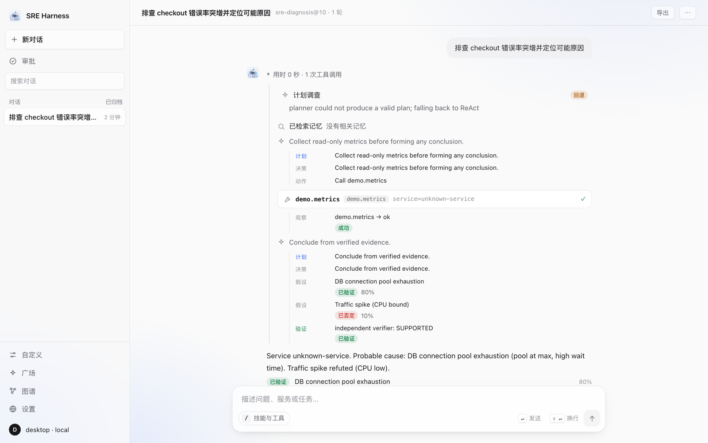
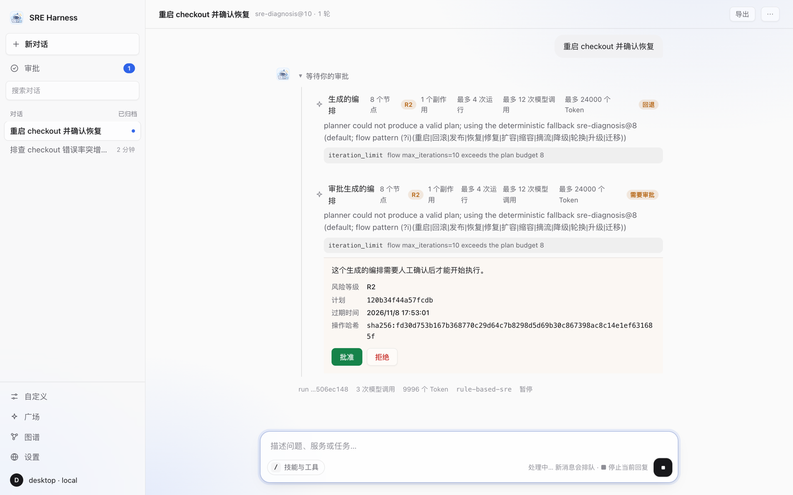
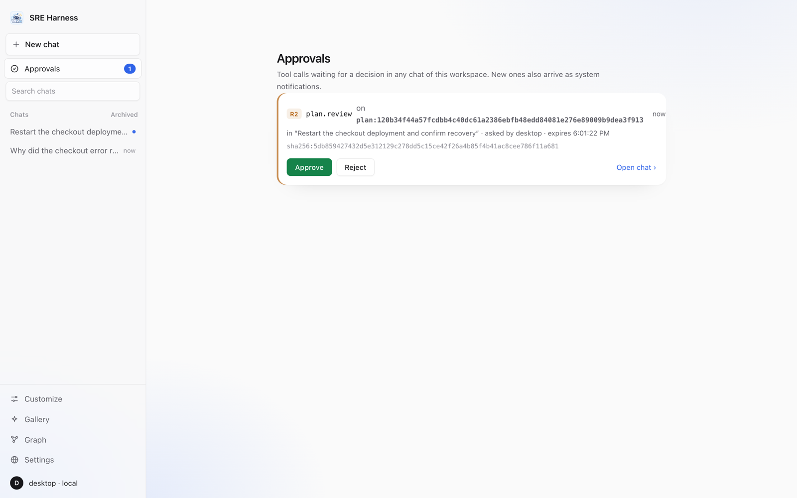
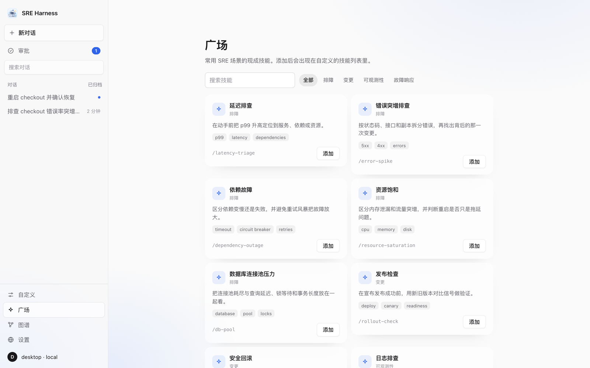
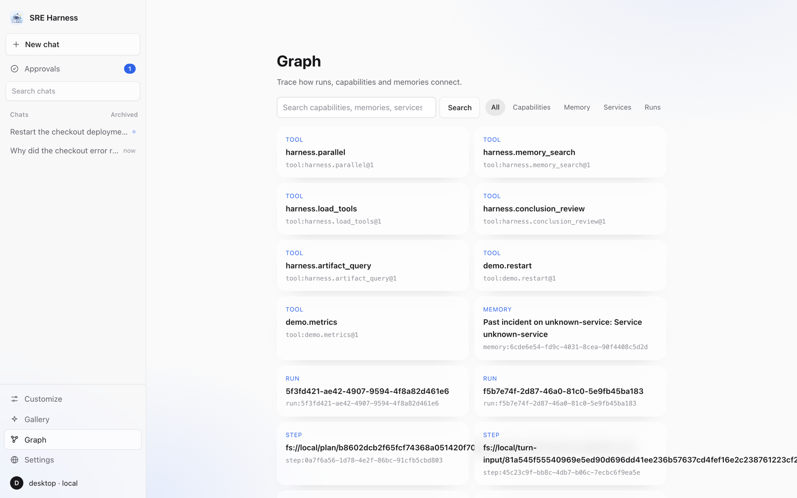

<div align="center">

# go-sre-harness

**English** | [简体中文](README.zh-CN.md)

A cognitive agent runtime for SRE: every reasoning step and tool call runs as a recoverable, auditable distributed transaction.



[Desktop client](#desktop-client) · [Quick start](#quick-start) · [Architecture](#architecture) · [Agent runtime](#agent-runtime) · [Memory](#memory) · [Reasoning quality](#reasoning-quality) · [Triggers & policy](#triggers-policy-rules-and-the-action-loop) · [Deployment](#deployment) · [Configuration](#configuration) · [API](#api)

</div>

## Highlights

- **The database is the only truth; push is an accelerator.** Disconnects, dropped messages and replica failures cannot make state inconsistent.
- **Side effects cannot be duplicated.** Approvals bind an action hash and are re-checked before execution; an unknown outcome goes to a human instead of being retried.
- **Plugins can only tighten, never relax.** The policy floor, risk-class source, trust rules and audit are enforced by the framework.
- **The full path runs without an API key.** The built-in scripted model exercises the ledger, prompt manifest, streaming and tool validation.
- **The evolution loop is complete.** Freeze a dataset → replay offline → gate → human approval → canary → automatic rollback.

## Core capabilities

| Area | Capability |
|---|---|
| **Durable execution** | Run/Step/Attempt state machine, step-level leases + fence tokens, resume after a crash; side-effect results are recorded before the step commit, so a lost commit never turns a known outcome into a human escalation |
| **Safe execution** | R0–R3 risk classes, approvals bound to `action_hash`, single-use grants, side-effect ledger; unknown outcomes go to `NEEDS_HUMAN` and are never replayed |
| **Conversations** | Session / Turn / Branch, single-writer queue, branch fork, replayable messages and events |
| **Model gateway** | Alias → hard filters → soft-score routing, circuit breakers, budget and concurrency admission, fallback only while "not yet sent"; Claude, OpenAI-compatible and Gemini |
| **Context & intent** | Prompt manifest (per-section hashes), deterministic compaction; each message is classified as a question, a task or a clarification |
| **Long-term memory** | Full-text + vector + dependency-graph recall, RRF fusion, poisoning checks and conflict resolution |
| **Orchestration DSL** | A profile-embedded flow graph: conditions/loops, parallel child runs, variable interpolation, approvals/human input, subflows and multi-agent |
| **Web** | `web.fetch` works out of the box; `web.search` supports Brave / Tavily / Bing / a generic backend, with output treated as untrusted |
| **Evaluation & evolution** | Datasets recorded from real runs, offline replay, non-inferiority gate, canary with automatic rollback |
| **Event delivery** | Committed event → event log → relay → JetStream → SSE; reconnects resume from the cursor, with no steady-state database reads |
| **Plugins** | Everything is replaceable except the state machine, leases, transactional commit, outbox and core routes |

## Desktop client

[`desktop/`](desktop/README.md) is a native Wails client. It starts in **Local runtime** mode: the app launches a bundled SQLite-backed harness core, commits execution events and runtime state together in SQLite. No Docker, PostgreSQL, NATS or terminal is needed. Switch to **Team server** to use a shared harness. Sessions, streamed reasoning, tool-call cards, inline approvals, an approval inbox, a Works view for continuous v2 Works, and model / MCP / HTTP tool / skill management are the same in both modes; local mode implements the same `/v1/extensions`, command, checkpoint/fork, memory, graph and evaluation APIs. Commands are version-guarded and idempotent across restarts, cancelling a flow cascades to child runs, and compaction summaries, memory hits, checkpoints and step output revisions are persisted in the local store.

```bash
desktop/build.sh run
```

### Screenshots

All screenshots are the local runtime with no model configured (the rule-based strategy).

<table>
<tr>
<td width="50%" valign="top"><br><b>Inline approval</b> — a generated plan with side effects waits for review: risk class, plan hash, expiry and action hash</td>
<td width="50%" valign="top"><br><b>Approvals inbox</b> — pending approvals from every chat, with a badge and system notifications</td>
</tr>
<tr>
<td width="50%" valign="top"><br><b>Gallery</b> — ready-made SRE skills (latency, error spikes, dependencies, rollouts…) added with one click</td>
<td width="50%" valign="top"><br><b>Graph</b> — search the links between runs, steps, tools, memories and services</td>
</tr>
</table>

### Answer cards

The final answer is shown as a card, not plain text, in both modes:

- **Markdown**: headings, lists, code blocks, GFM tables, math (KaTeX) and mermaid diagrams. Raw HTML is never rendered (it shows as text). Links open in the system browser through `OpenURL`, which accepts only `http`, `https` and `mailto`. `javascript:`, `file:` and other schemes are not linked or opened, and links to files (`.pdf`, `.csv`, `.json`, …) get a type badge.
- **Structured attachments**: `submit_conclusion` takes an optional `attachments` list of `{type: table|image|link|file, title, caption, url | ref, mime_type, columns, rows}`. The kernel validates the list before it reaches the run result (`result.attachments`). URLs must be absolute `http(s)` with no credentials. A `ref` must name an offloaded tool output of the same tenant (`obs:step<N>` resolves to its handle). Text and tables are capped (12 attachments, 20 columns × 200 rows), and anything else is dropped. Conclusions without attachments are unchanged.
- **Client rendering**: a table becomes a scrollable card with *Copy CSV*. An image from a URL loads lazily with no referrer, and a stored image (PNG, JPEG, GIF or WebP only, never SVG) is fetched by the Go side and shown inline. A link becomes a tile with its host, and a file becomes a tile with name, type and size plus *Open* (URL) or *Download* (stored output, saved through a save dialog). The WebView never holds the API token. Exported chats include the attachments.
- **API consumers**: attachments arrive in `GET /v1/runs/{id}` (`result.attachments`) and in session messages (the assistant message's content is the result artifact). `GET /v1/runs/{id}/attachments/{index}` (viewer) serves a stored attachment of that run's result. It serves only refs the kernel accepted, at most 32 MiB, with `nosniff` and a sandbox CSP, and always as a download except for an inline raster image.

## Quick start

**One command, no database** (single user, SQLite, loopback only):

```bash
go run ./cmd/harness local
```

It creates its data directory and a private token on first run, prints how to call the API, and uses the built-in rule-based model unless `ANTHROPIC_API_KEY`, `GEMINI_API_KEY` or `HARNESS_OPENAI_BASE_URL` is set. `web.fetch` is available by default (`HARNESS_LOCAL_WEB=off` removes it); `HARNESS_LOCAL_PROMETHEUS_URL` adds read-only `prom.query` / `prom.alerts`. Flags: `-data DIR`, `-addr HOST:PORT`. A non-loopback address is refused unless `HARNESS_LOCAL_ALLOW_REMOTE=true`.

Day-to-day commands for local mode:

| Command | What it does |
|---|---|
| `harness local init` | Choose a model provider, test the key with a read-only call (no tokens spent) and save it to `<data>/local.env` (mode 0600). The real environment always overrides the file. |
| `harness chat` | Interactive chat in the terminal with inline approvals (`/approvals`, `/approve N`, `/resume`, `--yes`). Works against a team server too (`-server`, `-token`). |
| `harness memory list \| set KEY VALUE \| rm KEY` | View and edit the personal memory the agent keeps about you (the desktop app has the same in its **Memory** view). |
| `harness memory review \| show ID \| approve ID \| reject ID [REASON] \| archive ID` | Review what the agent proposes to remember (CANDIDATE memories). **Only approved (ACTIVE) memories reach later runs**, so without review the agent's learning never takes effect. `review` shows what each proposal would replace; IDs may be shortened to a unique prefix. The desktop **Memory → Learned by the agent** tab does the same, with edit-then-approve and a pending-count badge. |
| `harness memory curate \| suggestions \| apply ID \| dismiss ID` | Look for memories worth setting aside and review the suggestions (see *Memory curation*). `apply` sets them aside as STALE (out of retrieval, restorable with `memory approve ID`); `dismiss` keeps them and the same finding is not raised again. |
| `harness compact-eval [-runs N]` | Measures what a compactor keeps from fixed investigation histories: key-fact recall, what the model is shown, citations, injection leakage. With no model configured it measures only the deterministic baseline and says the model-backed one was not run. |
| `harness local doctor` | Checks the data directory, token, database integrity and schema, port, disk use, model keys and Prometheus. Exits 1 on a failure. |
| `harness local backup [-out F]` | Consistent backup while running (database snapshot, event logs, artifacts). Tokens and API keys are never included. |
| `harness local restore FILE` | Restores a backup; the previous data directory is kept as `<dir>.before-restore-<time>`. Credentials stay with the installation. |
| `harness local prune [-older-than 30d] [-yes]` | Deletes old replay-only artifacts (full prompts, raw model responses, manifests). Results, steps, tool output, memories and event logs are kept. Dry run unless `-yes`. |
| `harness version` | Build version. |

Only one harness may use a data directory at a time (a lock refuses the second). The database records its schema version: an upgrade first copies the file to `harness.db.v<N>.bak`, and a database written by a newer harness is refused instead of being modified. With a real model configured, long investigations are compacted by a model-written summary (`HARNESS_LOCAL_LLM_COMPACT=off` keeps the deterministic one): citations (`obs:stepN`) are preserved, tool output is passed as data, and any model failure falls back to the deterministic summary. The kernel still appends the denied/failed/executed-action facts itself. The model is shown a *salient* excerpt of each long output (unusual lines and failure vocabulary, plus head and tail) rather than its first bytes, so a decisive line buried in a log still reaches it.

**Releases.** Pushing a `v*` tag publishes the command-line binary for linux/darwin/windows and the desktop app (macOS `.dmg`/`.zip`, Linux `.tar.gz`, Windows `.zip`) with `SHA256SUMS.txt`. The macOS app is ad-hoc signed, not notarized, and the Windows build is unsigned, so the OS asks for confirmation on first launch. Build locally with `desktop/build.sh && desktop/package.sh` (`DESKTOP_VERSION=v1.2.3` sets the version).

**Team server** (PostgreSQL, multi-tenant). Requires Go 1.26+ and PostgreSQL 14+; NATS is optional.

```bash
createdb harness
HARNESS_DATABASE_URL=postgres://localhost/harness go run ./cmd/harness all
```

With a model:

```bash
ANTHROPIC_API_KEY=sk-ant-... HARNESS_DATABASE_URL=postgres://localhost/harness go run ./cmd/harness all
```

Demo (create a run → R2 approval → SSE → conclusion):

```bash
scripts/demo.sh "remediate high latency service=checkout"
```

The default `dev` authentication mode only listens on loopback addresses.

## Architecture

```
clients (web / desktop)
   │ REST + SSE
internal/api ── extensions: memory / eval / extensions
   │
internal/kernel ── Durable Step Engine
   ├─ cognitive  intent analysis, context assembly, prompt manifest, strategies
   ├─ gateway    routing, circuit breakers, budget, request/usage ledger
   ├─ tools      MCP / gRPC / Kubernetes / Prometheus / HTTP
   └─ policy     risk gate and approvals
   │
PostgreSQL (source of truth)  +  NATS JetStream (wake-ups and event delivery)
```

- **Claim in a short transaction → execute outside it → commit with the fence**: a worker that lost its lease discards its result, so stale workers cannot overwrite new state.
- **Gap-free event log + transactional outbox**: state, events and wake-ups commit together; the reconciler recovers anything stuck.
- **Event plane**: a leased relay tails the event log, JetStream fans events out per run, and the SSE gateway reads the log once before streaming live updates.
- **The kernel depends only on interfaces**: it never imports PostgreSQL, NATS or a model SDK, so adapters are replaceable and testable.

The Work control plane owns long-lived goals; the same kernel owns their Runs, Steps and Attempts. Work-owned Runs, including flow descendants, investigate through read-only tools. Production changes go through the Action runtime, which binds policy, approval and dispatch to the current Work generation. Run reservation, owner linking and activation retain separate durable recovery boundaries.

Templates may set `repeat_from` to a wait stage. After the machine goal passes its observation window, the control plane atomically records the completed generation's Outcome, increments the generation and installs the next wait. Lifetime Run, Action and cost budgets remain cumulative. `inference-continuous` supplies this pattern for inference TTFT events; each new generation needs its own approval. Unknown effects use read-only inspection and fall back to manual recovery rather than redispatch. The automated WorkBench scenario is in `internal/workbench/testdata/sglang-continuous.json`; it uses scripted metrics and an isolated executor, not a live serving cluster.

The opt-in `inference-incident-v2` template runs a required mitigation child and an optional, read-only RCA child concurrently. It requires a caller-supplied machine recovery goal; mitigation inherits it explicitly through `inherit_success`, while the parent independently verifies the same goal. An inconclusive RCA can remain open after recovery. The existing incident route is unchanged. Cross-child report aggregation and a complete orthogonal Incident status projection are not yet implemented.

Decision adjudicator v3 canonicalizes inputs and revalidates current ledger evidence before API, scorecard and postmortem consumption. Historical v2 decisions remain replayable but require re-adjudication to become current. Pause scheduling and decision writes, drain older workers, upgrade consumers and workers together, then resume; a v2 binary cannot interpret newly written v3 decisions. A binary rollback therefore requires stopping v3 writers and retaining v3 readers for their records, not merely reverting the executable. No SQL migration is required for these additive fields. Pause repeating Works before rolling back to a binary that does not understand `repeat_from`.

### Orchestration DSL

A profile can set `strategy: "flow"` and embed a `flow` graph. The DSL compiles to the existing step engine: the parent run only coordinates, while agent / tool / subflow nodes become child runs, so leases, fences, approvals, the effect ledger and checkpoint recovery are reused. Parallelism is carried by child runs and joined by a `join` node; a child inherits the parent profile and can only narrow its tools and permissions.

```yaml
strategy: flow
tools: [demo.metrics, demo.restart]
max_steps: 40
flow:
  version: 1
  entry: triage
  limits: {max_steps: 20, max_children: 4, max_total_runs: 8, max_depth: 2}
  nodes:
    - id: triage
      type: agent
      role: triage
      tools: [demo.metrics]
      next: [{to: finish}]
    - id: finish
      type: end
      output: "${nodes.triage.output}"
```

Node types: `agent` / `tool` / `subflow` / `parallel` / `join` / `approval` / `input` / `loop` / `end`. `GET /v1/runs/{id}/flow` returns node and child-run state; the `provide_input` command answers an `input` node. Built-in examples: `sre-diagnosis@8` (parallel diagnosis + approval) and `@9` (human input + subflow).

### Generated plans

The desktop client does not ask you to choose a profile. An auto session starts with a durable **plan step**: the planner LLM submits a flow DSL through `submit_flow`; the server compiles it, runs a static safety/budget analysis, repairs malformed plans, and pins the plan as an artifact. A generated plan with side effects (or an R2/R3 tool) gets a **plan review** step whose approval binds the plan hash; changing the graph, inputs or tool set invalidates the approval. Only then is the flow step appended. If the model cannot produce a valid plan, the runtime falls back to the configured runbook (default `sre-diagnosis@8`) or ReAct. Generated plans, flow nodes, child runs, approvals and input gates are rendered in the conversation.

The planner treats its own inputs as untrusted: the goal, session history, capability lines and a failed attempt's node outputs are enclosed in `<<<DATA>>>` boundaries with chat-template tokens neutralized, and tool descriptions (which come from plugins and tenant MCP servers) that look like injected instructions are withheld from both the prompt and the tool schemas. Any such finding is recorded on the plan and forces a plan review of a generated flow, even with `HARNESS_PLAN_APPROVAL=never`. When a generated flow fails, the run is not failed straight away: up to `HARNESS_PLAN_MAX_REPLANS` times the planner is called again with the failure, the nodes that ran and the side effects that completed, and the new plan runs as a new flow generation (fresh state and child runs; the failed generation stays for audit, and its approvals do not carry over because the plan hash binds the generation).

Plans improve from earlier runs. A run that completes on a model-generated flow (not a fallback, no injection flag, not rejected, not disputed, not marked wrong) is distilled into a *plan exemplar* memory (scoped to the service, deduplicated by content) that follows the normal memory lifecycle; the planner is shown the closest ACTIVE exemplars and reasoning patterns for the goal and services, as untrusted data. Each run records plan metrics (repairs, fallback, replans, review requested/rejected, injection, cache hit), and the canary and candidate gates compare fallback, repair, replan, rejection, success and injection rates against the baseline. Routing tries a hint, the requested mode and named actions, then the regex lists, then a classifier (an n-gram kNN over labelled example goals by default, or an embedding classifier; set `ClassifierFirst` to consult it before the regexes). Every generated or fallback flow is dry-run with simulated successful children before approval: a flow that cannot complete its default path within its own limits is repaired, and side-effect nodes reached without a prior approval are flagged. The plan review carries a readable summary, ordered steps, risks, the dry-run path, and a diff against the previous generation (replan) or the fallback runbook. Agent nodes without pinned tools are pinned to the read-only tools so their risk is not assumed to be the highest. Token estimates use a typical output size, with the worst case reported alongside. Plans without replan or injection flags are cached per tenant and inputs, and a cache hit is re-validated against the current tool catalog. A profile's `planner` section can tighten (never loosen) these settings per tenant: model alias or ladder, approval mode, node/call/token/repair/replan limits, and fallback rules by service or goal pattern.

## Agent runtime

How a single agent run stays bounded, fast and contained.

### Agent loop safeguards

- **Run budget**: the kernel reads the run's model usage before each reasoning step. At 80% of `HARNESS_RUN_MAX_COST_USD` / `HARNESS_RUN_MAX_TOKENS` (or the profile's tighter `run_limits.max_cost_usd` / `max_tokens`) the model gets a `[kernel notice]` and a conclude-now instruction; at 100% the kernel writes the final answer itself (`stopped` in the result: the hypotheses and last tool results so far, marked UNVERIFIED) and skips the review, so a looping run cannot spend past its limit.
- **Parallel read-only calls**: when one response asks for several tools, the extra calls run together with the first in a kernel-owned `harness.parallel` step (hidden from the model, refused if it calls it) when each is registered, visible, allowed without approval, read-only and not a repeat; at most `max_parallel_tools`. Each call becomes its own observation (`obs:step<N>.<K>`), and a call that fails or changed since planning fails alone. Calls left out (side effects, approval needed, duplicates) are listed in the step summary as `deferred_not_run`; side-effecting calls always go one at a time through the approval gate.
- **Tool errors as observations**: a read-only call that fails permanently (bad arguments, missing resource, permission) becomes an `outcome=error` observation the agent can adapt to instead of failing the run; transient (retryable) errors still retry the step, and side-effecting calls keep the unknown-effect handling.
- **Repair feedback**: an unusable response (no parseable tool call, schema-invalid arguments, an invalid decision, an unknown tool) is sent back to the model as a `[correction]` naming the problem (and the available tools) up to twice per attempt before the step retries; repairs are recorded in the step summary.
- **Loop and stall guard**: an identical call (tool and canonical arguments) that already ran `max_repeats` times, or that was denied, rejected or expired, is not run again: it is recorded as a skipped step whose reason points to the earlier result. After `stall_steps` tool results without new content (repeats, errors, identical output) the agent is told to change approach; after twice that, a further tool call is replaced by a kernel conclusion.
- Profiles set these per agent under `run_limits` (`max_cost_usd`, `max_tokens`, `max_repeats`, `stall_steps`, `max_parallel_tools`); they can only tighten the process settings.

### Agent loop performance

- **Context rebuild**: each reasoning step rebuilds its context from the run history, which keeps retries deterministic. Artifacts are immutable, so the worker caches the ones it writes and reads (LRU, `HARNESS_ARTIFACT_CACHE_BYTES`); a step reads only what is new. Steps of a run already chain inside one worker (up to 20 before handing back to the queue).
- **Prompt cache**: the history section only grows between steps, so the request marks a cache breakpoint at its end (in addition to the system/tool prefix); the ledger, notices and instruction follow it. Providers with automatic prefix caching ignore the marker.
- **Tool selection**: with more than `HARNESS_TOOL_TOP_K` visible tools the model sees a stable subset per run — tools used or loaded in the run, builtins, tools named in the request, then the best word matches with the request — and a `[more tools]` list of the rest, which it loads with `harness.load_tools`. The choice does not change from step to step, so the cached prefix stays valid; any visible tool is still accepted.
- **Model routing**: with `HARNESS_MODEL_ROUTINE_ALIAS` / `HARNESS_MODEL_ESCALATED_ALIAS` the first analysis, likely or forced conclusions, stalls, the step after a rejected conclusion and repairs use the escalated alias, the other steps the routine one (`model_tier` in the step summary). A flow node's own alias takes precedence.
- **Adaptive stop**: when the ledger settles (a VERIFIED hypothesis at ≥ 0.8 and no competing hypothesis open) the agent is advised to conclude, before the step budget or the stall guard would intervene.
- **Token-budget compaction**: besides every N tool steps, history is compacted when the uncompacted results exceed `HARNESS_COMPACT_TOKENS` (then all but the newest result are folded). The default compactor (`deterministic-v2`) writes one line per result led by its citable ref and renders large JSON objects as their top-level fields; compacted refs, including batch parts, stay citable.
- **Speculative read-only calls** (`HARNESS_SPECULATIVE_TOOLS`): as each tool call completes in the model's stream, a call that is visible, read-only, allowed without approval and not a repeat starts at once; the tool step that runs the same call (same version, risk and arguments) takes the result. Unused results expire after two minutes; side-effecting calls are never started early.
- **Observability**: every step summary carries `timings_ms` (queue, context, model, review, tool), exported as `harness_step_phase_seconds{kind,phase}` together with commit time; `harness_agent_loop_events_total{event}` counts repairs, loop guards, notices, batches, convergence, routing, compaction, speculation and artifact-cache hits. The run result carries `loop` (steps, model requests, tokens, cost).

### Sandbox

`harness.sandbox.exec` runs a command (`command` for `sh -c`, or `argv`) in the run's sandbox: input `files` are written into `/workspace`, which persists across the run's calls and is never shared with another run or tenant, and the listed `outputs` are returned with exit code, stdout and stderr. It is for computing over data the agent already has; production changes still go through typed tools and approval.

- **Safety floor**: no harness environment or credentials (only variables the request sets), network `none`, read-only root file system, non-root user, all capabilities dropped, `no-new-privileges`, CPU / memory / process / time / output limits. Workspace files are read and written through `os.Root`, so a symlink planted by the command cannot reach host files. Results are untrusted (T4) and the tool is R0, so it needs no approval; it is never started speculatively.
- **Backends** (`sandbox` plugin kind): `container` runs a fresh docker or podman container per call (`extra_args: [--runtime=runsc]` for gVisor). The server enables it with `sandbox: {name: container, config: {...}}` (see `deploy/harness.example.yaml`); the desktop runtime with `HARNESS_SANDBOX_RUNTIME=docker|podman` and optional `HARNESS_SANDBOX_IMAGE` (default `python:3.12-alpine`). Workspaces untouched for `workspace_ttl` (24h) are removed. When the harness itself runs in a container, `root` must be a path the container daemon can mount.
- **MCP stdio servers** no longer inherit the harness environment: they get basic variables (`PATH`, `HOME`, locale, temp directory) plus their configured `env`; a bare `KEY` in an operator's config passes that variable through, which tenant-installed servers cannot do.

## Memory

What the agent remembers, for how long, and how memories are kept current.

### Memory tiers

| Tier | Lifetime | What it holds | Written by |
|---|---|---|---|
| Working | one run | the agent's notes: established facts, constraints, what is left to check; plus the hypothesis ledger | `notes` with scope `run` |
| Short-term | one conversation (branch) | the last `HARNESS_SHORT_TERM_MESSAGES` messages verbatim, a digest of older turns, and session notes | `notes` with scope `session` |
| Long-term | the tenant | incidents, remediations, reasoning patterns, plan exemplars, proposed facts (organization / service / incident scopes) | the consolidator, operators, `notes` with scope `long_term` (as CANDIDATE) |
| Personal | one user | stable preferences of the user who started the run (language, format, defaults) | `notes` with scope `user`, or the user via `/v1/me/memories` |

- **Notes**: the agent writes memory in its `THOUGHT` line or its conclusion as `"notes":[{"key","value","scope"}]`; writing a key again updates it, an empty value deletes it. The kernel rebuilds notes from the stored decisions, so they survive retries and compaction, and renders them in a `[working memory]` section inside a data boundary. A tier holds at most 24 notes of 500 characters.
- **Short-term**: the session notes after a run are stored in its result (`memory.session`); the next turn on the same branch starts from the latest completed turn's notes, so a forked branch sees only its own history.
- **Personal**: when a user-started run completes, its `user` notes create, reinforce, revise (new version) or archive that user's memory for each key (`pref:<key>`, ACTIVE, `restricted`). Personal memory is pinned with the run's retrieved memories and rendered in an `[about the user]` section for that user's runs only; shared retrieval, `harness.memory_search` and other users never see it (admins can list it). Instruction-like text is rejected, and a preference never authorizes an action. Users manage theirs with `GET /v1/me/memories`, `PUT|DELETE /v1/me/memories/{key}`.
- **Long-term from the agent**: `long_term` notes of a completed, undisputed run become CANDIDATE memories (VALIDATING when feedback verified the run) with subject `note:<key>`, reviewed like any other.

### Updating memory

- **Reinforcement instead of duplicates**: writing the same content again in the same scope, or a near-identical memory with the same subject (embedding cosine ≥ 0.95, or token overlap ≥ 0.85 without a comparable embedding) that is at least as validated, counts a reinforcement on the existing memory (`reinforcements`, `last_reinforced_at`, merged `source_refs`) when it comes from a new source. Reinforced memories rank slightly higher (up to ×1.3).
- **Revisions**: `PATCH /v1/memories/{id}` (approver; `expected_version`, `title` and/or `content`, `reason`) writes a new version: redacted and poison-checked like a new memory, re-embedded and re-indexed, audited, the status unchanged. Earlier versions stay in `agent_memory_versions`, so citations pinned to them still resolve; a revision that would duplicate another memory's content is rejected.
- **Supersession** (activating a memory retires ACTIVE ones with the same subject and scope), **lifecycle transitions**, feedback and retention work as before. Consolidation is idempotent: a re-run after feedback does not reinforce or revise twice.

### Memory curation

Long-term memory rots: duplicates pile up, facts change, lessons get refuted, entries go unused. The curator (`internal/curate`) is an offline pass in the spirit of "dreaming", built to be safe in operations:

- **It only proposes.** A suggestion says which memories to set aside and why; an approver applies or dismisses it (`POST /v1/memory/curation/{id}/decide`, approver role). Nothing changes before that. Applying sets the memories STALE (out of retrieval) and is reversible; if a memory in a suggestion was edited after it was made, applying fails with `proposal_outdated` and changes nothing.
- **It writes no text.** It never drafts, merges or rewrites a memory, so a poisoned run cannot get its words into memory through this path.
- **Evidence is the run record.** Signals, strongest first: `refuted_by_history` (at least 2 later runs about the same service whose independent verification was SUPPORTED refuted the lesson, none confirmed it; runs without a SUPPORTED verdict do not count), `superseded_fact` (same scope and wording, different figures, a newer memory), `duplicate` (token similarity ≥ 85% in one scope; the better-validated, more recent one stays), `unused` (not created, changed, reinforced or retrieved for 90 days). A memory appears in its strongest finding only. Personal memory is never examined.
- **Idempotent.** A finding is keyed by signal and exact memory versions: it is proposed once, and a dismissed one returns only when a memory in it changes. One pass is capped at 50 proposals.
- **Triggering.** `POST /v1/memory/curation/run` (operator), `harness memory curate`, the desktop **Memory → Learned by the agent → Check memories now**, and, in local mode, a pass one minute after start and then every `HARNESS_CURATE_INTERVAL` (default 24h; `off` disables). The team server has no tenant scheduler, so it runs on demand. Proposals live in `memory_curation_proposals` (migration 0032, row-level security; JSON objects in the local store).

### Memory search

Pinned memories and historical `harness.memory_search` results are checked again before model context assembly: tenant, current version, lifecycle, expiry, environment and data class must still permit recall. Personal pins additionally require the Run's user owner. Original artifacts remain immutable audit records. This filtering does not yet retract memory-derived free text from older compaction summaries or notes.

- **Past-run search**: `harness.run_search` (R0, `query`, optional `service`, `status`, `limit` ≤ 10) searches finished runs — what was asked, the conclusion and the hypotheses — so an agent can find how an earlier investigation ended even if nobody promoted it to a memory. It sees the caller's own chats and non-user runs (triggers, schedules, Works), never another user's chats, skips child runs of a flow and the calling run itself, redacts secrets, and labels results as history rather than evidence. It scans the most recent finished runs (300 by default, 6 s budget) with cached text and says when it was cut short; a database full-text index would lift the bound.

- **Search during the run**: the first reasoning step sees the memories retrieved for the goal. `harness.memory_search` (R0, `query`, optional `service` and `top_k` ≤ 10) runs the same pipeline (hard filters, full-text, vector and dependency branches, RRF, trust and profile exclusions, conflict resolution) with what the agent has learned since: a hypothesis, an error message, a component. Hits are returned as past experience to verify, with their `memory:<id>@<v>` refs; those refs are citable and reach the independent verifier as memory evidence. The stall notice suggests a search when the tool is visible.
- **Model embeddings**: the `http` embedder calls any OpenAI-compatible `/embeddings` endpoint (`base_url`, `model`, `api_key_env`, `dimensions`, `timeout`) with a small query cache; when it fails, retrieval runs without its vector branch. Vectors are only compared within one embedding model, so after a switch the consolidator's indexer (`index`, default on; `index_batch`, default 50) re-embeds live memories, active ones first, a batch per tick.
- **Chinese, Japanese and Korean text**: tokenization turns CJK runs into overlapping character bigrams, so full-text search (Postgres stores them in `search_terms`, part of `search_tsv`), the local store's matching and the hashing embedder (`hash-uni-bigram-v2`) find CJK fragments without a word segmenter. The indexer fills in terms for memories written before migration 0018.

## Reasoning quality

The agent's explicit decision trace (plan, hypotheses with confidence, verification) is scored, reused and improved. Provider-hidden reasoning is never read. Design: `docs/superpowers/specs/2026-11-07-reasoning-quality-and-self-improvement-design.md`.

- **Measure**: every finished run is scored by the consolidator (and rescored when feedback arrives). The score covers calibration (Brier score of hypotheses that ended VERIFIED/REFUTED), evidence grounding, redundant tool calls, steps to the first verdict, the conclusion verdict and a composite quality. Offline replays are scored the same way, and the release gate fails a candidate whose calibration, grounding, redundancy or quality regresses on the holdout split.
- **Citation check**: every observation header carries its ref (`obs:step<N>`), as do evidence (`kv:<key>@<v>`) and memories (`memory:<id>@<v>`). The kernel resolves each citation in `supports`, `refutes` and `evidence_refs` against what that request showed the model (aliases such as `obs:4`, `obs:<tool>` or an offload handle map to the canonical form). A citation that names nothing shown is stored as `unresolved:<text>` and does not count as grounding. A hypothesis settled without a resolved citation is an unsupported verdict, and a VERIFIED conclusion where neither the verification nor any verified hypothesis cites a resolved item is self-declared: it is scored and counted as unverified, does not count as success and is not distilled. Citation validity and the unsupported-verdict and unsupported-conclusion rates are summarized, gated in releases and canaries, and drive a `citation` playbook hint in the improvement loop.
- **Independent verification and backtracking**: a final task conclusion is checked by a verifier that did not write it. A rule layer (always on) requires every VERIFIED/REFUTED claim to cite evidence that exists, does not accept a failed tool call or a memory alone as evidence, and requires a VERIFIED conclusion to have at least one supported verified claim; an optional model judge (`HARNESS_VERIFIER_MODEL_ALIAS`, its own prompt, no agent history) decides per claim whether the cited evidence supports, contradicts or does not settle it. A conclusion that is not SUPPORTED is handed back to the agent through a kernel-owned `harness.conclusion_review` step (hidden from the model, refused when the model calls it) up to `HARNESS_REASONING_MAX_BACKTRACKS` times; its hypotheses show as CHALLENGED in the ledger. Otherwise the run completes with the report in `independent_verification`, and an unaccepted answer is marked as such. Scoring takes the independent verdict over the agent's own: a contradicted or insufficient conclusion is not a success and is not distilled.
- **Multiple hypotheses and self-consistency**: while investigating, the agent lists its competing hypotheses (id, status, probability) in the THOUGHT line; the kernel rebuilds a hypothesis ledger from the run's decisions and shows it every step, so the agent discriminates between open hypotheses and returns to the next one when the first is refuted. With `HARNESS_REASONING_SAMPLES` > 1 a final task conclusion is sampled that many times and the largest cluster of agreeing conclusions wins; agreement below `HARNESS_REASONING_MIN_AGREEMENT` counts as insufficient and triggers the review.
- **Post-hoc calibration**: each run records its hypotheses' first stated confidence and how they settled (the independent verdict decides when there is one). An isotonic calibrator per tenant profile is fitted from recent runs (independently judged forecasts preferred); the kernel stores the calibrated confidence next to the stated one, shows the model how often its stated confidences held, and the summary reports ECE and the calibrated Brier score; a rising ECE or contradiction rate fails the gate.
- **Induced playbook**: with `inducer_model_alias` on the `reasoning_improver` job, the improver shows a model the digests of the weakest runs (hypotheses and how they settled, tools, verifier objections; no raw tool output) and asks for general guidance lines. Lines that name resources or runs, look like instructions, weaken approvals, review, verification or trust rules, or repeat existing lines are rejected; template guidance is the fallback. The candidate still goes through the holdout gate, approval by someone other than the proposer, and the canary.
- **Reuse**: completed, undisputed runs with a VERIFIED conclusion are distilled into *reasoning patterns*: procedural memories listing the hypotheses checked in order, their verdicts and the tools used until the first verdict. They follow the normal memory lifecycle (CANDIDATE → approval → ACTIVE), so an operator activates every pattern. Each memory's success rate and Wilson lower bound are measured from the runs that retrieved it.
- **Pattern effectiveness**: a pattern is judged against the baseline success rate of the same service (runs that did not see it), not an absolute rate. Explicit citations (`memory:<id>` in evidence or hypothesis refs) decide once there are enough of them. Patterns significantly and materially worse than the baseline are excluded. Excluded patterns are still shown to a small, deterministic share of runs (`reasoning.pattern_probe_rate`, at most 0.2) and are reinstated when those runs reach the baseline. Stale entries are pruned, and the list keeps the strongest cases when it hits its 500-entry limit. Operators can propose an exclusion or reinstatement by hand.
- **Trace structure**: hypotheses carry a stable `id` used for deduplication across rewording. Confidence coverage and the structured share are measured, gated and diagnosed; a settled hypothesis without a confidence counts as a 0.5 forecast.
- **Improve**: the `reasoning_improver` job (or `POST /v1/reasoning/improve`) diagnoses weak dimensions and underperforming ACTIVE patterns. It proposes a profile candidate that changes only `reasoning.playbook` (fixed, domain-free guidance; at most 2,000 characters, poison-checked, rendered before the trust rules) and `reasoning.patterns_excluded`. Runs behind holdout cases are excluded from the diagnosis. The candidate goes through the existing pipeline: holdout gate, approval by a human other than the proposer, canary with automatic rollback. The canary monitor also rolls back when the canary's reasoning regresses against the control group (default on, at least 20 scored runs per side). The loop never approves, canaries or promotes, and proposes one change at a time.
- **Retention**: reasoning scores are kept for `reasoning_retention` (default 90 days) by the `retention` job.
- **APIs**: `GET /v1/reasoning/summary`, `GET /v1/reasoning/runs/{run_id}`, `GET /v1/reasoning/patterns`, `POST /v1/reasoning/patterns/{memory_id}/exclude|reinstate` (operator), `POST /v1/reasoning/improve` (admin). The desktop runtime scores and distills the same way and improves only on demand.

## Triggers, policy rules and the action loop

- **Triggers** (`triggers:`): `POST /v1/triggers/{name}` turns webhooks (Alertmanager, Grafana, PagerDuty, CI, …) into runs. Items fan out, `filter` drops noise, `resolve` events only attach evidence. Duplicates within the dedup window are injected into the open run as evidence instead of starting a new one; deduplication is shared through the database, so replicas agree. Optional HMAC signatures (`X-Harness-Signature: sha256=…`) and per-trigger rate limits. `schedule:` triggers create one run per interval across scheduler replicas.
- **Rule-based policy** (`policy: {name: rules}`): matchers over tool, source, labels, risk, environment, target, arguments, time windows, rate and blast radius. The strictest matching rule decides; the framework floor always applies. The environment is resolved per call and bound into the action intent.
- **Time and environment context**: runs carry a pinned `now`, incident window, services and labels (`context` on `POST /v1/runs`, or rendered by a trigger). `context_provider` plugins add topology, ownership and recent changes once per run; facts are pinned for replay and rendered as untrusted data. Tools with `time_args` get the window filled in when the model leaves it out.
- **Verify and compensate** (`tool_overlays.<tool>.lifecycle`): after a side effect the kernel polls the verify tool until `expect` holds. A refuted action proposes the compensation, which always waits for approval.
- **Large outputs**: oversized tool results become a `tool-output` artifact plus a structured summary (log levels, time range, frequent templates; JSON shape and numeric stats). The model queries the rest with `harness.artifact_query` (head, tail, lines, grep, JSON path, time range).
- **Untrusted output**: every tool result, operator evidence block and compacted summary is enclosed in a content-derived `<<<DATA id=…>>>` boundary that the content cannot close; chat-template control tokens are neutralized and instruction-like text (the memory poisoning patterns) is flagged `injection_suspected` in the prompt, the observation and the prompt manifest. Content is never dropped, only marked. Compaction keeps offload handles, verification verdicts and these flags outside the excerpt limit.
- **Routing**: when planning fails, the goal-context hint, the model's requested mode, configured patterns and side-effecting tools named in the goal decide between the fallback flow and ReAct.

The desktop runtime reads the same sections (`policy`, `triggers`, `context_providers`, `tool_overlays`) from `harness.local.json` in its data directory, or from `HARNESS_LOCAL_CONFIG`.

## Continuous Works (v2 control plane)

Behind `HARNESS_WORK_ENGINE_ENABLED`, a **Work** is a durable goal that spans many runs: events are deduplicated and correlated into Works, durable watches wait for events and timers, actions are planned against a bitemporal world state, held for approval bound to an intent hash, dispatched ledger-first and never replayed blindly, and a Work only succeeds with a verified outcome (metrics, world state, events or a human). `HARNESS_EVENT_SHADOW_MODE` (default on) routes events without creating Works; `HARNESS_ACTION_V2_ENABLED` turns on actions. Templates and correlation rules live under `work:` in the config file (`harness.local.json` on the desktop); `work_extension` plugins add action executors and metric sources. Run `scripts/v2/demo.sh` for an offline end-to-end incident on the built-in simulator, or `scripts/v2/demo-pg.sh` for the same on `harness all` + PostgreSQL with change/alert correlation, idempotent replay, `kill -9` crash recovery and pod topology checks.

- **Queues and resource pools**: five scheduling queues (`critical-mitigation`, `incident-investigate`, `routine-work`, `batch-evaluation`, `background-improvement`), each with its own claim loop and concurrency, plus pools for model runs (per tenant, across replicas), production actions and world snapshots. A full pool defers a step instead of failing it; queues never relax approval or risk rules.
- **Bounds** (RFC §20.3): besides runs, replans, duration, agents and actions, a template caps the total model spend of a Work (`max_cost_usd`), its active watches (`max_watches`, default 8), its evidence (`max_evidence` 500 / `max_evidence_bytes` 4 MiB) and the correlated events per minute that reach it (`max_event_rate`, default 120: past it, events stay linked in the inbox but neither grow the timeline nor wake the Work). A step refused by a bound blocks the Work with the reason; hits are counted in `harness_work_limit_total{limit}`. Per-run tokens, cost and parallel read-only tools are bounded by the run profile; snapshot depth and size by the world service.
- **Evidence planning** (RFC §12.4): before a run or agents stage starts and the Work already has competing hypotheses, the framework ranks read-only checks by how well they separate them (discrimination × output trust × freshness, minus latency, cost and load) and puts the top checks in each run's goal; parallel agents get different checks. Only tools the run's profile shows, that are R0 after risk overrides, that the policy allows without approval and that fit the remaining budget can be planned; a run's `next_checks` suggestions only re-rank those. Plans are on the timeline (`work.evidence_planned`) and counted in `harness_evidence_plan_total`. Operators describe checks with tool labels `evidence.topics`, `evidence.latency`, `evidence.cost`, `evidence.load` and `evidence.exclude`; stages tune it with `evidence_plan: {max_checks, disabled}`; `HARNESS_EVIDENCE_PLANNING=false` turns it off.
- **Security**: roles `viewer`, `operator`, `approver`, `admin`, `service` (events only) and `break_glass` (never implied); per-principal scopes limit event sources/types, resources and the approvable risk. R3 is never allowed, R2 always needs an approval bound to the intent hash; denials, approvals and break-glass are audited.
- **Who sees what (team server)**: roles say what a caller may *do*; a second rule says whose data they may *see*. A user's chats and the runs behind them are theirs: other members of the tenant, operators included, get `404` (the same as a missing id) for their sessions, runs, events, streams, attachments and reasoning records, and the session and run lists contain only their own. Runs no user started (triggers, schedules, Works and their stages, system fan-out) are shared operational work and are stored with initiator `system`; a run of unrecognized origin is admin-only. Admins see everything. An approver can open a run that has an approval request and read the session of a pending approval, and sees every pending approval in the inbox, so they can judge what they approve; on that run they may issue only approval decisions (`approve_tool`, `reject_tool`, `resolve_unknown`, `override_result`) — cancel, pause, retry, fork, feedback and the rest stay with its owner (`403 approver_scope`). Other users see only the approvals on their own runs. In the provenance graph, run, step and thought nodes carry who started their run (migration 0033) and are shown only for shared runs and the caller's own; a node with no recognizable owner is hidden, as are other users' personal-memory titles and their shard. Works and the world/event APIs are shared by design (role-gated, tenant-wide) and have no route that links an existing private chat run into a Work. Create-idempotency keys are private to the caller. The local single-user runtime is unaffected (its token is an admin).
- **Domain plugins**: `sre` (Prometheus/Alertmanager, Kubernetes, OTel, GitOps/Argo CD, Istio traffic, CMDB, Jira, AI infra) and `sre-sim`; source-native webhooks at `POST /v1/sources/{source}/events`; external plugins use `pkg/sdk`.
- **Evaluation and learning**: per-Work scorecard and safety gates (`/evaluation`), ledger-based postmortems (`/postmortem`, Markdown or a review Work), `postmortem` and `follow-up` templates, playbook proposals (`/playbook`) and memories with applicability and verified-outcome promotion.
- **Work bench**: `harness work-bench run bench/cases` replays incidents deterministically with expectations and a baseline gate; `record`/`replay` turn a real Work into a case.
- **Observability**: Work, action, event, watch and world metrics, with a Grafana dashboard and alert rules in `deploy/observability/`.
- **Desktop**: a Works view with outcomes, scorecard, action approvals, hypotheses, timeline and postmortems.

Details: [docs/v2-control-plane.md](docs/v2-control-plane.md).

## Deployment

```bash
docker compose -f deploy/docker-compose.yml up --build
```

- Roles: `api` / `worker` / `scheduler`; `all` runs them in one process, multiple processes need NATS.
- Kubernetes manifests: `deploy/k8s/harness.yaml`.
- Full plugin and configuration example: `deploy/harness.example.yaml`.
- In production use a non-superuser database role, otherwise RLS has no effect.

## Configuration

| Variable | Purpose |
|---|---|
| `HARNESS_DATABASE_URL` | required |
| `HARNESS_NATS_URL` | cross-process wake-ups and event delivery |
| `HARNESS_CONFIG` | plugin config file (YAML/JSON) |
| `HARNESS_AUTH_MODE` | `dev` / `token` / `oidc` |
| `HARNESS_SSE_MODE` | `push` (default) / `poll` |
| `HARNESS_MODEL_DAILY_BUDGET_USD` | per-tenant daily budget |
| `HARNESS_REQUIRE_DISTINCT_APPROVER` | the approver cannot be the initiator |
| `HARNESS_AUTO_PROFILE` / `_VERSION` | run profile for auto sessions; defaults to `sre-diagnosis` / `10` |
| `HARNESS_PLANNER_MODEL_ALIAS` / `_EFFORT` | model and effort used by the planner |
| `HARNESS_PLANNER_FALLBACK_PROFILE` / `_VERSION` | runbook used when planning fails; defaults to `sre-diagnosis` / `8` |
| `HARNESS_PLANNER_MAX_REPAIRS` / `_MAX_NODES` | plan repair attempts and generated node limit |
| `HARNESS_PLAN_APPROVAL` | `auto` (default), `always` or `never`; `auto` reviews generated plans with writes |
| `HARNESS_PLAN_APPROVERS` | required plan approvals; R3 plans always require at least two |
| `HARNESS_PLAN_MAX_REPLANS` | times a failed generated flow is replaced by a new plan in the same run (default 1, negative disables); the new plan sees which nodes ran and which side effects completed, and runs as a new flow generation |
| `HARNESS_PLANNER_MAX_CHILDREN` / `_TOTAL_RUNS` / `_DEPTH` / `_ITERATIONS` | generated-graph fan-out limits |
| `HARNESS_PLANNER_MAX_MODEL_CALLS` / `_MAX_ESTIMATED_TOKENS` | static model-call and output-token ceilings |
| `HARNESS_OUTPUT_OFFLOAD_BYTES` | tool results above this size are stored and summarized; the model reads them with `harness.artifact_query` (default 24576, negative disables) |
| `HARNESS_CONTEXT_PROVIDER_TIMEOUT` / `HARNESS_CONTEXT_MAX_FACTS` | per-provider deadline and fact limit for environment facts |
| `HARNESS_PLANNER_REACT_PATTERNS` / `_FLOW_PATTERNS` | fallback routing patterns, `\|\|`-separated regexes; `none` disables a list |
| `HARNESS_PLANNER_ROUTER_EXAMPLES` | JSON file of `{"text","mode"}` examples replacing the built-in routing classifier examples |
| `HARNESS_PLANNER_FALLBACKS` | JSON list of `{"name","services","goal_pattern","profile_id","version"}` fallback rules tried before the default runbook |
| `HARNESS_PLANNER_MODEL_LADDER` | comma-separated model aliases: the first plans, each repair escalates to the next |
| `HARNESS_PLANNER_CACHE_TTL` / `_CACHE_SIZE` | plan cache lifetime (default `10m`, `0` disables) and entries (default 512) |
| `HARNESS_PLANNER_TYPICAL_OUTPUT_TOKENS` | per-call output used for the token estimate (default a quarter of the max; negative uses the worst case) |
| `HARNESS_PLANNER_AUTO_PIN` / `_DRY_RUN` | pin tool-less agent nodes to read-only tools; dry-run plans before approval (both default `true`) |
| `HARNESS_REASONING_VERIFY` | independent verification of final task conclusions (default `true`; the rule layer needs no model) |
| `HARNESS_VERIFIER_MODEL_ALIAS` / `_EFFORT` / `_TIMEOUT` | model judge for the verifier (empty: rules only), its effort and deadline (default `1m`) |
| `HARNESS_VERIFIER_MEMORY_IS_EVIDENCE` | let a memory alone support a VERIFIED claim (default `false`) |
| `HARNESS_REASONING_MAX_BACKTRACKS` | times an unaccepted conclusion is handed back to the agent (default 1, negative: never) |
| `HARNESS_REASONING_SAMPLES` / `_MIN_AGREEMENT` | self-consistency samples of a final conclusion (default 1: off) and the agreement it needs (default 0.6) |
| `HARNESS_REASONING_CALIBRATION` / `HARNESS_CALIBRATION_MIN_FORECASTS` | confidence calibration per profile (default `true`) and the forecasts needed to fit it (default 30) |
| `HARNESS_RUN_MAX_COST_USD` / `HARNESS_RUN_MAX_TOKENS` | per-run model spend limit (default 0: off); from 80% the agent is told to conclude, at 100% the kernel concludes for it without another model call. A profile's `run_limits` can only tighten them |
| `HARNESS_LOOP_MAX_REPEATS` / `HARNESS_LOOP_STALL_STEPS` | how often an identical call may run again (default 1, negative: unlimited) and how many tool results without new content trigger the stall notice (default 4; twice that forces a conclusion; negative: off) |
| `HARNESS_MAX_PARALLEL_TOOLS` | read-only calls of one model response that run together (default 4; 1: one call per step) |
| `HARNESS_ARTIFACT_CACHE_BYTES` | worker cache of immutable artifacts used to rebuild the agent context (default 64 MiB; negative: off) |
| `HARNESS_TOOL_TOP_K` | tool schemas the model sees per run when more tools are visible (default 30; negative: all); the rest are listed by name and loaded with `harness.load_tools` |
| `HARNESS_COMPACT_TOKENS` | compact history when uncompacted tool results exceed about this many tokens (default 16000; negative: step count only) |
| `HARNESS_MODEL_ROUTINE_ALIAS` / `HARNESS_MODEL_ESCALATED_ALIAS` | model alias for routine investigation steps and for the steps that decide the outcome (default: the strategy's alias) |
| `HARNESS_SPECULATIVE_TOOLS` | start allowed read-only calls while the model is still streaming and reuse the result in the tool step (default `false`) |
| `HARNESS_LEASE_SAFETY_MARGIN` | drift margin the worker subtracts (on top of one heartbeat interval) from its lease; it stops executing, and never dispatches a side effect, once that conservative lease runs out (default `2s`) |
| `HARNESS_COMMIT_RETRY_BUDGET` | how long a failed step commit is retried while the lease is kept alive (default `30s`; negative: one try). A commit that failed ambiguously is settled from the fenced attempt row |
| `HARNESS_DB_LOCK_TIMEOUT` / `HARNESS_DB_STATEMENT_TIMEOUT` / `HARNESS_DB_TX_RETRIES` | per-transaction limits for kernel transactions (claim, commit, effect ledger, lease recovery; defaults `2s` / `10s`) and re-runs after failures PostgreSQL guarantees rolled back (serialization, deadlock, lock timeout; default 3) |
| `HARNESS_DB_IDLE_TX_TIMEOUT` | `idle_in_transaction_session_timeout` for every pool connection (default `1m`; `0` disables) |
| `HARNESS_SHORT_TERM_MESSAGES` | earlier conversation messages rendered verbatim (default 12; older ones are condensed into a digest; negative: all) |
| `HARNESS_EMBEDDING_BASE_URL` / `_MODEL` / `_DIMENSIONS` / `_API_KEY_ENV` | desktop runtime: use an OpenAI-compatible embeddings endpoint instead of the hashing embedder; the key is read from the variable named by `_API_KEY_ENV` (default `HARNESS_EMBEDDING_API_KEY`). The server configures `embedder: {name: http, …}` in `HARNESS_CONFIG` |

Generated plans emit `plan.generated`, `plan.validation_failed`, `plan.repaired`, `plan.fallback`, `plan.approval_requested`, `plan.approved`, `plan.rejected`, `plan.executed`, `plan.injection_suspected`, `plan.replan_requested` and `plan.replanned` events. Planner metrics are exposed on `/metrics`: `harness_plan_total`, `harness_plan_duration_seconds`, `harness_plan_repairs_total`, `harness_plan_validation_failures_total` and `harness_plan_fallback_total`.

Plan datasets record the plan artifact, analysis, flow state, approvals, outcome, duration and cost. `POST /v1/eval/datasets/{id}/plan-cases` adds a terminal run, `POST /v1/eval/plan-runs` replays the frozen split offline, and the report groups success, safety, replay completion, steps, duration and cost by variant (`react`, `fallback_flow`, `generated_flow`, `profile_flow`).

See `deploy/harness.example.yaml` for the rest.

## API

`POST /v1/runs`, `GET /v1/runs/{id}/events/stream` (SSE), `POST /v1/runs/{id}/commands` (approve / pause / cancel), `/v1/sessions…`, `/v1/memories…`, `/v1/eval…`, `/v1/evolution…`, `/v1/extensions…`, `/v1/triggers…`, `/v1/reasoning…`, `GET /v1/runs/{id}/attachments/{index}`, `/healthz`, `/metrics`. With the work engine: `/v1/works…`, `/v1/work-templates`, `/v1/events…`, `/v1/world…`, `/v1/actions…` (see [docs/v2-control-plane.md](docs/v2-control-plane.md)).

## Tests

```bash
HARNESS_PG_TEST_URL=postgres://localhost/harness_test go test -race ./...
harness work-bench run bench/cases
```

The CI gates (RFC §24.3) are below; the workflow file and the benchmark cases are kept local, not in the repository:

- **gofmt, go vet** (also with `-tags=integration`).
- **Unit tests** on SQLite and PostgreSQL, plain and with `-race`.
- **Migrations are append-only**: `migrations/checksums.sha256` pins every applied file. After adding a migration, record it with `go test ./migrations -run AppendOnly -update-checksums`; editing a recorded migration fails the build.
- **Upgrade compatibility**: `TestUpgradeKeepsOldRecordsReadable` seeds records at old schema versions (v1.0, the last v1 schema, early v2), upgrades to the latest and reads them back with today's code.
- **Fault injection** (`go test -tags=integration ./internal/orchestration -run Fault`): three replicas process the same Works while replicas crash mid-pass, commits are lost after they succeeded and the executor times out before or after applying. The gate: every effect is dispatched and applied at most once, nothing needing approval is dispatched without it, every SUCCEEDED Work has a SATISFIED outcome, and the only other end state is BLOCKED on an unknown effect for a human. The run logs its seed; set `HARNESS_CHAOS_SEED` to replay one.
- **Bench and load**: the benchmark cases, then `harness work-bench load`, which reports p50/p95/p99 and throughput for Work creation, event correlation, wake lag (a Work becoming due until an orchestrator starts it) and world snapshots, and fails when a series breaks the `-budget` file:

```bash
harness work-bench load -budget bench/load-budget.json            # temporary SQLite store
HARNESS_DATABASE_URL=postgres://localhost/scratch harness work-bench load -store postgres -works 2000 -events 20000
```

Point `-store postgres` at a migrated scratch database: the run writes Works, events and facts under tenant `load`.

PostgreSQL tests (including the v2 control-plane contract tests, which always run on SQLite too) read `HARNESS_PG_TEST_URL` and are skipped when it is unset; use a UTF-8 database, since full-text search on `SQL_ASCII` drops CJK text. The live planner probe exercises the real provider tool-call path (and exits non-zero if the model does not call `submit_flow` with a valid plan):

```bash
ANTHROPIC_API_KEY=sk-ant-... go run ./cmd/plancheck -goal "restart checkout after approval"
```

## Known limitations

- Model routing and KV-cache offload control for vLLM/SGLang are not implemented; serving health, diagnosis and prefill/decode pool scaling are.
- Artifacts: the filesystem store is single-node; use the `s3` store (S3/MinIO) in production.
- Offline evaluation uses its own in-memory ledger; its cost is not charged to the tenant budget.
- Plan replay drives the flow state machine with recorded node results; graphs with bounded loops are compiled and safety-checked but not step-replayed.
- Plugin config is read at startup; changes need a restart. Observability sources are the exception: they are versioned in the catalog and change online through the API (with rollback).


## Production control plane

The Work engine (`HARNESS_WORK_ENGINE_ENABLED`) runs long-lived goals on top
of the durable run kernel. With it off, nothing below runs and the run API is
unchanged. This section lists what the control plane provides for production
use.

- **Deployment gate.** `HARNESS_DEPLOYMENT_TIER=local|staging|production`.
  `harness validate-config --tier production` evaluates the flags against the
  tier without connecting to anything and derives the rollout stage
  (G0 legacy, G1 shadow, G2 read-only, G3 dry-run, G4 bounded production,
  G5 scoped automation). A production deployment missing a safeguard (custom
  policy, audit sink, known-target and distinct-approver checks, an action
  allow-list and scope, healthy required sources) is refused or runs in
  *investigation mode* with actions withheld. `harness doctor` checks a
  running deployment; `harness release-gate` compares two attestations;
  `GET /v1/governance/attestation` serves the current one.
- **Cluster-wide admission.** Model-run budgets are transactional
  reservations, so replicas cannot oversubscribe; reservations are fenced,
  idempotent per stage and reaped (renewed when the run is really in flight).
  Weighted tenant fairness, priority aging, reserved critical capacity,
  admission deadlines and load shedding for batch queues. Run terminal events
  wake the owning Work at once; polling and the reconciler remain the safety
  net.
- **Observability Query Broker.** A tenant-scoped Source Catalog (endpoints
  and credentials are operator-owned references), Prometheus/VictoriaMetrics/
  Mimir, Loki, Tempo, Jaeger and change-ledger providers, scope and budget
  checks, circuit breakers, caching, redaction, prompt-injection flagging,
  artifact storage and an audit trail. Results are `ok|partial|empty|stale|
  unavailable|unauthorized|denied`; only a complete bundle can support a
  "healthy" statement. Semantic tools: `sre.service_health`,
  `sre.latency_diagnose`, `sre.error_diagnose`, `sre.dependency_health`,
  `sre.gpu_health`, `sre.inference_health`, `sre.change_correlation`.
- **Action safety.** Resource identity (aliases share one lock; a recreated
  resource invalidates old approvals), descriptor contract hashing, unknown
  effects block further writes to the target, dry-run / allow-list / scope /
  strict pre-authorization, break-glass with incident reference, expiry and a
  second-person review, and `actiontest.Certify` for executor contracts.
- **World quality.** Collector health, source authority and conflict
  detection fail closed for production actions; stale facts are kept, never
  deleted.
- **Work graph.** Child Works inside the parent's ceiling, dependency edges
  with atomic cycle rejection, a `children` stage, cancellation cascade,
  structured agent findings validated against the evidence ledger (independent
  evidence, no majority vote), a runbook registry, Improvement Works from
  postmortems and an intent router.
- **Events and protocol.** A versioned event envelope, signed sources,
  late-event handling, recorded correlation decisions and topology-assisted
  leads. A stable event contract (`?protocol=1`), a unified
  `/v1/works/{id}/view`, and a Go SDK with a resumable `Subscribe`.
  Events, pages and snapshots declare schema, contract and minimum reader
  versions. The SDK reads legacy v1 data, but stops on incompatible versions,
  malformed frames or sequence gaps without advancing the last valid cursor.
  A terminal subscription drains through the captured snapshot's `LastSeq`
  before closing; audit events appended after that boundary need a new
  subscription.
  Existing client binaries still require v1 server semantics; incompatible
  changes need a new versioned endpoint. The Run relay checkpoints each
  published prefix; cursor writes recheck lease expiry after acquiring the
  row lock and cannot move backwards. Sinks renew before retrying; external
  delivery remains at least once.
- **AI infrastructure.** UUID-based GPU identity (replacement and MIG
  changes), ECC/NVLink/PCIe signals, TPOT/E2E/cache/prefill/decode signals,
  prefill/decode diagnosis, guarded `serving.scale_prefill|decode`, a cost
  model, and an S3/MinIO artifact store.
- **Rule-as-code.** `monitoring.rule_validate`, `monitoring.rule_propose` (R0)
  and `monitoring.apply_via_gitops` (R2, pull request only).

Schema changes are append-only migrations for PostgreSQL and SQLite. CI, the
deterministic bench cases and the load budget live in `.github/workflows` and
`bench/`.
