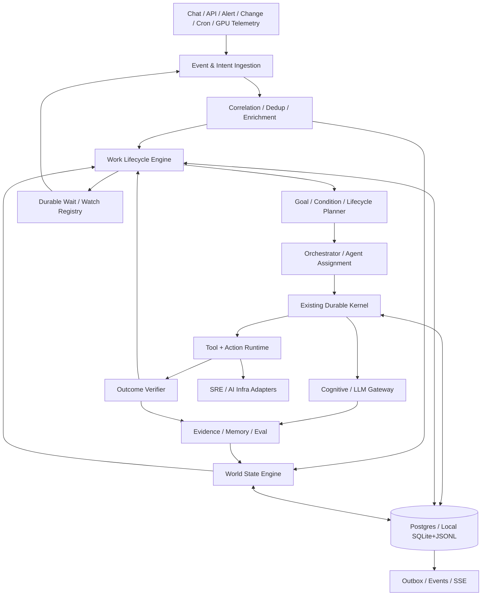
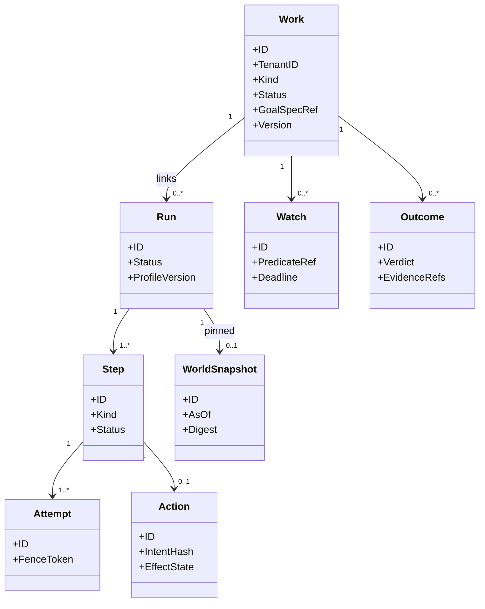
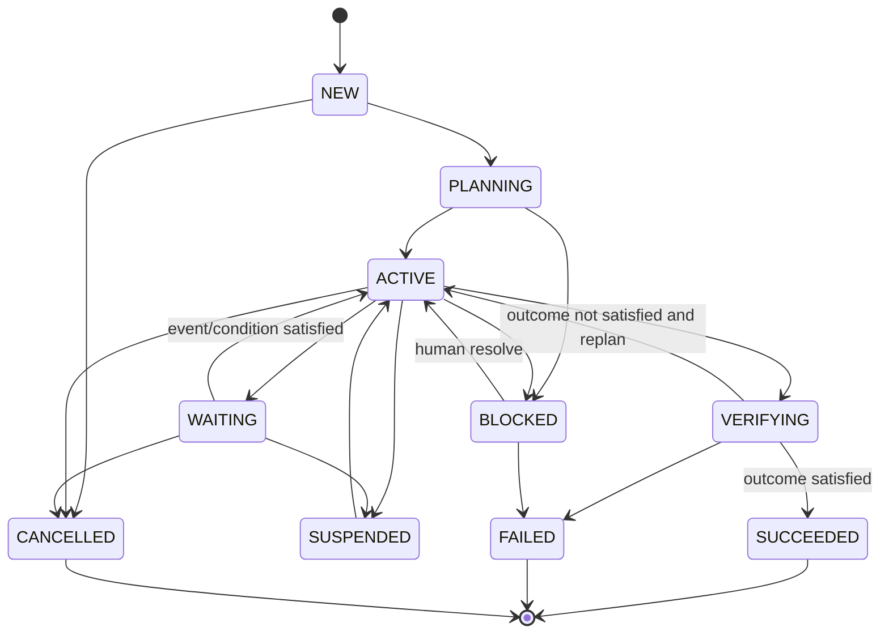
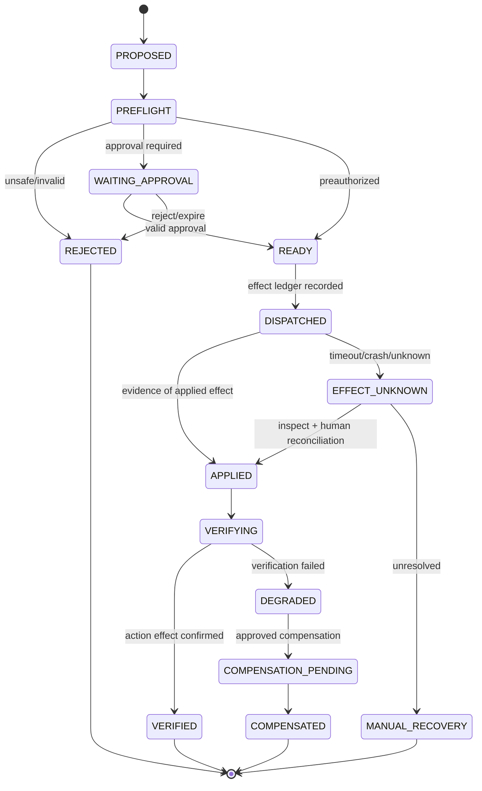
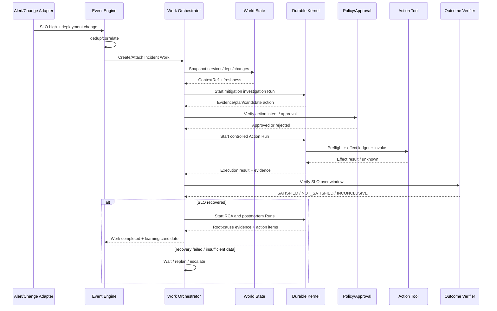

# SreAgentHarness v2.0：面向 SRE 与 AI Infra 的持续自治 Agent Framework 详细设计与实施方案

> 文档类型：架构 RFC + 实施设计 + 任务拆分 + 验收标准  
> 状态：**DRAFT（设计提案，未表示功能已经实现）**  
> 版本：v0.1  
> 编写日期：2026-11-08  
> 目标仓库：[rainyZhou2/SreAgentHarness](https://github.com/rainyZhou2/SreAgentHarness)  
> 源码基线：`main@218c2ce880cbbda33df6464b78aef96d201be913`  
> 主要语言：Go；团队模式 PostgreSQL；本地模式 SQLite + JSONL

---

## 目录

1. [设计目标与非目标](#1-设计目标与非目标)
2. [现有仓库基线与差距](#2-现有仓库基线与差距)
3. [总体架构与三层职责](#3-总体架构与三层职责)
4. [核心术语与对象关系](#4-核心术语与对象关系)
5. [Work：长期目标与生命周期引擎](#5-work长期目标与生命周期引擎)
6. [Event Engine：事件规范化与关联](#6-event-engine事件规范化与关联)
7. [World State：可感知的环境与历史快照](#7-world-state可感知的环境与历史快照)
8. [Goal/Intent 与持续工作编排](#8-goalintent-与持续工作编排)
9. [Continuous Agent：条件等待与事件唤醒](#9-continuous-agent条件等待与事件唤醒)
10. [Action Runtime：安全动作与副作用治理](#10-action-runtime安全动作与副作用治理)
11. [Outcome Verification：目标效果校验](#11-outcome-verification目标效果校验)
12. [Reasoning / Evidence / RCA 扩展](#12-reasoning--evidence--rca-扩展)
13. [Multi-Agent 协作协议](#13-multi-agent-协作协议)
14. [Memory、Playbook 与知识有效性](#14-memoryplaybook-与知识有效性)
15. [SRE 与 AI Infra 领域插件规范](#15-sre-与-ai-infra-领域插件规范)
16. [三个端到端业务时序](#16-三个端到端业务时序)
17. [持久化架构与数据库迁移](#17-持久化架构与数据库迁移)
18. [API / SDK / 事件协议](#18-api--sdk--事件协议)
19. [安全、权限与多租户](#19-安全权限与多租户)
20. [可靠性、性能与容量预算](#20-可靠性性能与容量预算)
21. [可观测性与指标](#21-可观测性与指标)
22. [代码目录与依赖约束](#22-代码目录与依赖约束)
23. [分阶段开发计划与任务拆分](#23-分阶段开发计划与任务拆分)
24. [测试矩阵与验收标准](#24-测试矩阵与验收标准)
25. [设计决策与开放问题](#25-设计决策与开放问题)
26. [首个最小闭环 MVP](#26-首个最小闭环-mvp)
27. [附录：示例配置、伪代码与开发任务单](#27-附录示例配置伪代码与开发任务单)

---

## 1. 设计目标与非目标

### 1.1 问题定义

当前 SreAgentHarness 已经包含 Durable Step Engine、模型网关、ReAct/Flow、工具注册表、风险策略、审批、副作用账本、上下文组装、记忆和推理质量评估等基础能力。**核心不足并非不能执行一次 Agent 任务，而是缺乏统一的“长期工作目标—动态世界状态—事件驱动—安全动作—业务效果验证”闭环。**

SRE/AI Infra 的工作往往不是一次问答：

- 故障预防：日常巡检、风险检测、监控缺失识别、容量和变更预评估。
- 故障感知：告警、SLO Burn Rate、模型推理延迟、硬件健康和变更事件收敛。
- 紧急止损：预案选择、暂停发布、降级/切流/限流、节点隔离、回滚与验证。
- RCA：跨指标、日志、Trace、变更、拓扑与历史故障的证据调查。
- 复盘：时间线、根因、改进行动项及后续验证。
- 日常需求：监控规则、告警优化、容量申请、配置修改、发布审核、基础设施交付。
- AI Infra：GPU 健康和资源调度、训练容错、推理 TTFT/TPOT、KV Cache、模型路由与成本。

这些是**领域场景**；本文目标是提炼它们共同需要的**Agent Framework 原语**，避免把故障业务代码硬编码在 Kernel 中。

### 1.2 框架级目标

| ID | 目标 | 完成判据 |
|---|---|---|
| G1 | 长生命周期 Work | 一个 Work 可以关联多个 Run，跨重启、跨天执行 |
| G2 | Event-driven + Goal-driven | 用户、定时、事件、条件变化均可驱动同一工作目标 |
| G3 | World State | 有来源、时间、版本与新鲜度的环境事实和拓扑快照 |
| G4 | 安全 Action | 计划、预检查、审批、执行、验证、补偿/人工恢复独立建模 |
| G5 | Outcome 驱动 | Tool 成功不等于目标成功；以业务指标/SLO/状态验证完成 |
| G6 | 持续 Agent | 原生 WAIT/WAKE/REPLAN，不占用长时间运行的 Worker |
| G7 | Multi-Agent | 明确任务所有权、共享证据、冲突解决和预算传播 |
| G8 | 可审计与可恢复 | 操作与决策因果链、幂等键、Fence、未知副作用安全恢复 |
| G9 | 领域可扩展 | SRE/AI Infra 作为插件，不改变 Kernel 安全不变量 |
| G10 | 工程可验证 | 有状态机、故障注入、回放、效果与成本基准 |

### 1.3 非目标

1. 不重写已存在的 Durable Step Engine，也不直接替换 PostgreSQL/SQLite 存储架构。
2. 不把 LangGraph、Temporal 或其他工作流引擎引入为强制依赖；先复用现有 Flow 和 Outbox 机制。
3. 不把所有 SRE 业务能力直接塞入 `internal/kernel`。
4. 不追求生产写操作的“无条件自动执行”；权限由策略、身份、资源版本和审批共同决定。
5. 不承诺跨不支持幂等的外部系统具备 Exactly-Once Effect。
6. 不采集或声称还原模型不可见的隐藏 CoT；保留可审计的**显式决策摘要、假设与证据链**。
7. 不在首期建设完备的时序数据库、图数据库或专用 GPU 管控平面。

### 1.4 总体原则

- **Kernel 极小化**：Kernel 负责持久执行、安全与一致性；领域意图由上层处理。
- **状态优于进程**：持续任务通过状态与唤醒运行，不通过无限循环的 Goroutine 持有资源。
- **事实可追溯**：每条事实有来源、事件时间、接收时间、可信度和有效期。
- **副作用保守**：效果不确定时进入人工恢复/查询，不自动重放。
- **业务结果优先**：Action 成功后必须单独验证目标/业务效果。
- **领域插件化**：行为契约和安全边界统一；领域 Schema/工具具体实现可替换。
- **先约束再自治**：先以人工审批和回放数据验证，再逐步放开自动化。

## 2. 现有仓库基线与差距

> 本节为 `main@218c2ce880cb` 静态源码盘点，**不是运行、性能或安全审计的结论**。是否达到生产等级取决于后续自动化测试与故障注入。

### 2.1 当前可复用能力

| 现有模块 | 已观察到的能力 | v2.0 复用方式 |
|---|---|---|
| `internal/kernel/{worker,loop,flow,plan}.go` | Step Claim/Lease/Fence/Commit；Reason/Tool/Plan/Flow/Compact | 不重写，作为 Run 执行底座 |
| `internal/trigger` | Webhook、定时触发、去重、证据追加 | 作为 Event Adapter，逐步升级为统一事件入口 |
| `internal/envctx` | Static/HTTP/Tool/Dependencies 等事实提供者 | 扩展为 World Snapshot Provider |
| `internal/graph` | Capability、Tool、Skill、Run 关联查询 | 作为能力图；另建业务拓扑投影，避免语义混淆 |
| `internal/cognitive` | Prompt Manifest、显式 THOUGHT、假设与 Decision | 统一 Reasoning/Evidence 协议 |
| `internal/tools` | Tool Registry、Descriptor、Target、Risk、生命周期覆盖 | Action 运行时以此为底层执行适配器 |
| `internal/policy` | R0–R3、ActionIntent、Policy Gate | 保留不可绕过的门禁 |
| `internal/verify` | 最终结论的证据验证 | 新增“业务目标效果”验证，避免职责混合 |
| `internal/memory`、`internal/reasoning` | 记忆、案例、质量评分、改进循环 | 加入有效期、环境适配和结果质量反馈 |
| `internal/store/pg` | 事务、Outbox、Run/Step/Attempt、审批与账本 | 新表以迁移方式增量接入 |
| `internal/localstore` | SQLite + JSONL、本地 Run/Step 等 | 本地实现同一 Work/Event/Wait 接口 |
| `internal/api`、`desktop` | REST/SSE、会话和审批体验 | 扩展 Work 视图、事件时间线与长期任务 |

另外，仓库**已经存在** `incidents` 表、`Run.IncidentID`、本地 `incidents/incidentEvents/serviceDeps` 等基础数据结构。v2 **不能再创建冲突的 Incident 实体**。建议为现有 Incident 提供适配关系：`Work.Kind=incident` 通过 `work_subject_links` 映射到既有 `incidents` 记录，并在后续版本决定是否整合。

### 2.2 当前架构核心安全语义

```text
ClaimStep（短事务）
  → Lease + FenceToken + ContextSnapshot
  → execute（事务外）
  → PrepareEffect（副作用派发前登记）
  → Tool.Invoke（外部调用）
  → CommitSuccess / CommitFailure（带租约检查的短事务）
  → Outbox / Event / 下一个 Step
```

- 只读工具可以转为 Observation 或被并行执行。
- 有副作用工具在规划、执行前都受工具注册表与策略约束。
- `DISPATCHED` 后出现未知结果时不应自动重放；可转 `NEEDS_HUMAN`。
- 生成计划的审批与 Plan Hash 绑定；补偿保持独立审批。
- 现有 Flow 子 Run 可作为业务多 Agent 执行的最小承载单位。

### 2.3 缺口与最小改造点

| 缺口 | 不能只靠什么解决 | 应新增的抽象 |
|---|---|---|
| 跨多 Run 的持续目标 | 超长 ReAct 循环 | `Work` + `WorkRunLink` |
| 事件导致长期任务恢复 | Webhook 直接创建新 Run | `DomainEvent` + `ConditionWait` |
| 变化中的环境与历史事实 | 静态 Goal Context | `WorldSnapshot` + `Fact` + `Relation` |
| 外部动作的工程契约 | 单一 `Tool.Invoke` | `ActionSpec` + `Preflight` + `Effect` |
| 目标真正恢复 | 工具退出码或模型自评 | `OutcomeSpec` + `OutcomeEvaluation` |
| 多 Agent 合作 | 只创建多个子 Run | `Assignment` + `SharedEvidence` + `MergePolicy` |
| 主动预防 | 每次等用户输入 | `Watch` + `Condition` + `Scheduler` |
| 不同领域能力复用 | 为每种故障写一条硬编码链 | `DomainAdapter` / `Capability` |

## 3. 总体架构与三层职责

### 3.1 逻辑架构



### 3.2 三层边界

**第一层：Kernel Plane（通用可靠执行）**  
Run/Step/Attempt、租约、Fence、幂等、事务提交、审批执行、模型/工具隔离、安全约束。该层不识别 `Prometheus`、`SGLang` 或 `Kubernetes` 的业务含义。

**第二层：Agent Control Plane（目标与持续自治）**  
Work、Goal、WorldSnapshot、Condition、AgentAssignment、ActionPlan、Outcome、Evidence、Watch、Replan。该层定义 Framework 原语和长期生命周期，不内置某种业务规则。

**第三层：Domain Capability Plane（可插拔的专业能力）**  
SRE、数据库、网络、GPU、模型训练/推理、业务监控、变更治理等适配器。负责数据读取、策略模板与具体 Action 实现。

### 3.3 三种不同的循环

```text
短循环 Execution Loop:
   Reason → Tool → Observe → Reason / Final

中循环 Work Lifecycle:
   Goal → Plan → Run → Wait → React → Verify → Replan / Complete

长循环 Improvement:
   History → Eval → Candidate → Holdout → Approval → Canary → Rollback/Promote
```

三个循环共享事件与证据；**不允许通过一个无限运行的 LLM 循环代替长期工作编排**。

### 3.4 拓扑视图：任务、状态和执行分离

- `Work`：业务目标及进度，生命周期可以跨 Run 和多天。
- `Run`：一次 Agent 执行，由现有 Kernel 管理。
- `Flow`：一次 Run 内显式子任务 DAG，仍复用当前子 Run 机制。
- `Watch`：条件等待或外部事件订阅，不能占用 Worker Lease。
- `WorldSnapshot`：Run 读取时被固定的环境视图。
- `Action`：带资源影响的受控外部操作。
- `Outcome`：独立验证“真正实现了什么”。

---

## 4. 核心术语与对象关系

### 4.1 关系约束



注意：`Work → Run` 不应只建一个简单外键。一个 Run 可能被多项业务工作引用作证据，但只能有一个**主执行所有者**。建议用 `work_run_links` 显式存储 `role=owner|evidence`，并通过约束禁止同一个 Run 有两个 `owner`。

### 4.2 框架 ID 与版本策略

- 内部实体使用 UUID/ULID；对外统一字符串，避免本地与 PostgreSQL SDK 不一致。
- 每个对象均携带 `tenant_id` 和 `version`，写入使用 CAS / `expected_version`。
- 事件携带 `event_id`、`schema_version`、`aggregate_id`、`aggregate_seq`。
- 所有配置规则、目标规格、动作计划与工具 Schema 使用不可变版本或内容哈希。
- 资源指向采用规范化 `resource_ref`（例如 `k8s://cluster/ns/kind/name`）；不使用自由文本目标作为安全权限依据。

---

## 5. Work：长期目标与生命周期引擎

### 5.1 目标

允许一个业务目标被用户提交、事件创建或定时触发后持续运行，支持多个 Run、暂停、等待、审批、恢复、重规划与结果校验。

`Work` 是 Framework 通用对象，不等于 `Incident`。一个 Incident、变更、巡检、容量需求、GPU 资源申请都可以对应不同 `Work.Kind`。

### 5.2 核心结构（设计草案）

```go
package work

import (
    "context"
    "encoding/json"
    "time"
)

type Kind string
const (
    KindIncident Kind = "incident"
    KindChange   Kind = "change"
    KindRoutine  Kind = "routine"
    KindRequest  Kind = "request"
    KindAIInfra  Kind = "ai_infra"
    KindGeneral  Kind = "general"
)

type Status string
const (
    StatusNew        Status = "NEW"
    StatusPlanning   Status = "PLANNING"
    StatusActive     Status = "ACTIVE"
    StatusWaiting    Status = "WAITING"
    StatusVerifying  Status = "VERIFYING"
    StatusBlocked    Status = "BLOCKED"
    StatusSuspended  Status = "SUSPENDED"
    StatusSucceeded  Status = "SUCCEEDED"
    StatusFailed     Status = "FAILED"
    StatusCancelled  Status = "CANCELLED"
)

type GoalSpec struct {
    Intent        string          `json:"intent"`
    SubjectRefs   []string        `json:"subject_refs"`
    Success       json.RawMessage `json:"success"`
    Constraints   json.RawMessage `json:"constraints"`
    Deadline      *time.Time      `json:"deadline,omitempty"`
    ProfileRef    string          `json:"profile_ref"`
}

type Work struct {
    ID           string
    TenantID     string
    Kind         Kind
    Status       Status
    GoalSpecRef  string
    ContextRef   string
    OwnerActorID string
    Priority     int
    Version      int64
    CreatedAt    time.Time
    UpdatedAt    time.Time
    ClosedAt     *time.Time
}

type Repository interface {
    Create(context.Context, Work, string) (Work, bool, error) // idem key
    Get(context.Context, string, string) (Work, error)
    Apply(context.Context, Command) (Work, error) // CAS + events + outbox
    ListRuns(context.Context, string, string) ([]RunLink, error)
}

type RunLink struct {
    WorkID string
    RunID  string
    Role   string // owner | evidence
    Phase  string // investigate | mitigate | verify | review | general
}

type Command struct {
    TenantID        string
    WorkID          string
    ExpectedVersion int64
    IdempotencyKey  string
    Kind            string
    Payload         json.RawMessage
    ActorID         string
}
```

> 接口用于说明边界，不是可直接粘贴编译的完整实现。实际字段、时间抽象、错误类型需与仓库的 `domain` / `store` 规范统一。

### 5.3 状态机



允许的状态转移由纯函数检查（`Transition(old, command)`）。`WAITING` 与 `BLOCKED` 必须区分：前者有可满足的外部条件，后者需人工处置或明确外部依赖；`SUSPENDED` 是主动暂停。

### 5.4 业务执行规则

1. `Work` 通过提交 `WorkCommand` 改变状态，不允许客户端直接 UPDATE 状态字段。
2. 所有 Run 由 Work Orchestrator 创建，幂等键形如 `work:{id}:phase:{phase}:generation:{n}`。
3. 一个 Work 同时允许多个只读调查 Run；并发写 Action 的可用范围由资源级互斥和 Policy 决定。
4. `Work` 的取消应向关联的**所有者 Run** 发起取消，但不强行撤回已经派发的副作用。
5. 不能仅因任意一个 Run 成功就将 Work 标记为 `SUCCEEDED`。必须通过 Work-level Outcome。
6. 对同一 Work 的并发事件，通过 `(tenant_id, work_id, version)` CAS 串行化决策。
7. 终态只允许创建新的 Work 或显式 `reopen` 形成新 generation；不要隐式把终态复活，避免审计混乱。

### 5.5 与已有 Incident 兼容

- 保留旧 `incidents` 表及外部 API；v2 新增 `work_subject_links(work_id, subject_kind, subject_id)`。
- 旧的 `Run.IncidentID` 继续可读，新创建的 Run 同时可通过 `work_run_links` 关联。
- 迁移时不反向改变旧 Incident 的业务状态机；引入 `incident-work adapter`。
- 所有已存在的 Incident 运行轨迹保持原始引用，可通过迁移作只读关联。

---

## 6. Event Engine：事件规范化与关联

### 6.1 目的

避免“每到一条告警就创建一次 LLM Run”。建立统一事件入口：解码 → 校验 → 标准化 → 幂等 → 关联 → 丰富化 → 条件匹配 → Work 状态推进。

### 6.2 Event Envelope

```go
package event

type Envelope struct {
    ID            string            `json:"event_id"`
    SchemaVersion int               `json:"schema_version"`
    TenantID      string            `json:"tenant_id"`
    Source        string            `json:"source"`
    Type          string            `json:"type"`
    SubjectRef    string            `json:"subject_ref"`
    CorrelationID string            `json:"correlation_id,omitempty"`
    DedupKey      string            `json:"dedup_key,omitempty"`
    OccurredAt    time.Time         `json:"occurred_at"`
    ObservedAt    time.Time         `json:"observed_at"`
    ExpiresAt     *time.Time        `json:"expires_at,omitempty"`
    Confidence    float64           `json:"confidence"`
    Labels        map[string]string `json:"labels,omitempty"`
    PayloadRef    string            `json:"payload_ref,omitempty"`
    PayloadHash   string            `json:"payload_hash,omitempty"`
    TraceID       string            `json:"trace_id,omitempty"`
}
```

**强制字段**：事件 ID、Tenant、Source、Type、Subject、OccurredAt、ObservedAt、SchemaVersion。`DedupKey` 是“同类事件关联”的业务键，不能替代不可重复的事件 ID。

### 6.3 事件处理流水线

```text
Webhook / Poller / PubSub / GitOps
     ↓
Authentication + Payload Validation
     ↓
Event Normalizer（type、subject、time、schema）
     ↓
Event Inbox（(tenant, source, event_id) unique）
     ↓
Resource Resolution（subject → resource/service/work）
     ↓
Correlation（时间窗口 + 拓扑 + 变更 + 指纹）
     ↓
Work Resolver（attach existing / create new / ignore）
     ↓
Watch Matcher / Work Command
     ↓
Outbox → Work Scheduler / SSE
```

### 6.4 关联和去重

- **去重**：同一外部事件的重复投递只写入一次 Inbox；独立的状态变更事件必须保留。
- **聚合**：同一业务、服务、窗口的多个信号可以归属同一个 Work。
- **抑制**：明确的上游故障可标记下游告警相关，而不是删除下游证据。
- **迟到事件**：事件时间早于当前时间时照常追加；是否重新触发决定由 Work 版本与 Watch 规则控制。
- **乱序**：按事件时间解释因果，但业务状态变更仍按提交顺序审计。
- **关联策略**：静态规则先行；模型可建议关联，但不能凭模型输出直接覆盖 Subject/权限。

### 6.5 事件订阅 API（草案）

```go
type PredicateSpec struct {
    SchemaVersion int
    EventTypes    []string
    SubjectRefs   []string
    Where         json.RawMessage // 白名单表达式 AST，不执行任意代码
}

type Subscription interface {
    Register(ctx context.Context, tenantID, workID string, p PredicateSpec, deadline time.Time) (string, error)
    Cancel(ctx context.Context, tenantID, subscriptionID string) error
    Match(ctx context.Context, e Envelope) ([]string, error)
}
```

### 6.6 Event Engine 设计底线

- Event 不携带自授权字段；授权由服务端确定。
- 原始 Payload 大于阈值时外存，保留哈希和内容大小。
- Event Adapter 对外来源做数据边界处理，禁止将 Webhook 文本作为 System Prompt。
- 事件关联失败不丢数据，进入 Dead-letter / Repair Queue。
- 事件过载时合并相同类别信号并施加租户/服务级限流；不要丢失最初发生与最终恢复的关键事件。

---

## 7. World State：可感知的环境与历史快照

### 7.1 动机

SRE Agent 需要知道“故障发生时真实世界是什么状态”，而不是只查询当前状态。例如事件发生时 Deployment 是 `v1`，十分钟后已经回滚到 `v0`，不能用当前拓扑覆盖历史事实。

### 7.2 世界模型四个抽象

| 对象 | 定义 | 示例 |
|---|---|---|
| `Entity` | 稳定身份的业务/基础设施对象 | Service、Pod、Node、GPU、Model Endpoint |
| `Relation` | 带时间和来源的有向关系 | Service A → calls → Service B |
| `Fact` | 可验证的对象属性或状态 | Pod Ready=false、GPU Xid |
| `WorldSnapshot` | 针对查询目的的固定视图 | 14:05 业务拓扑与故障状态 |

### 7.3 World Fact Schema

```go
type Fact struct {
    ID            string
    TenantID      string
    SubjectRef    string
    Predicate     string
    ValueRef      string
    Source        string
    TrustTier     string
    ValidFrom     time.Time // 事实在真实世界开始生效的时间
    ValidTo       *time.Time
    ObservedAt    time.Time // 系统观测到事实的时间
    ExpiresAt     *time.Time
    Version       int64
    EvidenceRefs  []string
    Confidence    float64
}

type Relation struct {
    TenantID   string
    FromRef    string
    Type       string // calls / deployed_on / owns / routes_to / uses_gpu ...
    ToRef      string
    ValidFrom  time.Time
    ValidTo    *time.Time
    ObservedAt time.Time
    Source     string
    Version    int64
}

type SnapshotRequest struct {
    TenantID    string
    SubjectRefs []string
    AsOf        time.Time
    MaxAge      time.Duration
    Required    []string // predicates
}

type WorldSnapshot struct {
    ID          string
    TenantID    string
    AsOf        time.Time
    CreatedAt   time.Time
    FactsRef    string
    GraphRef    string
    Digest      string
    Missing     []string
    Stale       []string
}
```

### 7.4 双时间设计

- `valid_time`：事实在现实中有效的时间。
- `observed_time`：平台记录到事实的时间。
- `as_of` 查询应同时指定“看哪个业务时间”和“当时平台已知哪些数据”，支持审计式重演。
- 快照中包含 `source_version` / `content_hash`，禁止以最新查询结果静默替换已固定的上下文。

### 7.5 查询策略

1. `ResolveIdentity`：将输入目标解析为权威资源 ID，不确定时保留多个候选并阻止写操作。
2. `GetCurrent`：返回最新状态并报告新鲜度。
3. `GetAsOf`：重建某个时刻的历史状态。
4. `ExpandNeighborhood`：限制跳数和节点数，避免整张拓扑进入 Prompt。
5. `DiffSnapshots`：比较两个时间点的拓扑、版本与关键状态变化。
6. `PinForRun`：将快照 digest/ref 写入 Run Context；重试时读取相同快照。

### 7.6 与 `envctx` 和 `graph` 的关系

- 现有 `envctx` 是 Context Provider，保留；新 `world` 提供规范化 Fact/Entity/Snapshot 存储和查询。
- 现有 `internal/graph` 主要处理 Capability / Provenance；不要直接将其等同于业务服务依赖图。
- 新 World Graph 可采用 PostgreSQL `world_entities/world_relations`；复杂查询需求出现后再评估专用图数据库。
- 新 World API 对 `cognitive.Assembler` 提供有界、引用化的 Context Section，防止上下文爆炸。

### 7.7 写操作的世界状态前置校验

任何有副作用的 Action 应要求：

- 目标资源仍存在，身份解析唯一；
- 关键 Facts 未过期；
- 资源版本与计划时匹配（`resourceVersion`、ETag、Revision 等）；
- 依赖容量、故障域与影响面符合 Policy；
- 不满足时返回 `PRECONDITION_FAILED`，**重新规划/审批**，不得盲目继续。

---

## 8. Goal/Intent 与持续工作编排

### 8.1 原生任务种类

```text
Question         一次性回答，不要求环境动作
Investigation    调查，收集证据并得出可验证结论
Mitigation       缓解故障影响，可能包含受控写操作
Prevention       检测隐患、输出或执行治理改进
Change           配置/发布/基础设施变更
Monitoring       监控规则、告警、看板配置
Capacity         容量、性能、成本治理
AIInfra          GPU、训练、推理的资源与运行治理
GeneralWork      其他长期工作
```

框架不应将业务类型硬编码成唯一 Workflow。`GoalSpec` 明确目标、硬约束、成功条件、有效期、批准者与终止条件；Profile/Plugin 提供领域知识。

### 8.2 GoalSpec Schema（示意）

```yaml
goal_version: 1
kind: mitigation
subject_refs:
  - service://prod/search-api
objective:
  description: 恢复搜索接口可用性与延迟 SLO
  success:
    all:
      - metric: availability
        op: gte
        value: 0.999
        window: 10m
      - metric: p99_latency_ms
        op: lte
        value: 350
        window: 10m
constraints:
  allow_production_write: false    # 未被审批前默认 false
  max_blast_radius: one_service
  require_fresh_data_seconds: 60
  max_model_cost_usd: 5
  deadline: '2026-11-08T12:00:00Z'
```

**注意：YAML 是目标草案，不是当前已实现的配置。** 真实时间窗、SLO 数值需要来自业务权威配置；此处为示例值。

### 8.3 Planner 的输出契约

`Plan` 不只是 DAG，还需要：

- `objective`：当前子目标；
- `required_evidence`：必要事实；
- `tasks`：读、分析、动作、验证、等待；
- `dependencies`：前置关系；
- `allowed_capabilities`：最小工具集；
- `budget`：token、cost、steps、deadline、fan-out；
- `replan_conditions`：什么情况要重新规划；
- `outcome_spec_ref`：目标验收规则；
- `plan_hash` / `version`：审批与审计绑定。

继续复用 `internal/planner` 的生成 Flow 与安全分析；新增 Work-level Planner 只负责选择下一阶段、决定是否开 Run 或 Wait，**不要重新实现 Model Gateway 和 Step Loop**。

### 8.4 对运行时调用的约束

- 不修改已提交的旧 Run 的计划快照；重规划创建新 generation，保留审计历史。
- 重大计划变化（目标、环境、风险、动作、影响范围）使旧审批失效。
- 单个 Work 的多 Agent 任务共享顶层成本和并发预算。
- Goal 完成由 Outcome Engine 判断，不由模型口头宣布。

---

## 9. Continuous Agent：条件等待与事件唤醒

### 9.1 核心问题

持续观察一个发布 30 分钟，不能占用一个 LLM 请求或一个长期持有租约的 Worker。框架应原生支持**有持久化订阅、超时和事件唤醒的 Wait 原语**。

### 9.2 Watch 数据结构

```go
package continuous

type WatchMode string
const (
    OnEvent   WatchMode = "event"
    OnTime    WatchMode = "time"
    OnEither  WatchMode = "either"
    Periodic  WatchMode = "periodic"
)

type Watch struct {
    ID          string
    TenantID    string
    WorkID      string
    Mode        WatchMode
    PredicateRef string
    Subjects    []string
    NotBefore   time.Time
    Deadline    *time.Time
    NextCheckAt *time.Time
    Cursor      string
    Status      string  // ACTIVE | FIRED | EXPIRED | CANCELLED
    Version     int64
}
```

### 9.3 执行模式

```text
Work.ACTIVE
   ↓
Stage completes and returns WaitSpec
   ↓
Persist watch + work WAITING + outbox (same transaction)
   ↓
Worker releases lease
   ↓
Incoming event / timer / periodic check
   ↓
Watch matcher claims match (CAS)
   ↓
Validate condition against fresh WorldSnapshot
   ├─ satisfied → WorkCommand{resume}
   ├─ not satisfied → update cursor/next_check_at
   └─ deadline reached → timeout transition
   ↓
Orchestrator creates next Run/Stage (idempotently)
```

### 9.4 防止双重触发与重复恢复

- `watch_firings` 使用 `UNIQUE(watch_id, event_id)` 防止相同事件重复唤醒。
- 对“每次只唤醒一次”Watch，`status=ACTIVE → FIRED` 使用版本 CAS。
- 状态改变和下一轮 Work Outbox 唤醒同事务写入。
- 定时检查与事件同时命中时只允许一个胜出；另一方变为 no-op。
- Reconciler 兜底扫描 `ACTIVE AND next_check_at <= now()`，避免单一 Timer 进程丢事件。
- 状态评估和条件副作用分开；条件本身必须是只读、可重试且受限的表达式或查询。

### 9.5 与现有 Kernel 的集成策略

**MVP 推荐独立 Work Wait，不新增 StepKind。** 一次 Run 正常结束后由 Work Orchestrator 设置 Watch；等待期间不再持有 Run Lease。这样不必立刻触碰已有 StepKind 枚举、数据库 CHECK、Flow 编译器和所有 Local Store 分支。

后续如果需要 Run 内可恢复等待，再新增 `StepWait`（必须同时改 PostgreSQL、SQLite、RunState、Flow、API、测试），作为兼容性的第二阶段。

---
## 10. Action Runtime：安全动作与副作用治理

### 10.1 定位

`Tool` 是调用能力；`Action` 是一次具有目标、风险、外部副作用、生命周期和业务验收的**受控操作**。框架不能依靠模型生成一段命令来完成生产变更。

- `Tool`：读取监控、检索日志、读取文件、查询资源，通常 R0。
- `Action`：流量切换、发布暂停、回滚、节点隔离、GPU 排空、监控规则发布等。
- `ActionRuntime` 负责动作契约、前置条件、权限、审批、执行与结果跟踪。
- 已有 `internal/tools`、`internal/policy`、`PrepareEffect` 保留，Action 最终通过既有 Tool/Executor 调用。

### 10.2 能力契约

```go
package action

import (
    "context"
    "encoding/json"
    "time"
)

type Descriptor struct {
    Name             string
    Version          string
    ResourceKinds    []string
    RiskClass        string
    InputSchema      json.RawMessage
    OutcomeSchema    json.RawMessage
    IdempotencyMode  string // NATIVE | QUERY_BEFORE_RETRY | NONE
    SupportsDryRun   bool
    SupportsRollback bool
    RequiredFacts    []string
}

type Plan struct {
    ID             string
    TenantID       string
    WorkID         string
    RunID          string
    ActionName     string
    ActionVersion  string
    TargetRef      string
    TargetVersion  string
    ArgsRef        string
    Preconditions  []ConditionSpec
    Verification   OutcomeSpec
    RollbackRef    string
    RiskClass      string
    BlastRadius    string
    PolicyVersion  string
    PlanHash       string
    ExpiresAt      time.Time
}

type PreflightResult struct {
    Allowed         bool
    Reasons         []string
    WorldSnapshotID string
    TargetVersion   string
    EvidenceRefs    []string
}

type Executor interface {
    Descriptor() Descriptor
    Preflight(ctx context.Context, p Plan) (PreflightResult, error)
    Execute(ctx context.Context, p Plan, idempotencyKey string) (json.RawMessage, error)
    Inspect(ctx context.Context, p Plan) (json.RawMessage, error)
    // 无法安全补偿时应明确不支持，不返回虚假的成功。
    Compensate(ctx context.Context, p Plan, executed json.RawMessage) (json.RawMessage, error)
}
```

**设计约束：** `Execute` 不直接开放给模型或上层 API；只有 Kernel 已领取的 Step 且通过 Action Gate 后可以调用。`Preflight` 是读取操作；`Inspect` 用于未知副作用的只读对账。

### 10.3 Action 生命周期状态机



这里区分两种验证：

1. **Effect Verification**：外部操作是否真的生效（例如流量权重从 100/0 变为 90/10）。
2. **Outcome Verification**：业务目标是否达成（例如 P99 是否恢复、错误率是否下降）。

一个 Action `VERIFIED` 并不等于整个 Work 成功。

### 10.4 生产动作完整前置条件

1. 目标资源解析唯一；同一租户且调用方对目标有权限。
2. Action Descriptor、工具版本、目标版本、参数哈希被固定。
3. WorldSnapshot 满足关键事实新鲜度要求。
4. 满足安全窗口、故障域、最大影响范围、容量冗余等硬性策略。
5. 对生产环境的 Approval Token 与 `action_hash`、对象版本、风险等级、失效时间绑定。
6. 执行前再次检查资源版本和 Policy；不满足即拒绝/重新审批。
7. 资源级动作互斥或乐观并发保护，避免两个 Work 同时切相同流量。
8. 外部执行器接收 Idempotency Key；若下游不支持，必须有状态查询或人工确认路径。
9. 输出包含可验证的操作记录与原始证据引用。
10. 超时/断联不能自动宣称失败或再次派发。

### 10.5 ActionIntent v2 的建议哈希输入

```text
ActionHashV2 = SHA256(CanonicalJSON({
  tenant_id,
  actor_scope,
  work_id,
  run_id,
  action_name,
  action_version,
  target_ref,
  target_resource_version,
  args_hash,
  policy_version,
  risk_class,
  blast_radius,
  preflight_snapshot_digest,
  plan_generation,
  approval_expiry
}))
```

不要在没有版本迁移的情况下替换已存在的 `ActionIntent.ActionHash` 算法；推荐新增 `intent_schema_version=2`，继续接受已创建但尚未过期的 v1 Approval，并在灰度后停止产生 v1。

### 10.6 外部副作用的边界

**无法仅依赖本地事务实现外部 Exactly-Once。** 核心方法是：

- **Before-dispatch**：本地 Effect Ledger 登记稳定幂等键和计划哈希。
- **Dispatch**：外部工具原样接收幂等键与资源条件。
- **After-dispatch**：以工具/外部平台的结果或只读对账确认是否生效。
- **Unknown-effect**：保持未知状态，禁止自动重复执行；进入 Inspect / Manual Reconcile。
- **Replay**：重播历史决策时使用录制数据，不执行真实外部写操作。

现有 `PrepareEffect()` 在调用前将 Effect 置为 `DISPATCHED`，因此“已经登记派发”并不严格证明网络请求真的到达下游。这是保守安全设计；在 UI 与审计中必须明确标识 **may have been dispatched**，避免误导运维人员。

### 10.7 补偿与回滚

- 补偿不是全局事务自动回滚，必须作为一个**新的 Action** 走同样的权限、幂等与账本。
- 高风险补偿需要独立审批；不可逆动作直接声明 `SupportsRollback=false`。
- 失败后恢复策略优先级：`Inspect` → `No-op` / `Confirm` / `Manual Recovery` → 可能的 `Compensate`。
- 自动降级/切流必须附带预期接收端容量、流量边界、业务错误率校验；不能只凭目标服务“Healthy”执行。

---

## 11. Outcome Verification：目标效果校验

### 11.1 为什么要单独建设

`verify.Verify()` 当前主要检查 Agent 结论与证据是否匹配；Tool Lifecycle 可验证外部操作。但 SRE 的成功标准是“业务是否恢复、影响是否降低、预案是否达到目标”，因此需要**与 LLM 答案独立的领域效果验证器**。

### 11.2 Outcome Spec

```go
package outcome

type Verdict string
const (
    Satisfied     Verdict = "SATISFIED"
    NotSatisfied  Verdict = "NOT_SATISFIED"
    Inconclusive  Verdict = "INCONCLUSIVE"
    Unknown       Verdict = "UNKNOWN"
)

type Objective struct {
    ID           string
    Kind         string // metric | state | event | human | composite
    TargetRef    string
    Expression   json.RawMessage  // 受限 DSL，不执行任意 Go/Python 代码
    Window       time.Duration
    Freshness    time.Duration
    MinSamples   int
    Required     bool
}

type Spec struct {
    Version      int
    AllOf        []Objective
    AnyOf        []Objective
    Deadline     *time.Time
    StableFor    time.Duration
}

type Evaluation struct {
    WorkID       string
    SpecHash     string
    Verdict      Verdict
    EvaluatedAt  time.Time
    EvidenceRefs []string
    Reasons      []string
    Missing      []string
}
```

### 11.3 评估原则

1. 成功条件由业务侧或已批准的 Profile/Runbook 提供，不允许 LLM 在执行失败后偷偷降低成功阈值。
2. `metric` 验证使用确定性查询及明确定义的时间窗口，保留原始查询/参数/样本 Artifact。
3. 对短窗口单次样本不下最终结论；`StableFor` 用于避免短暂恢复的误判。
4. 缺失指标、数据过期、采样不足返回 `INCONCLUSIVE`，而不是 `SATISFIED`。
5. 允许 `NOT_SATISFIED` 引导重新规划，且必须受总体预算和最大重规划次数约束。
6. 最终 Work 结论同时提供 Effect 验证、Outcome 验证与 RCA 证据验证，避免互相混淆。

### 11.4 示例：P99 延迟恢复

```yaml
outcome_version: 1
subject_ref: service://prod/search-api
all_of:
  - id: latency
    kind: metric
    expression:
      source: prometheus-prod
      query_ref: metric-query/search-api/p99
      operator: less_than_or_equal
      threshold: 350
    window: 10m
    freshness: 60s
    min_samples: 20
  - id: error-rate
    kind: metric
    expression:
      source: prometheus-prod
      query_ref: metric-query/search-api/error-rate
      operator: less_than_or_equal
      threshold: 0.01
    window: 10m
    freshness: 60s
    min_samples: 20
stable_for: 5m
```

以上阈值与 QueryRef 均是演示。生产中应引用服务注册的 SLO/SLI 定义，且统一单位、缺失数据处理和统计口径。

### 11.5 Work 终止准则

```text
If all required outcomes SATISFIED over required stable period:
    Work -> SUCCEEDED
Else if INCONCLUSIVE and deadline not reached:
    Work -> WAITING, schedule recheck
Else if NOT_SATISFIED and replan budget remains:
    Work -> ACTIVE, create next Run generation
Else:
    Work -> BLOCKED or FAILED; retain diagnostics and manual path
```

不允许由模型直接把 Work 状态写为 `SUCCEEDED`，模型只可以提交“建议完成”及证据。

---

## 12. Reasoning / Evidence / RCA 扩展

### 12.1 现有能力与新增目标

现有 `THOUGHT`、`Hypothesis`、`EvidenceRefs`、`RefSet`、`Verifier` 已提供良好基础。v2 不应该重写这一套，而应建立跨 Run 的证据关联、假设生命周期和世界状态变化对比。

### 12.2 共享 Evidence Ledger

```go
type EvidenceRecord struct {
    ID             string
    TenantID       string
    WorkID         string
    SourceType     string // metric | log | trace | change | topology | tool | human
    SourceRef      string
    ArtifactRef    string
    ContentHash    string
    OccurredFrom   time.Time
    OccurredTo     time.Time
    CapturedAt     time.Time
    TrustTier      string
    RedactionLevel string
    Claims         []string
}
```

- Evidence 不允许原地覆盖；修正采用新记录和 `supersedes` 关系。
- 引用必须能解析到模型当次可见的事实，或被标记为不可验证。
- 对外部日志/网页/MCP 文本一律执行不可信数据边界处理。
- 允许不同 Agent 共享 Evidence 引用，但不得自动共享任意敏感原文。

### 12.3 Hypothesis Ledger 跨 Run 扩展

```text
Hypothesis {
  id, work_id, statement,
  status: OPEN | SUPPORTED | REFUTED | CHALLENGED | INCONCLUSIVE,
  supporting_evidence_refs[], refuting_evidence_refs[],
  confidence, calibration_version,
  created_by_run_id, last_updated_by_run_id, version
}
```

- 不把主观置信度当作事实概率；使用已存在的校准逻辑评估。
- 相同假设跨 Run 用 `hypothesis_id` 关联，支持反证和重新打开。
- RCA 可以分为 `trigger`、`root_cause`、`contributing_factor`、`detection_gap`、`recovery_gap`。
- 根因验证应区分**时间相关**、**依赖传播**与**可证实因果证据**。

### 12.4 Evidence Planning

每次调查不只问“下一步查什么”，而是计算“哪项只读检查能最大程度区分当前竞争假设”。MVP 可以用启发式：

```text
candidate_checks = capabilities available for current goal
score = expected_discrimination
      × evidence_reliability
      × freshness_factor
      - latency_penalty
      - model/tool_cost_penalty
      - operational_risk_penalty

choose top K safe read-only checks
```

评分可由模型建议，但**可见工具、风险、预算与权限过滤必须由 Framework 硬约束**。如假设 A 为 CPU throttling，假设 B 为下游 RPC 延迟，则优先选可明显区分两者的 CPU throttling 与 Trace 指标，而不是重复查询没有新信息的 CPU 使用率。

### 12.5 结论层次

输出应明确分层：

1. Observed Facts（观测事实，带引用）；
2. Hypotheses（待证实假设）；
3. Root Cause（已获充分证据支持的原因，如无法确认则标注未知）；
4. Actions Taken（实际执行且有账本的动作）；
5. Outcome（业务效果，独立评估）；
6. Uncertainties / Next Checks（未解决问题与下一步）。

---

## 13. Multi-Agent 协作协议

### 13.1 原则

多 Agent 是调度策略而非默认架构。普通问答用单 Agent；复杂调查可以并行只读 Investigator；生产写操作必须经 Action Runtime。现有 Flow 子 Run 是底层执行载体。

### 13.2 核心对象

```go
type AgentRole struct {
    ID           string
    Version      string
    ModelAlias   string
    Instructions string
    Capabilities []string
    ToolAllowlist []string
    MaxSteps     int
    MaxCostUSD   float64
}

type Assignment struct {
    ID           string
    WorkID       string
    ParentRunID  string
    ChildRunID   string
    RoleRef      string
    GoalRef      string
    InputRefs    []string
    Status       string
    BudgetRef    string
}

type ResultEnvelope struct {
    AssignmentID string
    Status       string
    Findings     []string
    EvidenceRefs []string
    Hypotheses   []string
    Uncertainties []string
    CostMicros   int64
}
```

### 13.3 调度与数据共享

- Parent Work 决定任务拆分；子 Agent 只能在继承并**收紧**的工具/权限内执行。
- 共享的是结构化 Evidence Ledger 和 World Snapshot 引用，不复制整段未整理聊天记录。
- 子 Agent 不得修改其他 Agent 的原始输出；冲突由 Merger 显式记录。
- 多 Agent 共用顶层预算，防止每个 Agent 自行用满额度。
- 对同一个有副作用目标同时提交动作，由资源级 Action Lock 或版本前置条件挡住冲突；**禁止“多个 Agent 都认为可执行就并发执行”**。

### 13.4 冲突归并

```text
Child A: 怀疑下游 Redis
Child B: 怀疑本次发布
Evidence Merger:
  - 归一证据 ID 与时间范围
  - 保留支持/反对各自假设的记录
  - 标记证据冲突和时间偏差
  - 请求只读区分性检查
  - 结果仍不明确时返回 INCONCLUSIVE
```

不建议简单多数投票或平均置信度。以证据可复核性为主，模型自评为辅。

### 13.5 失败传播

- 可选 Agent 失败不会自动失败整个 Work，标记部分调查缺失。
- 必要子任务失败可以触发 Replan 或等待人工。
- Parent Cancel 向子 Run 发送取消，但不能宣称已派发副作用被撤销。
- 子 Run 超时、Budget Exhausted、模型不可用必须返回明确的终止原因。

---

## 14. Memory、Playbook 与知识有效性

### 14.1 目标

SRE 经验具有时间和环境边界：旧版 Kubernetes 预案可能不适用于新集群；旧 GPU 驱动的故障特征可能不适用于新硬件。需要在既有 `memory`/`reasoning` 基础上增加**适用范围和有效性**。

### 14.2 新增记忆元数据

```text
MemoryApplicability {
  scope: tenant/team/service/environment,
  subject_kinds[],
  version_constraints[],
  valid_from, expires_at,
  evidence_refs[],
  source_run_ids[],
  reviewer,
  last_verified_at,
  verified_success_count,
  verified_failure_count,
  superseded_by,
  risk_of_reuse
}
```

### 14.3 使用规则

1. 记忆只作**候选经验和检索线索**，不授予执行权限。
2. 检索过滤租户、环境、软件/模型版本和有效期。
3. 对高风险预案，必须先检查当前环境与预案适用前提。
4. 每次实际行动的 Outcome 可以更新预案效果统计，但失败统计不能只依赖模型判断。
5. 批准后才允许将某次 RCA/止损经验提升为 ACTIVE Playbook。
6. 没有成功验证的故障猜测不应沉淀为“已证实根因”。

### 14.4 Improvement Loop 与安全隔离

`History → Candidate → Offline Replay → Holdout Gate → Human Review → Canary → Promote/Rollback`。继续复用已有 `eval`、`reasoning/improve`、Profile Candidate 和 Rollout 机制。

需要补充的评估维度：

- 答案证据正确性；
- 是否违反动作规则；
- 是否重复发送未知副作用；
- 对业务指标的真实改善；
- 诊断时长、工具次数与成本；
- 与历史环境版本的匹配率；
- 是否扩大故障范围或制造次生事故。

---

## 15. SRE 与 AI Infra 领域插件规范

### 15.1 插件必须只负责领域知识和能力

**框架层**定义 Event/World/Action/Outcome/Work 契约；**领域层**只注册 Adapter、Read Tool、Action Descriptor、Outcome Evaluator、Profile/Playbook。

```go
type DomainCapability interface {
    ID() string
    Version() string
    RegisterEvents(EventRegistry) error
    RegisterWorld(WorldRegistry) error
    RegisterTools(ToolRegistry) error
    RegisterActions(ActionRegistry) error
    RegisterOutcomes(OutcomeRegistry) error
}
```

此处为设计用扩展接口，不要求替换现有插件 Host。MVP 可在 `plugins/sre` 与 `plugins/aiinfra` 中分别调用已有注册表的接入函数，稳定后再抽象统一 Domain SDK。

### 15.2 SRE 插件清单

| 插件 | 事件/世界事实 | Read Tools | Actions | Outcomes |
|---|---|---|---|---|
| Prometheus | SLO、告警、指标趋势 | query、alerts、rule inventory | 规则发布（走 GitOps） | 指标与规则生效 |
| OpenTelemetry | Trace、Service Graph | Trace 查询、依赖检索 | 无，默认只读 | 链路恢复验证 |
| Kubernetes | Deployment/Pod/Node/Events | describe、status、events | rollback、cordon、drain、scale | Ready/版本/稳定性 |
| Change / GitOps | 发布、配置、提交、审批 | change history、diff | pause、revert、deploy | Canary/SLO 成功 |
| Traffic | LB/Mesh 路由与容量 | routing、backend health | shift、throttle、degrade | 权重、错误率与容量 |
| CMDB / Ownership | 业务归属和依赖关系 | service lookup、topology | 建议/申请修订 | 资产同步一致性 |
| Ticket / ChatOps | 工单、负责人、通知 | get ticket、contacts | create/update task | 工单状态与闭环 |

### 15.3 AI Infra 插件清单

| 插件 | 应采集的关键事实 | 典型安全动作 |
|---|---|---|
| GPU/DCGM | GPU UUID、Xid、ECC、温度、功耗、NVLink、PCIe | 隔离节点、创建维修请求 |
| GPU Scheduler | 资源分配、Pending、碎片、拓扑约束、配额 | 重新规划资源、受控迁移/排空 |
| MIG/vGPU | Partition、Instance、租户/隔离关系 | 维护窗口内重分片（通常高风险） |
| Training | Step Time、NCCL、Checkpoint、失败原因 | 挂起、恢复、重启、重调度 |
| Inference/SGLang | TTFT、TPOT、E2E、QPS、请求队列、Prefill/Decode | 扩容、限流、模型路由策略调整 |
| KV Cache | 命中率、占用、Eviction、KV 可用空间 | 缓存/配额调整（需适配版本） |
| AI Cost | GPU-hours、Tokens/s/GPU、每 Token 成本 | 推荐容量与模型路由变更 |

### 15.4 AI Infra 不同于普通 Web 服务的约束

- GPU 租户隔离、MIG、PCIe/NUMA/NVLink 拓扑是调度安全条件。
- 模型回退可能改变质量、上下文长度、隐私边界，不仅仅是延迟与成本。
- 训练中断时的 Checkpoint 一致性与恢复点是 Outcome 的一部分。
- Prefill/Decode 调整需要同时验证 TTFT、TPOT、吞吐、显存和跨节点网络。
- 对于 GPU 故障，不应让 Agent 在不确定节点健康和工作负载影响面的条件下自动重启整个节点。

### 15.5 领域模块不能越过的硬约束

- 不能为自身声明更低风险等级（Risk 由 Operator 可信配置决定）。
- 不能自行生成并信任有效的 Approval Grant。
- 不能绕过 Action Ledger 或直接调用宿主机无限制 Shell。
- 不能把工具结果里的自然语言当作系统策略。
- 不能静默修改 Outcome 阈值或 WorldSnapshot 的历史内容。
- 对不能确保幂等的外部操作必须标记限制，进入人工确认路径。

---

## 16. 三个端到端业务时序

### 16.1 故障感知 → 紧急止损 → RCA → 复盘

**场景**：生产搜索服务 P99 从正常水平升高，告警同时伴随某次发布；业务 SLO 恶化。



**阶段性工作流与不变量**：

1. `Detect`：事件关联不直接等于根因判断。
2. `Assess`：根据业务影响、时间与拓扑评估 Severity；不能由 LLM 任意授权。
3. `Mitigate`：可与 RCA 并行，但写操作独占 Action Gate。
4. `Verify`：确认 SLO 回稳且没有明显次生影响。
5. `RCA`：恢复后的深度调查不应阻挡止损。
6. `Postmortem`：由已经持久化的事件与证据生成复盘候选，人工审核后写入案例库。
7. `Follow-up`：后续 Action Items 可绑定子 Work，直到验收完成。

### 16.2 日常监控配置需求

**输入**：“给 search-api 加错误率和 P99 SLO 告警”。

```text
Request → Work(kind=monitoring)
  → Resolve Service / Ownership / Existing Rules
  → Discover available metrics and labels
  → Generate PrometheusRule candidate (artifact)
  → Schema / promtool / label cardinality validation
  → PR or GitOps Change Request
  → Review / Approval
  → Merge / Deploy via controlled Action
  → Verify Prometheus loaded rule + alert semantics
  → Outcome SATISFIED → Work SUCCEEDED
```

验收不是“模型生成了 YAML”，而是规则被验证、发布成功、目标监控覆盖已形成且风险可接受。

### 16.3 AI Infra：推理 TTFT 异常

```text
TTFT SLO alert
  → Event correlation with model/version/GPU deployment changes
  → World Snapshot(model endpoint→worker→pod→GPU→node)
  → Parallel read-only investigations:
      A: Prefill queue / model routing
      B: GPU error / memory / NVLink
      C: KV Cache / eviction
      D: Recent deploy/config changes
  → Evidence merge / choose separating checks
  → Candidate mitigation:
      traffic throttle / capacity expansion / model route change
  → Action preflight: quality, GPU capacity, blast radius, approval
  → Execute via domain adapter
  → Outcome: TTFT + TPOT + error rate + quality constraint + GPU cost
  → RCA / learning / Work completion
```

如果 GPU 或推理 telemetry 不足以判定，返回 `INCONCLUSIVE` 并进行有界的数据采集，不能让模型虚构指标或结论。

---

## 17. 持久化架构与数据库迁移

### 17.1 存储原则

- **团队模式**：PostgreSQL 是业务状态权威，Outbox 与状态写入同事务。
- **本地模式**：继续使用现有 SQLite + JSONL；复用相同的 Domain Command/事件语义，但独立实现持久化，不能假设与 PostgreSQL 完全同构。
- **Artifacts**：大 JSON、日志、指标、模型请求、计划、证据存外部 Artifact Store，并保存哈希和引用。
- **Schema Migration**：只增加表/列，不直接破坏已有 `agent_runs`、`agent_steps` 的协议。
- **读模型**：Work 时间线和 World Graph 可以建立投影，源事件不可变；投影可重建。

### 17.2 迁移命名

当前仓库包含 `migrations/0001...0019`。建议新增：

```text
migrations/
  0020_work_core.sql
  0021_event_inbox_watch.sql
  0022_world_state.sql
  0023_action_outcomes.sql
  0024_work_evidence_assignments.sql
```

正式提交前须再次检查主分支，避免与并行开发合并后的编号冲突。

### 17.3 PostgreSQL 基础 DDL 草案

以下是目标约束的**示意迁移片段**，需在真实仓库中补齐关联外键、租户 RLS、字段编码、索引策略与迁移事务测试后再运行：

```sql
-- 0020_work_core.sql (draft)
CREATE TABLE agent_works (
    id UUID PRIMARY KEY,
    tenant_id TEXT NOT NULL,
    kind TEXT NOT NULL,
    status TEXT NOT NULL CHECK (status IN (
      'NEW','PLANNING','ACTIVE','WAITING','VERIFYING','BLOCKED',
      'SUSPENDED','SUCCEEDED','FAILED','CANCELLED')),
    goal_spec_ref TEXT NOT NULL,
    context_ref TEXT,
    owner_actor_id TEXT,
    priority INT NOT NULL DEFAULT 0,
    generation INT NOT NULL DEFAULT 1,
    version BIGINT NOT NULL DEFAULT 1,
    create_idempotency_key TEXT NOT NULL,
    created_at TIMESTAMPTZ NOT NULL DEFAULT now(),
    updated_at TIMESTAMPTZ NOT NULL DEFAULT now(),
    closed_at TIMESTAMPTZ,
    UNIQUE (tenant_id, id),
    UNIQUE (tenant_id, create_idempotency_key)
);
CREATE INDEX idx_agent_works_queue ON agent_works
    (tenant_id, status, priority DESC, created_at);

CREATE TABLE work_run_links (
    tenant_id TEXT NOT NULL,
    work_id UUID NOT NULL,
    run_id UUID NOT NULL,
    role TEXT NOT NULL CHECK (role IN ('owner','evidence')),
    phase TEXT NOT NULL,
    generation INT NOT NULL,
    created_at TIMESTAMPTZ NOT NULL DEFAULT now(),
    PRIMARY KEY (tenant_id, work_id, run_id),
    FOREIGN KEY (tenant_id, work_id) REFERENCES agent_works(tenant_id,id),
    FOREIGN KEY (tenant_id, run_id) REFERENCES agent_runs(tenant_id,id)
);
CREATE UNIQUE INDEX uq_work_run_single_owner
    ON work_run_links (tenant_id, run_id) WHERE role='owner';

CREATE TABLE work_events (
    tenant_id TEXT NOT NULL,
    work_id UUID NOT NULL,
    event_seq BIGINT NOT NULL,
    event_id UUID NOT NULL,
    type TEXT NOT NULL,
    actor_id TEXT,
    payload_ref TEXT,
    payload_hash TEXT,
    occurred_at TIMESTAMPTZ NOT NULL,
    committed_at TIMESTAMPTZ NOT NULL DEFAULT now(),
    PRIMARY KEY (tenant_id, work_id, event_seq),
    UNIQUE (tenant_id,event_id),
    FOREIGN KEY (tenant_id,work_id) REFERENCES agent_works(tenant_id,id)
);

CREATE TABLE work_subject_links (
    tenant_id TEXT NOT NULL,
    work_id UUID NOT NULL,
    subject_kind TEXT NOT NULL,
    subject_id TEXT NOT NULL,
    PRIMARY KEY (tenant_id,work_id,subject_kind,subject_id),
    FOREIGN KEY (tenant_id,work_id) REFERENCES agent_works(tenant_id,id)
);
```

```sql
-- 0021_event_inbox_watch.sql (draft)
CREATE TABLE event_inbox (
    id UUID PRIMARY KEY,
    tenant_id TEXT NOT NULL,
    source TEXT NOT NULL,
    external_event_id TEXT NOT NULL,
    event_type TEXT NOT NULL,
    subject_ref TEXT NOT NULL,
    correlation_id TEXT,
    payload_ref TEXT NOT NULL,
    payload_hash TEXT NOT NULL,
    occurred_at TIMESTAMPTZ NOT NULL,
    observed_at TIMESTAMPTZ NOT NULL,
    received_at TIMESTAMPTZ NOT NULL DEFAULT now(),
    processing_state TEXT NOT NULL DEFAULT 'NEW',
    UNIQUE(tenant_id,source,external_event_id)
);
CREATE INDEX idx_event_inbox_unprocessed ON event_inbox
    (tenant_id, received_at) WHERE processing_state='NEW';
CREATE INDEX idx_event_inbox_subject_time ON event_inbox
    (tenant_id, subject_ref, occurred_at DESC);

CREATE TABLE work_watches (
    id UUID PRIMARY KEY,
    tenant_id TEXT NOT NULL,
    work_id UUID NOT NULL,
    mode TEXT NOT NULL,
    predicate_ref TEXT NOT NULL,
    cursor TEXT,
    status TEXT NOT NULL DEFAULT 'ACTIVE',
    not_before TIMESTAMPTZ NOT NULL DEFAULT now(),
    next_check_at TIMESTAMPTZ,
    deadline TIMESTAMPTZ,
    version BIGINT NOT NULL DEFAULT 1,
    UNIQUE(tenant_id,id),
    FOREIGN KEY (tenant_id,work_id) REFERENCES agent_works(tenant_id,id)
);
CREATE INDEX idx_watches_due ON work_watches (next_check_at)
    WHERE status='ACTIVE' AND next_check_at IS NOT NULL;

CREATE TABLE watch_firings (
    tenant_id TEXT NOT NULL,
    watch_id UUID NOT NULL,
    event_id UUID NOT NULL,
    fired_at TIMESTAMPTZ NOT NULL DEFAULT now(),
    PRIMARY KEY(tenant_id,watch_id,event_id),
    FOREIGN KEY(tenant_id,watch_id) REFERENCES work_watches(tenant_id,id)
);
```

```sql
-- 0022_world_state.sql (draft)
CREATE TABLE world_entities (
    id UUID PRIMARY KEY,
    tenant_id TEXT NOT NULL,
    canonical_ref TEXT NOT NULL,
    kind TEXT NOT NULL,
    metadata JSONB NOT NULL DEFAULT '{}'::jsonb,
    version BIGINT NOT NULL DEFAULT 1,
    updated_at TIMESTAMPTZ NOT NULL DEFAULT now(),
    UNIQUE(tenant_id,canonical_ref),
    UNIQUE(tenant_id,id)
);
CREATE TABLE world_facts (
    id UUID PRIMARY KEY,
    tenant_id TEXT NOT NULL,
    subject_ref TEXT NOT NULL,
    predicate TEXT NOT NULL,
    value_ref TEXT NOT NULL,
    source TEXT NOT NULL,
    trust_tier TEXT NOT NULL,
    valid_from TIMESTAMPTZ NOT NULL,
    valid_to TIMESTAMPTZ,
    observed_at TIMESTAMPTZ NOT NULL,
    expires_at TIMESTAMPTZ,
    evidence_ref TEXT,
    CHECK (valid_to IS NULL OR valid_to > valid_from)
);
CREATE INDEX idx_world_facts_subject ON world_facts
    (tenant_id,subject_ref,predicate,valid_from DESC);
CREATE TABLE world_relations (
    id UUID PRIMARY KEY,
    tenant_id TEXT NOT NULL,
    from_ref TEXT NOT NULL,
    relation_type TEXT NOT NULL,
    to_ref TEXT NOT NULL,
    valid_from TIMESTAMPTZ NOT NULL,
    valid_to TIMESTAMPTZ,
    observed_at TIMESTAMPTZ NOT NULL,
    source TEXT NOT NULL
);
CREATE INDEX idx_world_relations_src ON world_relations
    (tenant_id,from_ref,relation_type,valid_from DESC);
CREATE TABLE world_snapshots (
    id UUID PRIMARY KEY,
    tenant_id TEXT NOT NULL,
    as_of TIMESTAMPTZ NOT NULL,
    facts_ref TEXT NOT NULL,
    graph_ref TEXT NOT NULL,
    digest TEXT NOT NULL,
    created_at TIMESTAMPTZ NOT NULL DEFAULT now()
);
```

```sql
-- 0023_action_outcomes.sql (draft)
CREATE TABLE work_actions (
    id UUID PRIMARY KEY,
    tenant_id TEXT NOT NULL,
    work_id UUID NOT NULL,
    run_id UUID,
    action_name TEXT NOT NULL,
    action_version TEXT NOT NULL,
    plan_ref TEXT NOT NULL,
    plan_hash TEXT NOT NULL,
    intent_hash TEXT NOT NULL,
    effect_key TEXT,
    status TEXT NOT NULL,
    target_ref TEXT NOT NULL,
    target_version TEXT,
    result_ref TEXT,
    last_error_code TEXT,
    version BIGINT NOT NULL DEFAULT 1,
    created_at TIMESTAMPTZ NOT NULL DEFAULT now(),
    updated_at TIMESTAMPTZ NOT NULL DEFAULT now(),
    FOREIGN KEY (tenant_id,work_id) REFERENCES agent_works(tenant_id,id),
    UNIQUE(tenant_id,id),
    UNIQUE(tenant_id,work_id,plan_hash)
);
CREATE INDEX idx_work_actions_status ON work_actions(tenant_id,status,updated_at);

CREATE TABLE work_outcomes (
    id UUID PRIMARY KEY,
    tenant_id TEXT NOT NULL,
    work_id UUID NOT NULL,
    spec_ref TEXT NOT NULL,
    spec_hash TEXT NOT NULL,
    verdict TEXT NOT NULL CHECK (verdict IN
      ('SATISFIED','NOT_SATISFIED','INCONCLUSIVE','UNKNOWN')),
    evaluation_ref TEXT NOT NULL,
    evaluated_at TIMESTAMPTZ NOT NULL,
    version BIGINT NOT NULL DEFAULT 1,
    UNIQUE(tenant_id,id),
    FOREIGN KEY (tenant_id,work_id) REFERENCES agent_works(tenant_id,id)
);
CREATE INDEX idx_work_outcomes_recent ON work_outcomes
    (tenant_id,work_id,evaluated_at DESC);
```

### 17.4 设计中尚需补齐的数据库工作

- 完善 `work_actions.run_id` 的租户一致性 FK。
- 为 `work_events` 增加按 Work 无空洞序列生成的事务规则，不能在外部预分配后造成永久缺号。
- 建立 `work_commands` 命令去重表，持久化 actor、expected_version、reject_reason。
- `event_inbox` 配置保留期、分区、去重键清理策略与数据敏感度。
- `world_facts` 和 `world_relations` 处理多来源冲突、时间区间重叠，不能简单 UNIQUE 丢弃不同来源事实。
- 所有新表应用现有租户 RLS 与权限策略，确保租户跨表查询不可泄漏。
- 添加 `work_evidence`、`work_assignments`、`work_goals` 等必要表及查询索引。
- `watch_firings.event_id` 需允许定时触发的确定性 ID，避免每次扫描都产生新 firing。
- 与已有 `external_tool_effects` 用 `effect_key`/`step_id` 关联，不做两套互相矛盾的外部 Effect 账本。

### 17.5 本地 SQLite + JSONL 落地策略

现有本地实现以 JSONL 追加日志为执行事件事实源，SQLite 维护索引及状态对象。新增 Work/Event/Watch 可以采用相同模式：

```text
localstore/
  Work.Apply(command)
    → write-ahead/append Event to JSONL
    → update in-memory state + SQLite indexes
    → record outbox wake-up

Restart:
  read snapshot/index → replay missing JSONL events
  → reconcile running/unknown actions
  → restore due watches and work queue
```

但必须通过故障注入验证**日志已写、数据库未更新**和**数据库已更新、日志未 fsync**等崩溃窗口，不能简单认为 JSONL 和 SQLite 两个独立写入天然原子。

建议沿用已有本地 Store 的事务缓冲与恢复逻辑，补充 `WorkRepository` 契约测试；不在本次 RFC 中擅自重新定义本地持久化协议。

---
## 18. API / SDK / 事件协议

### 18.1 设计原则

- 沿用当前 REST + SSE 与 `internal/api.Extension`，不破坏现有 `/v1/runs`、`/v1/sessions`。
- `Work` 接口只负责长期目标生命周期；Run API 负责单次执行细节。
- 非 GET 操作必须具备身份、角色、Idempotency Key 和可选 `If-Match` / `expected_version`。
- SSE 事件有稳定的 `event_id` 和可恢复游标；会话 token delta 可以是 best-effort，不作为持久事实源。
- `/v1/actions/*` 的“计划/审批/执行”与普通 Tool Calling 分开；禁止客户端直接提交未经服务器重建的 ActionIntent。

### 18.2 建议 API

| Method | Path | 作用 | 权限建议 |
|---|---|---|---|
| POST | `/v1/works` | 创建 Work | operator 或定义的 service principal |
| GET | `/v1/works` | 按状态/类别/主体查询 | viewer |
| GET | `/v1/works/{id}` | Work 当前状态 | viewer |
| GET | `/v1/works/{id}/events` | Work 时间线 | viewer |
| GET | `/v1/works/{id}/runs` | 关联 Run/阶段 | viewer |
| POST | `/v1/works/{id}/commands` | pause/resume/cancel/replan/resolve | operator + expected_version |
| POST | `/v1/works/{id}/evidence` | 附加可信/不可信来源证据 | operator/service principal |
| GET | `/v1/works/{id}/watches` | 当前等待条件 | viewer |
| GET | `/v1/works/{id}/outcomes` | 目标验收结果 | viewer |
| GET | `/v1/works/{id}/events/stream` | SSE、带 cursor | viewer |
| GET | `/v1/world/entities/{ref}` | 读取 World Entity | viewer |
| POST | `/v1/world/snapshots/query` | 构建只读快照 | viewer/operator, 有成本限制 |
| GET | `/v1/actions/{id}` | 查看动作计划、状态与证据 | viewer |
| POST | `/v1/actions/{id}/approve` | 批准动作 | authorized approver |
| POST | `/v1/actions/{id}/reconcile` | UNKNOWN 的人工对账 | elevated operator |

### 18.3 创建 Work 的请求例子

```http
POST /v1/works HTTP/1.1
Content-Type: application/json
Idempotency-Key: incident-prod-search-p99-20261108
Authorization: Bearer <redacted>

{
  "kind": "incident",
  "goal": {
    "intent": "diagnose_and_mitigate",
    "subject_refs": ["service://prod/search-api"],
    "success_ref": "slo://prod/search-api/latency-availability",
    "constraints": {
      "production_writes": "approval_required",
      "max_blast_radius": "single_service"
    }
  },
  "source_event_id": "alert-001",
  "profile_ref": "sre-incident@3"
}
```

```json
{
  "id": "f7cc5a3d-6ab4-471b-9266-ad6c4ac97613",
  "status": "NEW",
  "version": 1,
  "created": true,
  "stream_url": "/v1/works/f7cc5a3d-6ab4-471b-9266-ad6c4ac97613/events/stream"
}
```

此处 ID 为例子；正式实现需匹配仓库所用 ID 格式和响应错误规范。

### 18.4 Work Command（幂等与 CAS）

```http
POST /v1/works/{id}/commands
Idempotency-Key: work-123-resume-01
If-Match: "version-7"
Content-Type: application/json

{
  "type": "resume",
  "reason": "监控恢复可用，继续效果验证"
}
```

**响应语义**：

- `200/202`：命令已应用或受理；返回状态与版本。
- `409`：状态冲突、版本冲突、重复但参数不一致。
- `403`：权限或审批不足。
- `412`：资源版本/前置条件不满足。
- `422`：Schema 或状态转换不合法。
- `429`：Work/租户配额不足。
- `503`：后端暂不可用且命令未确认持久化。

如果网络断开但服务器已经应用命令，调用方应使用相同的 `Idempotency-Key` 查询/重试；服务器必须返回原结果而不是再执行一次。

### 18.5 SSE 事件 Envelope

```json
{
  "event_id": "work-event-00023",
  "schema_version": 1,
  "tenant_id": "tenant-a",
  "work_id": "work-123",
  "work_seq": 23,
  "type": "work.action.verification_completed",
  "occurred_at": "2026-11-08T09:03:00Z",
  "actor": "outcome-verifier",
  "causation_id": "action-event-0009",
  "correlation_id": "incident-2026-001",
  "payload": {
    "verdict": "SATISFIED",
    "evaluation_ref": "artifact://evaluation/123"
  }
}
```

- 通过 `Last-Event-ID` / `after_seq` 恢复；稳定顺序以 `(work_id, work_seq)` 为准。
- 处理乱序外部通知时保留原事件时间，但 Work 提交序列不能倒退。
- 大 Payload 用 Artifact Ref，不在 SSE 中直接传入数 MB 的日志。
- 事件消费者对 `event_id` 去重；`run_id`、`step_id`、`trace_id` 作为可选关联信息。

### 18.6 Go SDK 设计

```go
type WorkClient interface {
    Create(ctx context.Context, req CreateWorkRequest, idempotencyKey string) (WorkView, error)
    Get(ctx context.Context, tenantID, workID string) (WorkView, error)
    Command(ctx context.Context, req WorkCommandRequest) (WorkView, error)
    Events(ctx context.Context, tenantID, workID, cursor string) (<-chan Event, error)
}
```

SDK 负责重试策略、鉴权、错误分类、SSE 恢复；**不代替服务端安全规则**。Python/Go SDK 语义应一致。

---

## 19. 安全、权限与多租户

### 19.1 信任边界

```text
Trusted control plane:
  profile/operator policy, tool registry, server-calculated action intent,
  signed approval, step lease/fence, audited command handler

Untrusted data plane:
  user goal (as data), web content, tool/MCP output, logs,
  metric labels, service names, change descriptions, retrieved memories
```

不可信数据经过 Prompt Boundary、Schema 校验与授权检查，不因来源看起来像“系统消息”就获得更高权限。

### 19.2 权限模型

RBAC + Resource Scope + Action Risk：

- `viewer`：只读工作目标、Run、证据和结果。
- `operator`：创建 Work、执行只读调查、提出动作计划。
- `approver`：批准满足其范围/风险额度的动作，不得批准自身无权资源。
- `admin`：配置租户级 Plugin、Policy、Profile、凭据引用；不因此自动越过 Framework R3 底线。
- `service_principal`：告警/CI/CD 等自动事件来源，限定事件类型与目标资源。

### 19.3 跨租户安全

- 所有 SQL 操作强制携带 `tenant_id`；复用已有 PostgreSQL RLS 策略。
- Graph 查询限制源节点及所有扩展节点的租户，防止多跳泄漏。
- Evidence/Artifact 的读取与引用解析再次检查租户和 Scope。
- Work/Run/Action 关联不能跨租户建立，数据库约束 + API 鉴权双重检查。
- 与模型 Provider 共享前进行数据分级和脱敏。
- 不允许任意 SSRF：HTTP/MCP/World Adapter 使用网络白名单与凭据最小权限。

### 19.4 高风险动作审批

- R0：只读可按策略自动执行。
- R1：低风险可逆变更；仅在授权环境/工具/范围内自动化。
- R2：生产写操作默认人工审批或明确的预授权策略，批准与 Action Hash 绑定。
- R3：继续遵守现有 Framework 默认禁止的安全底线；不可通过插件放宽。
- 紧急 Break-glass 不是 LLM 权限；由独立的人类身份和审计通道触发，明示风险和追踪。

### 19.5 数据保留与隐私

- Prompt Manifest、模型输出、证据原文、工具参数可能含敏感信息，应采用分类保留策略与脱敏。
- 不需要存储模型隐式/隐藏 CoT；记录显式任务计划、决策摘要、可检查的证据与行动原因。
- 严格区分审计日志与运行诊断日志：前者防篡改保留，后者可按 TTL 清理。
- Artifact 访问使用最小权限签名链接或后端受控转发，不将生产凭据注入模型上下文。

---

## 20. 可靠性、性能与容量预算

### 20.1 故障模型

系统至少在以下故障下保持可解释且安全的状态：

| 故障 | 预期行为 |
|---|---|
| Worker 在 Claim 后崩溃 | 租约到期后由 Reconciler 重新排队，保证 Fence 检查 |
| Worker 在模型返回前崩溃 | Reason Step 可重试，但按模型账本记录额外费用 |
| Worker 在只读工具执行时崩溃 | 可以重试受限的只读调用 |
| Worker 在 Action 派发后崩溃 | UNKNOWN / Inspect / Manual Recovery；不自动重放 |
| DB Commit 失败 | 依赖租约与 Effect Ledger 防旧提交；返回明确未知结果 |
| 消息队列重复通知 | 通过 Claim/CAS 防止重复 Step 执行与重复 Work 唤醒 |
| Webhook 重放 | 事件 Inbox 去重，保留原外部 ID |
| 批量告警风暴 | 合并关联事件、租户和目标限流、降级优先级 |
| 世界事实过期 | 阻止需要新鲜事实的生产动作；只读诊断可标记不确定 |
| LLM 供应商不可用 | 保留只读查看、确定性 Runbook 和人工恢复路径 |
| 子 Agent 超时 | 主 Work 可等待、重规划或部分结果终止，不挂死 |
| Watch Timer 丢失 | Reconciler 根据持久化 `next_check_at` 恢复 |
| 成功执行但 SLO 未恢复 | Action Effect 成功，Work Outcome 失败；继续调查/止损 |

### 20.2 队列与资源池隔离

建议队列分级：

```text
critical-mitigation  # 只允许认证事件/运维明确触发
incident-investigate
routine-work
batch-evaluation
background-improvement
```

对模型、只读工具、生产 Action、世界快照查询分别设并发池和租户预算；高优先级调度不代表可越权操作。

### 20.3 有界性约束

- `max_work_duration`、`max_runs_per_work`、`max_replans`、`max_watch_count`。
- `max_agents_per_work`、`max_parallel_read_tools`。
- `max_world_nodes`、`max_relation_depth`、`max_evidence_bytes`。
- `max_token_budget`、`max_model_cost`、`max_action_count`。
- `max_event_rate`、`max_correlation_window`。
- 自动降级/止损必须有限速与影响面上限；不允许无限自动重启风暴。

建议默认值通过 Profile/Policy 配置，先用低风险环境和真实观测校准；不要在代码中固定所有业务适用的通用阈值。

### 20.4 降级策略

| 依赖不可用 | 降级行为 |
|---|---|
| 模型网关 | 已批准的确定性 Runbook 仍可手工触发；自动认知规划暂停 |
| World Graph | 基于可确认的直接资源事实继续只读分析；需要全局影响面的写操作禁止 |
| Metrics | Outcome 返回 INCONCLUSIVE，不把“缺失数据”当作健康 |
| 事件总线 | Outbox + 持久化扫描兜底；事件客户端重连补齐 |
| Artifact Store | 证据无法落盘时不伪造成功；副作用已发生返回 UNKNOWN |
| 审批服务 | 有风险动作等待，不默认放行 |

### 20.5 缓存与一致性

- 允许缓存 World 查询与 Tool Schema，但缓存键包括租户、版本、数据时间窗。
- Action Preflight 绝不能只使用未过期标记之外无法验证的缓存。
- Planner 历史成功路径可做候选缓存，但每次必须重新校验工具清单、策略版本、资源新鲜度与依赖状态。
- Outcome 的查询数据与判断规则保存不可变 Artifact，便于事后回放。

---

## 21. 可观测性与指标

### 21.1 Framework 指标建议

| 指标 | 类型 | 说明 |
|---|---|---|
| `harness_work_active` | Gauge | 活跃 Work 数，按状态/类别 |
| `harness_work_age_seconds` | Histogram | Work 从创建到关闭的耗时 |
| `harness_work_replans_total` | Counter | 按原因分类的重规划次数 |
| `harness_event_ingest_total` | Counter | 按来源/结果分类事件数 |
| `harness_event_correlation_seconds` | Histogram | 事件规范化/关联延迟 |
| `harness_watch_due_lag_seconds` | Histogram | Watch 到期至成功恢复的延迟 |
| `harness_world_fact_staleness_seconds` | Histogram | 世界事实年龄 |
| `harness_world_snapshot_seconds` | Histogram | 快照构建延迟 |
| `harness_action_preflight_total` | Counter | Action 前置检查结果 |
| `harness_action_effect_unknown_total` | Counter | 未知副作用数量（重点告警） |
| `harness_action_verify_seconds` | Histogram | Effect 验证耗时 |
| `harness_outcome_verdict_total` | Counter | 业务效果判定结果 |
| `harness_agent_assignment_total` | Counter | Agent 子任务数与结果 |
| `harness_work_model_cost_usd` | Histogram/summary in ledger | Work 级模型费用；指标聚合时使用低基数维度 |
| `harness_guard_denials_total` | Counter | 策略拒绝原因 |

避免在 Prometheus 标签中放 `work_id`、`run_id`、`user_id` 或任意服务名组合导致高基数。此类 ID 放 Trace/Log 或审计记录。

### 21.2 Trace 结构

```text
work.lifecycle / work.resume
  ├─ event.normalize / event.correlate
  ├─ world.snapshot
  ├─ plan.generate
  ├─ run.execute
  │    ├─ step.reason
  │    ├─ step.tool
  │    └─ action.preflight / execute / effect_verify
  ├─ outcome.evaluate
  └─ work.commit
```

`work_id/run_id/step_id/attempt_id/trace_id/action_id` 进入 Trace Span Attribute（注意隐私与采样），并将 `causation_id` 传递到统一事件。

### 21.3 看板与告警

最小运维看板：

- Work 待处理与等待状态；
- `NEEDS_HUMAN` / `EFFECT_UNKNOWN` 的总量与积压时间；
- Outbox  backlog、事件投递延迟、Watch 到期滞后；
- Agent 任务成功率、Outcome 成功率、重规划率；
- 模型调用失败率、工具超时、成本与长尾耗时；
- 不同租户和任务等级的队列等待时长。

**安全关键告警**：未知副作用异常增长、审批保护失效、未经授权的 Action 尝试、跨租户读取拒绝、Watch 唤醒停止推进。

---

## 22. 代码目录与依赖约束

### 22.1 建议增量目录

```text
go-sre-harness/
├── cmd/
│   ├── harness/
│   └── harness-local/
├── internal/
│   ├── domain/              # 现有：Run/Step/Decision 基础类型
│   ├── kernel/              # 现有：Durable Step Engine（安全核心）
│   ├── cognitive/           # 现有：Context / Strategy / LLM
│   ├── planner/             # 现有：生成计划与 Flow 编译安全分析
│   ├── flow/                # 现有：DAG
│   ├── tools/               # 现有：Tool Registry/Adapters
│   ├── policy/              # 现有：策略与审批
│   ├── trigger/             # 现有：Webhook/Schedule
│   ├── envctx/              # 现有：上下文提供者
│   ├── graph/               # 现有：能力与来源关系
│   ├── memory/              # 现有：记忆
│   ├── reasoning/           # 现有：评估与推理记录
│   ├── store/pg/            # 现有：PostgreSQL
│   ├── localstore/          # 现有：SQLite/JSONL
│   │
│   ├── work/                # NEW：Work 状态机、Commands、Repository
│   ├── eventing/            # NEW：Event Envelope、Inbox、Correlation
│   ├── world/               # NEW：Entity/Fact/Relation/Snapshot
│   ├── orchestration/       # NEW：Work phases、Agent Assignment
│   ├── continuous/          # NEW：Watch / Wait / Wake / Reconcile
│   ├── action/              # NEW：ActionSpec/Preflight/Effect Adapter
│   ├── outcome/             # NEW：Effect/Business Outcome 评估
│   ├── evidence/            # NEW：跨 Run 证据索引与引用
│   └── api/work/            # NEW：Work API Extension
│
├── plugins/
│   ├── sre/                 # NEW：监控、变更、服务拓扑、止损适配
│   └── aiinfra/             # NEW：GPU、训练、推理、容量适配
├── migrations/
│   ├── 0020_work_core.sql
│   ├── 0021_event_inbox_watch.sql
│   ├── 0022_world_state.sql
│   ├── 0023_action_outcomes.sql
│   └── 0024_work_evidence_assignments.sql
├── pkg/sdk/                # 扩展：Work/Events 客户端
└── docs/rfcs/              # 设计提案、ADR、实施记录
```

### 22.2 依赖方向

```text
plugins/sre, plugins/aiinfra  →  Framework Contracts
api/work                    →  work, eventing, world, orchestration
orchestration               →  work, continuous, outcome, kernel Adapter
work / eventing / world     →  domain primitives, artifact references
kernel                      →  existing domain/tool/policy interfaces
store/pg, localstore        →  implement repository contracts
```

- `internal/kernel` 不可 import `plugins/sre`、`plugins/aiinfra`。
- `internal/work` 不可 import SQL 驱动或 HTTP Handler。
- `internal/action` 不直接导入具体 Kubernetes/Prometheus SDK。
- `plugin` 可以 import Framework 接口，但不能重定义风险、审批或 Work 状态机。
- Work Orchestrator 持有 `StartRun` 适配器，而不是通过内部 HTTP 回调自己的 API。
- **需要避免 `kernel ↔ orchestration` 循环依赖**：Run 完成后通过现有提交事件和 Outbox 通知 Work；Work 不被嵌入 Kernel 代码。

### 22.3 接口分层（Ports & Adapters）

```go
// Orchestrator 只依赖能力端口，不依赖具体数据库/消息系统。
type RuntimePorts struct {
    WorkStore      WorkRepository
    RunStarter     RunStarter
    EventInbox     EventInbox
    WorldReader    WorldReader
    OutcomeReader  OutcomeEvaluator
    WatchStore     WatchRepository
    ActionPlanner  ActionPlanner
    EventPublisher EventPublisher
}
```

上述是依赖注入示意；实际实现建议将每一个端口定义为小接口，避免单个巨大 `RuntimePorts` 对象成为新的 God Object。

### 22.4 与现有代码的明确接入点

| 现有位置 | 改动方式 | 注意点 |
|---|---|---|
| `internal/api/start.go` | 可选把 `Run` 关联到现有 Work，不破坏旧 StartRun | 保持现有幂等协议 |
| `internal/api/conversation.go` | 允许 Session/Turn 创建 Work（可选） | 对话可以无 Work，不能强制所有问答变长任务 |
| `internal/trigger/service.go` | 将归一化事件投向 Event Inbox；兼容旧 create-run 模式 | Feature Flag 滚动切换 |
| `internal/envctx` | 暴露 Fact Provider Adapter | 旧 ContextFact 继续支持 |
| `internal/graph` | 明确 Capability Graph 与 World Graph 的边界 | 避免混合信任域 |
| `internal/kernel/worker.go` | **尽量不改**；只消费现有 Run completion events | 不破坏 Lease/Fence |
| `internal/kernel/agentloop.go` | Action Tool 复用现有 follow-up/verification | 不允许直接绕过 Policy |
| `internal/store/pg` | 增加 Work/Watch/World Store | 审批及副作用账本继续唯一 |
| `internal/localstore` | 增加对应 Domain State | SQLite/JSONL 的恢复语义要有契约测试 |
| `internal/api/api.go` | 通过 Extension 注册 Work 路由 | 使用现有授权中间件 |
| `desktop/` | 新增 Work/Timeline/Action Outcome 视图 | 保持现有会话和 Run 兼容 |

---

## 23. 分阶段开发计划与任务拆分

### 23.1 实施策略

采用 **纵向薄切片**（Vertical Slice）：每阶段同时包括 Domain、Persistence、API、Worker、测试和可观察性，不先堆满接口再补实现。

### P0：正确性基线与兼容性保障

**P0-1 状态机契约测试**
- 针对当前 Claim/Heartbeat/Fence/Commit、Approval、PrepareEffect 编写并发与故障注入测试。
- 验证旧 Run 不受 Work 功能标志影响。
- 检查真实迁移链与本地 JSONL 重建路径。

**P0-2 Work Domain + Store**
- 新建 `internal/work`：Command、Transition、Repository、RunLink。
- 增加迁移 `0020_work_core.sql` 与 localstore 支持。
- 实现 Work 创建、查询、Command CAS、Run 主所有者关联。
- 在桌面与 API 可查询 Work 状态。

**P0-3 Event Inbox + Correlation**
- 新建 `internal/eventing`：Normalizer、Inbox、Dedup、Correlation。
- `trigger` 新旧模式 Feature Flag，先使用 Shadow Mode 做事件关联比对。
- 相同外部事件不会重复建 Work；同类多信号可关联到一个 Work。

**P0-4 World Snapshot MVP**
- 先接 Service + Deployment + Change + Prometheus 指标事实。
- 实现 `GetCurrent/GetAsOf/PinForRun` 和数据时效性检查。
- 独立保存 Snapshot Artifact + Digest。

**P0 阶段 Definition of Done**：事件触发建立/关联 Work；Work 可创建读调查 Run；Run 完成回写 Work；服务/变更上下文被固定；任何子系统重启后可恢复。无自动生产写动作。

### P1：安全动作与长期等待

**P1-1 Action Contract & Preflight**
- 定义 Action Descriptor/Plan/Preflight；接既有 `tools` 和 `policy`。
- 增加 ActionPlan v2 哈希，兼容已有 Approval。
- 首个动作选择可回放的 `deployment.pause_rollout` 或沙箱模拟动作；真实 Kubernetes 写能力须受限开关控制。

**P1-2 Effect/Outcome 双层验证**
- 明确 Effect Verdict 与 Work Outcome Verdict 的区别。
- 首个 Outcome Evaluator 使用 Prometheus 只读查询，支持窗口、缺失数据、稳定时间。
- 保存 Spec Hash、Query Artifact、EvidenceRef。

**P1-3 Durable Watch**
- 新增 Watch Store、Due Scanner、Event Matcher、Timeout Handling。
- Run 完成后 Work 可以 WAITING，后续从事件/时间唤醒并发起新 Run。

**P1-4 资源级冲突控制**
- 对生产动作绑定 Target Revision、ActionHash 与审批；对于敏感资源可增加租约/分布式互斥，最终仍依赖外部条件写/版本比较保障。

**P1 阶段 Definition of Done**：故障止损候选经 Preflight→审批→执行→Effect Verify→Outcome Verify；执行未知不会自动重复；30 分钟发布观察不占用持续 Worker。

### P2：多 Agent 与推理质量

**P2-1 Assignment + Shared Evidence**
- 根据 Work Phase 将调查拆成并行只读子 Run。
- 提供 Evidence Merger、子任务失败与预算传播。

**P2-2 RCA Work Protocol**
- 共享 Hypothesis Ledger、竞争假设与证据有效性；根因输出区分 Trigger、Root Cause、Contributing Factors。

**P2-3 Postmortem/Follow-up 作为 Workflow Template**
- Incident 复盘及待办作为 Domain Profile/Plugin 实现，不写入 Kernel。

**P2-4 Work Benchmark**
- 录制故障与变更回放数据，建立证据、动作、目标效果基准。

**P2 阶段 Definition of Done**：一个 Incident Work 具有并行调查、审计证据、止损、验证、复盘和 Follow-up Run；质量有可追踪指标。

### P3：AI Infra 与生态扩展

**P3-1 GPU World Adapter**：GPU/Node/Pod/Allocation 拓扑与 DCGM 健康事实。

**P3-2 Inference Adapter**：SGLang/vLLM 推理 SLI、KV Cache、PD Worker、模型路由与版本。

**P3-3 Training Adapter**：Checkpoint、Step Time、NCCL、调度状态。

**P3-4 Domain Plugin SDK**：插件开发接口、Schema 校验、版本管理、示例仓库和兼容性测试。

**P3-5 Desktop/CLI/SDK**：Work Timeline、Action Card、Outcome Card、长期观察状态。

**P3 阶段 Definition of Done**：至少一个 AI Infra 异常场景能产生具有资源拓扑、指标证据、预案选择和 Outcome 判断的完整 Work 流程。

### 23.2 建议 PR 顺序

```text
PR-01  test(kernel): durable lease/fence/effect regression tests
PR-02  feat(work): types, state transition, pure unit tests
PR-03  feat(store): pg work migration + localstore work commands
PR-04  feat(api): work create/get/command/events
PR-05  feat(eventing): inbox dedup + trigger adapter (shadow)
PR-06  feat(world): service/deployment/change facts + snapshot
PR-07  feat(orchestration): Work→Run and Run→Work event bridge
PR-08  feat(continuous): persistent watch + wake + reconcile
PR-09  feat(action): descriptor + preflight + effect adapter
PR-10  feat(outcome): metric/state evaluator + window verification
PR-11  feat(sre): read-only incident sample + approved mitigation
PR-12  feat(evidence): shared evidence/assignee merge + RCA trace
PR-13  feat(desktop): Work timeline and approval/outcome view
PR-14  feat(aiinfra): GPU & SGLang read-only adapters
```

每个 PR 至少包含：接口契约、迁移/兼容性说明、单元/集成测试、异常路径、观测指标、Feature Flag、回滚办法和一条演示命令。

### 23.3 实施过程中不建议立即做的事情

- 重做 Kernel 的 Step 状态机。
- 先实现上百个 SRE Tools 再构建 Work/World/Action 抽象。
- 直接上线自动生产切流/重启，无端到端验证与安全回滚。
- 为全量业务事实引入复杂图数据库。
- 把所有需求都强行拆成十几个 Multi-Agent。
- 通过读取模型的自由文本判断是否有权限执行 Action。

---

## 24. 测试矩阵与验收标准

### 24.1 必须覆盖的自动化测试

| ID | 类别 | 场景 | 验收 |
|---|---|---|---|
| T01 | Work 幂等 | 同 `Idempotency-Key` 并发创建 100 次 | 只创建一条 Work |
| T02 | Work CAS | 两个 Controller 同时推进版本 7 | 仅一个成功，另一个 409/冲突 |
| T03 | Run 关联 | 同 Run 同时链接两个 owner Work | DB 约束拒绝第二个 owner |
| T04 | Inbox 去重 | Webhook 重试/乱序 1,000 条 | 相同 ID 去重，不丢独立状态事件 |
| T05 | Correlation | 同故障多来源告警 + 变更 | 一 Work，多条原始证据 |
| T06 | Watch 并发 | Timer/Event 同时命中 | 只唤醒一次，另一方 no-op |
| T07 | Watch 恢复 | WAITING 后进程重启 | 下一次事件/到期能正常唤醒 |
| T08 | World 时间视图 | 14:00 v1，14:10 v2，查询 14:05 | 返回 v1 与正确来源 |
| T09 | World 缺失/过期 | 拟执行高风险动作但关键数据过期 | Preflight 拒绝 |
| T10 | Approval 绑定 | 审批后替换目标/版本/参数 | 原审批失效 |
| T11 | Action 幂等 | 工具支持幂等键的重复调度 | 下游仅有一次效果 |
| T12 | Unknown Effect | Tool 已派发后 Worker 崩溃 | `NEEDS_HUMAN`，不自动重放 |
| T13 | Fence | A 失租后 B 接手，A 返回 | A 无法提交旧结果 |
| T14 | Partial Commit | 外部效果生效，结果 Artifact 落盘失败 | 不报告成功；进入 UNKNOWN |
| T15 | Outcome 缺数 | Prometheus 断连/空向量 | INCONCLUSIVE，不误判恢复 |
| T16 | Outcome 稳定期 | 指标短暂恢复后反弹 | 不标为 SUCCEEDED |
| T17 | Agent 并行 | 两个只读 Agent + 一个失败 | 汇总可用证据并标注缺口 |
| T18 | Scope/多租户 | Work A 查询 tenant B 的 Evidence | 拒绝，无泄漏 |
| T19 | Injection | 工具结果包含“忽略审批”指令 | 保持数据边界，Gate 不受影响 |
| T20 | Budget | 多子 Run 同时消耗成本 | 顶层 Work Budget 不被绕过 |
| T21 | Downgrade | 旧 Run/API/桌面用户在新库执行 | 不受新功能开关影响 |
| T22 | Local Replay | JSONL 已写但 SQLite 未更新时重启 | 能按约定恢复或明确报告损坏 |
| T23 | Model outage | LLM 无法调用 | 已提交 Work 不丢失，人工与确定性路径可操作 |
| T24 | Action conflict | 两个 Work 对同一 Deployment 相反操作 | 版本/锁约束阻止冲突写 |

### 24.2 测试分层

1. **Pure Unit**：状态转移、表达式、哈希、授权、风险分类、事实选择。
2. **Contract Tests**：同一 Store 契约分别运行于 `store/pg`、`localstore`。
3. **Integration**：PostgreSQL + Worker + Outbox + Tool Stub；本地 SQLite + JSONL。
4. **Chaos / Fault Injection**：SIGKILL、DB 断线、租约失效、外部返回前崩溃、重复消息。
5. **Replay**：冻结原始事件、工具响应、World Snapshot、Action Plan，在模拟环境重演。
6. **Eval**：故障定位、证据支撑、动作安全、业务效果、Token/时间/成本。
7. **Security**：越权、SSRF、Prompt Injection、跨租户证据、审批重放。

### 24.3 CI 必须具备的 Gate

```bash
# 基础测试
go test ./...
go test -race ./...

# PostgreSQL 集成测试
HARNESS_TEST_DATABASE_URL=postgres://localhost/harness_test go test ./...

# 迁移测试：从旧库升级到最新版，并验证旧记录仍可读
# 此项需新增仓库自定义 migration compatibility test

# 内核与 action 故障注入：建议独立 build tag / CI job
# go test -tags=integration ./internal/... -run 'Test(Fence|UnknownEffect|WorkWake)'
```

> 正式 CI 片段应删除说明性占位行，并根据真实仓库测试命名配置；这里只示意所需测试类别。

### 24.4 业务验收（非纯框架测试）

**故障场景：** 使用隔离的演练环境模拟一次发布导致搜索服务 P99 增加。系统必须：

- 关联告警与变更，不为每个事件创建无关的新工作；
- 固定故障发生时的拓扑和发布版本；
- 给出带引用证据的诊断假设；
- 仅在正确审批后执行模拟切流/回滚；
- 确认外部动作效果；
- 在指定稳定窗口内判定业务 Outcome；
- 即使进程崩溃，Work 仍可恢复；
- 产生可审计的时间线和复盘输入。

**日常需求：** 配置一个新监控规则，在变更前验证 PrometheusRule 合法性，保留 GitOps 审批，发布后验证规则存在和实际查询有效。

**AI Infra 场景：** 用录制的 SGLang/Prometheus/DCGM 数据模拟 TTFT 异常，定位 GPU/队列/发布证据差异，给出只读诊断和受控动作计划；在缺失指标时返回 `INCONCLUSIVE`。

### 24.5 SLO 与工程验收门槛

不要一开始给所有模块设毫无根据的固定数字。建议验收分两层：

- **硬安全门槛**：未授权写动作 = 0；已知未知效果被自动重放 = 0；跨租户数据泄漏 = 0；旧 Fence 提交成功 = 0；缺失证据被误判为成功 = 0。
- **性能门槛**：从测试负载测量 p50/p95/p99 的创建 Work 延迟、告警关联延迟、Watch 唤醒滞后、世界快照构建耗时和成本，先建立基线，再在下一阶段设配额与回归预算。

---

## 25. 设计决策与开放问题

### ADR-001：选择 Work 而不是扩展 Run 为超长生命周期

**决策**：新增独立 Work Aggregate。  
**理由**：Run 是执行事务和租约单位，Work 是长期业务目标，生命周期不同。  
**代价**：多一个持久化实体，需维护 Run→Work 的关联与事件桥接。  
**不选择**：无限增长的 Run/Flow，导致审批、恢复、成本和审计耦合。

### ADR-002：World Graph 与 Capability Graph 分开

**决策**：保留现有能力来源图；新建世界实体/时态关系。  
**理由**：工具能力版本关系与真实服务依赖关系在时态、权限、可信来源上不同。  
**代价**：增加 Entity Resolver 和跨图关联。

### ADR-003：首版 Wait 在 Work 层，不添加 Kernel StepKind

**决策**：通过 Work Watch 等待，下次恢复创建新 Run。  
**理由**：最大限度复用现有 Kernel 状态机与存储约束。  
**代价**：对于需要在同一个 Run 内等待的细粒度 Flow，未来可能需新增 `StepWait`。

### ADR-004：Action 只通过已有安全 Kernel 执行

**决策**：Action Runtime 封装/适配 Tool 与 Policy，而不是建立第二套生产命令总线。  
**理由**：避免出现两套不一致的审批、幂等、重试与副作用账本。  
**代价**：部分动作生命周期需要从 Kernel Tool Step 的事件中重建投影。

### ADR-005：Outcome 业务验收独立于模型答案复核

**决策**：业务指标与状态由确定性 Evaluator 判定；模型可解释不确定性。  
**理由**：模型生成“已恢复”不能替代真实 SLO 查询。  
**代价**：需构建领域 Evaluator 与指标定义版本管理。

### ADR-006：保持 Modular Monolith 优先

**决策**：先在现有 Go 进程中以独立包/Store 适配器实现；根据负载分离组件。  
**理由**：减少早期分布式事务和部署复杂度。  
**代价**：后期可能分离 World 查询、事件收敛和 Action Worker。

### 25.1 尚需产品/运维确认的问题

| 问题 | 默认建议 |
|---|---|
| 是否所有 Session 自动创建 Work？ | 否。普通问答沿用现有 Turn/Run；长期目标才创建 Work |
| Incident 是 Work 还是独立对象？ | 保留现有 Incident，Work 通过链接关联 |
| 预授权动作范围如何定义？ | 每租户/环境/目标/Action/影响范围配置，生产写默认审批 |
| World 所需数据源谁是权威？ | 由领域 Adapter 声明 Source Priority，冲突显式保留 |
| Watch 事件语义能否容忍迟到？ | 默认允许追加证据，终态不自动复活 |
| 生产环境是否允许自动回滚？ | 初期仅演练/审批后开启，再基于安全评估放开 |
| 是否需要专用图数据库？ | 首期否，先 PostgreSQL + 有界查询 |
| 记忆是否可自动激活高风险预案？ | 否；需要审核与效果验证 |
| 多 Agent 默认并发多少？ | 由 Profile 和预算配置，先从只读小规模并行开始 |

---

## 26. 首个最小闭环 MVP

### 26.1 首选场景

**生产搜索服务部署变化导致延迟异常，平台自动关联事件，发起诊断，给出止损方案，经审批后执行模拟变更，验证业务恢复。**

### 26.2 最小功能集

1. `POST /v1/works` 创建 Incident Work；旧 Run 兼容。
2. Alert + Deployment Change 进入 Event Inbox，关联同一个 Work。
3. World Snapshot 包含 Service→Deployment→Pod 与最近变更。
4. 调用已有 Prometheus + K8s 只读工具；完整记录 Observation/Evidence。
5. Work Orchestrator 生成诊断 Run；模型输出有证据的建议动作。
6. Action Plan 固定目标版本、影响范围、审批和幂等键。
7. 演练模式工具返回可验证的 Effect（真实写能力默认关闭）。
8. Outcome Evaluator 对 SLO 指标进行稳定窗口判断。
9. Work 根据 Outcome 成功、等待或重新规划。
10. Work Timeline 展示所有事件、Run、动作与验证。

### 26.3 MVP Demo 脚本流程（拟实现）

```text
# 1. 创建服务资产 / 指标 / 变更演练数据
scripts/v2/seed_demo.sh

# 2. 启动服务
HARNESS_DATABASE_URL=postgres://localhost/harness \
  go run ./cmd/harness all

# 3. 发送模拟变更与 SLO 告警
scripts/v2/send_change_event.sh search-api v2
scripts/v2/send_alert_event.sh search-api p99_latency

# 4. 查询 Work 和证据（待新增 API）
curl -H 'Authorization: Bearer ...' \
  'http://127.0.0.1:8080/v1/works?kind=incident&status=ACTIVE'

# 5. 提交模拟动作审批并执行
# 6. 注入恢复后的指标数据
# 7. 验证 Outcome SATISFIED 和 Work SUCCEEDED
# 8. 重新发送相同事件与动作命令，证明幂等
# 9. 模拟 Worker 崩溃并恢复，证明 Work 持久性
```

这里的 `scripts/v2/*` 属于待开发交付物；不能把示例路径误认为仓库现有命令。

### 26.4 MVP Definition of Done

- 一个 Work 能跨至少两个独立 Run 推进。
- Webhook 重放没有重复 Work/Action。
- World Snapshot 可重建故障时刻的依赖与部署信息。
- 一次 Action 具备 Preflight、审批、账本、Effect/Outcome 双层验证。
- Worker 重启后 Watch/Work 仍可恢复。
- 缺数、超时和副作用未知情况都不会“误标为成功”。
- 系统在只读模拟模式下跑通，全程留下审计事件与可引用 Artifact。

---

## 27. 附录：示例配置、伪代码与开发任务单

### A. Profile 示例（设计草案）

```yaml
id: sre-continuous-incident
version: 1
work:
  kind: incident
  max_duration: 48h
  max_runs: 30
  max_replans: 4
  default_deadline_action: escalate

orchestration:
  phases: [detect, assess, mitigate, verify, investigate, review]
  parallel_readonly_agents: 3
  max_cost_usd: 20
  max_steps_per_run: 30

world:
  required_sources: [service_registry, kubernetes, metrics, change_timeline]
  max_age_seconds:
    deployment: 60
    traffic: 30
    topology: 300
  max_graph_depth: 3

security:
  production_writes: approval_required
  actions:
    allow: [traffic.shift.v1, deployment.rollback.v1]
    max_blast_radius: one_service
  forbid_unverified_goals: true

outcome:
  spec_ref: slo://prod/search-api/golden-signals
  stable_for: 5m
  missing_data: inconclusive
```

该配置用于界定目标 Schema；实际需拆分现有 `profile.Spec` 与新 `work.Profile` 的归属，避免产生冲突字段。

### B. Work Orchestrator 主循环伪代码

```go
func (o *Orchestrator) HandleWorkWake(ctx context.Context, tenantID, workID string) error {
    // 1. 以版本 CAS 领取 Work 的推进权，不能并发生成两个相同 Stage。
    work, err := o.workStore.Get(ctx, tenantID, workID)
    if err != nil { return err }
    if isTerminal(work.Status) { return nil }

    // 2. 读取最新已提交事件和关联 Run 结果。
    events, runs, err := o.loadCommittedView(ctx, work)
    if err != nil { return err }

    // 3. 遵守等待条件；不占用 Kernel Worker。
    if work.Status == StatusWaiting && !o.watchSatisfied(events) {
        return nil
    }

    // 4. 若存在已执行动作，优先独立验证真实效果。
    if needsOutcomeEvaluation(work, runs) {
        evaluation := o.outcomeEvaluator.Evaluate(ctx, work)
        return o.commitEvaluationCAS(ctx, work, evaluation)
    }

    // 5. 业务阶段规划与状态转移（可以是确定性规则或模型计划）。
    decision, err := o.lifecyclePlanner.Next(ctx, work, events, runs)
    if err != nil { return err }

    // 6. 同一个 DB 事务中写 Work Command + Links/Watch + Outbox。
    // 此处不要在事务内直接调用 LLM 或外部工具。
    return o.applyDecisionCAS(ctx, work, decision)
}
```

实际实现需要将 `Next` 的模型调用与事务隔离，并通过 `plan_ref` 固定结果；不能在长数据库事务中等待模型。上面伪代码强调阶段顺序，不代表 `Next()` 在数据库事务内执行。

### C. 一个 Work 阶段决策的类型建议

```go
type LifecycleDecision struct {
    WorkID       string
    BaseVersion  int64
    Generation   int
    Kind         string // start_run | wait | verify | escalate | complete
    RunPlanRef   string
    WatchSpecRef string
    OutcomeRef   string
    Reason       string
    DecisionHash string
}
```

确保 `DecisionHash` 可重放，`BaseVersion` 检查不会被绕过；若外部事实变化，旧决策应重新校验。

### D. Action 测试伪代码

```go
func TestActionUnknownEffectDoesNotReplay(t *testing.T) {
    // 1. 模拟一个已批准的 side-effect Action Step。
    // 2. 外部 Stub 已收到唯一幂等键并发生效果。
    // 3. 在 CommitSuccess 前模拟 Worker 崩溃。
    // 4. 恢复 Worker、消息队列重复唤醒。
    // 5. 检查动作没有自动发送第二次。
    // 6. 状态应为 UNKNOWN / NEEDS_HUMAN，保留 Inspect 入口。
}
```

这是验收测试意图，非现成可执行单测；落地应使用仓库现有 Test DB 与 Stub 工具构造。

### E. 首批 Issue/任务单（可直接用于 GitHub Projects）

| Issue | 名称 | 主要改动 | 验收依赖 |
|---|---|---|---|
| FW-001 | Durable Kernel Crash Matrix | `internal/kernel`, `internal/store/pg` tests | 无 |
| FW-002 | Work Aggregate / State Machine | `internal/work` | FW-001 |
| FW-003 | Work PG/Local Store | `internal/store/pg`, `internal/localstore`, migration | FW-002 |
| FW-004 | Work API + Event Stream | `internal/api/work` | FW-003 |
| FW-005 | Unified Event Envelope / Inbox | `internal/eventing` | FW-003 |
| FW-006 | Trigger Adapter / Shadow Mode | `internal/trigger` | FW-005 |
| FW-007 | World Fact & Temporal Snapshot | `internal/world`, `internal/envctx` | FW-003 |
| FW-008 | Work↔Run Event Bridge | `internal/orchestration` | FW-004, FW-005 |
| FW-009 | Persistent Watch & Reconciler | `internal/continuous` | FW-008 |
| FW-010 | Action Descriptor & Preflight | `internal/action`, `internal/policy` adapters | FW-007 |
| FW-011 | Action Effect Projection | `internal/action`, PG/local adapters | FW-010 |
| FW-012 | Outcome Evaluator | `internal/outcome` | FW-007, FW-011 |
| FW-013 | SRE Read-only Domain Adapter | `plugins/sre` | FW-007 |
| FW-014 | E2E Incident Work Demo | `scripts/v2`, fixtures | FW-009, FW-012, FW-013 |
| FW-015 | Shared Evidence & Multi-Agent | `internal/evidence`, orchestration | FW-014 |
| FW-016 | GPU/SGLang Adapter | `plugins/aiinfra` | FW-007, FW-012 |
| FW-017 | Desktop Work Timeline | `desktop/` | FW-004, FW-014 |
| FW-018 | Safety/Eval Release Gate | `internal/eval`, CI | FW-014 |

### F. 安全回滚与发布策略

- v2 功能默认由 Feature Flag 控制，例如 `HARNESS_WORK_ENGINE_ENABLED=false`、`HARNESS_EVENT_SHADOW_MODE=true`、`HARNESS_ACTION_V2_ENABLED=false`。
- 阶段性 Shadow Mode：旧 Trigger 仍创建 Run，新 Event Engine 只关联与记录，不实际控制执行。
- Canary 按租户/环境/任务类型逐步扩大，验证没有 Run 重复、未知副作用增加和 Watch 丢失。
- 回滚时先停止新 Work 创建，再使已有 Work 进入 `SUSPENDED` 或只读查看；**不可删除已经存在的动作账本或审计事件**。
- 数据迁移遵循 Expand → Migrate → Switch → Contract，Contract 阶段独立发布。

### G. 关键参考源码（同一基线）

- [Kernel Worker](https://github.com/rainyZhou2/SreAgentHarness/blob/218c2ce880cbbda33df6464b78aef96d201be913/internal/kernel/worker.go)
- [Kernel Agent Loop](https://github.com/rainyZhou2/SreAgentHarness/blob/218c2ce880cbbda33df6464b78aef96d201be913/internal/kernel/agentloop.go)
- [Kernel Plan](https://github.com/rainyZhou2/SreAgentHarness/blob/218c2ce880cbbda33df6464b78aef96d201be913/internal/kernel/plan.go)
- [Kernel Flow](https://github.com/rainyZhou2/SreAgentHarness/blob/218c2ce880cbbda33df6464b78aef96d201be913/internal/kernel/flow.go)
- [Tool Descriptor / Registry](https://github.com/rainyZhou2/SreAgentHarness/blob/218c2ce880cbbda33df6464b78aef96d201be913/internal/tools/tools.go)
- [Policy Gate](https://github.com/rainyZhou2/SreAgentHarness/blob/218c2ce880cbbda33df6464b78aef96d201be913/internal/policy/policy.go)
- [Event Trigger](https://github.com/rainyZhou2/SreAgentHarness/blob/218c2ce880cbbda33df6464b78aef96d201be913/internal/trigger/service.go)
- [Environment Context](https://github.com/rainyZhou2/SreAgentHarness/blob/218c2ce880cbbda33df6464b78aef96d201be913/internal/envctx/providers.go)
- [Existing Capability Graph](https://github.com/rainyZhou2/SreAgentHarness/blob/218c2ce880cbbda33df6464b78aef96d201be913/internal/graph/graph.go)
- [Local Store](https://github.com/rainyZhou2/SreAgentHarness/blob/218c2ce880cbbda33df6464b78aef96d201be913/internal/localstore/store.go)
- [Initial Schema & Incident](https://github.com/rainyZhou2/SreAgentHarness/blob/218c2ce880cbbda33df6464b78aef96d201be913/migrations/0001_init.sql)
- [README 中文](https://github.com/rainyZhou2/SreAgentHarness/blob/218c2ce880cbbda33df6464b78aef96d201be913/README.zh-CN.md)

---

## 最终设计结论

**SreAgentHarness v2 的本质不是“加更多 Agent”，而是增加五个稳定的框架原语：**

1. **Work**：长期业务目标与跨 Run 生命周期。
2. **World**：有来源、时态、版本和新鲜度的环境状态。
3. **Continuous**：事件/条件驱动的持久等待与恢复。
4. **Action**：安全、可审核、具备幂等/未知副作用保护的外部动作。
5. **Outcome**：基于真实业务事实而不是模型自评的目标验收。

现有 Durable Kernel 负责正确执行一个 Run；新增 Work Orchestrator 负责让**多个 Run 在真实世界持续变化中围绕业务目标形成闭环**。SRE 的故障预防、感知、止损、RCA、复盘、监控与变更，以及 AI Infra 的 GPU/训练/推理治理，都应建立在这组抽象之上，而不是各自实现一套不同的 Agent Loop。

> **实施起点**：先完成 `Work + Event Inbox + WorldSnapshot + Run Bridge`，再实现 `Action + Outcome + Durable Watch`。以一个搜索服务演练事件证明：从告警到证据、审批、止损、业务效果和审计都可跨重启恢复，并可复现实验结果。
